# FastAPI 精通课程：153：密码重置——确认重置 🔐

## FastAPI 精通课程：153：概述 🧭

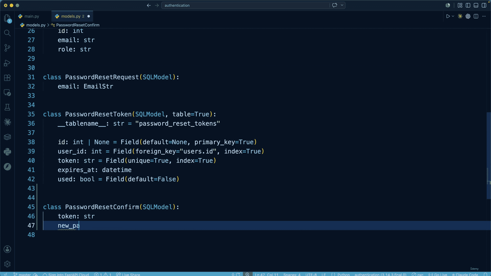

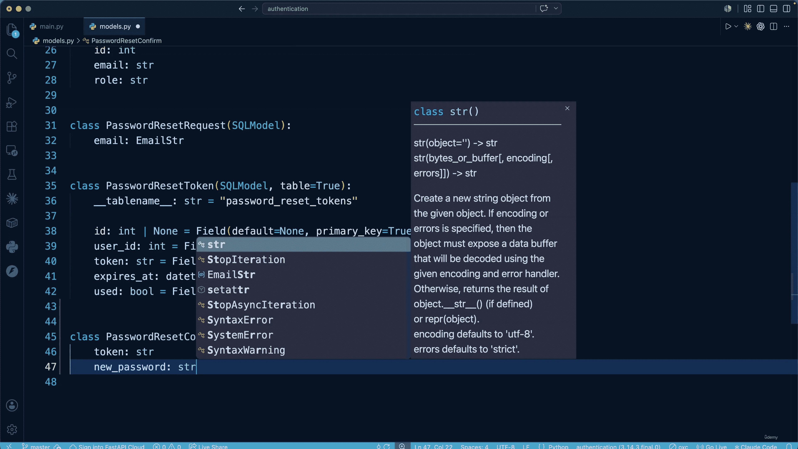

在本节课中我们将要学习密码重置流程的第二个端点：用户提交令牌和新密码，服务端验证令牌有效且满足所有条件后，覆盖数据库中该用户的密码。上一节我们已经完成“请求密码重置”并让用户拿到令牌，本节中我们来看看“确认重置”如何落地。这个端点看起来简单，但背后要检查令牌是否存在、是否已使用、是否过期，还要找到令牌对应的用户，最后把新密码哈希后写回数据库。为了让初学者也能看懂，下面的内容会把这些步骤拆开，并用代码把关键概念写出来。我们只处理确认重置这一步，不处理前端页面，也不处理邮件发送的细节。接下来从请求数据模型开始。

## FastAPI 精通课程：153：定义确认重置的请求模型 🧩

首先从 `model.py` 开始。我要定义一个表示第二个端点入站数据形状的新模型，模型名可以叫 `PasswordResetConfirm`。这个类继承 `SQLModel`，但它不对应数据库表，只是一个普通 Pydantic 模型。这个模型会接收 `token` 字段，类型是字符串；还会接收 `new_password` 字段，类型也是字符串，并且可以套用上面创建用户时密码所用的完全相同的验证规则。下面是模型的核心代码。

```python
class PasswordResetConfirm(SQLModel):
    token: str
    new_password: str
    # 这里放置与创建用户密码相同的验证规则
```

为了保留“复制上方需求”的含义，可以把它理解成：创建用户时密码有什么长度、复杂度等校验，确认重置的新密码也要有同样校验。我会滚动到上面，把用户首次创建账户时定义的密码要求复制下来，再把验证粘贴到下面。这样模型层就完成了。上一节我们处理了请求模型，本节中我们来看看如何在主应用里创建确认端点。

## FastAPI 精通课程：153：创建确认重置端点 🛠️

回到 `main.py`，先在文件顶部导入这个新的 `PasswordResetConfirm` 模型。然后在文件底部定义新端点，使用 `@app.post`，路由可以写成 `/password/reset/confirm`。这里的预期流程是：用户在邮件里收到链接，点击链接，在某个网页上填写信息，网页表单把用户的新密码和邮件中的令牌提交到这个路由。

下面是端点定义的核心结构，路由处理函数名为 `confirm_password_reset`。我需要覆盖数据库中的用户记录，所以需要 `SessionDep`；同时需要接收 payload，类型就是刚定义的 `PasswordResetConfirm`。

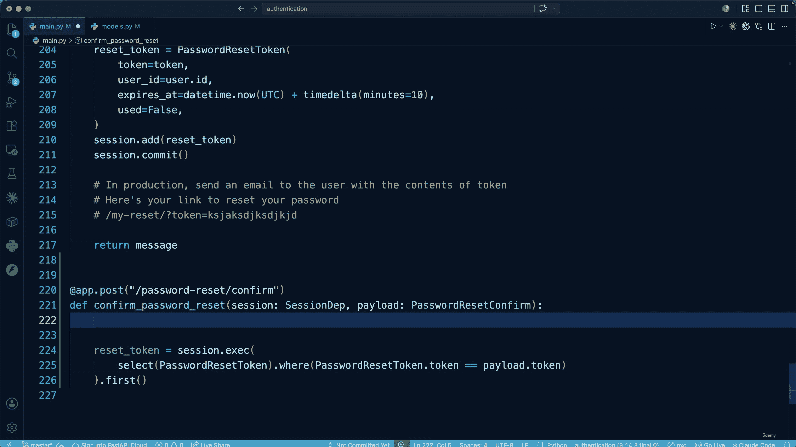

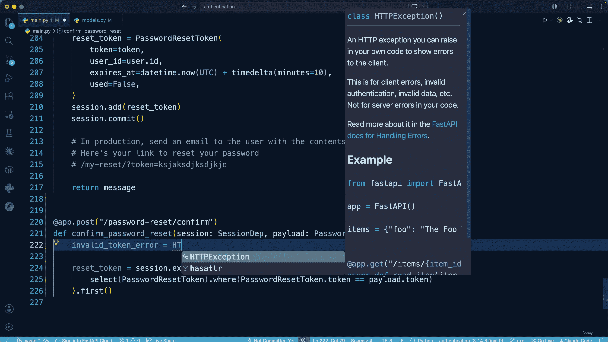

```python
@app.post("/password/reset/confirm")
def confirm_password_reset(
    payload: PasswordResetConfirm,
    session: SessionDep,
):
    ...
```

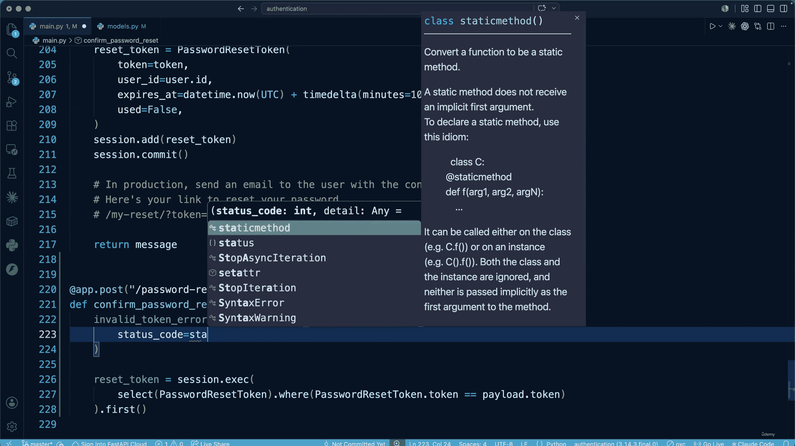

这个函数的第一步是接收 payload 中的一次性令牌。我要查询密码重置令牌表，确认它是否有效。下面用 `session.exec`、`select` 和 `PasswordResetToken` 来查表，并通过 `where` 对 `token` 字段做等值匹配，匹配的值是 `payload.token`。用户发到这个端点的令牌就是查询条件，我要在表里找到它来证明它是有效令牌。

```python
reset_token = session.exec(
    select(PasswordResetToken).where(
        PasswordResetToken.token == payload.token
    )
).first()
```

查询结果会得到一个结果对象，所以调用 `.first()`，并把返回值放进 `reset_token` 变量。这个变量要么是代表表中某一行的有效密码重置令牌模型实例，要么是 `None`，表示没有找到该令牌。接下来我要定义一个可复用的 HTTP 异常对象，也就是错误对象。它会返回通用错误信息，因为这里故意不告诉调用方具体是哪一种失败。错误对象可以叫 `invalid_token_error`，状态码为 400 Bad Request，详情消息为 `Invalid reset token`。下面是对应的代码。

```python
invalid_token_error = HTTPException(
    status_code=400,
    detail="Invalid reset token",
)
```

这里会故意保持通用，因为可能出错的地方有好几个，而所有失败都返回同一个通用消息。第一个可能出错的地方是令牌在数据库里没有有效条目；所以检查 `if not reset_token`，如果成立就抛出 `invalid_token_error`。第二个可能出错的地方是：令牌在数据库里找到了，但已经被使用过。也就是说，它已经用于重置过一次密码。现在我们还没有真正把 `used` 列改成 `True`，但可以想象，成功重置密码后，我们会取出已有令牌记录，把 `used` 列的值改成 `True`。因此这里要检查 `reset_token.used` 是否为真；如果为真，说明令牌已使用，不能再次用于第二次密码重置，所以再次抛出同一个 `invalid_token_error`。

```python
if not reset_token:
    raise invalid_token_error

if reset_token.used:
    raise invalid_token_error
```

第三个要检查的是令牌过期。假设用户六个月后才提交请求，这是无效的，因为我们只会给他们大约 10 分钟窗口来完成密码重置。下面定义变量 `token_expired`，它的意图是：如果令牌已过期，就为真；如果为真，就抛出完全相同的错误。

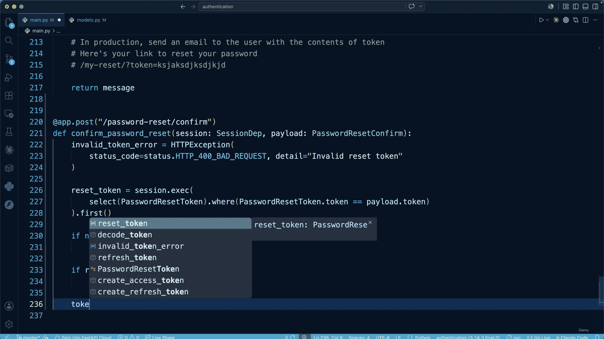

```python
token_expired = (
    reset_token.expires_at.replace(tzinfo=None)
    < datetime.now(UTC).replace(tzinfo=None)
)

if token_expired:
    raise invalid_token_error
```

这段代码稍微复杂，因为要处理日期时间和时区。它会取出数据库中 `reset_token` 的 `expires_at` 字段，该字段是日期时间，然后检查它是否小于当前时间。为了实际比较，还需要对日期时间对象调用 `replace`，传入 `tzinfo=None`，以处理时区带来的复杂性。直白地说，就是判断重置令牌的过期时间是否在过去，也就是是否早于服务器当前时刻；如果是，就说明令牌过期。令牌过期就代表令牌无效，我们要阻止用户修改密码。所以这里再次抛出同一个 `invalid_token_error`。至此，三种基础校验就完成了。接下来，在这些条件都满足时，我们才去获取用户记录并更新密码。

## FastAPI 精通课程：153：获取用户并更新密码 🔄

如果上面的条件都没有触发错误，我们就可以继续修改。先要从数据库取出实际用户记录，因为用户记录里才有我们要更新的哈希密码。下面是取用户的代码。这一次我按用户 ID 查询用户，使用 `session.get`，传入用户模型，第二个值是用户的实际 ID；这个 ID 可以从重置令牌的 `user_id` 属性取得。

```python
user = session.get(User, reset_token.user_id)
```

这样我们只会查询与这个给定令牌关联的用户，因为只有这个用户才应该拥有修改密码的权限。如果这一步出问题，比如用户 ID 对应用户不存在，例如我们发出重置令牌后用户删除了账户，那么该 ID 的用户就可能不存在。所以 `user` 要么是用户记录，要么是 `None`。这里再次检查 `if not user`：如果因为某种原因无法找到该 ID 的用户，就再次抛出 `invalid_token_error`。

```python
if not user:
    raise invalid_token_error
```

到这一步，我们已知令牌有效、未使用、未过期，也拿到了根据邮箱匹配应当与该令牌关联的用户。现在可以真正修改密码。注意，用户记录在数据库中的实际列名是 `hash_password`。这里要特别小心：payload 里有 `new_password`，但绝不能直接把明文密码保存到数据库，必须用创建用户时完全相同的方式做哈希。当前文件已经导入了 `hash_password` 函数，所以调用它得到哈希值，再把哈希值保存到表中已有的用户记录。

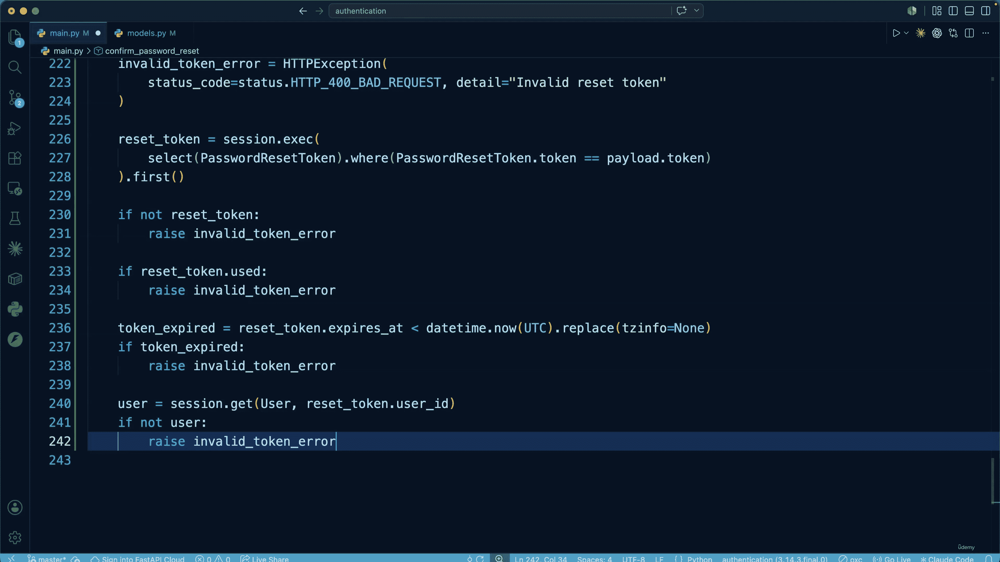

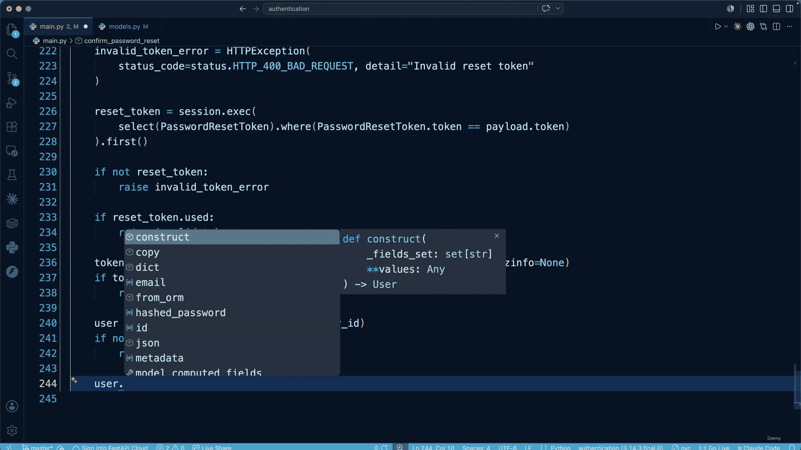

```python
user.hash_password = hash_password(payload.new_password)
session.add(user)
```

然后我还会做一处修改：假设这个操作成功，也要更新令牌，表示该令牌已经被使用。因此要定位数据库中实际的令牌，并把 `used` 列的值改成 `True`。我们已经从数据库取出了 `reset_token`，所以直接把它当前应为 `False` 的 `used` 列标记为 `True`，并把这项修改也加入数据库变更队列。这里要记住，这仍然是内存中的 Pydantic 模型，只是代表数据库行；我需要确保真正覆盖与 `reset_token` 对应的数据库记录。下面是这两处变更的代码。

```python
reset_token.used = True
session.add(reset_token)
```

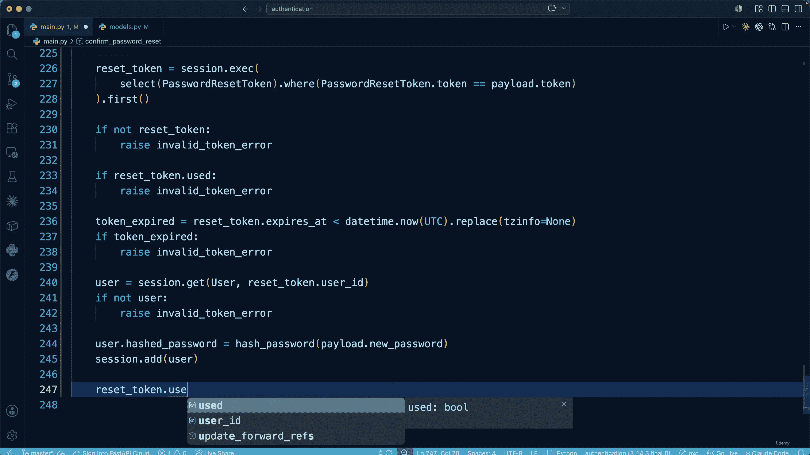

现在我已经把用户和令牌这两处变更都排入队列，所以调用 `commit`，把两个变更分别提交到对应的表。最后，把实际 payload 返回给用户，可以是一个普通字典，键为 `message`，值为类似 `Password reset successfully` 的消息。此时用户不会处于登录状态，但密码已经成功修改，之后可以用新凭据登录。下一节课我们会测试这段代码。

```python
session.commit()
return {"message": "Password reset successfully"}
```

到这里，确认重置的主流程就完成了。上一节我们完成了端点主体，本节中我们来看看实际项目中还可以补充哪些安全与体验设计。

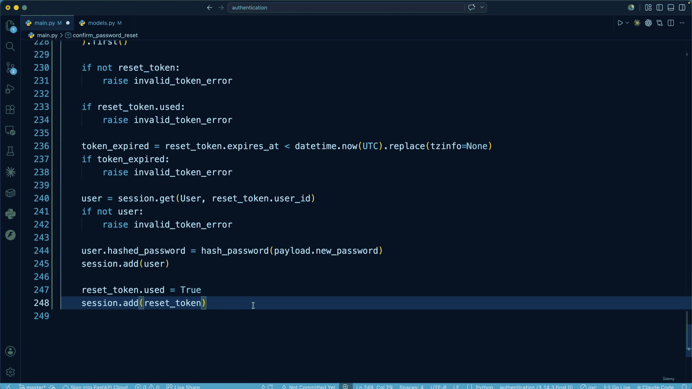

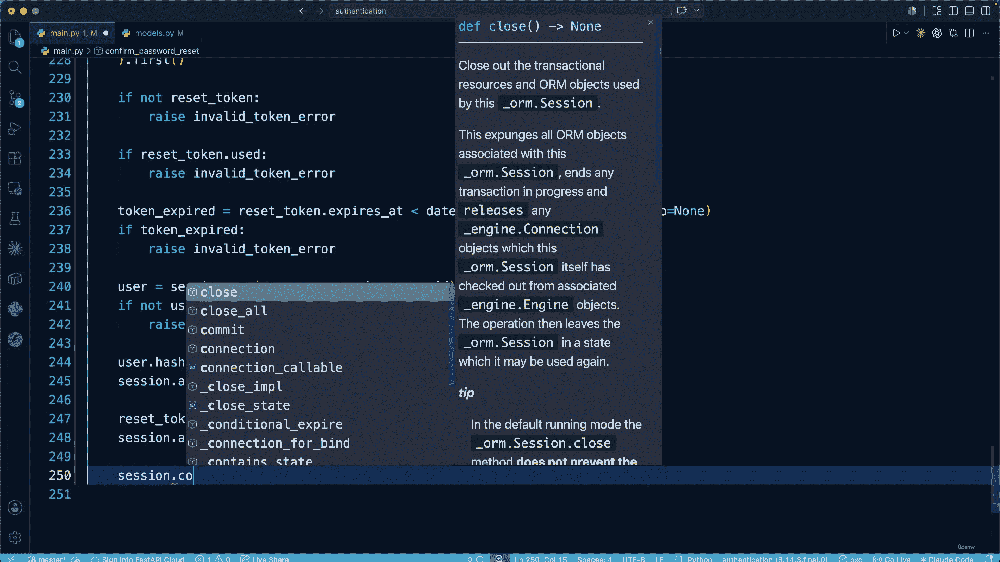

## FastAPI 精通课程：153：生产环境中的增强建议 🛡️

在结束本课之前，我还想补充几条在实际项目中可能有价值的信息。第一个额外安全层是给这个端点做限流。限流是指允许客户端请求某个给定端点，但限制它命中该端点的总次数，比如每分钟 10 次或每小时 50 次。这样即使令牌是随机且难猜的，攻击者仍然可以自行提交新密码，并尝试不断猜令牌；你仍然不希望黑客用成千上万台计算机把这个端点打上百万次，所以很可能要限制单个 IP 地址访问这个端点的请求总数。以下是本课建议关注的增强点。

- 对确认重置端点做限流，例如限制为每分钟 10 次或每小时 50 次，并可按 IP 统计请求总数。
- 仍然对数据执行常规验证，不能允许两个字符或四个字符这种过短密码。
- 在路由处理函数中执行副作用，例如有邮件服务器时，可以像前一个端点发送重置令牌邮件那样，给用户发送“密码已更改”的通知邮件。
- 如果使用数据库或服务器端状态跟踪登录会话，要考虑在重置密码时登出所有会话；JWT 默认是无状态的，但前面几课也谈过把登录状态保存到某张表里的做法。
- 重置密码在某种意义上代表用户记录的关键数据被修改，通常应让用户在所有设备退出登录，强制他们用新凭据重新登录。

这些建议不改变主流程，但能让端点更接近真实项目。下面再用引用强调一次核心原则。

> 令牌校验要覆盖存在性、是否已使用、是否过期；密码写入前必须哈希；重置成功后要标记令牌已使用，并考虑全局登出。

## FastAPI 精通课程：153：总结 🎯

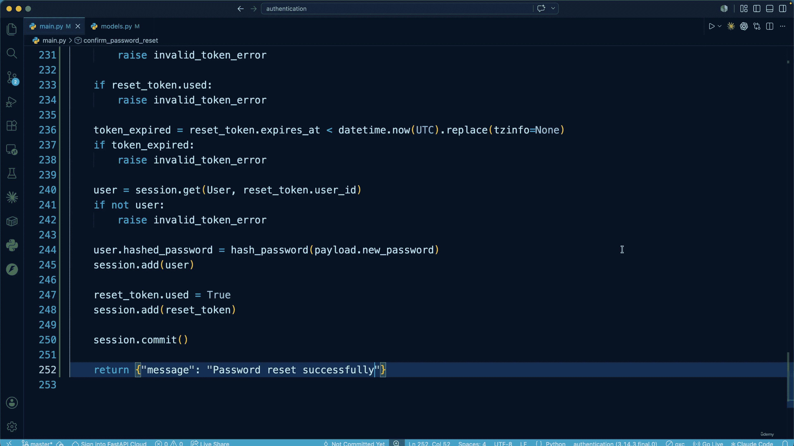

本节课中我们一起学习了密码重置的第二个端点：定义 `PasswordResetConfirm` 请求模型，创建 `/password/reset/confirm` 路由，查询并校验重置令牌，检查令牌是否存在、是否已使用、是否过期，再根据令牌关联的用户 ID 获取用户，使用 `hash_password` 哈希新密码并写回数据库，同时把令牌标记为已使用，最后提交事务并返回成功消息。我们还补充了限流、数据验证、通知邮件和全局登出等生产环境建议。下一节课我们会测试这两个端点。本课内容到此结束。

