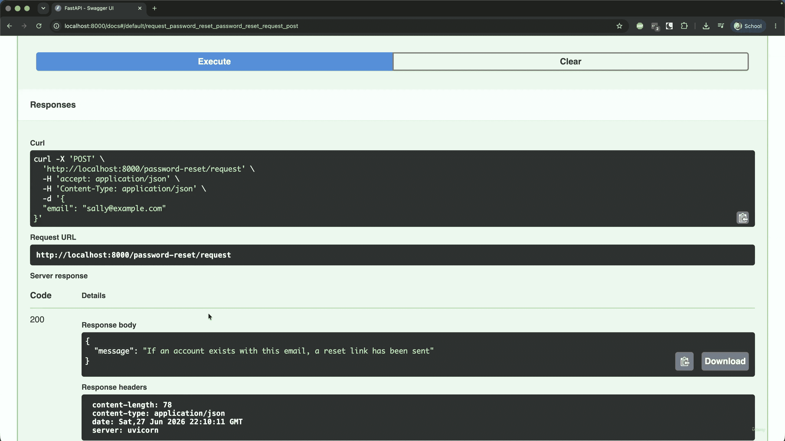
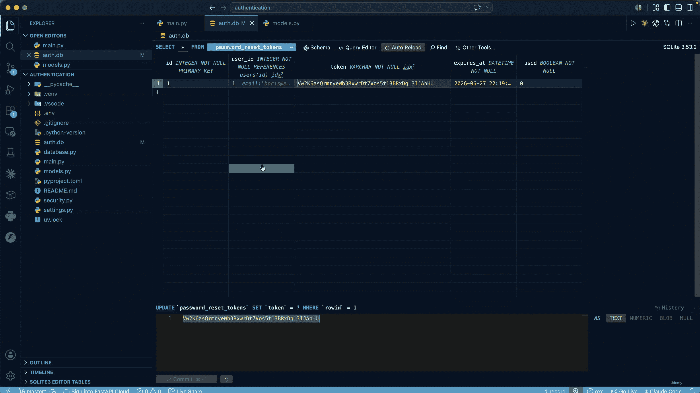
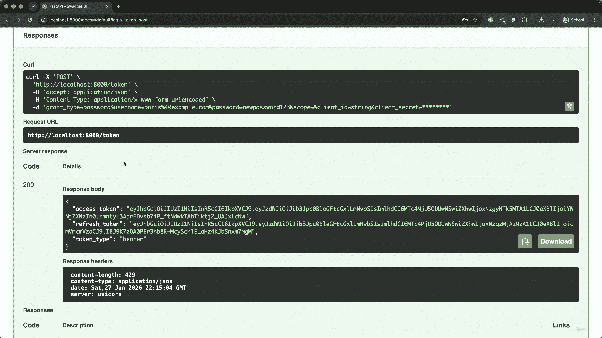
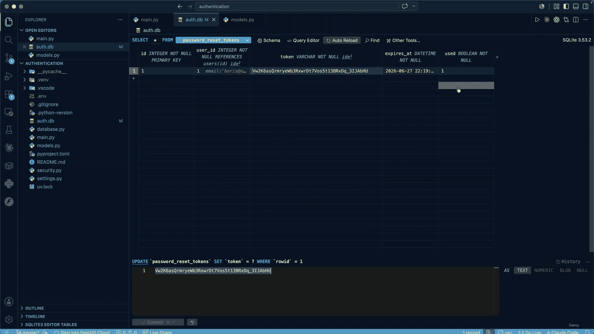

# FastAPI 大师课：第53节：测试密码重置 🔐

在本节课中，我们将要学习如何测试密码重置功能里的两个新端点。整个测试会从干净数据库开始，先注册一个用户，再请求密码重置令牌，然后检查数据库里的令牌记录，最后使用令牌确认新密码并验证登录结果。我们还会观察一次性令牌的行为，确认同一个令牌不能反复使用。通过这一整套流程，我们可以把密码重置的完整链路走通，并理解每个步骤在真实系统里的作用和意义。

在正式测试之前，需要先说明测试环境。上一节课程结束后，我们已经有了相关端点，本节开始前会删除数据库并重启服务器，因此测试从一个干净的状态开始。这样做的目的是避免旧用户、旧令牌和旧密码干扰测试结果，让每一步都能清楚看到数据库的变化。以下列出准备工作的要点。

- 删除原有数据库，避免历史数据影响测试。

- 重启服务器，让应用重新连接干净数据库。

- 确认当前数据库中没有用户和密码重置令牌。

完成环境准备后，我们就可以创建测试用户。下一节将使用注册端点创建第一个用户，并记录该用户的编号，方便后面检查密码重置令牌对应关系。

## FastAPI 大师课：第53.1节：注册测试用户 🧑‍💻

上一节我们准备好了干净数据库，本节中我们来看看如何创建测试用户。首先访问注册端点 `/register`，点击 Try it out 进入接口测试界面。然后提供邮箱 `boris@example.co`，密码使用示例密码 `password1,2,3`。填写完成后点击 Execute 执行请求。请求成功后，在下方响应区域可以看到数据库中已经创建了第一个用户，用户 ID 为 `1`。这个用户就是后续密码重置流程里的测试对象。

为了更直观地说明，可以用下面的代码表示注册时提交的核心数据。下面的代码只是示意请求内容，不是额外的新接口。

```text
POST /register
email: boris@example.co
password: password1,2,3
```

完成注册后，我们假设该用户忘记了自己的密码，因此无法登录系统。这个假设是密码重置场景的起点。下一节将访问两个新端点中的第一个端点，也就是密码重置请求端点。下面先给出两个端点的名称，方便建立整体印象。

```text
POST /password-reset/request
POST /password-reset/confirm
```



## FastAPI 大师课：第53.2节：请求密码重置 📧

上一节我们注册了测试用户，本节中我们来看看如何发起密码重置请求。访问第一个新端点 `/password-reset/request`，点击 Try it out。这个端点需要提交用户的邮箱。即使我们忘记了密码，也需要记得注册邮箱，因为系统要靠邮箱找到对应账户。以下列出请求密码重置时的操作步骤。

- 在邮箱字段填写 `boris@example.co`。

- 点击 Execute 执行请求。

- 观察响应内容是否为统一提示信息。

执行后，下方返回的响应应当是：`如果存在此邮箱账户，重置链接已发送`。这就是正常路径下的结果，也就是邮箱确实对应一个已存在用户时的表现。此时数据库中应该已经生成一条密码重置令牌记录，后面会进入数据库确认。这里先记住一个关键点：请求端点返回的是一个统一提示，而不是直接返回令牌或暴露账户是否存在。

接下来还要测试另一种情况。为了验证系统不会泄露账户信息，可以再提交一个不存在的邮箱，例如 `sally@example.co`。此时端点应当返回完全相同的响应，也就是同样提示“如果存在此邮箱账户，重置链接已发送”。以下列出这个安全检查的含义。

- 对存在邮箱返回统一提示。

- 对不存在邮箱也返回统一提示。

- 让攻击者无法判断邮箱是否真的注册过。

这个行为很重要，因为它可以迷惑攻击者，避免通过响应差异判断某个邮箱是否存在于系统里。完成请求端点测试后，下一节进入数据库查看密码重置令牌记录，确认请求端点确实生成了有效数据。

## FastAPI 大师课：第53.3节：检查密码重置令牌 🗄️

上一节我们测试了请求端点，本节中我们来看看数据库里生成了什么。回到 VS Code，打开数据库文件，先查看用户表，可以看到里面只有一个用户。再查看密码重置令牌表，也就是 complementary password reset tokens 表，可以发现只有一条令牌记录。这条记录对应刚才那个有效用户，也就是 ID 为 `1` 的 `boris@example.co`。记录中包含令牌本身以及过期时间，过期时间是当前时间之后 10 分钟。

这里还需要理解 `used` 列的含义。SQLite 使用整数来模拟布尔值，`0` 表示 `false`，`1` 表示 `true`。因此当 `used = 0` 时，表示这个令牌还没有被使用。下面的代码可以清楚表达这个映射关系。

```text
used = 0  -> false -> 令牌未使用
used = 1  -> true  -> 令牌已使用
```

这条令牌就是用户接下来需要提交给第二个端点的关键数据。用户需要把令牌和新密码一起提交，才能获得更新密码的权限。下一节会进一步说明真实应用里的邮件流程，以及令牌如何从邮件链接进入客户端表单。

## FastAPI 大师课：第53.4节：理解邮件链接与令牌流程 ✉️



上一节我们确认了数据库中的令牌记录，本节中我们来看看真实系统里的密码重置流程。整体流程可以这样理解：用户会收到一封邮件，邮件中包含一个指向客户端应用页面的链接。这个页面是面向用户的页面，页面上有一个表单，用户可以在表单里填写新密码。我们提供给用户的导航链接会带上这个令牌，通常令牌会作为查询参数出现在链接里。这样当表单提交时，Web 客户端或应用就可以把用户的新密码和指定令牌一起提交给后端。

当前教程环境里并没有真正构建这个页面，因此我们假设这个页面已经存在。也就是说，我们手动复制数据库中的令牌，模拟用户从邮件链接里拿到令牌的过程。在数据库界面中可以点击令牌内容，在下方输入框中全选并复制。这个令牌就是一次性的权限凭证，它允许用户更新 ID 为 `1` 的用户的密码。下面的公式可以概括令牌的作用。

```text
有效重置令牌 + 新密码 => 一次密码更新权限
```

复制令牌后，就可以回到 Swagger API 页面测试第二个端点。下一节将使用这个令牌调用密码重置确认端点，并观察成功与失败两种情况。

## FastAPI 大师课：第53.5节：确认密码重置 ✅

上一节我们复制了有效令牌，本节中我们来看看如何使用第二个端点完成密码重置。回到 Swagger API，找到第二个端点 `/password-reset/confirm`，展开后点击 Try it out。为了确认端点会校验令牌，可以先提交一个完全无效的令牌，观察系统是否返回错误响应。以下列出确认端点的测试步骤。

- 先提交一个无效令牌，确认端点返回错误。

- 再提交数据库中的有效令牌。

- 同时提交符合长度要求的新密码。

在真正走正常路径时，把数据库中的有效令牌粘贴到 reset token 字段，新密码可以设置为 `new password 1,2,3`。新密码仍然需要满足模型里设置的最小长度要求，这一点不能忽略。此时令牌相当于用户的权限凭证，用户通过假设中的表单提交请求，请求里带上从邮件查询参数中得到的令牌，以及新的密码。提交后向下滚动页面，应当看到用户密码已经成功重置。系统还会把 `used` 列的值改为 true，表示该令牌已经被使用。

为了验证一次性令牌，可以再次提交完全相同的请求。此时同一个令牌不能再用于重置密码，因为第二次使用已经不被允许。再次点击 Execute 后，数据库中的 `used` 列已经是 true，端点会返回无效重置令牌。以下引用可以表示这个失败结果。

> invalid reset token（无效重置令牌）

完成确认端点测试后，下一节将回到登录端点，验证旧密码确实失效、新密码确实生效。

## FastAPI 大师课：第53.6节：验证新密码与旧密码 🔑

上一节我们完成了密码重置确认，本节中我们来看看登录结果是否符合预期。回到实际的登录端点，也就是 `POST /token`。先使用旧凭据测试，提交邮箱 `boris@example.com` 和旧密码 `password1,2,3`。这个请求应当失败，因为旧密码已经不再有效。向下查看响应，可以看到 `401` 错误，提示未授权或凭据无效。旧密码无法登录，这是密码重置成功的第一个好迹象。

然后提交新密码进行测试。邮箱仍然使用对应用户，密码改为 `new password1,2,3`。如果前面的流程全部成功，第二个令牌端点已经用于设置新密码，并且密码在数据库中是哈希存储的。服务器会把提交的密码进行哈希处理，再与用户表中的密码哈希进行匹配。匹配成功后，系统会返回一个新的 JWT，表示认证成功。下面的代码可以概括登录验证的核心逻辑。

```text
hash(输入密码) == users 表中的密码哈希  -> 认证成功并返回 JWT
```

到这里，密码重置的完整链路已经验证通过。下一节还会补充令牌过期和一次性使用的检查，并对整个流程做总结。

## FastAPI 大师课：第53.7节：令牌过期与一次性使用 ⏳

上一节我们验证了新密码可以登录，本节中我们来看看令牌过期和一次性使用的边界情况。可以等待 10 分钟，让令牌过期，然后再访问第二个端点。令牌过期后，请求会得到类似无效令牌的响应。这说明确认端点不仅要求令牌存在，还要求令牌在有效期内。以下列出本流程验证过的关键规则。

- 必须发送有效令牌才能确认密码重置。

- 令牌只能使用一次，使用后 `used` 变为 true。

- 令牌过期后不能继续使用。

- 有效令牌可以成功重置密码。

还可以回到 VS Code 再次检查数据库。此时 `used` 列已经翻转为 `1`，也就是布尔值 true。这个令牌不再有资格用于重置用户密码。如果另一个用户或者同一个用户想再次重置密码，就必须走完全相同的流程：先提供有效邮箱创建新的有效密码重置令牌，再把这个令牌当作权限通行证，获得一次成功编辑或重置密码的机会。下面的公式可以概括整个规则。

```text
邮箱 -> 创建一次性重置令牌 -> 有效期内使用一次 -> 修改密码 -> 令牌作废
```





本节课中我们一起学习了如何测试 FastAPI 密码重置的两个新端点。我们从删除数据库和重启服务器开始，注册测试用户，调用请求端点生成令牌，检查数据库中的令牌记录，理解邮件链接和查询参数中的令牌流程，使用确认端点重置密码，验证旧密码失效和新密码生效，并确认令牌只能使用一次且过期后不可用。整个教程把密码重置从请求到确认再到登录验证的完整路径串联起来，初学者可以按照这些步骤理解每个端点、每条数据库记录和每个安全提示背后的作用。

