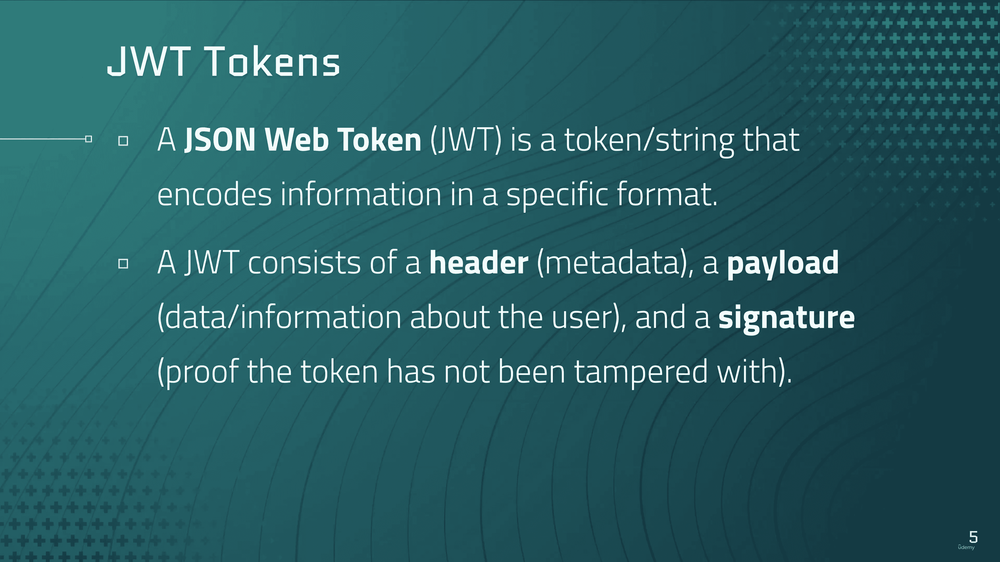
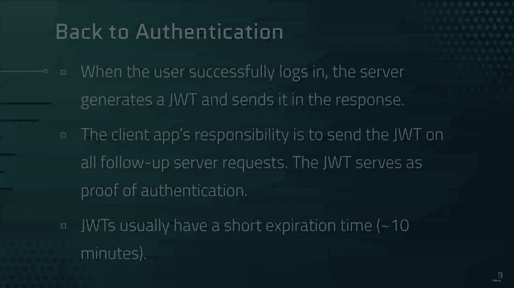
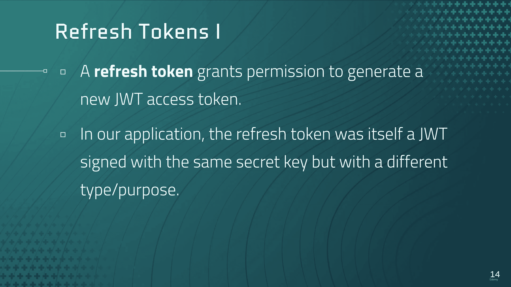
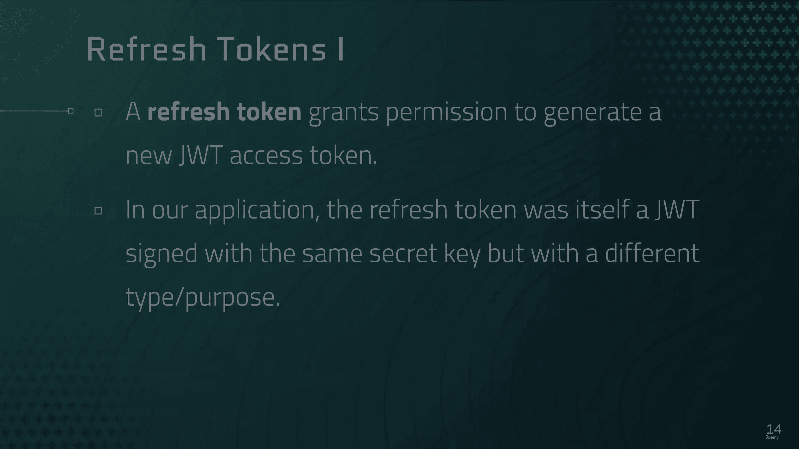
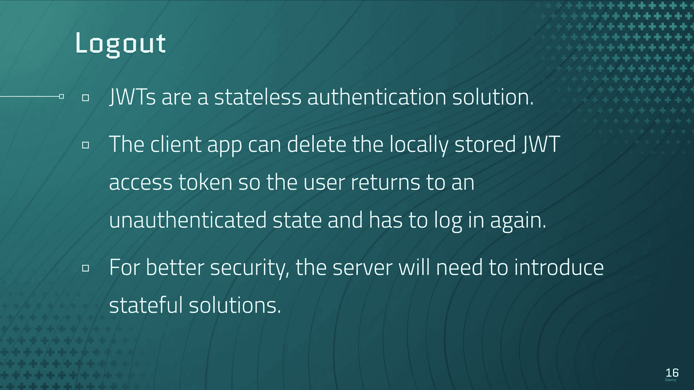

# FastAPI Masterclass part2：第155节：章节复习 🎓

恭喜你完成了本课程又一个章节的学习。按照惯例，我们应该花一点时间，把这一节学过的内容从头到尾回顾一遍，这样能帮助你把零散的知识点串联起来，形成更牢固的整体理解。本节课的核心是身份验证（authentication），也就是把用户登录到你的系统或应用中的这一动作。我们不仅会回顾身份验证的基本概念，还会梳理它在 FastAPI 中的具体实现方式，以及相关的 JWT、密码哈希、环境变量等配套知识。接下来，我们一起进入复习。

## 📌 身份验证与无状态令牌认证

我们这一节特别讨论了基于令牌的身份验证。这种验证方式要求客户端或用户提交一个所谓的“令牌”（token）。在我们的案例中，具体的令牌类型是 JWT，也就是 JSON Web Token。客户端在初次登录成功之后，每次向服务器发起新的请求时，都要在请求中携带这个令牌。从本质上说，这个令牌就是一个普通的字符串，但它在整个认证过程中扮演着“通行证”的角色。

从后端角度来看，这是一种典型的无状态（stateless）身份验证系统。所谓“无状态”，意思是后端不会持久化任何“用户已登录”的永久状态。举个例子，数据库里不会专门保存一条记录来说明用户 A 已经通过认证、用户 B 还没有通过认证。我们没有任何类似“session 记录”的东西存在数据库里。相反，认证的判断依据完全来自令牌本身，以及客户端是否在请求中提供了正确的令牌。每次后续请求所携带的 JWT，就是客户端用来证明“我确实已经登录过，所以我有权访问某些接口，或者有权在系统内执行某些操作”的凭证。

当每个后续请求到达后端时，服务器（后端）会解析这个 JWT，提取并解码其中的信息。这些信息通常包括用户标识，比如邮箱地址或数字 ID，服务器可以用这些信息去数据库里查询对应的用户记录。可以这样理解：每个请求都是独立的、无状态的，JWT 本身就已经包含了服务器完成身份识别所需的全部信息。不需要再去查询“这个用户是否在线”之类的状态，只要令牌有效，就认为用户是登录的。

这里有一个非常核心的公式可以概括整个认证过程：

```text
每个受保护请求:
  Authorization: Bearer <JWT>
  服务器验证JWT -> 解码 -> 获取用户信息 -> 返回数据
```

在后面的小节中，我们会逐步揭开这个过程中各个组件的细节。

## 🗃️ 用户表与密码哈希

要支持身份验证，第一步自然是搭建一个用户表。这张表用来存储用户的基本信息，以及一个唯一标识符，比如用户名或邮箱。同时，密码也是必须存储的。不过我们之前反复强调过一个非常重要的原则：绝不能用明文（plain text）形式存储用户密码，也就是用户提交时那个原始字符串本身。这么做完全是为了安全和隐私考虑。你想，如果用户表泄露了，或者黑客设法拿到了数据库的访问权限，我们肯定不希望他们直接看到一大堆明文密码，那简直是一场灾难。

那我们应该存什么呢？答案是密码的哈希（hash）版本。哈希是一种单向数据变换算法，它接收用户最初的明文密码，然后把它转换成一个新的字符串，这个字符串就是哈希值。可以把它想象成一台“绞肉机”：肉进去，肉馅出来，但你没办法从肉馅变回完整的肉。用术语说就是单向变换。从明文密码计算出一个可预测的、确定性的哈希，这个操作相对容易；但是从哈希值反推出原始的明文密码，在计算上极其困难。这正是哈希设计的初衷。因此，我们会取用户的密码（比如 `top secret` 或者 `star wars` 这样的例子），对其进行哈希计算，然后把哈希后的密码保存到用户表中的那条用户记录里。

这里可以用一行伪代码来表示：

```text
hashed_password = hash(plain_text_password)
```

另外要提醒一句：密码哈希是故意设计得非常“昂贵”的。也就是说，计算哈希会消耗不少计算资源。这对我们的服务器来说是一种负担，但同时对黑客的计算机也是一种负担。假设黑客拿到了数据库，但里面只有哈希后的密码，他想要破解，就得尝试大量不同的明文密码，并对每一个都进行哈希，再与目标哈希比对。比如尝试 100 万个不同的明文密码，这 100 万次哈希计算会非常消耗内存和 CPU，从而拖慢破解速度。如果黑客想更快，就得购置更多计算机，这会增加他的财务成本，也会在一定程度上降低黑客行为的吸引力。

不过，这也带来一个衍生问题：既然服务器也要承担哈希计算的开销，那么在实现登录端点时，我们有必要采取一些额外保护措施，比如速率限制（rate limiting）。否则黑客可以对你的登录端点发起每秒上百万次的请求，每一个请求都触发一次昂贵的哈希计算，很快就能把你的服务器拖垮。相比其他常见的后端操作，哈希计算确实更加消耗资源，所以在服务器端我们必须先想好办法，避免它被过度滥用。

## 📝 注册与登录端点

正如前面提到的，我们需要构建两个端点。第一个端点是让用户创建初始账户，也就是注册；第二个端点是让已有的用户登录。可以这样理解：注册是“第一次见面”，登录是“再次确认身份”。这两个端点配合起来，才能完成最基本的身份认证闭环。



在第一个端点（注册）中，我们接受用户提交的凭据，这些凭据一般包含邮箱或用户名，以及明文密码。收到密码后，我们不是直接存起来，而是先对它进行哈希，再把哈希值保存到数据库。这个过程可以用下面的代码概念来描述：

```python
# 注册端点逻辑（伪代码）
user = User(email=email, password=hash(plain_password))
db.add(user)
db.commit()
```

在第二个端点（登录）中，用户会再次提交明文密码。我们同样先对这个密码做哈希，然后与数据库中保存的哈希密码进行比对。数据库里的记录可以通过邮箱来定位对应用户。如果两个哈希值一致，就说明密码正确，登录成功。好在 Python 生态中有很多现成的库可以帮我们处理这些密码哈希的复杂度，比如 `passlib`。有了库，我们就不用自己手写哈希算法和比较逻辑，只要调用封装好的函数即可。

## 🔐 JWT 的结构

我们使用的具体令牌类型是 JWT，这本质上是一个能够以特定字符串格式编码信息的普通字符串。你可以把它看作一个可以把结构化数据“打包”成字符串的容器。比如，我们可以向 JWT 提供一个 JSON 对象作为输入。JWT 由三个段组成，段与段之间用点号（`.`）分隔。第一个段是 header（头部），它包含元数据，比如用于签名这个 JWT 的算法；第二个段是 payload（载荷），我们可以把业务数据放进去，在我们的场景中就是一个 Python 字典，里面包含各种键值对；第三个段是 signature（签名），它起到安全验证的作用，证明这个令牌没有被篡改过。

下面用一个公式来表示 JWT 的整体形状：

```text
JWT = Base64Url(header) + "." + Base64Url(payload) + "." + signature
```

把 payload 正确设置好是至关重要的。因为在后续请求中，服务器解析 JWT 时，正是从 payload 中提取重新获取用户所需的信息。这就是为什么我们需要在 payload 里放入用户邮箱或用户 ID 之类的东西。否则，在一个后续请求中，服务器即使解开了 JWT，也找不到任何线索来确定这个令牌代表的是哪个用户。签名则是最后一道防线，确保 JWT 在传输过程中没有被篡改。

需要特别说明的是，JWT 的生成过程并不是秘密的、私有的或加密的过程。我们之前做过演示：把一个 JWT 字符串拿到互联网上任意一个 JWT 解析网站，粘贴进去，网站立刻就能把它翻译回等价的 JSON 对象或字典。所以 JWT 的目标不是加密，也不是保密，而只是“翻译”。我们先把 Python 原生对象转成 JSON，而 JSON 是服务器之间通信的通用语言，然后再把 JSON 翻译成字符串形式的令牌。简单来说，中间经过了两次转换：

```text
Python对象 -> JSON -> JWT字符串
```

这样做仅仅是为了传输方便：给用户发送一个连续的字符串，比处理带有花括号或方括号的 JSON 对象要容易得多。一个只包含 URL 安全字符（比如字母和数字）的字符串，无论对客户端还是服务器，解析起来都不容易出错。这正是 JWT 名字的由来。

## 🗝️ 签名与密钥的重要性

签名的关键组成部分是密钥（secret key）。正是这个密钥让我们能够生成独一无二的 JWT。密钥的任何细微变化，比如多一个字母或少一个字母，都会导致最终生成的 JWT 签名完全不一样。换句话说，密钥对 JWT 第三段签名的影响是决定性的。正因为如此，密钥被视为极其私密和敏感的信息。在生产应用中，你应该尽量限制密钥的扩散范围。如果需要与团队中其他可信任的开发者共享，也要做到最小权限原则，只给那些你完全信任的人。此外，在部署 FastAPI 应用时，比如部署到 AWS 或 Google Cloud 这样的云平台，通常是通过平台的管理界面来提供密钥，然后应用在启动时读取这些值。这样做的目的仍然是为了让密钥远离源代码。假设你有一个开源仓库，一旦密钥被黑客拿到，他们就能用密钥生成有效 JWT，从而伪造用户身份，冒充合法用户。这是我们必须避免的情况。反过来，只要黑客没有密钥，他们基本上不可能凭空生成一个能被服务器接受的 JWT。密钥是 JWT 签名机制中不可或缺的一环。



这里可以给出一个简化的签名公式：

```text
signature = sign(header + "." + payload, secret_key)
```

## 🌱 环境变量与 Pydantic Settings

在本地开发时，我们通过环境变量来提供密钥。环境变量本质上就是一个来自“外部世界”的值，这里的外部世界指的是你的 Python 或 FastAPI 应用之外。它是一段存留在具体项目或代码库之外的数据。本地开发中一个很常见的模式是把环境变量写进一个 `.env` 文件中。然后在 FastAPI 应用启动时，它会读取这些值，并把它们填充到代码库中所有需要的地方。很多情况下，`.env` 文件里的值是敏感的，但也不一定必然敏感。它们只是从外部进入应用的数据，我们可以在应用启动之前定制这些值，从而让应用在不同的条件下以不同的方式运行。

举个例子，在本地开发、预发布（staging）和生产环境中，我们可以配置不同的密钥，从而拥有完全独立的配置。再比如，你的 FastAPI 应用可能会向某个第三方服务发起 API 请求，比如 Anthropic 或 OpenAI。这类第三方服务通常有面向开发者的沙箱环境，也有面向真实用户的生产环境。于是，在本地开发时，可以在 `.env` 文件中放开发环境的 API 密钥；而在生产环境，则通过托管平台的界面来提供生产环境的 API 密钥。这样一来，环境变量的优势就体现出来了：它不光是为了隐私保密，还能带来配置的灵活性。不同的值流入应用后，应用就能访问同一个 API 的不同版本。

环境变量和 `.env` 文件太常见了，以至于 Python 生态中出现了很多库来标准化读取它们。本课程介绍了 `pydantic-settings`，你可以把它看作 `pydantic` 的扩展包。它会将 `.env` 文件中的所有值读入一个 `BaseSettings` 模型的实例。这个模型基本上就是 `pydantic` 的 `BaseModel` 的一个子类。`pydantic` 在这里特别合适，因为我们要做的事情本质上就是验证和转换。我们不仅要负责读取，还要确保环境变量都存在、数据类型正确、满足某些约束（比如最小长度或最大长度），甚至可能需要进行类型转换，比如把字符串 `"123"` 转换成整数 `123`。这正是 `pydantic` 最擅长的领域：取一些数据，验证它、转换它、把它塑造成我们想要的形态。这也是 `pydantic-settings` 在社区中流行起来的原因。

此外，`pydantic-settings` 还可以为缺失或没有值的环境变量提供回退值（默认值）。不是每个环境变量都必须预先配置一个值。比如你的应用可能会可选地使用某个 API：如果有 API 密钥，应用就去请求这个 API；如果没有 API 密钥，应用可能会回退到另一个服务的请求，或者干脆不发请求。总而言之，环境变量就是从外部世界流入应用的数据，而 `pydantic` 和 `pydantic-settings` 负责把这些数据读进来、处理好，让它们处于一个可用的、符合预期的状态。

## 🚀 JWT 的认证流程与过期时间

让我们回到身份验证的主线上来。当用户成功登录后，服务器会使用密钥生成一个 JWT，然后在响应中把它返回给客户端。接下来，客户端应用有责任在后续所有发给 FastAPI 后端的请求中带上这个 JWT。这是一种典型的“责任下放”设计。从某种意义上说，后端是“不知情”的：它不关心请求是来自 Web 浏览器应用（比如 React 或 Angular），还是来自移动 App。FastAPI 服务器只要在授权头中收到 JWT，就可以确认它是否有效、是否未过期，然后使用其中编码的信息去获取用户，并执行对应的路由处理函数，返回请求的数据。所以，由客户端提供 JWT 这件事本身，就是认证的证明。

需要提醒的是，JWT 本身有过期时间，通常比较短，比如 10 分钟。这个过期时间在 JWT 创建的时候，直接嵌入到 JWT 字符串中，由 JSON payload 来指定。也就是说，JWT 内部带着自己的“寿命”信息，它会告诉服务器“我应该存活多久，请验证我现在是否仍然有效”。我们故意让 JWT 过期时间短，是为了限制黑客窃取 JWT 后能够造成的损害。如果 JWT 可以一个月有效，那黑客拿到后就能冒充你一个月；如果只有 10 分钟，那损失就小得多。

在服务器端，每个后续请求都会再次使用密钥来验证和解码 JWT。这个过程包括：确保 JWT 有效、没有过期，然后从字符串中解析出等价的 JSON，再得到我们最初提供的 payload 数据。记住，服务器上没有保存任何会话状态，所以我们把信息嵌入 JWT 中，让每个请求都像第一次见面一样，从头开始验证。一切皆无状态，JWT 本身包含了所有需要解析的信息，之后再去数据库查询对应用户。

从黑客的角度看，在不知道密钥的情况下，要数学上构造出一个合法 JWT 是非常困难的。由于组合空间极其庞大，即使给黑客 10 分钟，也不可能暴力枚举出正确的签名。而且我们不仅使用密钥，还结合了当前日期时间，所有这些因素都会影响最终生成的签名。因此，10 分钟后生成的 JWT 会截然不同，黑客在 10 分钟内根本没有足够的时间去碰撞出一个能通过服务器校验的有效 JWT。可以说，较短的过期窗口在很大程度上缩短了被盗 JWT 的生命周期，从而限制了黑客能做的坏事。

## 🧩 Swagger 集成与 OAuth2PasswordBearer

具体到 FastAPI 中，我们引入了一个非常重要的组件：`OAuth2PasswordBearer` 类。它位于 `fastapi.security` 模块中。一旦我们实例化这个类，它就会自动在 Swagger 文档页面上添加一个“Authorize”按钮。这个按钮允许用户直接在 Swagger 文档里进行身份验证。用户登录后，Swagger 会拿到服务器返回的 JWT，并在之后该页面上的任何请求中自动附带这个 JWT。这大大方便了开发调试。

这里有必要回忆一下授权头的实际格式。标准的 HTTP 请求头中，`Authorization` 是头部字段的名称；请求头本质上就是客户端发送给服务器的一组键值对元数据。在 `Authorization` 字段中，我们先写 `Bearer` 这个词，然后空格，最后才是 JWT 本身。`Bearer` 这个词的意思就是“携带者”，表示用户正在携带这个令牌。用户负责保管令牌，并在每一次后续请求中提供它。下面给出具体的头部格式：

```text
Authorization: Bearer <JWT>
```

在我们创建 `OAuth2PasswordBearer` 实例时，还提供了 `tokenUrl` 参数。这个参数指定了认证端点，在我们的项目中就是 `/token`。因此，当你在 Swagger 文档中点击“Authorize”并填写弹窗表单时，Swagger 实际上就是向 `/token` 端点发起了一个 POST 请求，通过认证后拿到 JWT，并在后续每个请求中自动带上它。虽然我们当时没有搭建一个正式的、面向用户的前端应用，但 Swagger 的这套行为逻辑，本质上和你在 React 等前端框架中要实现的东西是完全一致的。

## 🔄 OAuth2 标准与 get_current_user 依赖

接下来聊聊 OAuth2 标准。这个标准说白了就是一系列约定和最佳实践。如果你愿意遵循这些约定，那么你在 FastAPI 中会获得很多开箱即用的功能，同时你的代码风格也会紧跟现代的常规标准。例如，OAuth2 规范中有一个细节：负责登录并发令牌的端点应该命名为 `token`。这只是一个一致性的约定，但如果你遵循它，就会发现从一个项目到另一个项目，代码越来越相似，因为大家都采用了相同的标准，学习成本就低了。

下一步，我们定义了一个 `get_current_user` 依赖函数。这个函数可以和 FastAPI 的 `Depends` 函数结合使用。它的全部职责就是：验证令牌、提取信息、从数据库中获取当前已登录的认证用户。建立这个函数最大的好处是避免在多个路由处理器中重复编写同样的逻辑。过去你可能要在每个需要认证的接口里复制粘贴验证代码，现在只需要在代码库中保留一个单独的函数，由它承担所有复杂性。然后，我们把这个函数与一个 `current_user` 类型配合起来。一旦某个路由处理器的参数类型被声明为 `current_user`，该路由就相当于被强制要求认证，否则根本不会执行。

在实现层面，我们使用了 PyJWT 库来验证 JWT 令牌是否有效且未过期，这个库处理了所有底层的复杂逻辑。同时，我们还验证了一些关键细节，比如 JWT 中是否存在 email 声明（claim）。在 JWT 术语中，“claim”就是指一个键值对。我们要确保收到的不仅是一个未过期的 JWT，而且其中嵌入了关于用户的邮箱信息。随后，这个邮箱被用作查询用户表的依据，从而从数据库中得到对应用户记录。

为了防止信息泄露，我们在处理错误时故意把错误信息写得比较模糊。比如用户可能遇到各种不同的失败原因：JWT 无效、JWT 过期、缺少某个 claim、用户不存在等等。但我们不会告诉黑客“你的 JWT 过期了”或“缺少 email 字段”，而是统一返回一个类似 `invalid token` 的通用错误。这样黑客就很难判断他提交的请求到底哪里出了问题，只能盲目地继续尝试，从而增加了攻击难度。

这里可以给出一个典型的依赖注入示例：

```python
def get_current_user(
    token: str = Depends(oauth2_scheme),
    db: Session = Depends(get_db),
):
    # 验证token，提取email，查询用户
    ...
    return user

@app.get("/protected")
def protected_route(current_user: User = Depends(get_current_user)):
    # 只有认证用户能到达这里
    ...
```

如果我们并不需要在路由处理器中使用当前用户对象，只是想强制认证，那么也可以直接使用 `Depends(get_current_user)` 并把它放进装饰器中的 `dependencies` 列表，或者放在 router 上。这样做的好处是，router 下所有的子路由都会自动获得认证要求，因为 router 的依赖逻辑会在任何路由处理器之前运行。只需要记住：`Depends` 接收的是未被调用的 `get_current_user` 函数，不要加括号。

## 🔁 刷新令牌



访问令牌 JWT 的过期时间通常很短，比如 10 分钟。但如果你强迫用户每 10 分钟重新登录一次，那用户体验肯定非常糟糕。于是，常见的解决方案就是引入刷新令牌（refresh token）。刷新令牌的全部目的就是授予客户端生成新 JWT 访问令牌的权限。在我们的应用中，刷新令牌本身也是一个 JWT，它使用完全相同的密钥来签名，并通过在令牌内部嵌入的 `type` 键，与普通访问令牌区分开。其实这只是一种实现方式。你也可以为两种令牌使用不同的密钥，甚至可以让刷新令牌不是 JWT。但核心原则是清晰的：刷新令牌允许你每隔一段时间（比如 10 分钟）去调用一个刷新端点，获得一个新的 JWT 访问令牌。整个过程通常在后台自动完成，用户甚至感觉不到。



这里的内容其实已经提前泄露了下一页的要点，但没关系，我们在这里正式复述一遍：当访问令牌过期时，客户端会把刷新令牌发送到一个新端点，以获取新的 JWT 访问令牌。两种令牌长得非常相似，但它们服务的用途不同。刷新令牌的作用是为你换来一个新的访问令牌，而访问令牌的作用则是允许你访问某个端点，也就是获得在系统内执行某些操作的权限。这样做的好处很明确：用户不需要频繁登录，同时刷新令牌的有效期通常更长，大约一周。

具体来说，在客户端应用（比如 React 应用）中，当你请求一个端点，服务器返回“JWT 已过期”的错误时，前端客户端可以先拿出刷新令牌，然后自动向刷新令牌端点发送请求，换回一个全新的 JWT 访问令牌，再用新令牌重新尝试刚才的原始请求。这些逻辑通常都封装在条件错误处理代码中。理想情况下，用户在一周内都不需要重新登录；等到一周过去，刷新令牌过期了，JWT 也过期了，这时用户才需要再次登录。顺带一提，在这一周中间可能会产生很多个 JWT，但没关系，用户只需要每周登录一次，这个频率要合理得多。

可以用下面的流程来概括：

```text
客户端请求 -> 服务器返回401 -> 客户端用刷新令牌换新JWT -> 重新请求成功
```

## 🚪 注销用户



接下来，我们来聊聊注销。JWT 默认是无状态身份验证解决方案，但它也有不少权衡和弊端，最明显的一点是：后端其实并不知道用户“已经注销”。在理想的快乐路径下，客户端应用只需要删除本地存储的 JWT，下次再向 FastAPI 后端发请求时，服务器就会说“用户未认证，请重新登录”。用户再次登录后，服务器会生成新的访问令牌 JWT，客户端再把它和刷新令牌一起存起来。这个路径比较畅快，因为你不用太担心黑客手中的 JWT。

但如果想要更高的安全性，比如某些应用场景中，管理员希望能够强制注销一个恶意用户，那么你就需要引入有状态的解决方案。有状态方案基本上意味着在数据库里存储一些东西，用来跟踪用户、会话，或者跟踪哪些令牌有效、哪些令牌无效。具体方案有很多种，你可以自己研究一下不同的替代设计。但它们都围绕同一个核心：在超高安全要求下，我们不能仅仅信任用户出示的令牌，还需要在服务器端保存一些状态，作为“你是合法用户”的凭证。一旦后端有了状态，要吊销或删除该状态，实现用户注销就变得容易多了。这也是 JWT 的一个被普遍认可的缺点：黑客可能在 10 分钟内持有一个令牌并冒充合法用户。这正是无状态身份验证所要付出的代价。

## 🔑 密码重置

最后，我们用密码重置来结束这一节的回顾。如果一个用户无法登录，处于未认证状态，他显然不能提供自己的密码，也无法在系统内做任何事。那我们怎么让他重新获得访问权呢？一个典型方案就是利用他的邮箱。未登录用户可以访问某个端点（通常是通过前端应用上的某个页面进入），在那里输入一个邮箱地址，请求我们发送令牌。当然，我们首先要验证这个邮箱是否对应数据库中的有效用户。假设邮箱有效，我们生成的令牌将授予用户“一次性修改密码”的权限。用户会收到一封包含链接的邮件，链接中带有一个一次性使用的令牌。我们需要在数据库中记录这个令牌是否已经被使用过。

用户点击邮件里的链接后，会进入前端应用的某个页面，并在那里提交新密码。这个令牌最初来自邮件，然后通常会被放入前端应用的查询参数中，最后在提交新密码时，它被送到第二个端点。第二个端点会验证令牌是否有效、是否过期、是否已经使用过。假设所有这些条件都满足，我们就可以安全地更新用户的密码了。

这个流程的设计意图是：用户无法登录我们的系统，但我们假设如果他能访问自己的邮箱，特别是注册时使用的那个邮箱，并且能成功登录该邮箱账户，那他就很可能是用户本人，而不是黑客。在这种情况下，我们允许他一次性更新现有密码。如果黑客也能访问用户的邮箱，那当然不好，但严格来说，这已经是另一个安全问题，不是我们的系统能解决的。我们希望的是服务好那些正常的用户：也许他们几个月没用应用，忘记了密码，但更有可能还记得注册邮箱。于是我们通过邮箱发送令牌，他们用令牌来访问站点、请求密码重置、设置新密码，然后重新登录。这就是密码重置的全部逻辑。

## 📚 总结与展望

在本节课中，我们一起回顾了身份验证的方方面面。我们从基于令牌的无状态认证开始，解释了为什么 JWT 适合作为认证凭证，也学习了如何用哈希来安全存储密码。我们还拆解了 JWT 的 header、payload、signature 三段结构，强调了密钥在签名中的核心地位。随后，我们看了环境变量和 `pydantic-settings` 如何帮助我们管理配置，以及 FastAPI 中 `OAuth2PasswordBearer` 和 `get_current_user` 依赖如何简化认证流程。最后，我们还讨论了刷新令牌、注销用户和密码重置这几个贴近真实开发场景的主题。希望你喜欢这堂关于身份验证的课。在下一节中，我们将把目光转向与身份验证互补的第二部分：授权。授权关注的是如何允许特定类型或角色的用户在系统内执行某些操作，而这些操作是其他角色或类型的用户无法执行的。前方还有很多有趣的内容，我们下节见！
