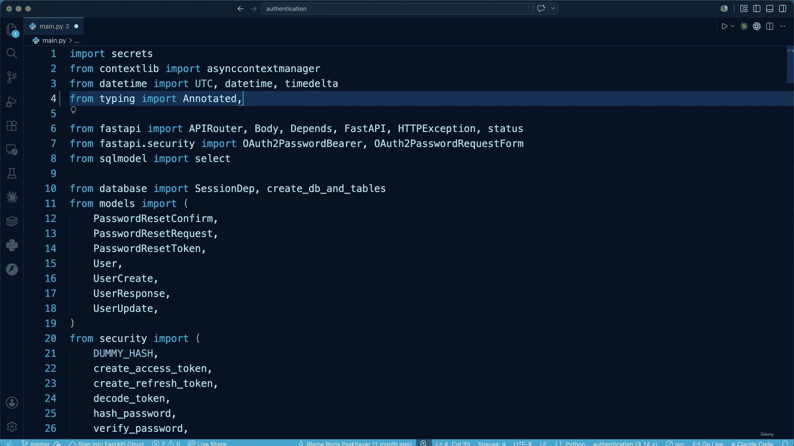
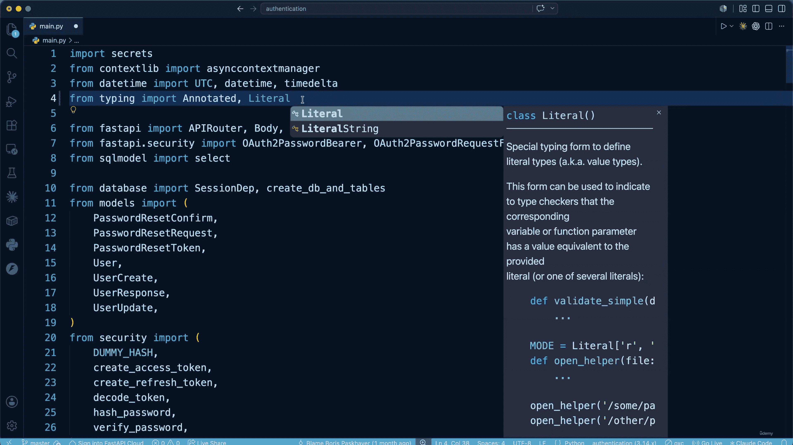
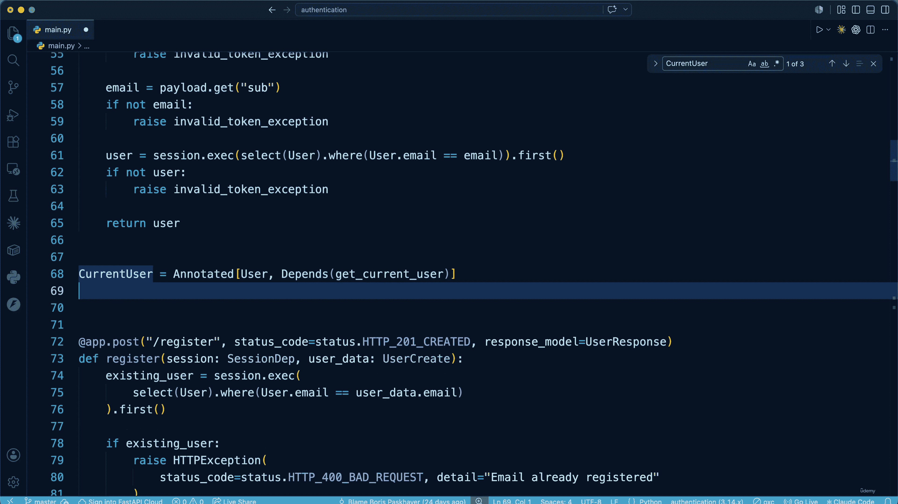
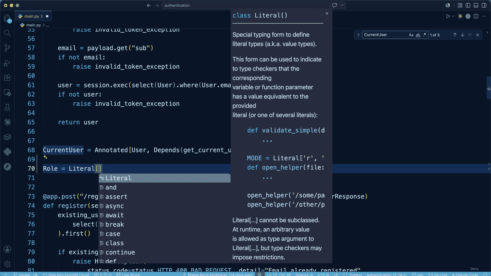
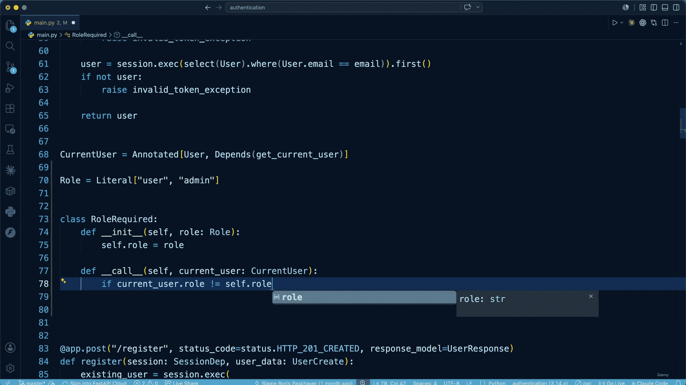
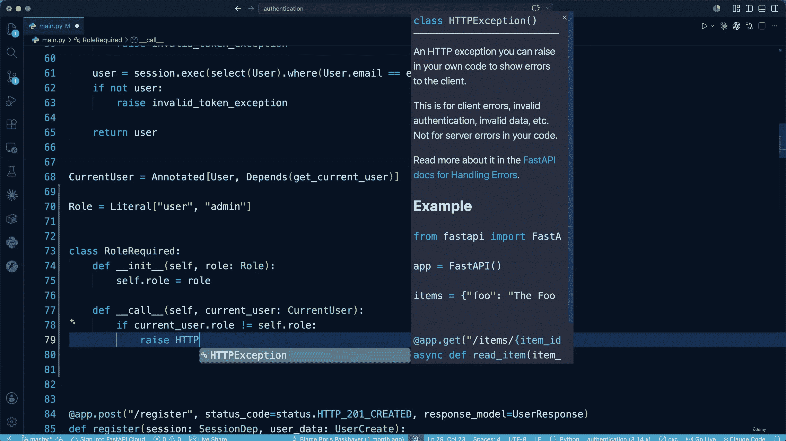
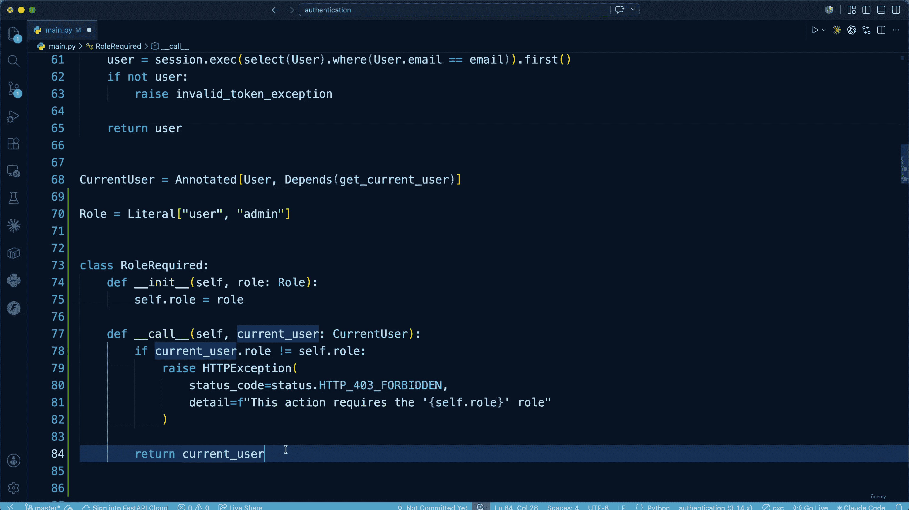

# 🔐 FastAPI Masterclass Part 2：156：基于角色的访问控制

在本节课中，我们将学习授权（Authorization）的核心概念，并在此基础上理解基于角色的访问控制（Role-Based Access Control，简称RBAC）。我们会先搞清楚认证与授权的区别，然后通过一个简单的删除资源示例，演示如何在路由处理器中做基础权限校验，最后一步步构建一个可复用的角色检查依赖类，为后续在路由中强制要求“只有管理员才能访问”打下基础。

## 从认证到授权

在上一节中，我们重点学习了认证（Authentication），也就是确认“用户是谁”的过程。简单来说，认证就是让用户登录到系统中的过程。与认证互补的是授权（Authorization），它关心的是“用户能做什么”，包括用户拥有哪些权限、可以执行哪些操作。这两个概念经常一起出现，但它们在系统设计中扮演着完全不同的角色。

“授权”这个词来源于“权威”（authority），意思就是“谁有权威或权限去执行某个特定操作”。举个例子，某类用户可能被允许查看某个资源、创建它或者删除它，而另一类用户则不应该拥有这些权限。所以，认证解决的是身份问题，授权解决的是权限问题。理解了这一点，我们才能继续往下看如何在FastAPI中实现授权。

## 一个简单的权限检查示例

为了让你直观理解授权，我们先来看一个非常基础但很典型的例子。这段代码只是为了快速演示而写的临时代码，没有实际用途。假设在类似Airbnb的租房项目中，我们有一个用于删除房间的端点。一个很自然的规则是：只有创建该房间的用户才有权删除它。在Airbnb上，如果任何用户都能随意删除其他用户的房间，那显然很不合理，所以我们需要在代码里加上限制。

我们的端点可能长这样：路径中带有资源ID，同时还要有当前用户。将当前用户的参数类型直接标注为`current_user`的一个好处是，它会强制要求认证——也就是说，必须有一个已登录的用户才能访问这个端点。但这还不够，因为即使有已登录用户，也不意味着该用户可以在系统内执行任意操作。比如，在删除资源时，我们必须额外检查这个用户是否有权限删除。

具体做法是：在删除资源时，先从数据库中取出该资源，然后做一次检查——检查资源的用户ID（也就是创建该资源的外键）是否与当前请求用户的ID匹配。如果不匹配，也就是当前用户不是资源的创建者，却试图删除它，我们就可以通过一个简单的`if`语句检查，然后抛出异常，告诉用户：“你没有权限删除其他用户的资源”。这种逻辑完全可以只用普通的Python代码和条件判断在任意一个路由处理器中实现，不需要任何复杂的框架特性。

## 什么是基于角色的访问控制（RBAC）

上面这种简单的检查方式虽然可行，但如果在很多路由里都要重复写，就会变得很啰嗦。因此，在本节中，我们要把这个思路扩展一下，讨论更大规模的授权方案——基于角色的访问控制，也就是RBAC（Role-Based Access Control）。这是一种将权限与角色绑定的设计思想，也是实际项目中非常常见的授权方案。

在RBAC中，系统会为每个用户分配一个角色（role），这个角色可以是`user`（普通用户）或`admin`（管理员），也可能根据用户在公司的职位来定义，比如`marketing`、`product`等。但从技术角度看，角色的意思就是：你的访问权限由你的角色决定。也就是说，拥有某些角色的用户可以执行一些操作，而其他角色的用户不能执行这些操作。这里的核心是“角色”二字，而不是用户本身。

在本次实现中，我们保持简单：只有两种角色——`user`和`admin`。`user`就是普通的常规用户，`admin`则拥有额外的权限，可以在系统中执行更多操作。这是一种非常常见的设计。例如，对于内部员工，你可以给他们管理员权限，让他们能执行普通用户不能执行的操作。比如说，Airbnb的客服人员可能拥有管理员权限，他们可以删除某个房间，哪怕当时出现了某种非法犯罪活动而创建者自己不会去删除它。关键点在于：正是用户的角色赋予了他们执行某个操作或动作的权限。

回到我们的项目。在模型文件`models.py`中，我们已经有用户模型，它对应数据库中的`users`表，并且表中已经有一个`role`列。目前，我们给每个用户分配的角色都是`user`，也就是普通用户。但在这个部分，我们要把它扩展成两种可能的角色：`user`和`admin`，并讨论如何让管理员拥有普通用户不具备的额外权限。

## 把授权逻辑从路由处理器中移出去

RBAC的一个优点是，我们可以把大量授权逻辑从路由处理器中移出去，放到更高层的依赖里。例如，我们可以规定某个路由只能由管理员访问。这不仅仅是“已认证”，而是“已认证且已授权”。和之前处理`current_user`的方式类似，我们希望把逻辑从路由处理器中搬到依赖层级，这样每个路由处理器就不需要一遍遍重复同样的代码了。这是一种很好的代码复用方式。

在本课中，我们将开始构建一个类，用来检查用户的给定角色（`user`或`admin`）。这里会涉及一个有趣的设计模式：我们要把该类的实例与FastAPI的`depends`函数结合使用。回顾一下，`depends`函数接收某个可调用对象。所谓可调用，就是支持Python的括号语法，比如`func()`。它可以是一个未被调用的函数（完全有效），也可以是一个普通类（因为类可以通过括号语法实例化），还可以是某个类的对象，只要该对象是可调用的。这个模式之前在课程中见过，但我们从未使用过自己定义的自定义类。本节我们就要开始构建这样一个类。

## 定义角色类型：使用Literal

首先，在`main.py`的顶部，我们从`typing`模块中导入一个额外的值：`Literal`。`Literal`类型是一组预定义的可能值。换句话说，使用`Literal`可以限制一个变量的取值范围。





然后，在`current_user`附近，我们定义一个配套的类型，叫做`Role`。写法如下：



```python
from typing import Literal

Role = Literal["user", "admin"]
```

这里的含义是：如果某个函数参数的类型是`Role`，那么传入该函数的参数值不能是任意字符串，而只能是这两个字符串之一：`user`或`admin`。有了这个类型约束，我们在写代码时就能提前发现错误，避免把类似`"superuser"`这样的值传进去。

## 创建RoleRequired类



接下来，我们定义一个类，称之为`RoleRequired`。这里刻意取一个比较通用的名字，因为我们的目标是让这个类强制要求某个给定角色存在——无论是`user`还是`admin`，但主要会用于管理员权限。我们故意把它设计得比较通用，这样可以在不同的路由处理器中，根据需要的角色类型，复用于多个`depends`调用。目前只有两种角色，但如果系统里有10种不同角色，你也可以用这个类来检查其中任意一种。我们将在本节课和下一节课中看到这一切是如何巧妙组合在一起的。

类的定义是普通Python代码。首先定义一个`__init__`初始化方法：

```python
class RoleRequired:
    def __init__(self, role: Role):
        self.role = role
```

这里我们接受`self`（代表由类创建的实例或对象），以及一个名为`role`的参数，其类型是上面定义的`Role`。这样，当我们创建该类的一个实例时，必须指定一个角色（`user`或`admin`），然后通过`self.role = role`将它保存为对象上的属性。比如，我们可以创建对象：`RoleRequired("admin")`，或者`RoleRequired("user")`，类型检查器也能正常工作。

现在，我们有了一个可以创建实例的类，但该类的实例还不可调用。也就是说，不能直接拿一个`RoleRequired`实例，比如赋给变量`rr`，然后执行`rr()`——这样的语法是不被支持的。类本身是可调用的，但由类创建出来的实例或对象并不是。要让对象支持这种`rr()`的调用语法，我们需要在类里面定义一个魔法方法（dunder method），叫做`__call__`。

## 让对象可调用：实现__call__方法

和`__init__`类似，`__call__`也是双下划线包围的方法。我们可以在类中这样定义它：

```python
class RoleRequired:
    def __init__(self, role: Role):
        self.role = role

    def __call__(self, current_user: CurrentUser):
        if current_user.role != self.role:
            raise HTTPException(
                status_code=403,
                detail=f"此操作需要 {self.role} 角色"
            )
        return current_user
```

这个方法也接受`self`，它表示：当我们拿一个`RoleRequired`类的实例（比如`rr`）并加上一对括号时，Python会在后台运行这个方法。这样，`rr()`的语法就被支持了。如果你不定义这个方法，直接调用实例就会报错，因为默认情况下实例并不是可调用的对象。

在`__call__`里，我们还定义了一个参数`current_user`，并标注类型为`CurrentUser`（对应之前定义的依赖）。这个设计的精妙之处在于，我们实际上是在一个依赖内部使用了另一个依赖。当我们把`RoleRequired`类（更准确地说，是它的实例）与`depends`结合时，会同时依赖于`current_user`，从而强制要求先有认证过的用户，然后`__call__`方法才会运行。你可以把这种模式想象成一条依赖链：只有已经拥有已登录的认证用户，我们才会去运行角色验证逻辑。这样做的好处是，权限检查不会在未登录的情况下被触发，逻辑上更安全。

在方法体内，我们利用当前的`current_user`。记住，在`current_user`上有一个数据库列叫`role`，它会映射到模型上的`role`属性。我们做一个`if`检查：如果当前用户的角色不等于我们保存在`RoleRequired`实例上的指定角色，就抛出异常。





这里的情形是：比如我们希望某个路由只允许管理员访问，但当前用户只是普通用户，那么就应该抛出一个错误，让请求在进入需要管理员角色的路由处理器之前就被拦截。我们抛出一个`HTTPException`，状态码使用`403`，这是“禁止”（Forbidden）的状态码，表示你被禁止访问这个资源或执行这个操作。同时可以提供一个详细描述字符串，比如`"此操作需要 admin 角色"`。这样前端收到响应时，就能明确知道是因为权限不足而拒绝。

只有当当前用户（例如普通用户）不满足角色要求时才会抛异常。如果异常没有被抛出，说明当前用户的角色确实符合我们创建实例时指定的角色，一切正常，此时就简单地返回`current_user`。返回用户对象很有用，因为在后续的路由函数中，我们仍然可以拿到当前用户的信息。

这样一来，在路由处理器的定义中，我们不再只是要求“当前用户”，而是可以要求“具有某个角色（如`admin`）的用户”。当所有依赖运行完毕后，我们仍然可以在实际函数参数中获得`current_user`对象。这样既保证了权限控制，又不丢失用户信息。

## 总结



本节课中，我们一起学习了授权与认证的区别，了解了基于角色的访问控制（RBAC）的基本思想。我们通过一个删除资源的例子演示了如何在路由处理器中做简单的权限检查，然后在此基础上，使用`Literal`定义了角色类型，并创建了可复用的`RoleRequired`类。通过实现神奇的`__call__`方法，我们让这个类的实例变得可调用，从而可以配合FastAPI的`depends`函数构建依赖链。下一节课中，我们将看到如何实际把`RoleRequired`挂载到路由处理器上，确保只有拥有指定角色的用户才能访问路由处理器的正文内容。
