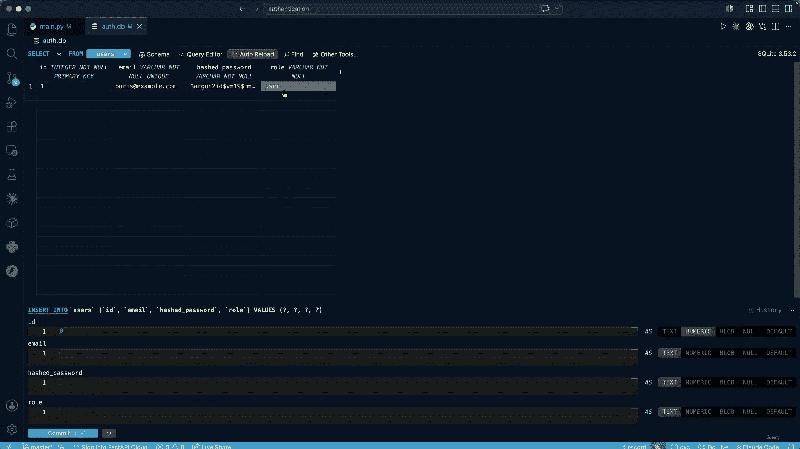
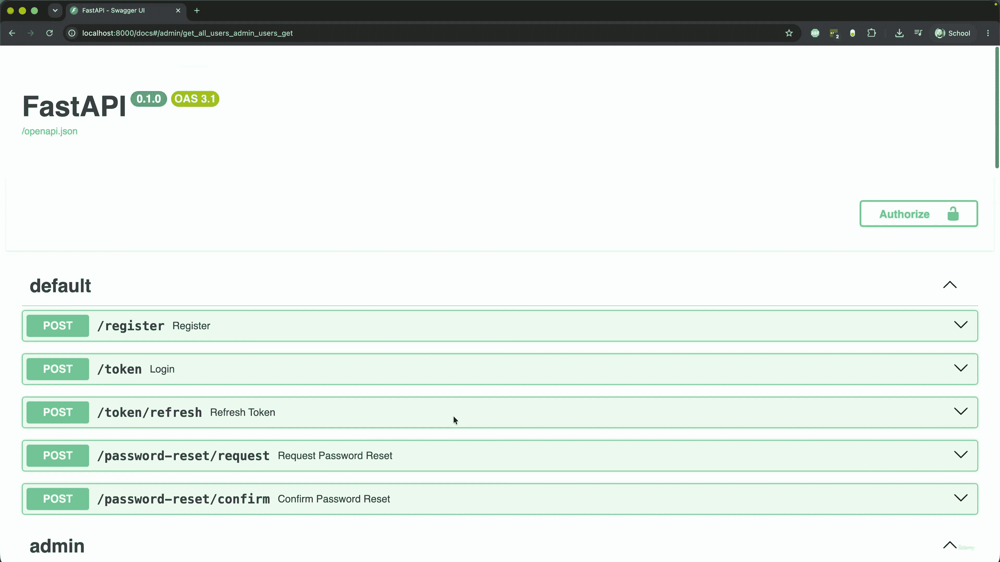
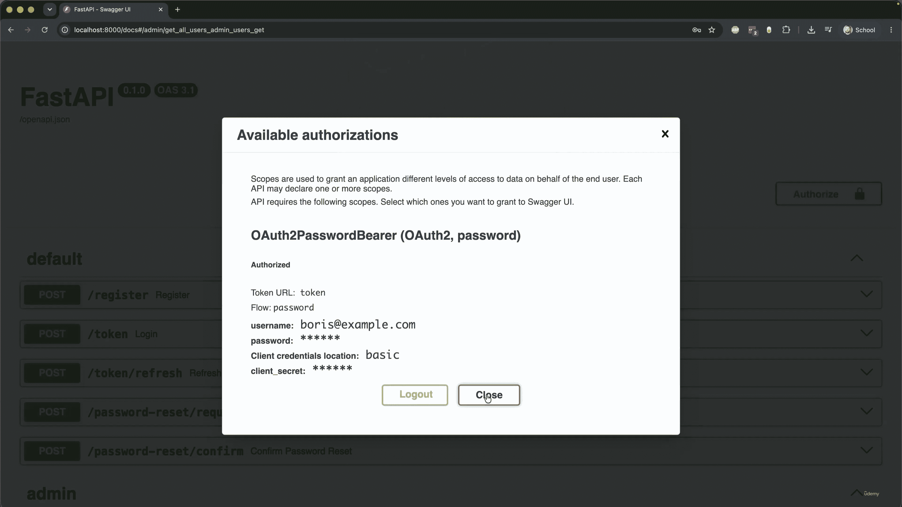
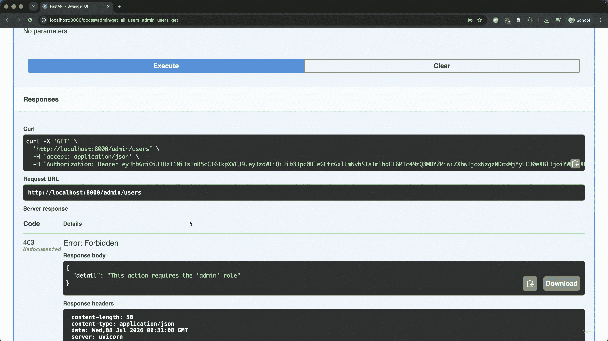
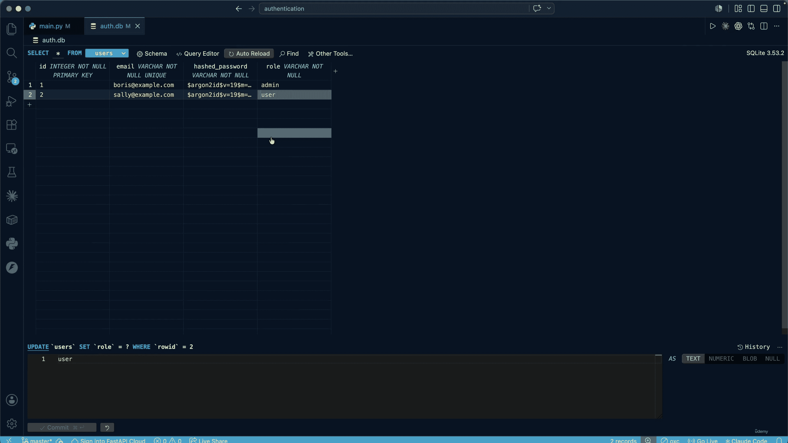
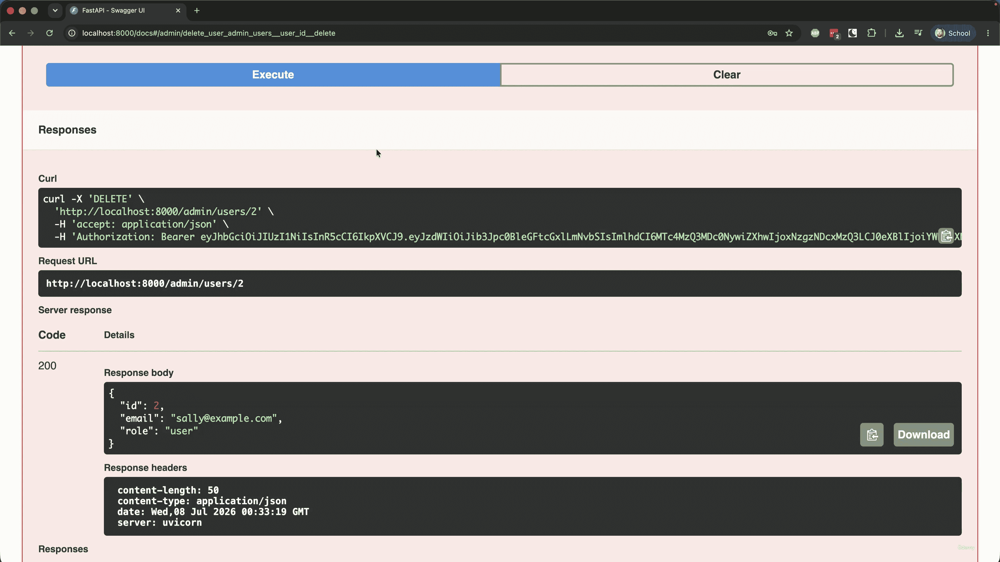
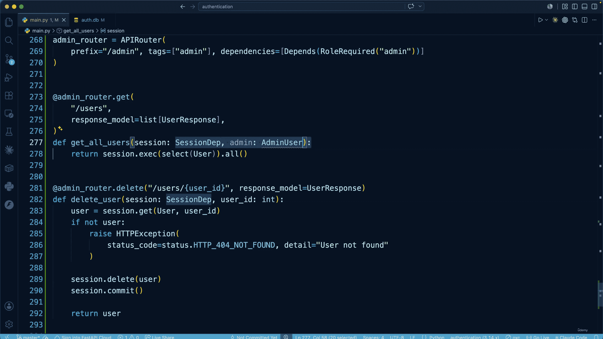

# 🚀 FastAPI 大师课：第56节：创建管理员路由


## 📖 本节概述

在本节课中我们将要学习如何把上一节定义好的角色检查依赖挂到路由器上，并创建一组只有管理员才能访问的管理员路由。我们会先回顾依赖注入的基本用法，然后新建 `admin_router`，在路由器级别统一加上管理员权限检查，再编写几个示例路由来验证效果。接着我们会分别用未登录用户、普通用户和管理员用户去测试访问控制是否生效。最后还会介绍另外两种应用同样授权检查的方式，方便你根据项目需要灵活选择。下面我们开始。


## 🔙 回顾：把依赖附加到路由器

上一节我们定义了 `role_required` 依赖，本节中我们来看看如何把它附加到路由器上。这个依赖既可以只用在一个路由处理函数里，也可以直接挂到路由器上。把依赖挂到路由器上是一种很好的模式，因为如果你要定义多个管理员路由，并且希望只有管理员才能访问其中任何一个，那么就可以把这段依赖逻辑、这道“门禁”、这个授权检查统一放在路由器级别，它会自动应用到该路由器包含的每一个路由上。下面演示具体做法。

我们先把现有代码整理一下。这个文件里已经有一个用户路由器，文件底部原本也有一行把路由器注册到应用中的调用。为了把路由器集中在一处注册，我们先剪切这行调用，再把它粘贴到文件最底部。整理好之后，我们新建一个路由器，命名为 `admin_router`。和之前一样，我们创建 FastAPI 的 `APIRouter` 类实例，并给它一些通用配置。例如设置 `prefix` 前缀，让所有管理员路由都以 `/admin` 开头；再设置 `tags` 标签，传入 `["admin"]`，这样在自动生成的 Swagger 文档里就会用 `admin` 作为分组标题。接下来是关键部分：我们给 `dependencies` 参数传入一个依赖列表。这个参数之前已经见过，通常里面会放 `Depends` 函数调用，并搭配某种可调用对象。作为提醒，这里可以传入未调用的函数、普通类，或者任何支持 Python 括号调用语法的对象。这里我们不传函数或类，而是直接传入 `RoleRequired` 类的实例，因为我们定义了 `__call__` 方法，`Depends` 会把它识别为可调用对象，所以普通的括号调用语法完全没问题。下面用代码表示这个路由器配置。

```python
admin_router = APIRouter(
    prefix="/admin",
    tags=["admin"],
    dependencies=[Depends(RoleRequired("admin"))],
)
```

这里直接在行内实例化 `RoleRequired`，并给构造函数传入表示角色的字符串 `"admin"`。背后发生的事情是：这会生成一个合法的 Python 对象，也就是 `RoleRequired` 类的实例；把它传给 `Depends` 完全合适，因为它支持括号调用语法，而这是通过实现 `__call__` 方法做到的。这样一来，任何挂到这个 `admin_router` 上的路由处理函数，在执行自身逻辑之前，路由器都会先执行它的全部依赖，和其他传给 `Depends` 的参数一样。当依赖执行时，会运行 `__call__` 方法；如果当前用户的角色不是 `admin`，就会提前返回并抛出异常。这个条件判断在上一节已经定义过。只有当前用户角色确实是 `admin` 时，代码才会继续往下走。因此这里增加的是授权检查：不仅要求有已登录用户，也就是当前用户，还要求该用户的角色等于 `admin`。如果是其他角色，`__call__` 方法里的 `if` 语句会提前捕获并抛出异常，路由处理函数根本不会执行。写好后保存文件。接着在文件下方调用应用的 `include_router` 方法，把新的 `admin_router` 注册进去。过渡一下，路由器配置好后，我们就可以开始定义示例路由来验证这套逻辑了。


## 🧪 编写管理员示例路由

上一节我们把管理员权限检查挂到了路由器上，本节中我们来看看如何定义几个管理员示例路由。这些只允许管理员访问的路由通常比普通用户能访问的路由更全局、更强大。例如，管理员可以查看系统中的所有用户。普通登录用户通常只能看到自己的信息，也许只能看自己；而管理员可以访问一个列出系统内所有用户的路由。这只是一个简单的示例。

按照之前的用法，我们可以通过路由器对象本身来定义路由，`admin_router` 支持 `get`、`post`、`patch` 等常用方法。下面定义第一个示例：对 `/users` 发起 `GET` 请求。因为设置了前缀，最终路径会是 `/admin/users`。同时指定 `response_model` 为 `list[UserResponse]`，表示返回用户响应对象的列表。路由处理函数名为 `get_all_users`，它通过 `SessionDep` 接收数据库会话参数，然后直接返回查询结果。代码中可以用 `select(User)` 查询 User 模型和对应的用户表，再对结果对象调用 `all()` 方法，把它转换成普通的 Python 列表，之后会进一步整理成符合 `UserResponse` 模式的数据。以下是这个示例路由的代码。

```python
@admin_router.get("/users", response_model=list[UserResponse])
def get_all_users(session: SessionDep):
    result = session.exec(select(User))
    return result.all()
```

接下来再添加一个更敏感、更危险的功能，也就是普通用户不应该拥有的删除用户能力。假设只有管理员才有权限删除某个用户，我们不希望任何其他用户，更准确地说，不希望任何角色为普通 `user` 的用户，甚至能够访问这个路由。这个设计的美妙之处在于：由于路由器上已经挂了管理员依赖，非管理员用户会在进入路由处理函数之前就被自动踢出去，因此处理函数的主体代码根本不会运行。等到这些路由处理函数真正执行时，我们已经确定当前用户角色是 `admin`。下面定义另一个路由处理函数，对 `/users/{user_id}` 发起 `DELETE` 请求，路径里的 `user_id` 用花括号表示，是路径的一部分。响应模型返回单个 `UserResponse`。函数名为 `delete_user`，同样接收数据库会话参数，还需要提取路径参数 `user_id` 并转换为整数。下面是删除用户路由的代码示例。

```python
@admin_router.delete("/users/{user_id}", response_model=UserResponse)
def delete_user(user_id: int, session: SessionDep):
    user = session.get(User, user_id)
    if not user:
        raise HTTPException(status_code=404, detail="User not found")
    session.delete(user)
    session.commit()
    return user
```



代码逻辑是：先在数据库中查询用户，用 `session.get` 传入模型 `User` 和用户 ID。这个 ID 可能并不对应数据库里的有效用户，因此查询结果要么是用户对象，要么是 `None`。我们用 `if not user` 判断是否为 `None`。如果确实没有用户，这对管理员来说虽然是合法操作，但没有可删除的对象，所以抛出异常，状态码用 `HTTP 404 Not Found`，错误详情写 `"User not found"`。假设系统中存在这个用户，我们就调用 `session.delete` 并传入用户对象，把它加入删除队列，然后调用 `session.commit` 把更改提交到数据库。行删除后，可以把用户对象以 JSON 形式返回给客户端，方便 UI 做一些后续处理。这里的关键不是两个路由处理函数内部的逻辑，而是它们都被路由器上的 `Depends` 检查保护起来，强制要求管理员用户才能访问。过渡一下，路由和权限检查都写好了，接下来我们实际测试不同身份的访问效果。


## 🔐 测试访问控制



上一节我们写好了管理员路由，本节中我们来看看如何用 Swagger 文档测试访问控制。目前数据库的 `user` 表里有一个用户 Boris，角色是普通 `user`。默认情况下，普通用户不应该能访问刚才那两个路由。我们先刷新 Swagger 页面，可以看到新增的两个管理员路由。为了测试删除功能，先创建一个稍后要删除的新用户。在 `POST /register` 端点创建一个用户 Sally，密码可以设为 `StySally` 之类，保存后应该返回 201，并得到 ID 为 2 的用户。接下来按照三种身份分别测试，以下是测试步骤。

1. 未认证用户访问：此时没有登录用户，也就没有角色可检查，应该立即被拒绝。点击 Try it out 再点击 Execute，下方会返回 `401 Unauthorized`，提示未认证，因为根本没有登录系统。
2. 普通用户访问：用 Boris 登录，密码为 `password123`。登录后已经获得系统授权，再请求同一个端点，仍然应该被拒绝，因为角色是 `user` 而不是 `admin`。此时会看到不同的错误信息 `403 Forbidden`，提示该操作需要管理员角色。这个错误来自 `RoleRequired.__call__` 方法里的 `if` 判断，说明检查在进入 `/admin/users` 方法体之前就已经运行了。路由器依赖列表里的 `Depends` 调用了可调用对象，触发了 `__call__` 方法，并传入依赖取得的当前用户，因此当前登录用户被挡在路由之外。
3. 管理员访问：为了反向验证，需要确保有一个真正具有管理员角色的用户。这里为了演示，手动在数据库中把 ID 为 1 的用户的角色改成 `admin`，点击保存并提交更改。注意真实项目中不应这样做，因为涉及安全，这里只是示例。回到 Swagger 刷新页面并重新登录，让 JWT 带上新权限。用 Boris 登录并授权后，`admin` 下的两个路由都应该可以访问，因为角色已经是 `admin`。依赖列表仍然会调用 `role_required`，但这次不会再触发 `if` 语句里的异常，代码会走到最后，实际路由处理函数得以执行。访问 `/admin/users` 可以看到正确响应，返回数据库中的 Boris 和 Sally 两个用户以及对应的模式数据。再测试删除路由，以管理员身份展开删除用户端点，传入 ID 为 2 的 Sally，执行后返回成功响应，ID 为 2 的用户被成功删除。





以上测试说明，路由器级别的依赖确实能在路由处理函数执行前完成统一拦截。过渡一下，除了把依赖挂在路由器上，我们还可以用其他方式应用同样的授权检查，下面介绍另外两种常见写法。




## ♻️ 另外两种应用授权检查的方式

上一节我们通过路由器级别依赖完成了统一权限检查，本节中我们来看看如果不希望在路由器上挂依赖，还有哪些替代方式。回顾一下，示例中我们把依赖加到了路由器的 `dependencies` 列表里，这种设计很优雅，因为它会自动应用到所有现有路由以及未来定义的管理员路由。但如果你不想用这种方式，还有两种做法。以下是第一种做法：直接在路由装饰器上指定依赖。

`get`、`delete` 等方法本身也接受 `dependencies` 列表参数。如果没有在路由器上挂依赖，可以写成下面这样。这样同样会在指定路由执行前运行依赖，完成相同的安全检查。这个示例里路由器和路由上都写了检查，所以看起来有些冗余；但如果路由器上不存在该依赖，这段代码就能独立完成同样的安全校验。它会运行指定的依赖，实例化 `RoleRequired("admin")`，依赖运行时 `Depends` 会在背后调用 `__call__` 方法，一旦发现违规就提前返回。使用装饰器 `dependencies` 的一个特点是拿不到 `__call__` 方法的返回值，也就是当前用户对象；不过在这个场景里我们本来也不需要管理员用户对象。



```python
@router.get("/users", dependencies=[Depends(RoleRequired("admin"))])
def get_all_users(session: SessionDep):
    ...
```

以下是第二种做法：把依赖写在函数参数里。如果你需要拿到当前用户对象，可以这样定义参数。这里可以把参数命名为 `admin_user` 或 `admin`，类型注解最终是普通的 User 模型，更准确地说，是角色等于 `admin` 的 User 模型实例。在 `Annotated` 的方括号里，第二个值写依赖，即 `Depends(RoleRequired("admin"))`，这样能达到完全相同的效果。

```python
@router.get("/users")
def get_all_users(
    admin_user: Annotated[User, Depends(RoleRequired("admin"))],
    session: SessionDep,
):
    ...
```

如果你不想在每个路由处理函数里复制粘贴这段代码，也不想把它们绑在同一个路由器上，还可以把这段依赖提取成一个类型变量，例如 `AdminUser`。之后在任何路由处理函数的参数类型里写 `AdminUser`，都会运行对应的依赖函数，进而调用 `RoleRequired`，再依赖当前用户依赖，如此形成一条链式依赖：一个调用另一个，一个调用另一个。任何环节出问题都会提前报错。只要在函数参数上写出这个类型，背后的逻辑就会自动运行。因此你可以根据实际需要，选择在路由器上提供 `dependencies` 列表，在单个路由上提供 `dependencies` 列表，或者用参数类型注解，既可以复制这段代码，也可以提取成共享类型 `AdminUser`，在多个不同路由中复用。演示代码可以删掉。以上就是本节课要覆盖的内容。


## 🎯 本节总结



本节课中我们一起学习了如何创建管理员路由并统一应用授权检查。我们先回顾了把 `role_required` 依赖附加到路由器上的做法，然后新建了带 `/admin` 前缀和 `admin` 标签的 `admin_router`，并在路由器级别通过 `dependencies=[Depends(RoleRequired("admin"))]` 加上管理员权限检查。接着编写了查看所有用户和删除用户两个示例路由，并用未认证用户、普通用户和管理员用户分别测试，验证了 401、403 以及管理员成功访问的效果。最后还介绍了在路由装饰器 `dependencies` 中指定依赖，以及通过 `Annotated` 参数类型和共享类型 `AdminUser` 来应用同样检查的替代方式。掌握这些方法后，你就可以根据项目结构灵活地为管理员功能加上安全门禁。
