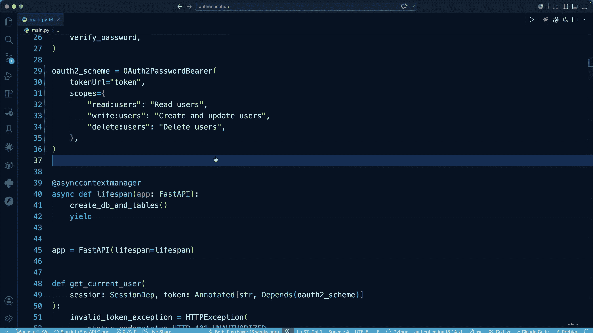
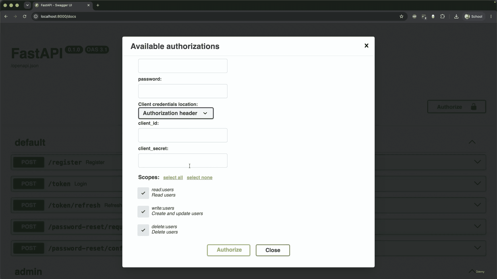
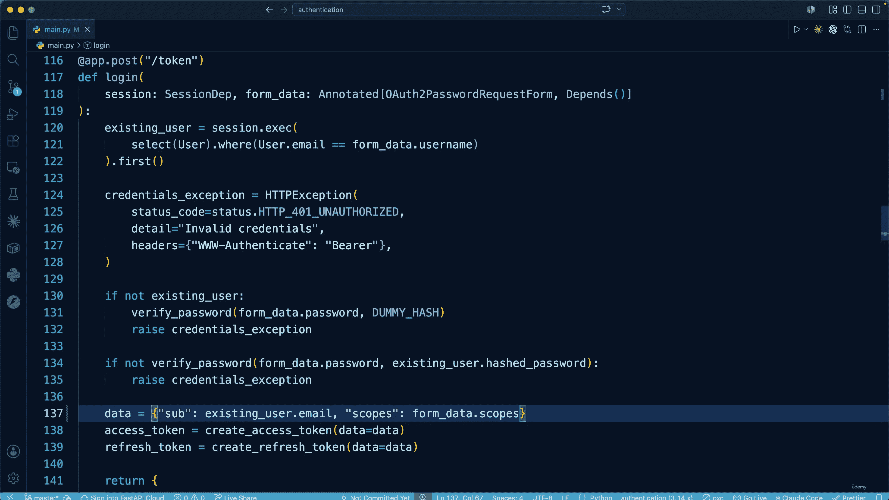

📘 FastAPI Masterclass：Part 2 Lesson 57：OAuth2 Scopes

在本节课中，我们将要学习 OAuth2 Scopes。我们先回顾一下之前构建的基于角色的访问控制，然后分析为什么在真实项目中往往需要更细粒度的权限控制。接下来，我们会讨论 scopes 的本质，也就是权限字符串，并展示如何在 FastAPI 的 Swagger 文档中声明它们。最后，我们会把用户在 Swagger 登录表单里选择的 scopes 直接写入 JWT，为后续在端点里校验权限做好准备。

## 一、从角色控制到资源权限

在最近几节课里，我们搭建了一个基本的基于角色的访问控制系统。在这个系统里，一个用户能不能访问某个接口，取决于他是不是某个特定角色，比如管理员（admin）。现在，我们可以在这个设计的基础上继续扩展，加入更多的角色。不过，有些时候我们希望控制粒度能够更细，而这种更细的控制往往会和系统内的资源绑定在一起。

这里说的“资源”是指什么呢？简单来说，资源就是属于业务领域的实体。常见的资源实体包括：

- 用户（users）
- 房间（rooms）
- 支付方式（payment methods）

举几个例子。当我们要控制对这些资源的访问时，也许我们希望某个角色只能读取系统里的用户，而不能更新用户；也许另一个角色只能删除用户，却不能创建用户。事实上，针对不同的资源，我们甚至希望为各种 CRUD 操作提供不同的逻辑。CRUD 分别对应创建（Create）、读取（Read）、更新（Update）和删除（Delete）。

面对这种“根据资源和你能对它们做什么来授权，而不是根据某个具体角色”的需求，OAuth 规范给出了一个解决方案，这个方案叫做 Scopes。

## 二、Scope 到底是什么

Scopes 听上去很复杂，其实就是一组权限字符串。它们长这样：`read:users`。这个字符串会授予“对某个资源执行某个操作”的权限。请注意，我们这里讨论的不再是“admin”这种角色类型，而是“能够读取用户”这个权限，以及另外一个与之互补的权限，例如 `delete:users`。

这样一来，一个权限就不再和某一个角色显式耦合在一起，而是可以在多种不同角色之间复用。它的典型工作方式是：当用户登录时，我们把他的 scopes 定义在 JWT 上。于是，在后续的每一个请求里，我们都可以验证这个用户是否拥有执行某个操作所需的权限或 scope。也就是说，这种设计减少了对角色的耦合。当然，scopes 完全可以由某个角色来设置或决定，但更重要的其实是“用户能做什么”这个权限范围。

我们可以用下面的方式表达 scope 的格式：

```
scope = 操作:资源
```

例如：

- `read:users`：读取用户
- `delete:users`：删除用户
- `write:users`：创建或更新用户

这种做法让路由处理器可以验证用户拥有的 scope 或权限，而不是验证他的准确角色。有了这个设计，多种不同类型的用户既可以同时拥有执行某些操作的相同权限，又可以被禁止执行其他操作。

## 三、在 FastAPI 中声明 Scopes

你可能还记得，FastAPI 对 OAuth 支持得很不错。OAuth 是授权和认证领域的一个规范或标准。在这个例子里，我们有一个 `OAuth2PasswordBearer` 类，它实际上负责渲染 Swagger 文档上的 Authorize 按钮。我接下来要做的事情，就是给这个类添加一个额外的参数，叫做 `scopes`，这个参数的值是一个字典。这个字典不会影响 API 本身的任何逻辑，但它会影响 Swagger 文档中那个渲染出来的模态框。用户点击 Authorize 按钮并且输入用户名、密码等凭证的时候，看到的就是这个模态框。

我们要提供的字典，键就是 scopes 本身。每个 scope 都是一个描述某种权限的字符串，它通常包含一个动词和一个资源。OAuth 里的常见约定是：先写动词，再写冒号，最后写资源。比如，我们的系统里一个用户可能拥有 `read:users` 这样的 scope 或权限。这个 scope 允许一个用户读取其他用户，也就是获取数据。和删除或创建这类操作相比，这里做的就是读取，而具体资源是 users。当然，如果系统里还有其他资源，我们可能还会有 `read:payment_methods` 这样的 scope/权限，或者 `read:accounts` 这样的 scope/权限。

在字典里，键就是实际的 scope 名称，也就是描述权限的字符串，后面我们会看到它到底起什么作用；而值则是一段描述。比如，我可以直接写一个值，叫做 `"read users"`。每一个键值对都会出现在用户登录 Swagger 时渲染出来的模态框里。我们马上就能看到效果。

我们先把 `read:users` 这个键值对放进去。接着来添加第二个键值对。下一个我想授予某个或多个用户的 scope/权限，是“能够影响或写入用户”的能力。这里我可以声明一个 scope，叫做 `write:users`，名称完全由我自己决定。也许这个针对用户资源的写权限，允许一个用户创建或更新用户。你并不一定非要同时包含创建和更新这两个意思。你完全可以把它们拆开：设置一个 `create_user` scope，再单独设置一个 `update_user` scope。系统里的权限到底怎么定义，完全取决于你。再举一个例子，我会添加第三个键值对，它就是 `delete:users`。然后我可以在这里提供一段描述，比如 `"delete users"`。

下面是这段代码在 FastAPI 中的样子：

```python
from fastapi.security import OAuth2PasswordBearer

oauth2_scheme = OAuth2PasswordBearer(
    tokenUrl="token",
    scopes={
        "read:users": "read users",
        "write:users": "write users (create or update)",
        "delete:users": "delete users",
    },
)
```



需要注意的是，这里我们在代码中写的 scopes，只是用户登录时会在 Swagger 中看到的候选权限，它们最终会进入提交到 token 端点的那个表单。

## 四、在 Swagger 中查看 Scopes 的效果

为了看看它是怎么工作的，我会保存这个文件。然后切换回 Swagger 文档并刷新页面，点击 Authorize 按钮。你会注意到，对于刚才定义的三个 scopes，我们都能在模态框里看到对应的 scope。这个 scope 就是键值对中的键，而旁边显示的值就是它的描述，这个描述基本上就是文档说明。这里的意图是，用户在登录的时候，会请求一定数量的 scopes 或权限。

可能你已经发现了，这部分完全属于 Swagger 设置层面的事情。在真实世界里，你的 scopes 通常是在某个用户被创建的那一刻就确定下来的。一个用户将要拥有的 scopes，可能是直接根据他的角色来附加的，也可能由某个管理员手动添加到系统里。也许你还会在数据库里设计一张配套的 user_scopes 表，把特定用户和他们将要拥有的 scopes 关联起来。这里需要说明的是，OAuth 标准并不规定你必须在数据库里如何存储这些权限，也不规定它们应该如何分配。它只是规定了这种标准格式，也就是带有描述、动词、冒号和资源的键值对结构。

## 五、把选中的 Scopes 写进 JWT

现在，我们要进入真正的授权环节。刚才我们在 VS Code 里写的代码，其实只是在 Swagger 的 Authorize 模态框里渲染 scopes，还没有把选中的 scopes 真正授予用户。现在，我们要把这些从 Swagger 表单里选中的 scopes 附加到 JWT 上。



这里我们先说一个真实项目中需要做的事情：在真实世界里，你需要一套安全机制或业务协议，来决定哪些用户能够读取、写入以及删除哪些特定资源。不过，为了保持例子简单，我们这里做一个有点“刻意”的简化：用户在 Swagger 表单里勾选了多少 scopes，我们就给这个用户授予多少 scopes。这显然不是一个好的真实示例，因为用户不应只是说一句“我想要删除用户的 scope”，系统就直接把权限给他。但这样的简化能非常轻松地帮助我们演示这个思路是如何运作的。我们不妨先假设自己已经拥有一个登录并经过认证的用户，他拥有某一组 scopes，同时没有另一组 scopes。所以这个例子确实有点刻意，但目前你可以这样理解：在 Swagger 登录时勾选的所有 scopes，就是这个用户登录后拥有的权限。

那么，为什么要大费周章把这些 scopes 写进 JWT 呢？因为在我们的无状态认证系统里，JWT 本身就是记录用户状态的那个东西。我们不会把登录用户的记录保存在内存状态中，也不会保存在数据库里。所以，我们要把这些权限或者 scopes 直接嵌入 JWT 本身。这样，在后续的请求中，当客户端或用户把 JWT 发过来时，我们就能根据 JWT 里写好的 scopes 判断出他到底有权做什么。

现在，我们回到 VS Code，找到 token 端点，也就是下面的 `POST /token` 端点。这里只需要一个小改动，我们想把之前的所有逻辑都保留下来。你可以看到，下面这些数据就是我们要直接嵌入 JWT 的内容。我要在这里添加一个新的键，叫做 `scopes`。我可以从表单数据里访问到它，因为我们使用的就是和获取用户名、密码完全相同的表单数据。这些都是 OAuth 标准的一部分。Swagger 表单和 FastAPI 的 `OAuth2PasswordRequestForm` 类，会根据用户在 Swagger 登录时选择的内容，把 scopes 放到 `form_data` 上。所以，如果我去访问 `form_data`，你会发现它带有一个 `scopes` 字段。这个字段其实就是一个字符串，里面直接包含了用户选中的那些 scopes。我们马上就能看到它。但这里我只是把这些 scopes 直接保存到数据中，而这份数据会成为 JWT 里嵌入的 payload 的一部分。

代码可以这样改：

```python
from fastapi import Depends
from fastapi.security import OAuth2PasswordRequestForm

@app.post("/token")
async def login(form_data: OAuth2PasswordRequestForm = Depends()):
    # ... 原有的用户认证逻辑 ...

    token_payload = {
        "sub": user.username,
        # 把用户在 Swagger 里选择的 scopes 写入 token
        "scopes": form_data.scopes,
    }
    token = jwt.encode(token_payload, SECRET_KEY, algorithm=ALGORITHM)
    return {"access_token": token, "token_type": "bearer"}
```

在这里，`form_data.scopes` 就是用户选中的所有 scopes 组成的字符串。请注意，这个 `scopes` 字段并不是我们手动拼出来的，而是 FastAPI 根据 OAuth2 表单自动解析出来的。

简单总结一下：用户在 Swagger 模态框里选择的 scopes，就是我们在系统里授予这个用户的权限。不过，我们目前还没有修改任何端点去真正测试或验证某个 scope。当然，这就是下一节课要添加的新功能。

## 小结



本节课中，我们一起学习了 OAuth2 Scopes。我们从基于角色的访问控制出发，明白了为什么有时需要更细粒度的资源级权限。我们介绍了 scopes 的本质：它们就是 `操作:资源` 形式的权限字符串。然后，我们在 FastAPI 的 `OAuth2PasswordBearer` 中通过 `scopes` 字典声明了候选权限，并在 Swagger 文档里看到了它们的渲染效果。最后，我们在 token 端点中把用户选中的 scopes 写进了 JWT，为下一步在路由处理器中校验 scopes 做好了准备。下一节课，我们将真正去修改端点，让它们能够验证用户的 scope 或权限。

