# FastAPI Masterclass Part 2：第159节：基于作用域的路由保护🔐

在本节课中，我们将学习如何基于作用域（scope）来保护路由。作用域可以理解为一个字符串，它代表某种权限，也就是在系统里对某个资源执行特定操作的权限。我们会在上一课的基础上，定义一个全新的依赖函数，从JWT中取出用户被授予的作用域，然后逐一验证这些作用域是否满足路由的要求。我们还会看到FastAPI的`Security`依赖函数与普通`Depends`的区别，以及如何把角色（role）和作用域组合起来使用。最后，我们会对比在路由器级别和单条路由级别设置作用域要求的不同效果。

## 回顾作用域与依赖链

在上一节课中，我们引入了作用域的概念。你可以把作用域想象成一个字符串，这个字符串表示某种权限，具体来说就是在系统内对某个资源执行特定操作的权限。我们还配置了Swagger表单，让用户登录时可以提交他们需要的作用域，并在我们返回的JWT中分配这些作用域，从而自动授予用户这些权限。再次说明，在生产环境的应用中这样做并不是一个好的标准，但它足以帮助我们演示本课要讲解的原理。现在，我们只是把用户请求的权限集合原样交给用户。

这里还有另一个关键部分：在给定的路由上，要求用户必须拥有特定的作用域或权限。也就是说，现在不光是简单要求“管理员角色”才能访问，我们可以改为：只有当用户拥有某个具体作用域（比如“读取用户”的能力）时，才允许这个路由处理函数运行。除此之外，我们还可以把角色和作用域组合起来使用，或者只使用其中任何一种。本节课我们将看到所有这些选项。

接下来，我们需要定义一个新的依赖函数来实现这种作用域检查。

## 定义新的依赖函数

因此，我首先要做的是定义一个新的依赖函数。这个函数要读取分配给用户的作用域，也就是上一课结束时嵌入到JWT中的那些作用域。

大家可以看到项目里已经有一个非常有用的函数`get_current_user`。它的作用是解码JWT，确保它是一个有效的访问令牌，确保其中有email字段，并且该email对应用户在数据库中确实存在，等等。我们希望保留所有这些逻辑，因为所有验证应当先执行。然后在此基础上，继续检查用户实际被授予的作用域（也就是权限）。

所以，我们将在下面定义一个新的依赖函数，名字叫`get_user_with_scope_check`。这个函数的作用与`get_current_user`非常相似，区别在于：如果某个路由只需要当前用户，就可以直接用`get_current_user`；如果某个路由不仅需要当前用户，还要执行安全校验，确保用户具有指定权限，那么就使用新函数，校验逻辑就发生在这里。我们马上会展示FastAPI是如何把这些连接起来的。

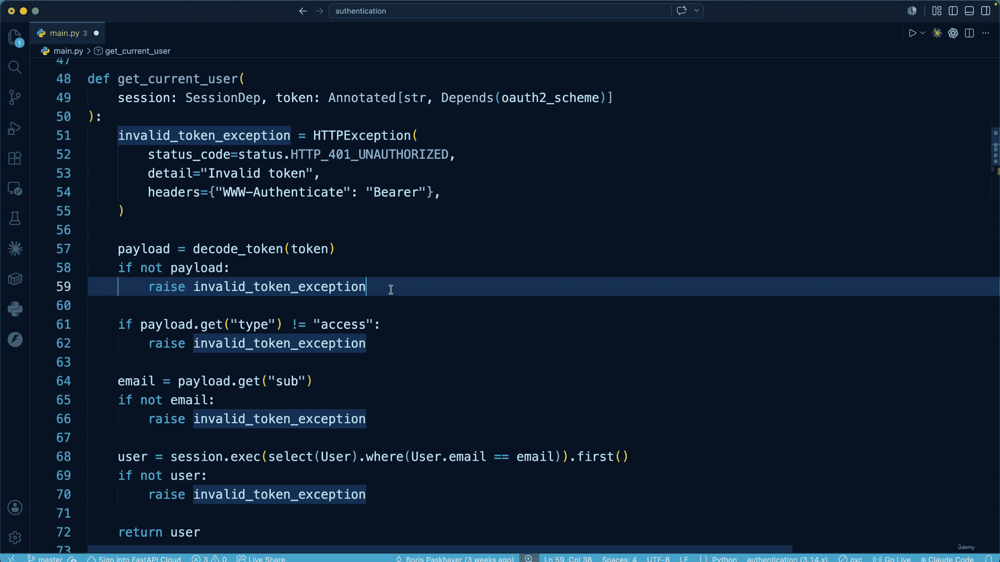

先看函数的第一个参数：我们打算用`Annotated`类型提供`current_user`。根据类型声明，我们知道`current_user`是`User`对象。这里我们会使用`Depends`，并传入上面那个未被调用的`get_current_user`函数。请记住，这个设计的巧妙之处在于：每当这个新依赖函数要执行时，我们能确定`get_current_user`已经成功了。因为如果在依赖执行过程中任何时刻抛出了错误，FastAPI会自动向客户端返回错误，后面的函数根本就不会执行。所以，我们只是通过提供一个注解，就构建出一条依赖链。通常我们会把类似的代码写在路由处理函数里，但在另一个依赖函数中使用也完全没有问题，我们只是在构建一系列顺序执行的逻辑操作。

接下来，我们需要token本身，因为要从JWT中取出payload，然后读取上一课写入的`scopes`键。在`get_current_user`中，我们返回了user，但实际上没有对解码后的token做额外处理。所以，我们要在新的函数中再次从token中解析payload的`scopes`部分。我们复制一段代码来访问JWT token本身，但真正验证token是否有效、是否过期的工作，仍然是依靠执行`get_current_user`来完成的。

这时，新函数的签名大致如下：

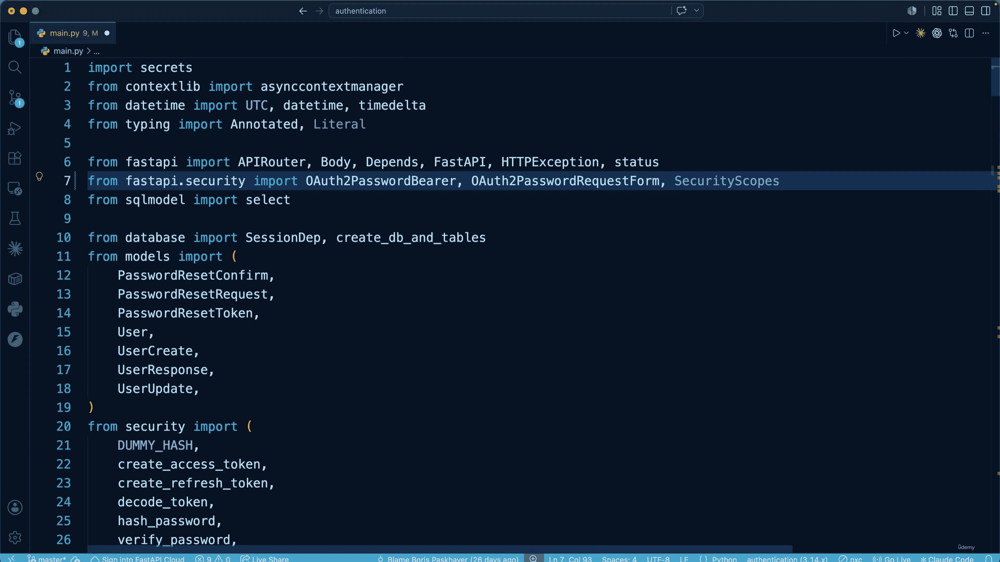

```python
async def get_user_with_scope_check(
    current_user: User = Depends(get_current_user),
    token: str = Depends(oauth2_scheme),
    security_scopes: SecurityScopes,
) -> User:
    ...
```

这里解释一下签名：我们有`current_user`，有`token`，最后，在任何给定的路由处理函数中，我们需要传入该路由所需的作用域。FastAPI能够识别这个参数，是因为我们为它设置了精确的类型`SecurityScopes`。`SecurityScopes`来自`fastapi.security`，实际上它是一个类而不是函数，但它可以作为依赖项来使用。我们可以把`security_scopes`参数看作“某条路由要求用户拥有的作用域列表”。最终，这个函数返回的仍然是一个用户对象，但在此之前，我们要在这里完成真正的校验：确保用户拥有路由处理函数要求的全部作用域。

> 注意：`security_scopes`并不是在路由处理函数里直接给出的一个普通参数，而是FastAPI根据类型注解自动注入的。我们只需要在依赖函数中声明这个类型，FastAPI就会把当前路由对应的作用域列表传进来。

## 从JWT中解析作用域

所以需要做的第一件事是再次解码token。我们有一个辅助函数`decode_token`，可以把从Authorization头中解析出的JWT token传入，得到一个类似`payload`的对象。这个函数会返回token内容的实际字典，其中应当包含上一课用户登录时写入的`scopes`声明（键）。接下来，我们对这个字典调用`get`方法，获取`scopes`键，如果该键不存在，就回退为空列表。

这里Python类型检查器会报一个警告，因为从技术上讲，`decode_token`函数既可以返回有效token，也可以返回`None`。我们其实不需要担心这一点，因为在`get_current_user`中（保证在`get_user_with_scope_check`执行前先运行）我们已经检查了解码逻辑，如果解码失败或token无效，就会抛出异常并返回`None`。换句话说，我们依赖`get_current_user`已经执行过，并保证在进入新函数时token一定是有效的。但类型检查器并不理解这种保证，所以我们需要添加一个类型检查：使用Python的`assert`关键字，确保`payload`不是`None`。这个断言只是为了告诉类型检查器，后面的`payload`保证是字典。实际上它永远不会失败，因为如果payload是`None`，之前的`get_current_user`早就报错退出了。这样就能消除VS Code中的类型检查警告。

然后，我们从JWT嵌入的内容中获取用户作用域列表。这一步可以写成：

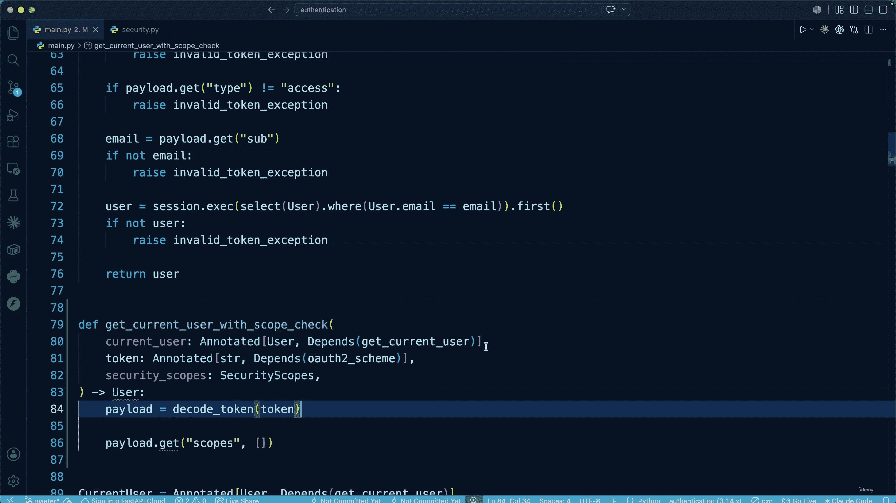

```python
payload = decode_token(token)
assert payload is not None
user_scopes = payload.get("scopes", [])
```

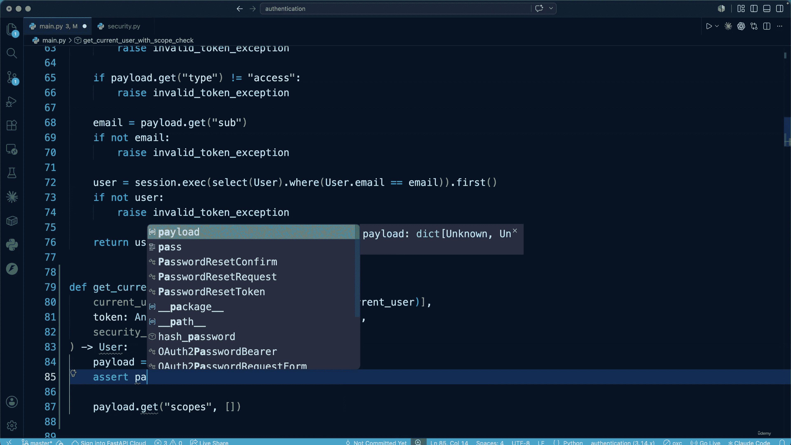

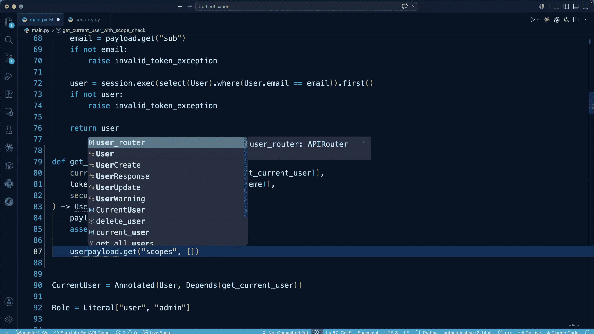

现在，已经有了用户作用域，接下来要验证路由要求的作用域。

## 验证作用域并抛出异常

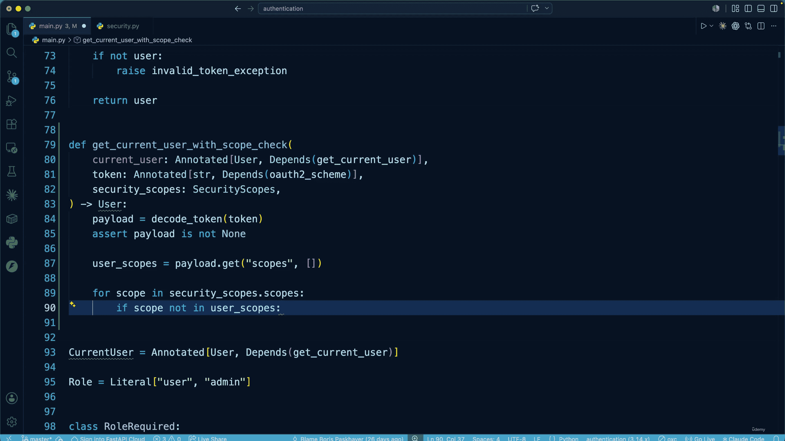

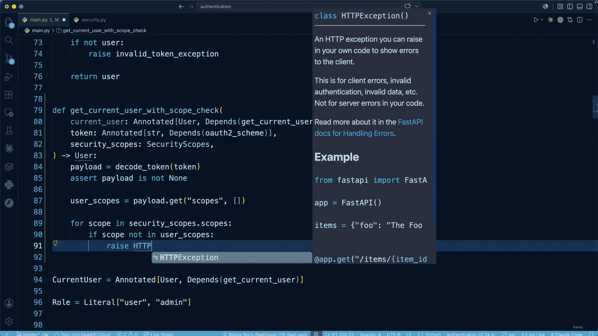

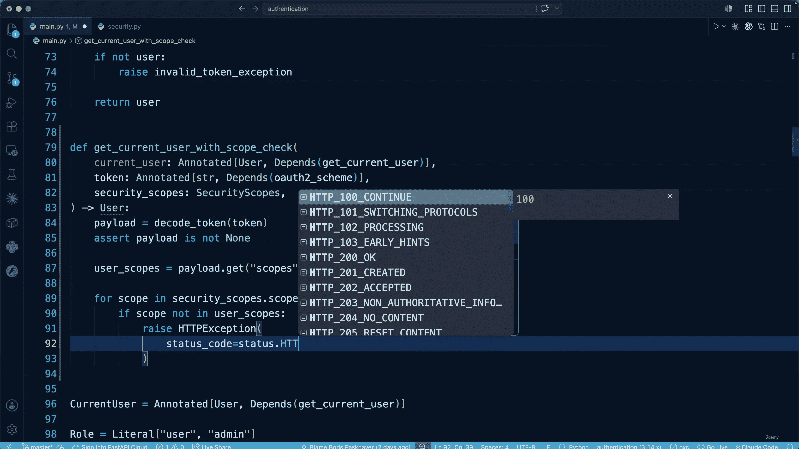

你可能已经猜到了，接下来要遍历路由处理函数请求的所有作用域，确保用户拥有全部这些作用域。我们使用`for`循环遍历`security_scopes`。`security_scopes`对象本身有一个`scopes`属性，里面就是路由处理函数请求的作用域列表。在遍历过程中，如果某个作用域没有出现在`user_scopes`中，说明请求的权限不在用户拥有的权限列表里，那么我们就知道用户没有权限访问此路由。于是，抛出一个`HTTPException`。

这个异常的状态码使用403 Forbidden，detail信息写`"insufficient permissions"`。这个描述既简洁又模糊，符合安全最佳实践。同时，为了遵循OWASP标准，我们还在响应头中加上一个键为`WWW-Authenticate`、值为`Bearer`的header。

再次澄清：在这个场景下，用户已经是已认证状态，因为`get_current_user`已经通过了；但这个已认证用户并没有访问当前路由所需的权限。如果任何一项路由请求的权限不存在于用户被允许的权限集合中，那就说明该路由要求了用户不具备的能力，用户因此无权访问，我们会抛出一个错误。

如果所有检查都通过了，说明用户拥有路由请求的全部权限，那么最后返回`current_user`，这模仿了`get_current_user`的设计。这样，任何想通过`Depends`使用这个依赖的人，也能拿到当前用户对象。完整的函数看起来大致如下：

```python
from fastapi import HTTPException, status
from fastapi.security import SecurityScopes

async def get_user_with_scope_check(
    current_user: User = Depends(get_current_user),
    token: str = Depends(oauth2_scheme),
    security_scopes: SecurityScopes,
) -> User:
    payload = decode_token(token)
    assert payload is not None
    user_scopes = payload.get("scopes", [])
    for scope in security_scopes.scopes:
        if scope not in user_scopes:
            raise HTTPException(
                status_code=status.HTTP_403_FORBIDDEN,
                detail="Insufficient permissions",
                headers={"WWW-Authenticate": "Bearer"},
            )
    return current_user
```

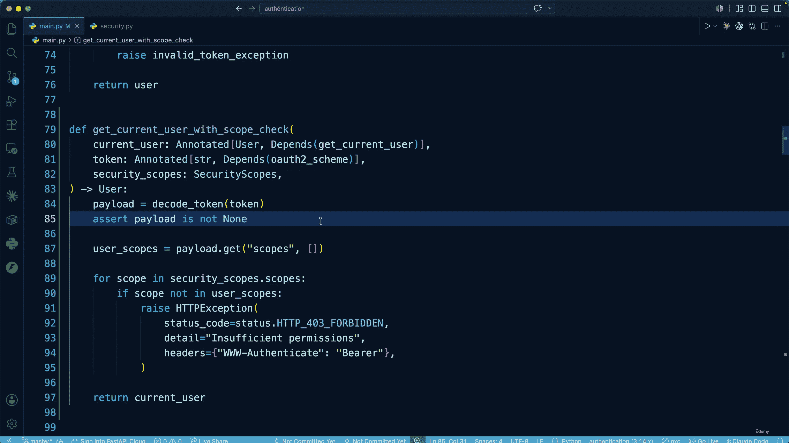

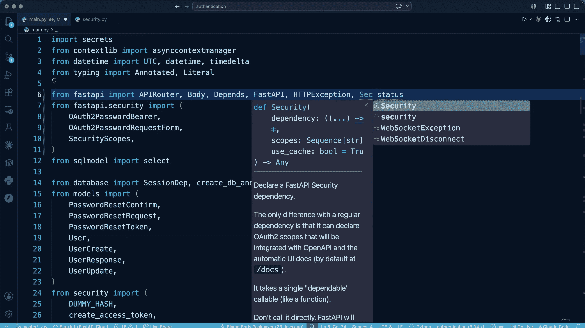

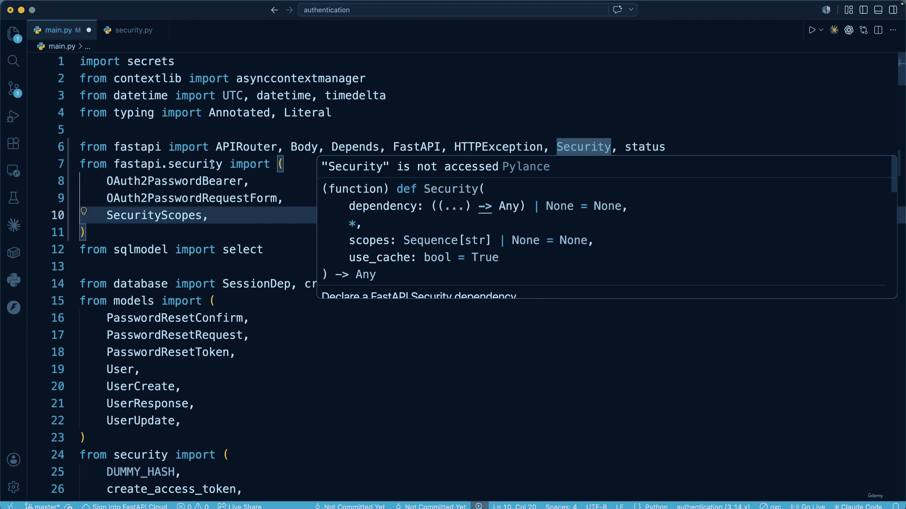

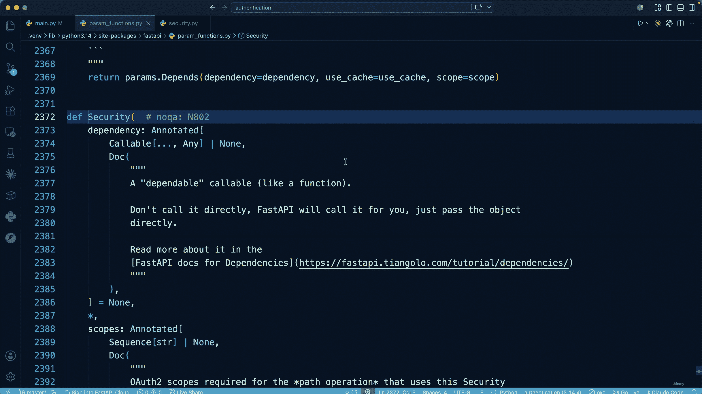

## 在路由中使用Security

这里有很多复杂之处，我们来看看它在具体路由中是如何运作的。首先，回到文件顶部，从FastAPI导入一个新的构造：`Security`。之前被绕晕的地方就在于此：`SecurityScopes`是一个类，而这个来自FastAPI的`Security`是一个独立的依赖函数，我们可以在路由处理函数中使用它。

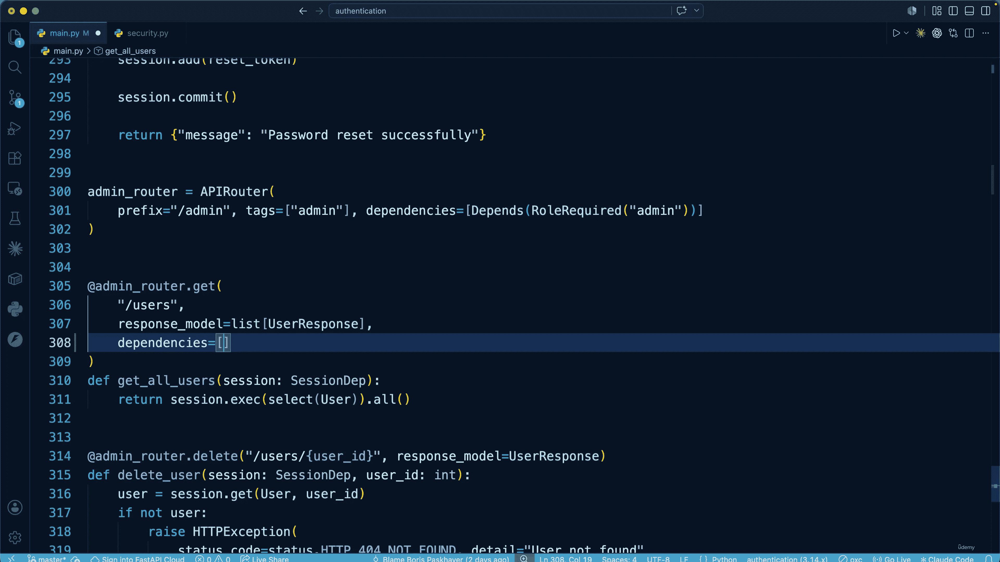

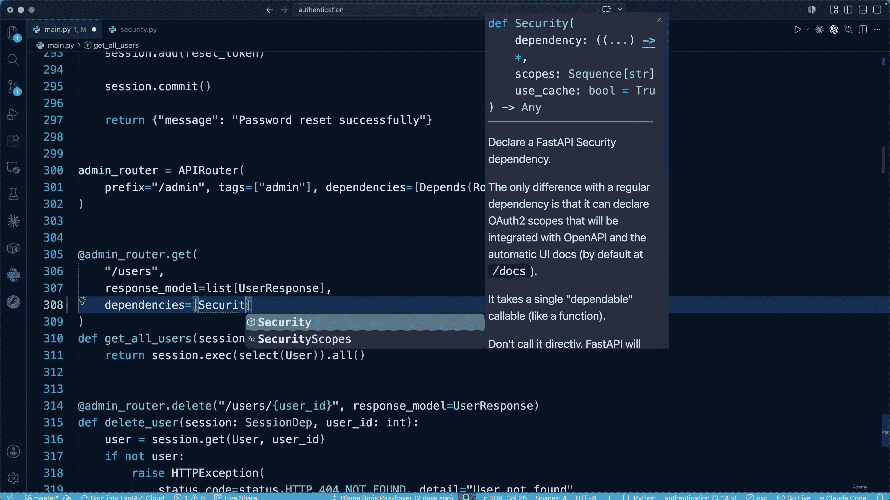

正如我们之前看到的，我们可以把依赖作用在路由器上，也可以作用在任何一个路由处理函数上，取决于我们希望控制得多具体，两者的语法完全一致。现在，我们以`/users`路由为例：像往常一样添加`dependencies`列表，但这次不用`Depends`，而是用刚导入的`Security`。

这个`Security`函数接受两个参数。第一个参数是要调用的依赖函数，这一点与`Depends`非常相似：我们传给它一个未被调用的函数，让它在路由处理函数执行前先运行。对我们来说，这个函数就是刚才写的`get_user_with_scope_check`。`Security`和`Depends`的区别在于：`Depends`只是调用一个函数，而`Security`除了调用指定函数外，还有第二个参数——实际的作用域，也就是该路由所需的权限。这里我们会提供一个`scopes`参数，其值为一个列表，列表中是字符串形式的一个或多个作用域。

例如，我们在Swagger里定义的作用域之一是`read:users`。正是这个条目被传入`scopes`参数，最终会成为前面依赖函数签名中的`security_scopes`参数。FastAPI不会按参数顺序匹配，而是按参数类型匹配。所以，不管把`security_scopes`参数放在依赖函数签名的哪个位置，都没有关系。FastAPI要做的只是：对于任何一个给定路由处理函数，找到依赖函数中类型为`SecurityScopes`的参数，然后把你在`scopes`列表中传入的内容交给这个参数。因此，在这个路由里，我们传入的是`read:users`；当依赖函数运行时，`security_scopes`的值就是`read:users`。

我们可以用下面的代码示例来展示：

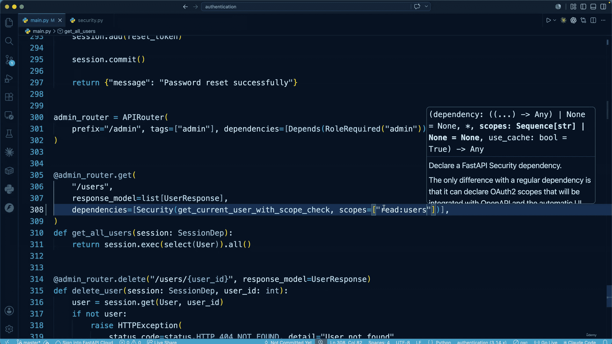

```python
@router.get("/users", dependencies=[Security(get_user_with_scope_check, scopes=["read:users"])])
```

现在，我们要检查请求的作用域`read:users`用户是否拥有。如果用户的JWT token里没有`read:users`权限，就在这里抛出异常。如果你在列表中提供两个或三个不同的作用域，规则同样适用。所以，`Security`函数相比`Depends`的整个意义在于：它仍然会为你运行一个依赖函数（第一个参数指定的那个），同时还允许你传入作用域列表（也就是权限）。这个列表会流入依赖函数中类型为`SecurityScopes`的参数，然后你执行自定义的验证逻辑，得到想要的结果。

因此，我们在这里的需求是：用户必须是管理员，因为`Depends(get_current_user)`这个依赖仍然会在路由器级别生效并且先运行；但除此之外，用户还必须具有`read:users`作用域或权限。在这个例子里，我们组合了两个依赖，但它们并非必须组合。你可以只做基于角色的权限检查，也可以只做基于作用域的权限检查。例如，可以把这段代码复制到另一个不需要管理员身份的路由上，它同样是有效的。在这种情况下，我们不是按角色验证，而是按作用域/权限验证。所以，你可以二选一，也可以同时使用两者：在一个特定路由上同时要求角色和权限，它们会按顺序组合执行。

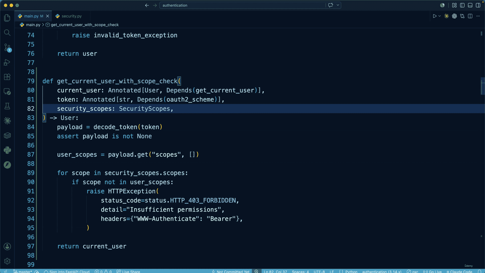

## 在delete路由中实践

现在再看另一个例子，我们练习一下`delete`路由的语法。假设我们不仅需要管理员用户，还需要一个具有删除用户作用域的管理员用户。和上面装饰器类似，我们在这里提供`dependencies`列表，这次不使用`Depends`，而是调用`Security`。第一个参数仍然是被调用的函数，它由FastAPI在路由处理函数执行前调用；这个函数依然是`get_user_with_scope_check`。然后在`scopes`参数中传入字符串形式的权限列表，比如`delete:users`。这本质上是一次简单的字符串检查，但我们把这个作用域定义为用户能够运行此函数所必需的权限。执行检查的正是`get_user_with_scope_check`这个函数。

代码如下：

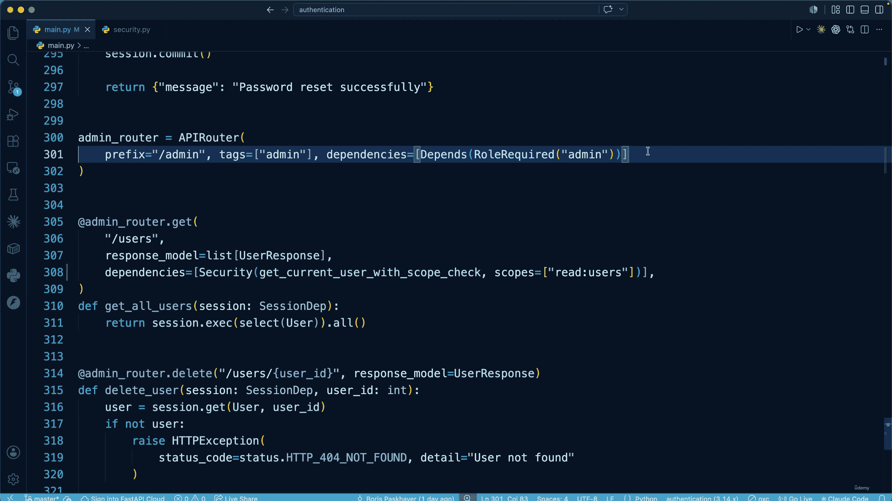

```python
@router.delete("/users/{user_id}", dependencies=[Security(get_user_with_scope_check, scopes=["delete:users"])])
```

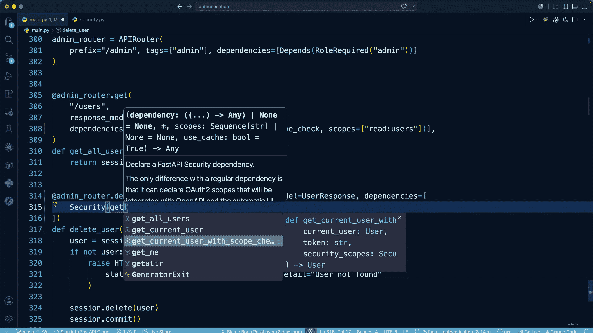

换句话说，FastAPI实际上相当“被动”：它不会自己去判断用户有没有给定权限。你只需要告诉它运行哪个函数、这些权限是什么，剩下的事情由你自己负责。如果这个函数返回时没有抛出任何异常，FastAPI就假定用户拥有这些权限，然后继续执行后面的路由逻辑。

再强调一下：角色和作用域是两个完全独立的授权系统。我们在这里把它们组合使用，但它们并不一定要同时出现。如何为你的系统定义安全策略，完全由你自己决定。

## 路由器级别与路由级别的作用域

我们来看一个快速替代方案：可以把这段语法粘贴到路由器本身上面的`dependencies`里。例如，如果写了这样的代码，并删掉路由级别多余的security检查（因为它已经冗余了），这样写也是有效的，不过它设置的是一组不同的要求。现在，对于属于admin路由器的任何路由，你都必须同时具有管理员角色和读取用户的作用域。当这两个检查都通过后，对应的路由处理函数才会运行。

这样一来，比如对于`delete`路由，我们实际上也要求它有`read:users`；而且，在“管理员 + `read:users`作用域”这一路由器级要求之上，`delete`路由还会额外增加一个`delete:users`权限的要求。于是，我们相当于在路由器要求和具体路由要求之间做了层层叠加。这和刚才的配置略有不同。

差别在于，现在路由器级别的要求少了一些。如果回到刚才的配置，对于admin路由器中的任何路由，我们仍然要求管理员身份，但具体的作用域随路由变化。因此，一个拥有`delete:users`作用域的用户可以访问`delete`路由，而不必拥有`read:users`作用域，因为`read:users`不再要求于路由器级别，只要求于那一条具体路由。这样，你的权限划分可以更加细化和专门化。可以专门定义基于角色的权限、基于作用域的权限，或者二者的组合，一切都取决于你希望系统的安全机制如何运作。希望这个设计的基本思路是清楚的：我们再次依赖FastAPI的依赖注入思想，指定在路由处理函数执行前应该运行什么逻辑。只不过这次用的是`Security`而不是`Depends`；我们传入要执行的函数，并给它提供作用域，也就是用户为了运行该路由所必须具备的权限。

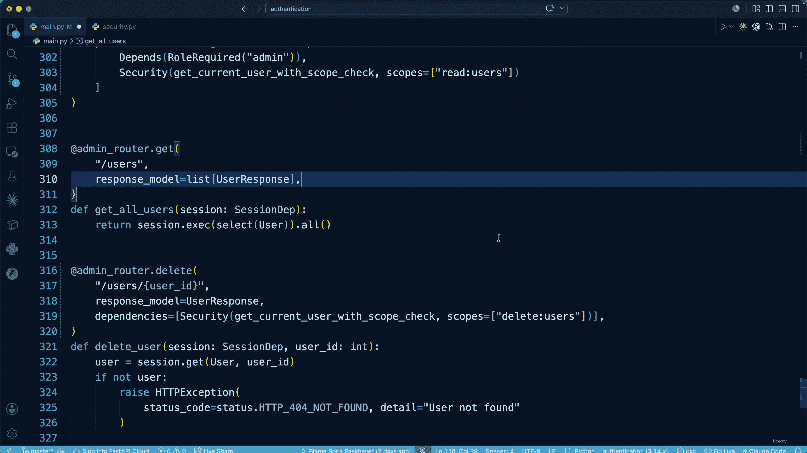

所以，在`get_users`或`delete_users`执行前，FastAPI会先执行`Security`中的函数，并把指定的作用域传进去。我们在函数中实现验证用户是否拥有给定作用域的逻辑；假设用户确实拥有这些权限，就不抛出异常，返回当前用户对象。FastAPI看到我们没有返回错误，就会假定用户拥有所需权限，然后继续执行正常的路由处理函数。好，这里面确实有很多复杂性，我们将在下一课中在浏览器里测试这些代码。

## 总结

本节课中，我们一起学习了如何通过作用域来保护路由。概括起来，本节课涉及以下几个关键点：

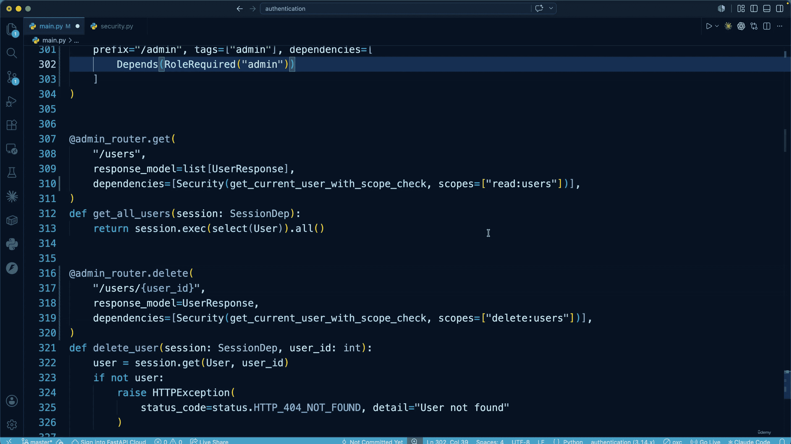

- 作用域是用字符串表示的权限，例如`read:users`、`delete:users`。
- 通过定义`get_user_with_scope_check`依赖函数，可以从JWT中解析用户作用域，并与路由要求的作用域进行比对。
- FastAPI的`Security`函数接受两个参数：要执行的依赖函数和所需的作用域列表。
- 角色与作用域可以单独使用，也可以组合使用。
- 路由器级别的作用域要求会应用到所有属于该路由器的路由，而路由级别的作用域只作用于那一条路由。

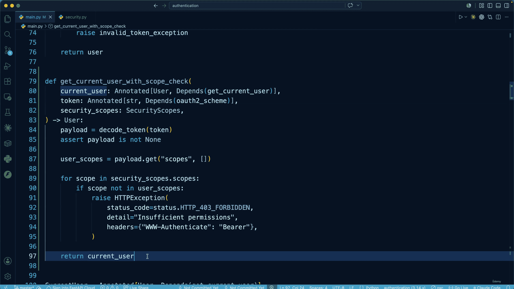

我们回顾了作用域的基本概念，明白了它是表示权限的字符串；然后创建了`get_user_with_scope_check`这个依赖函数，让它从JWT中解析用户作用域，并和路由请求的作用域进行比对。我们还展示了如何使用FastAPI的`Security`依赖函数来传入所需作用域，比较了它和`Depends`的差异，并且在`/users`和`delete`路由中做了实践。最后，我们讨论了角色与作用域的组合方式，以及路由器级别和路由级别作用域要求的区别。希望这些内容能帮助大家在自己的FastAPI项目中设计出更灵活、更细粒度的权限控制。
