# FastAPI 大师课：第 59 讲：测试作用域 🔬

在本节课中，我们将要学习如何测试 FastAPI 中的分层授权机制。我们已经在前面的课程中实现了基于角色和基于作用域的授权代码，现在要回到 Swagger 文档页面上，通过实际操作来验证这套机制是否按照预期工作。在动手之前，我们先明确一下思路：角色决定你是谁，作用域决定你能做什么。只有把这两者放在一起看，才能真正理解复杂授权方案是如何运转的。接下来，我们会通过几个不同的登录组合，逐一观察访问端点的结果。

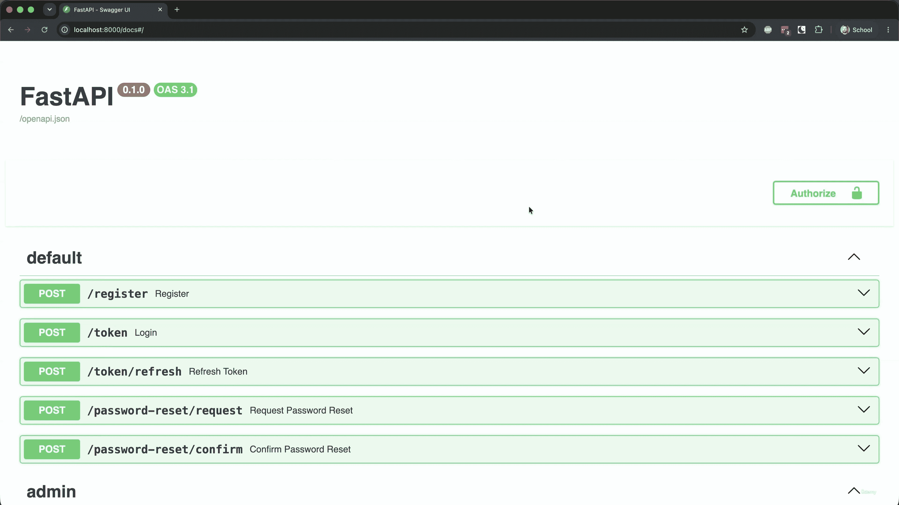

## 准备工作：认识现有的用户和角色 🧑‍💼

现在我们已经回到了 Swagger 文档页面，接下来要测试的是我们在代码中启用的分层授权方法。这个方法由两部分组成：一部分是基于角色的授权，另一部分是基于作用域的授权。简单来说，角色代表用户的身份级别，而作用域代表用户具体拥有的权限点。在真实项目中，通常会把这两者结合起来使用。

目前数据库中只有一个用户，名字叫 Boris，他的角色是 admin。也就是说，这个账号是一个管理员账号，能通过角色检查，但能不能真正访问某条具体的接口，还要看他的作用域是否匹配。下面我们就用这个唯一的用户来开始测试。

## 没有作用域的 Admin 用户：被拒绝访问 🚫

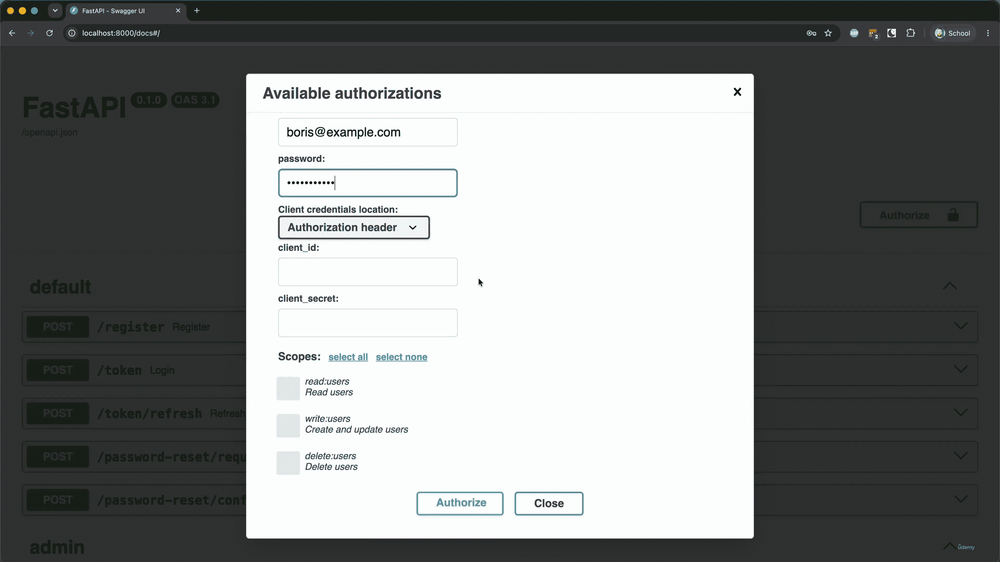

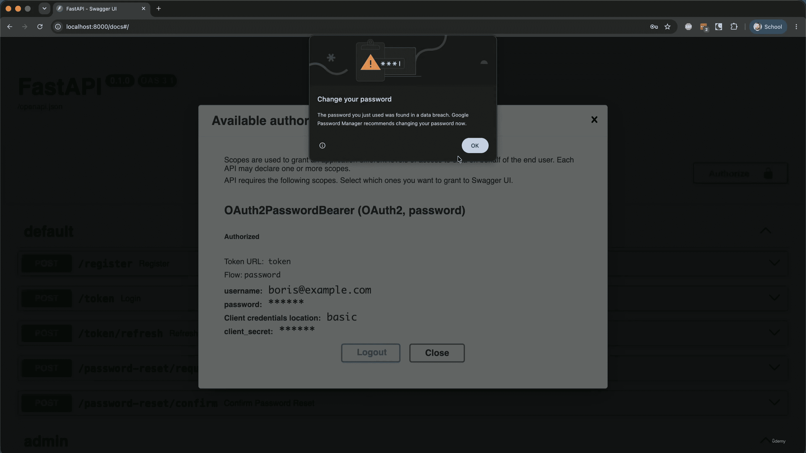

我们先来做一个最简单的实验：以 Boris 的身份登录，但不给他任何作用域。请点击页面上的 Authorize 按钮，然后输入邮箱 boris@example.com，密码是 password123。在下方选择 scopes 的时候，我们要保持默认状态，也就是不选择任何 scope。这样做的效果是：Boris 依然是 admin 角色，但在他的 JWT 中不携带任何实际作用域，也就是没有任何权限信息。

登录成功之后，我们来观察下方的 admin 路由。这些管理员路由的要求比较特殊，需要同时满足两个条件。以下是这个路由的授权要求：

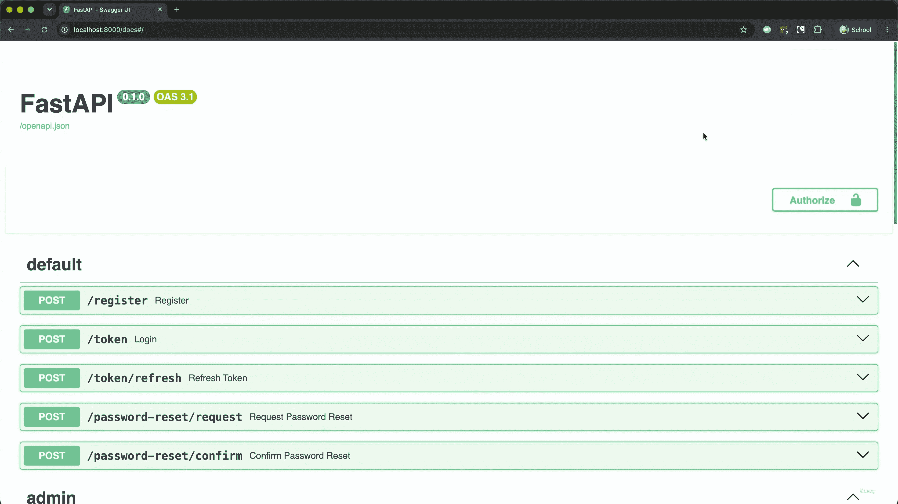

- 第一个条件是用户必须拥有 admin 角色。这一点我们当前是满足的，因为 Boris 确实是 admin。
- 第二个条件是每条具体路由还必须要求额外的作用域。比如，这里有一条路由需要 read_user 作用域，另一条路由需要 delete_user 作用域。而 Boris 目前一个作用域都没有。

所以，如果现在尝试对这些路由发起请求，即使我们已经完成了身份认证，即使我们确实拥有 admin 角色，系统依然会拒绝我们。你会在响应中看到“insufficient permissions”（权限不足）的错误信息，并且最关键的是，路由处理器（route handler）根本不会运行。

为什么会这样呢？这个拦截动作来自上一节课程中使用的安全函数。我们在路由中配置了一个名为 get_current_user_with_scope 的依赖函数，它会在路由处理器执行之前先运行。这个依赖函数内部有一段 if 判断，专门检查当前登录用户是否拥有路由所要求的作用域。当我们检查 Boris 是否拥有 read_user 这个作用域时，检查结果为空，也就是说他没有这个作用域。于是，依赖函数在 if 语句中直接抛出了异常，后面的路由处理器自然就没有机会执行了。同样的逻辑也适用于另一条删除用户的路由，它们都会因为作用域不匹配而提前终止。

这个检查逻辑用伪代码来表示会非常清晰。下面这段代码展示了 get_current_user_with_scope 的核心判断，也就是“需要的 scope 必须存在于用户的 scope 集合中”：

```python
# 伪代码：get_current_user_with_scope 的检查
def get_current_user_with_scope(user, required_scope):
    # 检查用户的作用域集合中是否包含所需作用域
    if required_scope not in user.scopes:
        # 不包含就抛异常，阻止路由处理器运行
        raise InsufficientPermissionsError("insufficient permissions")
    # 包含则返回用户，继续执行后续逻辑
    return user
```

这里我们特意用大白话注释，帮助初学读者理解。

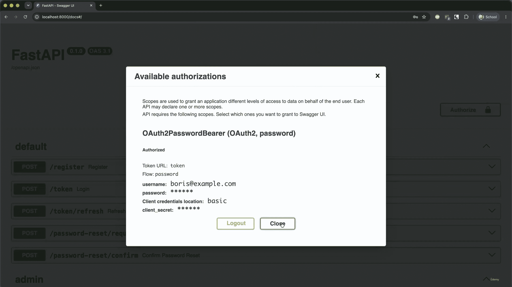

## 给 Admin 用户加上作用域：顺利访问 ✅

在刚才的测试中，我们已经看到了没有作用域时会发生什么。现在，让我们换一种登录方式，给 Boris 加上 read_user 作用域。首先刷新页面，回到未认证的状态。然后再次点击 Authorize，用 Boris 的邮箱登录，密码和之前完全相同。但在选择 scopes 这一步，我们需要勾选 read_user 这个作用域。

这里需要解释一下代码里的处理方式：在登录时，我们只会简单地获取请求中传过来的 scopes，然后把这些 scopes 自动分配给编码进 JWT 中的用户。也就是说，你请求了哪些作用域，JWT 里就会带上哪些作用域。这种做法对于真实的安全系统来说并不是最好的选择，但放在教学中是一个合理的模拟方式。借助这个机制，我们可以模拟出一个已经通过认证的 admin 用户，并且这个用户现在确实拥有了 read_user 这个权限。

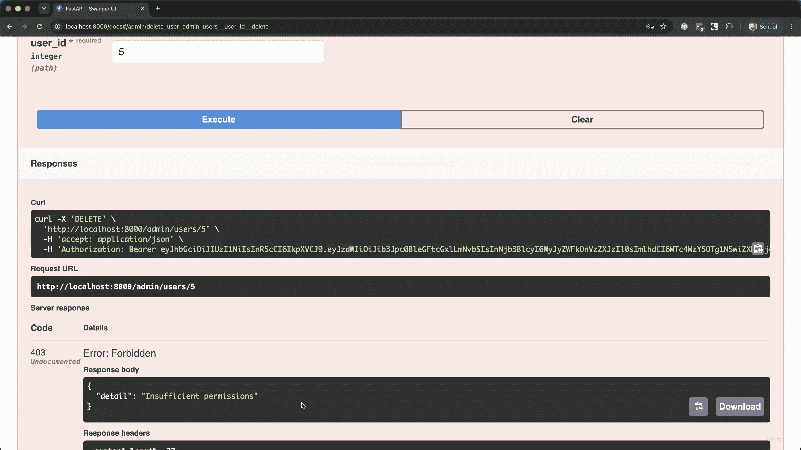

完成授权之后，我们再次访问刚才失败的那个 admin 路由。此时，JWT 中已经包含了 read_user 这个作用域。这个路由的访问条件有两个：一个是必须是 admin 用户，这一点我们满足；另一个是 JWT 中必须包含 read_user 作用域，这一点我们同样满足。因此，这次代码会正常工作。你会看到接口返回了真实的响应数据，这就说明路由处理器被正常执行了。

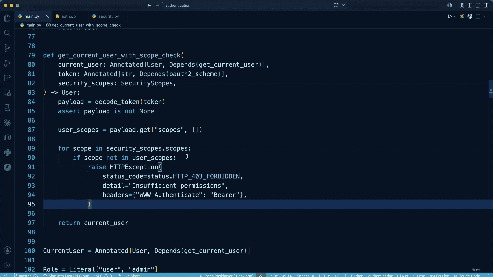

不过，我要特别指出一点：删除用户的那条路由依然不会工作。我们可以先试试直接访问这条删除路由，比如随便传入一个用户 ID，例如 5。其实传入什么 ID 都不重要，因为路由处理器依然不会执行。原因在于，作用域检查会在路由处理器之前启动，我们会在检查阶段就直接抛出异常。

你往下滚动页面，就会看到返回的错误是“Forbidden: insufficient permissions”。此时此刻，我们是已认证的 admin 用户，并且拥有 read_user 作用域，但问题是我们没有 delete_user 这个作用域，而当前这条路由恰好要求 delete_user。请注意，这个错误并不是在路由处理器内部产生的，而是出现在 get_current_user_with_scope 这个依赖函数中。依赖函数在这里再次提前返回，并抛出了异常，因为路由处理器声明需要的是 delete_user，而用户的 scopes 集合中目前只有 read_user，找不到 delete_user。

## 创建临时用户并测试删除作用域 🗑️

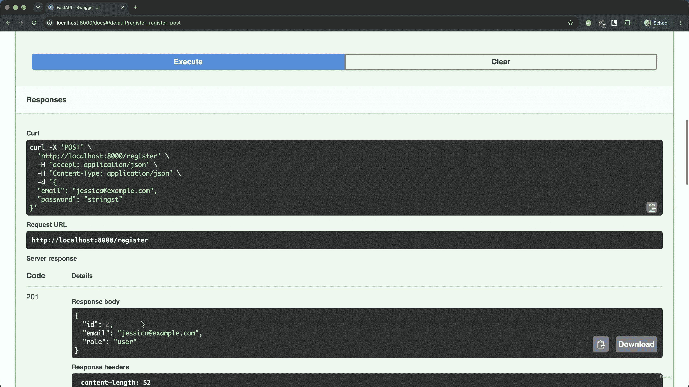

到目前为止，我们看到的都是失败案例。如果想要看到完全成功的对应示例，我们需要以一个拥有 delete_user 作用域的用户身份登录。不过，当前的数据库里只有 Boris 一个用户，所以我们需要先创建另一个用户，专门用来做删除测试。

我们先刷新一下页面，然后找到最上方的注册接口（register endpoint）。点击 Try it out，开始创建一个新用户。这个用户就叫 Jessica，邮箱是 jessica@example.com。密码可以随便填，因为我们马上就要把她删掉。字段里的其他内容也都无所谓，不会影响测试。填写完毕之后，点击 Execute 执行。执行成功后，你可以看到返回结果中显示这个新用户的 ID 是 2。

接下来，我们再次以 Boris 的身份登录。Boris 是第一个用户，密码还是之前的 password123。在下方选择 scopes 的时候，我们要想一想：既然目的是删除用户，至少需要 delete_user 这个作用域。当然，我们完全可以在一次登录中同时请求多个 scopes，这没有任何限制。所以最省事的做法就是把所有 scopes 全部勾选上，这些作用域最终都会写入 JWT。

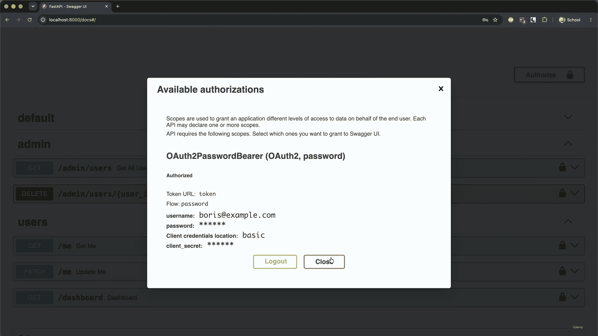

因为现在我们同时拥有了 read_user 和 delete_user 两个作用域，所以上面那两条需要不同作用域的端点，我们应当都可以访问。在页面上，我们以 admin 用户身份登录，并且带着这两个作用域。先来看获取所有用户列表的接口：返回结果中可以看到两个用户，一个是 Jessica，另一个就是我自己（Boris）。

然后，我们再看删除用户端点。我们尝试删除 ID 为 2 的那个用户，也就是 Jessica。系统会再次验证这条路由的授权要求：路由器会验证当前用户是 admin 角色；同时，我们传递给路由处理器和依赖函数的那个 security 对象会验证当前用户是否具备所需的 delete_user 作用域。既然两项检查都能通过，这个请求就可以正常执行。往下看，你会看到响应体里成功返回了被删除用户的信息，这说明我们成功访问并运行了路由处理器，作用域安全检查也顺利通过了。

## 有作用域但没有 Admin 角色：仍然被拒 🚷

最后，我想向你展示一个稍微反过来一点的过程，帮助你更完整地理解角色和作用域的关系。现在我们要考虑的问题是：如果一个用户拥有普通角色，但他同时也拥有某个操作的作用域，会发生什么？答案其实很明确：这样的用户依然无法访问这些 admin 路由，因为他缺少 admin 角色。

请记住，我们当前的代码设计是：对于这些 admin 路由，同时结合了角色验证和作用域验证。但这并不是必须的。你可以只使用角色验证，也可以只使用作用域验证，还可以把两者都放在一起。这里采用的策略是两者结合起来，所以我们才会看到“角色不够就会被拒”的情况。接下来，我们用一个新用户来验证这一点。

我们先注册一个新用户。还是来到注册接口，这次创建的用户叫 Bobby，邮箱是 bobby@example.com，密码是 Bobby123。执行之后，数据库里就多了一个新用户。这个用户和 Jessica 不同，它是一个普通用户，没有被赋予 admin 角色，只有默认的 user 角色。

创建完成后，我们刷新页面，然后以 Bobby 的身份登录。邮箱是 bobby@example.com，密码是 Bobby123。登录时，我们需要在 scopes 一栏中请求所有列出的作用域，然后点击 Authorize。现在，我们登录的 Bobby 是一个普通用户，但被赋予了全部作用域，也就是拥有了这些作用域对应的所有权限。

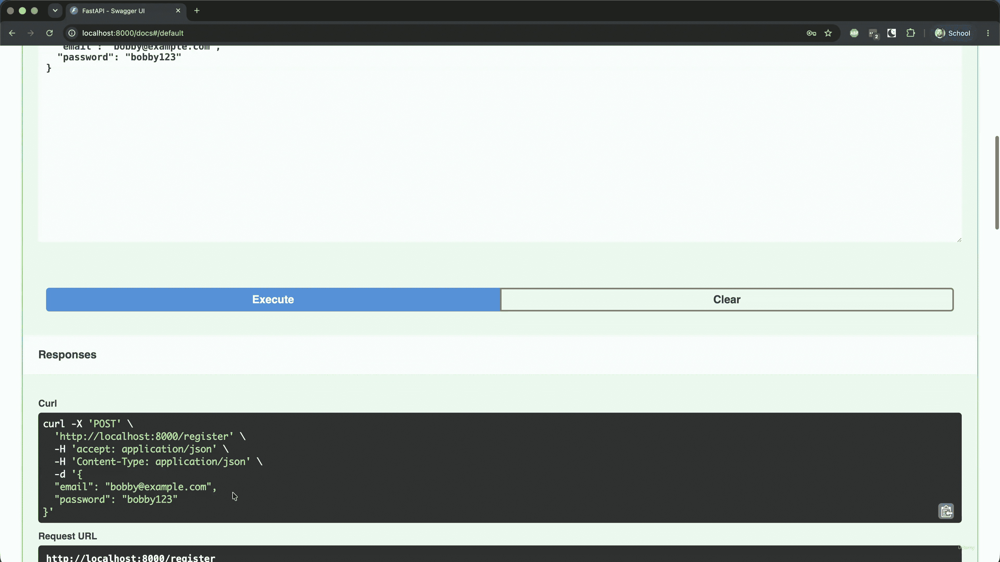

接下来，即使 Bobby 拥有 read_user 和 delete_user 这两个作用域（分别对应读取接口和删除接口），他依然不能访问这些端点，原因就是他缺少 admin 角色。真正拦下他的，是 admin 路由器中的那项检查。我们来看一眼 admin 路由器的代码，会发现在这个位置有一个检查点。正是这个检查点阻止了 Bobby 访问这两个端点，因为路由器级别的依赖检查（也就是授权检查）会在作用域检查之前运行。所以 Bobby 在进入具体作用域检查之前，就已经被拒绝访问了，我们甚至根本不会走到检查用户 scopes 的那一步。

这个顺序用代码来看会更直观，下面是 admin 路由的简化结构：

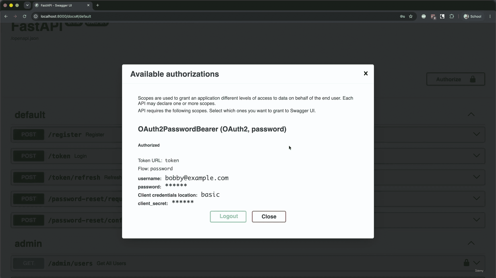

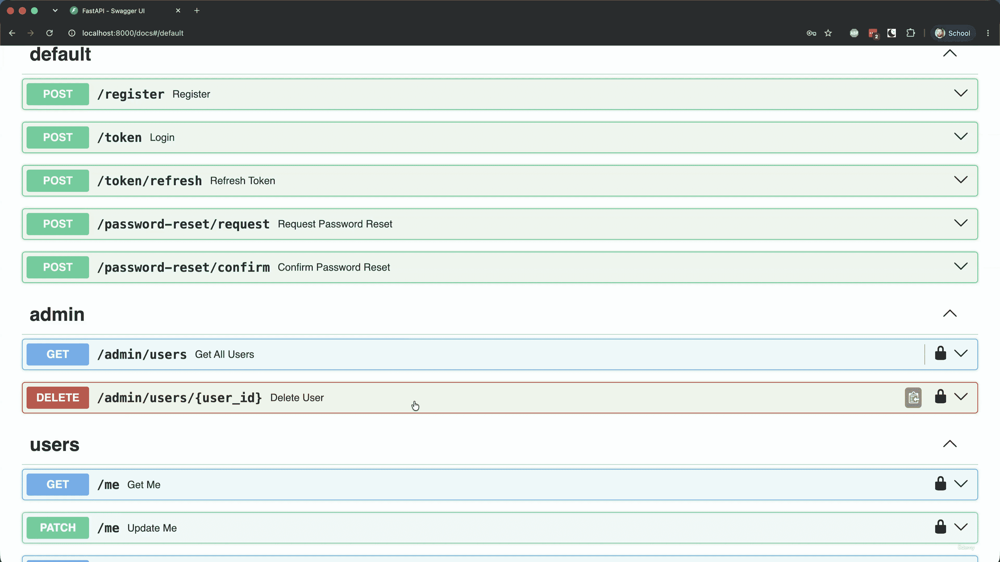

```python
# 简化版 admin 路由示例
router = APIRouter(dependencies=[Depends(RoleRequired("admin"))])

@router.get("/admin/users", dependencies=[Depends(get_current_user_with_scope("read_user"))])
def get_users():
    # 只有角色和作用域都验证通过后，才会执行到这里
    ...
```

在这里，`RoleRequired("admin")` 是路由器级依赖，它会先于路由内部的 scope 依赖执行。因此，Bobby 会在 scope 检查之前就被拦住。

回到 Swagger 页面，试着访问任意一个 admin 路由，你会看到错误提示：“This action requires the admin role”。这表明当前用户需要 admin 角色。这段验证逻辑就写在 RoleRequired 类中，它会先于作用域检查执行。

## 总结 📝

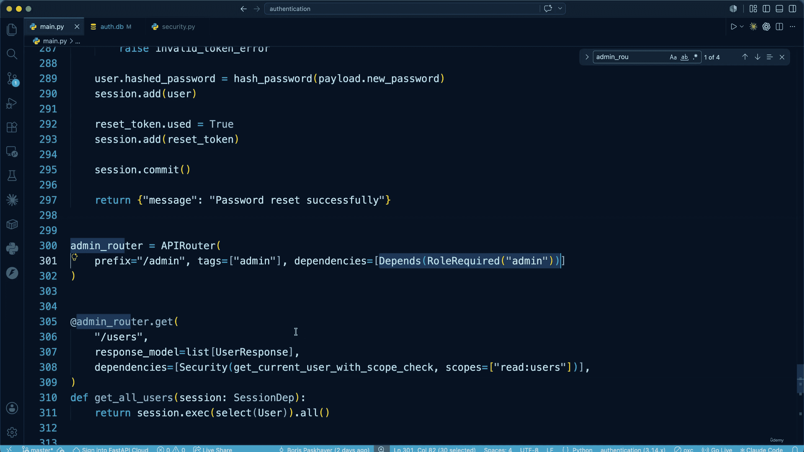

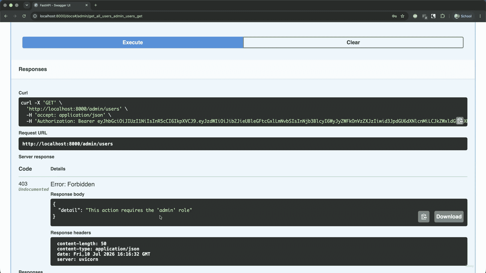

在本节课中，我们一起学习了如何测试 FastAPI 中基于角色和基于作用域的分层授权。我们先看到了没有作用域的 admin 用户会被拒绝访问，因为我们无法通过作用域检查。接着，我们给 admin 用户添加了 read_user 作用域，发现读取接口可以正常工作，但删除接口依然失败，因为缺少 delete_user 作用域。为了测试完整的删除流程，我们注册了一个临时用户，并让 admin 用户携带全部作用域，这时两个接口都成功了。最后，我们反过来测试了只有作用域但没有 admin 角色的情况，结果依然被拒绝，因为路由器级别的角色检查会优先于作用域检查。通过这些例子，你应该已经理解了角色与作用域是如何协同工作的。以后在自己的项目中，你可以根据实际需要，自由选择只验证角色、只验证作用域，或者两者叠加，从而实现复杂而灵活的授权方案。
