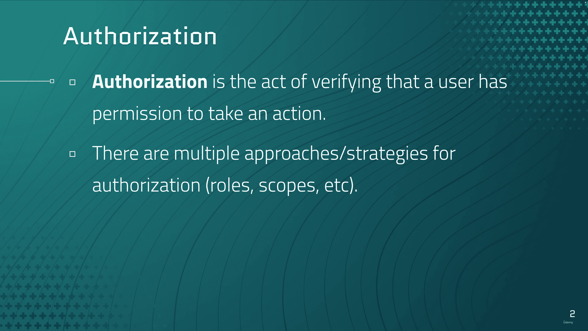
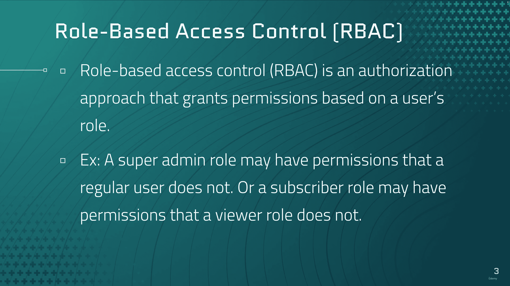
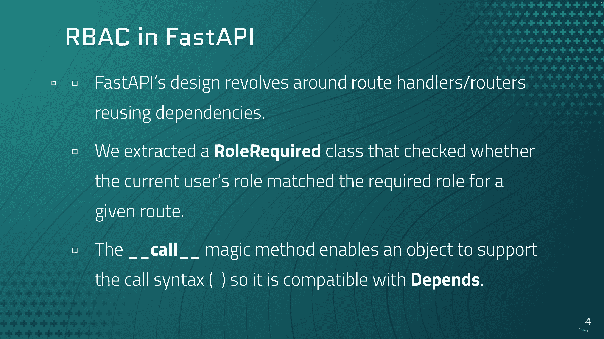
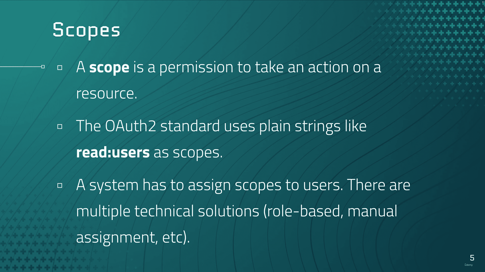
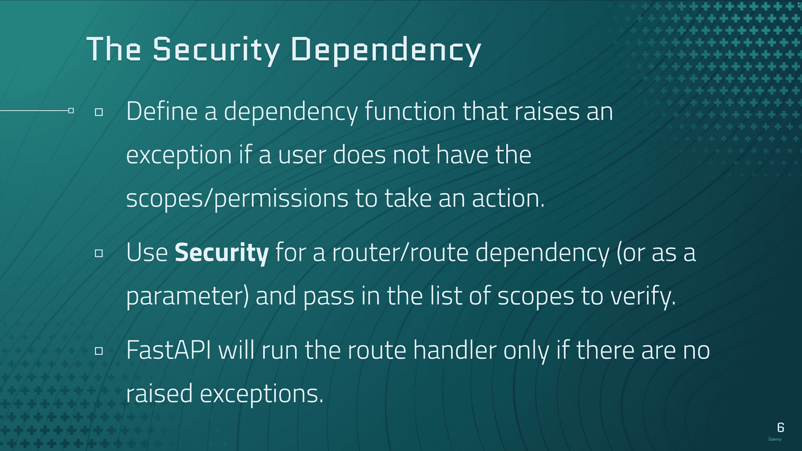
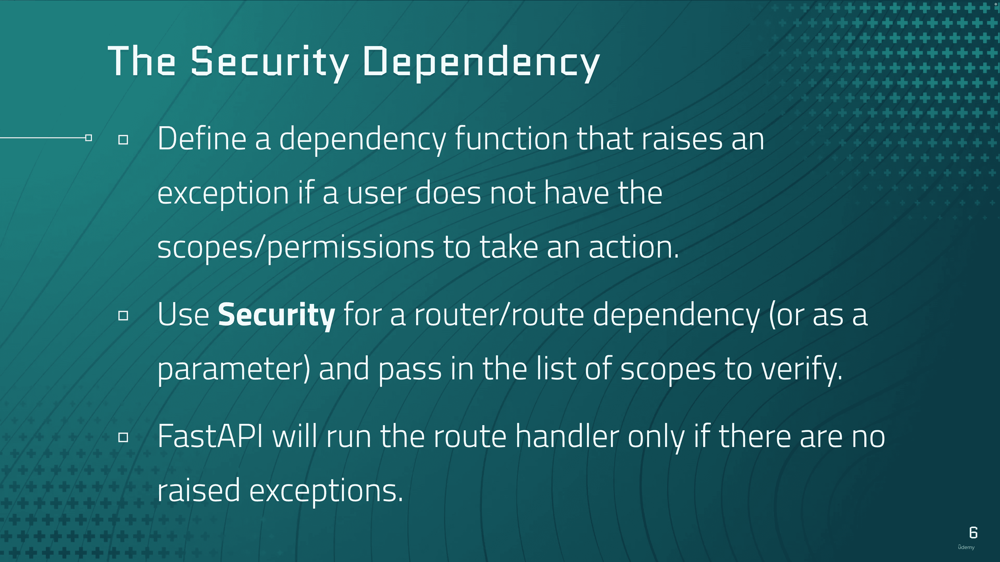
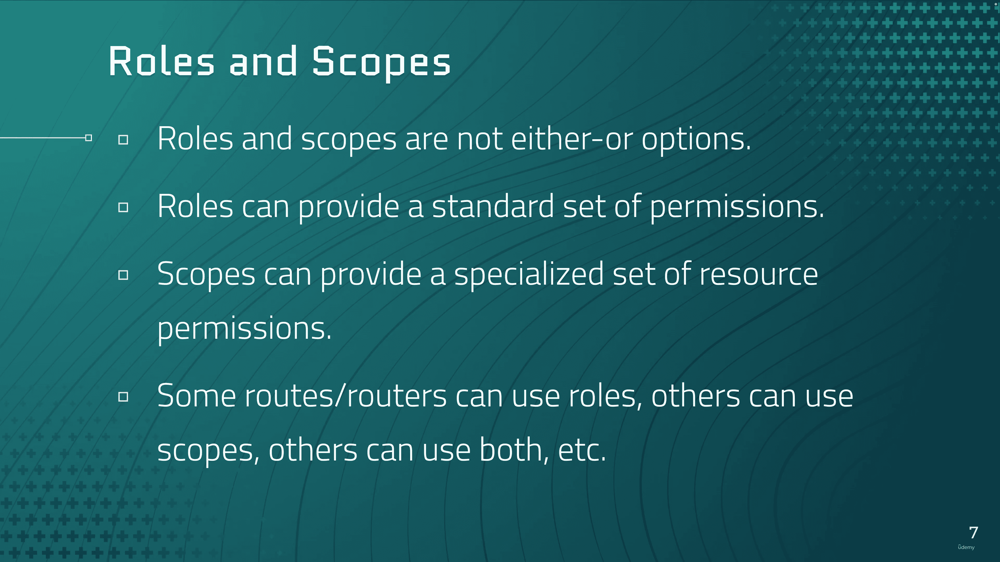

# 🎓 FastAPI Masterclass：第161节：授权与作用域回顾

恭喜你完成又一个课程章节。按照惯例，本节花几分钟回顾这一节学到的内容。在本节课中，我们将要学习授权，它是认证的补充：认证负责把用户登录进系统，或者识别用户是谁；授权负责验证这个用户是否有权限执行某个动作。我们会回顾基于角色的访问控制、作用域（Scopes）、FastAPI 中通过依赖和 Security 实现授权的方式，以及角色与作用域如何配合使用。本节也会说明为什么没有唯一完美的授权策略，以及如何把这些概念落到实际代码中。下面先从认证和授权的基本区别开始。

## 🔍 FastAPI Masterclass：第161节：认证与授权的关系



上一段已经提到认证和授权是两件不同的事，本节先把这两个概念彻底分开。认证是让用户登录系统，或者确认当前用户是谁；授权是在用户已经登录之后，检查这个用户有没有权限执行某个动作。原文也提到，授权有多种方法和策略，很多时候这些策略与认证策略是互补关系，例如角色、作用域，以及其他方案。下面的代码块用最直白的方式概括这两个概念。

```text
认证 = 识别用户是谁，或者把用户登录进系统
授权 = 验证用户是否有权限执行某个动作
```

理解了认证和授权的关系之后，本节继续看最常见的授权方案之一：基于角色的访问控制。它的核心思路是把权限和用户角色绑定起来，而不是每次单独判断某个用户能做哪些事。

## 🧩 FastAPI Masterclass：第161节：基于角色的访问控制（RBAC）

基于角色的访问控制有时缩写为 RBAC。它的基本想法是：系统中的访问由用户角色控制，也就是根据用户拥有什么角色来授予权限。原文特别说明，系统里应该有哪些角色、需要多少个角色，并没有固定标准，这完全由开发者决定。你可以像课程示例那样只设置普通用户角色和管理员角色，也可以根据公司部门设置十个不同角色，例如市场角色、安全角色、人力资源角色，每个角色拥有不同的权限集合。角色的设计会随着系统类型和业务场景变化。



以下是几个角色设计的例子，用来说明 RBAC 的灵活程度：

- 如果你为公司开发内部工具，可能需要一个超级管理员角色，它拥有很多普通用户角色没有的权限。

- 如果你开发 SaaS 产品，或者类似 Netflix 的视频流媒体服务，可能会有订阅者角色；订阅者付费后获得观看视频的权限，而一个已经认证但没有订阅、角色只是观看者的普通用户可能没有这个权限。

- 角色具体怎么设计由你决定，RBAC 的原则是根据用户角色在系统中授予权限；有时你也可以给一个用户分配多个角色，这取决于你希望如何实现系统。

从上面的例子可以看到，RBAC 的重点不是角色数量，而是“权限跟着角色走”这个原则。接下来看 FastAPI 本身如何处理授权。FastAPI 这个库对授权实现方式保持相对“无知”，它并不规定你必须使用角色还是作用域。FastAPI 只要求你提供一个可以执行的依赖，如果这个依赖抛出异常，FastAPI 就会提前返回错误，并且永远不会执行对应的路由处理函数。FastAPI 的一致设计围绕 `Depends` 函数展开，你可以把依赖应用到整个路由器，也可以应用到单个路由处理函数，核心目标是复用依赖。

> 核心原则：不要在每一个路由处理函数里重复声明授权逻辑。重复逻辑既冗余，又可能在重构时带来风险；例如要修改作用域名称时，最好只改代码库中的一个地方，而不是在多个路由处理函数里逐个修改。

除了避免重复，抽取依赖函数还能让路由处理函数本身保持简单，让它们专注于真正的核心职责：获取或创建自己负责的资源。课程示例使用的是原生 Python 代码：抽取一个 `RoleRequired` 类，在实例化时接收一个角色，例如 `user` 或 `admin`，然后定义 `__call__` 方法。这样做的原因是让这个类的对象或实例变成可调用对象。可调用对象是 Python 中任何支持括号调用语法的对象；函数是可调用对象的一个例子，类也是可调用对象的一个例子，因为对类使用括号会创建该类实例。定义 `__call__` 方法之后，普通对象也能支持括号语法。把这个对象传给 `Depends` 后，FastAPI 会在路由处理函数或路由器执行之前运行这个依赖，也就是在后台调用 `__call__` 方法。FastAPI 会信任你提供的依赖：一旦依赖发现问题，就应该抛出异常。下面的代码是一个简化示意。

```python
class RoleRequired:
    def __init__(self, role: str):
        self.role = role

    def __call__(self, current_user):
        if current_user.role != self.role:
            raise HTTPException(status_code=403, detail="权限不足")
        return current_user


# 简化示意：把实例传给 Depends，FastAPI 会执行 __call__
current_user = Depends(RoleRequired("admin"))
```

需要说明的是，FastAPI 没有某种原生内置的授权方案，现实中有很多种解决方案。课程实现的是手写方案，直接放在自己的代码里；如果想了解更广泛的 FastAPI 生态，也有很多库会处理这些复杂度，基本可以做到即插即用。FastAPI 只想专注于服务器逻辑和路由处理函数的执行，它表达的意思是：你给我一个依赖，让这个依赖判断授权相关的事情，我就把它当作判断是否应该运行路由处理函数的依据；如果依赖抛出异常，就不运行。理解了角色之后，下一节看另一种授权思路：作用域。

## 🔐 FastAPI Masterclass：第161节：作用域（Scopes）

上一节介绍了角色，本节来看看作用域。作用域是对资源执行某个动作的权限。通常会把作用域表示成普通字符串，例如 `read:users`，这个做法来自 OAuth2 标准。OAuth2 是一套规范，或者说是标准化规则和建议，用来规定如何组织和实施授权系统。你可能有一个类似 `read:users` 的用户作用域，可以手动把它分配给用户，也可以根据用户角色授予作用域。逻辑上给某个用户或一组相关用户分配所需作用域的方式有很多种，目的是让他们能够在系统中执行有效动作。角色和作用域的区别可以用下面的公式概括。

```text
角色 = 身份类别或 designation，例如 admin、marketing、subscriber
作用域 = 具体权限，通常是“动词:资源”
scope = "<动作>:<资源>"
```

原文强调，角色是类似管理员这样的身份标识，而作用域是某种权限，通常由动词、冒号和资源组成，例如 `delete:payment_methods`、`create:payment_methods` 或 `read:payment_methods`。具体定义哪些作用域由你决定，你也可以自定义 Swagger 文档中的展示。用户登录时，可以像课程中看到的那样指定自己想请求哪些作用域；然后你可以在后端路由处理函数的实际逻辑中决定是否授予这些作用域，或者这些作用域是否应该基于角色、数据库中的保存内容来标准化。FastAPI 对作用域没有特定的推荐做法，这和依赖函数、角色一样，取决于你希望如何架构整个授权方案。不过 FastAPI 支持 OAuth2 标准，也支持基于作用域的做法。



以下是作用域命名的几个直观示例，帮助初学者理解“动作加资源”的写法：

- `read:users` 表示读取用户资源的权限。

- `delete:payment_methods` 表示删除支付方式的权限。

- `create:payment_methods` 表示创建支付方式的权限。

- 具体作用域名称由你定义，也可以根据业务需要调整 Swagger 文档中的说明。

知道了作用域是什么之后，本节继续看 FastAPI 中如何用 `Security` 把作用域校验接到路由上。这个部分的关键是依赖函数和异常机制。

## ⚙️ FastAPI Masterclass：第161节：使用 Security 和作用域



具体来说，课程从 FastAPI 导入 `Security` 函数，它的工作方式与 `Depends` 非常相似。传给 `Security` 的第一个参数是一个未调用的依赖函数，这个函数会在用户没有给定作用域或权限执行动作时抛出异常。这个依赖函数预期会接收已登录用户，也就是当前用户，当前用户通常会把作用域嵌入在 JWT 令牌里；此外，路由处理函数会把它要求的作用域传给依赖。课程中 `Security` 的第二个参数就是作用域列表，列表里包含所有作用域字符串，这个列表会流入作为 `Security` 第一个参数传入的依赖函数。这样每个路由都可以自定义访问它需要请求哪些作用域。下面的伪代码展示这个结构。

```python
# 伪代码示意：第一个参数是未调用的依赖函数
# 第二个参数是当前路由要求的作用域列表
current_user = Security(require_scopes, scopes=["read:users"])
```

FastAPI 并不会关心你具体如何执行验证，关键在于你传给 `Security` 的依赖函数应当在用户没有权限执行给定动作时抛出异常，也就是没有权限访问这个路由处理函数时抛出异常，因为路由处理函数接下来会执行某些操作。只有依赖函数没有抛出异常，FastAPI 才会运行路由处理函数。这个机制和角色依赖的思路一致：把校验放在依赖里，让路由处理函数专注业务。理解了 `Security` 和作用域校验之后，最后看看角色与作用域如何配合，以及为什么没有唯一完美的策略。

## 🤝 FastAPI Masterclass：第161节：角色与作用域如何配合

最后，课程展示了角色和作用域这两种可能方案，目的是说明系统中没有单一完美的授权策略。实际上，角色和作用域不是二选一的关系，你可以只用角色，也可以只用作用域，还可以两者一起使用。角色可以提供标准化权限集合。例如系统有 10000 个用户，其中 100 个属于市场部门，你不希望每创建一个用户就手动给他们逐个分配相同权限，这时可以在系统中设置一个通用的市场角色，由这个角色授予一组标准权限。作用域则允许你提供专门的资源权限，也就是对业务领域中某个模型或实体执行动作的能力。下面的列表总结了角色和作用域配合时的几个判断点，供设计授权方案时参考。



- 角色适合表达“用户属于哪一类”，也适合批量授予一组标准权限，减少手动维护成本。

- 作用域适合表达“用户能不能对某个具体资源执行某个具体动作”，例如读取用户、删除支付方式。

- 有些角色或路由可以只用角色，有些可以只用作用域，有些可以两者都用，也有些可以两者都不用；这取决于你希望如何架构权限并设计权限模型。

- 最终目标是让权限设计优雅地建模你的系统、业务领域，并为各个端点提供足够的安全性和权限控制。



这些选择没有绝对答案，关键是让授权模型贴合业务，同时不要把所有逻辑散落在路由处理函数里。到这里，本节的主要内容已经回顾完毕。

## ✅ FastAPI Masterclass：第161节：本节总结



本节课中我们一起学习了授权与认证的区别，回顾了基于角色的访问控制（RBAC），理解了角色如何控制访问以及如何用依赖复用授权逻辑；我们还学习了作用域（Scopes），知道了作用域通常写成“动作:资源”的形式；随后看了 FastAPI 中 `Security` 与作用域校验的配合方式，以及角色和作用域可以单独使用，也可以组合使用。本节也说明了 FastAPI 本身不规定唯一授权方案，开发者可以根据系统架构选择手写依赖或生态库。本节到此结束，希望学习过程有收获，下一节见。

