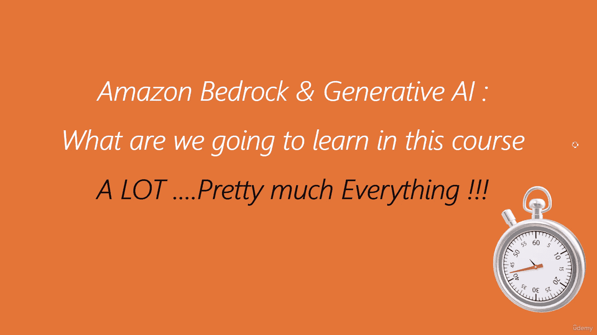
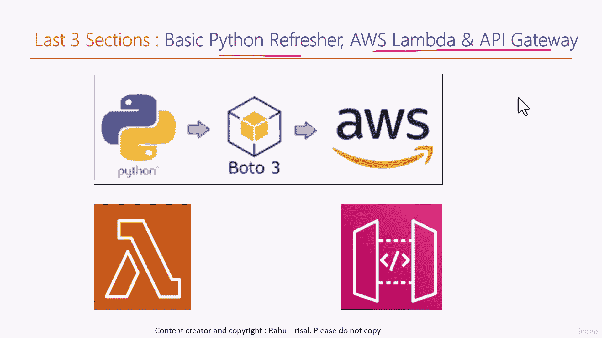

# 🎓 生成式AI在AWS上：Amazon Bedrock、RAG与KIRO [2026]：第1章：课程介绍

📘 **课程概述**

在本节课中，我们将要学习的是这门课程的整体学习路线图。我们会把后面每一个章节的核心主题快速浏览一遍，让你在正式动手之前，先知道整个课程会带我们走到哪里。这个章节本身就是整个课程的第1节，也就是介绍性内容，所以内容不会太深，主要是建立一个全局概念。你可以把这节课看作是一张地图，后续所有章节都会沿着这张地图展开。下面我们就按照课程的顺序，一节一节地看过去。

🎯 **第1节：课程结构介绍**

课程的第1节是入门部分，当前这一讲就属于第1节。在这个部分里，我们不会立刻进入技术细节，而是先把课程的整体结构讲清楚，让你知道接下来要面对的内容大概是什么。这样做的目的是让你在学习过程中始终知道自己处在哪个阶段。

🧠 **第2节：生成式AI的演进**

从第2节开始，我们就要进入正式的知识学习了。这一节的主题是生成式AI的演进过程，而且我们会从最基础的概念开始讲起。以下是我们在这个部分要了解的核心概念列表：

- 人工智能是什么：简单来说，就是让机器具备感知、推理、决策等类似人类的能力。
- 机器学习是什么：机器学习是人工智能的一个分支，核心思想是让机器从数据中自动总结规律，而不是靠人工逐一编写规则。
- 监督学习：在一组带有标签的数据上训练模型，让模型学会输入到输出的映射。可以用公式表达为：给定训练集 \(D = \{(x_i, y_i)\}_{i=1}^N\)，目标是学习一个函数 \(f\)，使得 \(f(x_i)\) 尽量接近 \(y_i\)。
- 无监督学习：数据没有标签，模型自己去发现数据中隐藏的结构，比如聚类或者分布。形式化地说，给定数据 \(X = \{x_1, x_2, ..., x_N\}\)，我们希望学习数据本身的分布 \(p(x)\)。
- 强化学习：智能体通过与环境不断交互，根据获得的奖励来调整自己的行为，目标是让累积奖励最大化，即 \(R = \sum_{t=0}^\infty \gamma^t r_t\)。

学完这些基础概念之后，我们还会学习人工神经网络。人工神经网络是整个生成式AI的基石，因为后面要讲的基础模型本质上就是非常大规模的神经网络。简单理解，一个人工神经网络的单个神经元可以写成 \(y = \sigma(Wx + b)\)，而多个神经元堆叠起来就能拟合非常复杂的函数。这一部分非常重要，因为理解了神经网络，你才能真正明白生成式AI基础模型是如何工作的。

🤖 **第3节：生成式AI和基础模型的基本概念**



有了第2节的基础之后，第3节我们就要进入生成式AI本身了。这一节会讲解与生成式AI和基础模型相关的一些基本概念。我们首先要弄清楚什么是生成式AI：它是一类能够学习训练数据分布，并据此生成全新内容的模型。用大白话说，就是给模型看大量文字、图片或代码，然后模型能自己写出、画出或改出类似的内容。下面是我们会在第3节中涉及的内容：

- 生成式AI的定义和常见使用场景：比如写文章、做客服对话、生成图片、辅助编程等。
- 生成式AI到底是怎么工作的：核心思想是从数据分布中采样。可以用公式理解为：模型学习数据分布 \(p_{\theta}(x)\)，生成时从这个分布中采样出新的样本 \(x_{\text{new}} \sim p_{\theta}(x)\)。
- 几个关键术语的意思：提示词（prompt）、推理（inference）、补全（completion）、上下文窗口（context window）等。其中，提示词就是用户给模型的输入指令；推理是模型根据输入产生输出的过程；补全是模型生成的输出内容；上下文窗口则决定了模型一次能看到的文本长度。
- 基础模型的关键特征：这些模型通常在海量数据上训练，具备很强的通用能力，并且可以通过微调或提示来适配不同任务。

要理解提示词和补全，你可以把模型看作一个函数：`completion = model(prompt)`。我们会在后面的章节中反复用到这个思维模型。

⚙️ **第4节：深入解析Amazon Bedrock**

第3节建立了基础概念之后，第4节我们就要深入一个具体的AWS服务了，这就是Amazon Bedrock。Amazon Bedrock是AWS目前最重要的生成式AI服务，所以我们会花一整节来仔细研究它。我们要做的事情包括：做一个详细的控制台操作演示，让你看看这个服务长什么样；然后分析Amazon Bedrock的整体架构，搞清楚它各个组件之间是怎么连接的；接下来会讲解它的定价方式；最后还会学习推理参数，也就是那些控制模型输出行为的旋钮。以下是我们需要掌握的推理参数：

- 温度（temperature）：控制输出的随机性。温度越低，输出越确定；温度越高，输出越多变。可以用公式理解为：\(T \to 0\) 时几乎总是选择概率最高的token，\(T\) 增大时概率分布被拉平，随机性变强。
- Top-K：采样时只从概率最高的K个token中挑选，例如Top-K=50，就表示每次都从排名前50的token里采样。
- Top-P：采样时从累积概率达到P的最小token集合中挑选，例如Top-P=0.9，表示只从前90%概率质量的token里采样。

这些参数在实际调用模型时非常常用，以后你调试生成效果的时候一定会用到它们。

🎨 **第5节：第一个动手案例——用Amazon Bedrock生成电影海报**

从第5节开始，我们就要动手做案例了。第一个动手案例是用Amazon Bedrock生成一张电影海报。我们会先提供一个提示词，也就是输入给模型的具体描述，然后模型会根据这段描述生成一张海报图片。在案例中，我们会展示从输入到输出的完整流程：这张图就是通过我们即将构建的应用生成出来的。我们还会搭建一个完整的架构，让你看到这个应用的前后端是如何配合的。这个案例虽然规模不大，但能让你把前面学到的概念串起来。

📝 **第6节：第二个动手案例——制造业文本摘要**

有了第一个案例的练习，第6节我们会做第二个动手案例，这次的主题是面向制造业的文本摘要。在这个案例中，我们要构建一个能够自动总结文本的服务，并且会用到多个AWS组件。以下是我们会使用的核心组件：

- API Gateway：作为外部请求的入口，接收用户的文本输入。
- Lambda：运行具体的业务逻辑，比如调用模型完成摘要。
- Cohere基础模型：负责真正生成摘要内容，它来自Amazon Bedrock提供的模型库里。

简单来说，用户把文本通过API Gateway发给Lambda，Lambda再去调用Cohere模型，最后把摘要结果返回给用户。这个架构非常典型，也是后面很多案例的基础。

💬 **第7节：构建聊天机器人**

第6节我们学会了如何用几个AWS服务组合出一个文本摘要应用，第7节我们会更进一步，构建一个聊天机器人。这个聊天机器人会用到Streamlit来搭建界面，用LangChain来组织对话逻辑，用Amazon Bedrock提供底层的大语言模型。接下来我们要看的是这一节的架构：整个系统由前端界面、对话逻辑层和模型层组成。在LangChain里，我们会用到像对话链（conversation chain）和记忆（memory）这样的组件，让机器人能够记住之前聊过什么，而不是每次对话都像第一次见面。

🔍 **第8节：构建基于RAG的问答应用**

第7节我们构建了能记住上下文的聊天机器人，第8节我们要在这个基础上做一个更强大的问答应用，并且引入一个非常重要的概念：RAG，也就是检索增强生成（Retrieval-Augmented Generation）。RAG的基本思路是：先从一个向量数据库中检索出和问题相关的文档片段，再把这些片段和问题一起交给大模型，让模型基于检索到的内容生成答案。可以用下面的伪代码表示这个过程：

```text
retrieved_chunks = vector_store.search(query)
answer = LLM(prompt = query + retrieved_chunks)
```

这个应用我们会用Streamlit做前端，用LangChain组织流程，用Facebook AI相似度搜索作为向量存储，用Amazon Bedrock的基座模型来生成答案。整个架构会把“检索”和“生成”两个环节清晰地分开，这也是RAG应用的标准结构。

📚 **第9节：构建无服务器E-Learning应用与Bedrock知识库**

第8节我们已经接触了向量检索，第9节我们还要换一个更省事的方式：直接使用Amazon Bedrock的知识库功能来构建一个无服务器的E-Learning应用。所谓无服务器，就是说我们不需要自己去管理服务器，只需要把各个服务连接起来就行。以下是我们会用到的AWS组件：

- API Gateway：接收用户的请求。
- Lambda：执行后台逻辑。
- Claude基础模型：负责生成学习相关的回答或内容。
- Bedrock知识库：负责管理文档和检索。

这里特别要说明的是，Bedrock的知识库（Knowledge Base）其实就是AWS提供的一项托管式RAG服务，也就是说，我们自己不需要搭建向量数据库和检索流程，AWS已经把这些能力打包好了。这能大大降低搭建RAG应用的门槛。

🏦 **第10节：使用Amazon Bedrock Agents构建零售银行Agent**

第9节我们用托管知识库实现了一个应用，第10节我们又要引入一个新能力：Agent，也就是智能体。我们将使用Amazon Bedrock Agents来构建一个零售银行场景的Agent。这个Agent可以理解用户的问题、调用必要的工具或API，最终完成像查询余额、转账、处理客服请求这样的任务。我们会看一下这个Agent的整体架构，了解它是如何与Bedrock以及外部系统交互的。从一个简单的文本摘要应用一路做到能处理复杂任务的Agent，你会发现我们的应用在一步步变聪明。

🔄 **第11节：生成式AI项目生命周期与行业用例**

第10节我们完成了一个Agent应用，接下来的内容会更偏工程和策略。我们会进入生成式AI项目生命周期的高级概念，看看一个真实的生成式AI项目通常要经历哪些阶段。这些阶段包括问题定义、数据准备、模型选择、模型优化、评估、部署和监控等。除此之外，我们还会看一些跨行业的典型用例，比如金融、医疗、制造、教育等领域是怎么使用生成式AI的。这些内容能帮助你从“写代码”的视角提升到“做项目”的视角。

🧭 **第12节：如何选择基础模型**

第11节我们知道了项目生命周期里有模型选择这一步，所以第12节我们专门来解决一个问题：根据我们的使用场景，到底应该选哪个基础模型？这一节会讲解在选择基础模型时需要考虑的各种因素，包括模型能力、成本、延迟、上下文窗口、许可证和性能等。我们还会做一个关于基础模型选择标准的实操，用Amazon Bedrock的模型评估服务来帮助我们识别最合适的模型。这门服务会自动对比不同模型的表现，给出客观数据，省去人工感觉。

✍️ **第13节：提示工程理论与实践**

选择完模型之后，我们要学会怎么跟模型说话，所以第13节的主题是提示工程。我们会同时学习理论和实操，先了解哪些因素会影响提示设计，比如指令是否清晰、有没有示例、模型本身的风格偏好等。然后我们会学习各种提示设计技术，以下是几种最基础的技术：

- 零样本提示（zero-shot prompt）：直接给模型一个任务描述，不给任何示例。例如：“把这句话翻译成中文：Hello world”。
- 少样本提示（few-shot prompt）：在提示里先给几个输入输出示例，再让模型完成新任务。例如先给“苹果 -> apple”，再让模型翻译“香蕉”。
- 链式思考提示等进阶技巧：引导模型一步一步推理，通常能得到更稳定的答案。

此外，我们还会学习如何为Stability AI模型和Claude基础模型编写高质量的提示词。不同模型的提示风格不同，掌握了这些最佳实践，你的输出质量会明显提升。

🔧 **第14节：微调基础模型**

第13节我们主要靠提示来影响模型输出，但有时候提示不够用，我们还需要微调基础模型。第14节我们会学习如何对基础模型进行微调，首先要搞清楚微调的架构是什么样的。所谓微调，就是在已有预训练模型的基础上，用你自己的任务数据再做一轮训练，让模型更贴合特定场景。可以表示为：给定任务数据集 \(D_{\text{task}}\)，在基础模型参数 \(\theta\) 上继续优化，目标是 \(\theta^* = \arg\min_\theta \mathcal{L}(\theta; D_{\text{task}})\)。我们还会做关于微调基础模型的实操练习，让你亲手跑一遍这个流程。

💻 **第15节：用生成式AI生成代码**

微调模型可以让模型更擅长特定任务，第15节我们把生成式AI用在软件开发上：用AI生成代码。要实现这个功能，我们会使用Amazon CodeWhisperer，这个工具现在已经更名为Amazon Q Developer。它可以像智能助手一样，在你写代码的时候自动补全代码片段，或者根据自然语言描述生成对应代码。这一节会演示如何在开发环境中使用它，对于提高编码效率非常有帮助。

📖 **最后三节：预备知识复习**

如果你在看到这里的时候，发现自己对Python、AWS Lambda或者API Gateway还不太熟悉，不要担心。在课程的最后三个部分，我会给你提供一份复习内容，帮助你快速上手。这份复习材料会涵盖Python基础知识、AWS Lambda函数怎么编写和部署，以及API Gateway怎么配置和调用。它的目的就是让你能够跟上后面动手案例的节奏，所以如果你已经熟悉这些内容，完全可以跳过，如果不太熟，建议先过一遍。

🏁 **总结**



本节课中，我们一起学习了这门课程的整体路线图。我们从最基础的人工智能和机器学习概念出发，一路了解了生成式AI与基础模型、Amazon Bedrock服务本身，以及从电影海报生成、文本摘要、聊天机器人、RAG问答、E-Learning应用到Agent的一系列动手案例。我们还了解了生成式AI项目生命周期、基础模型选择、提示工程、模型微调和代码生成等进阶主题。最后，我们还为不熟悉Python和AWS基础服务的学习者准备了复习章节。现在你已经知道接下来每一步会学什么了，以上就是本讲的全部内容，我们下一讲见，谢谢。
