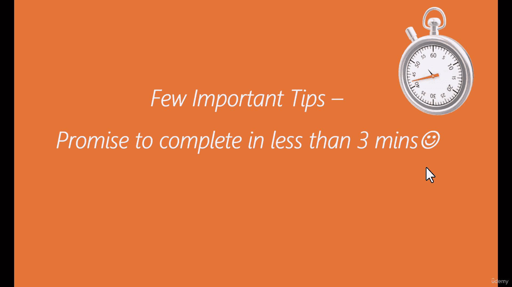
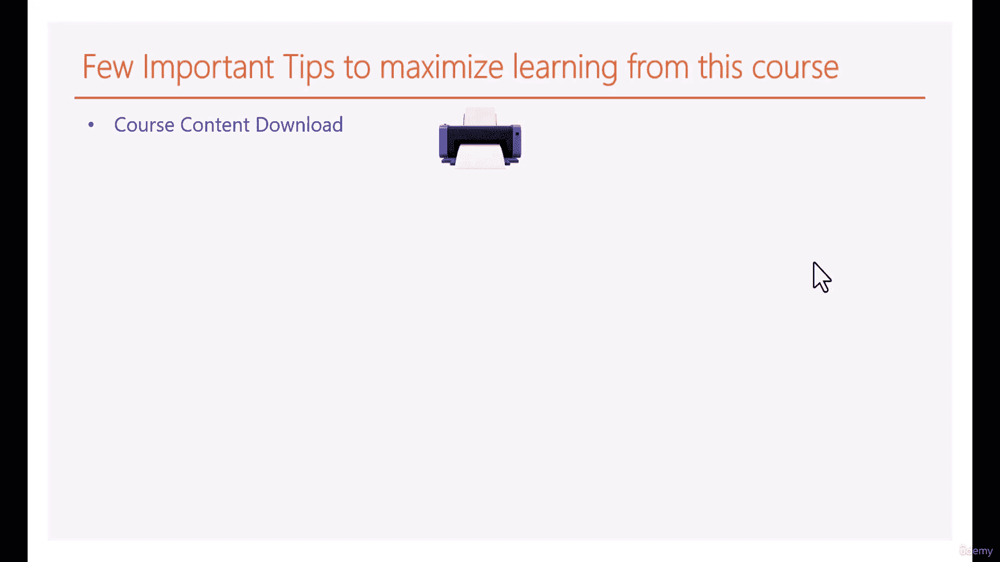
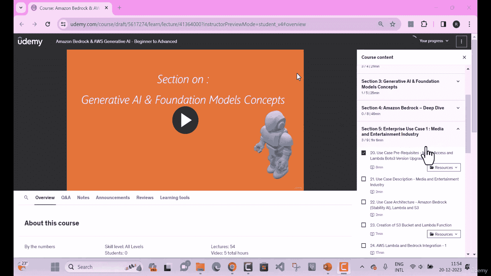
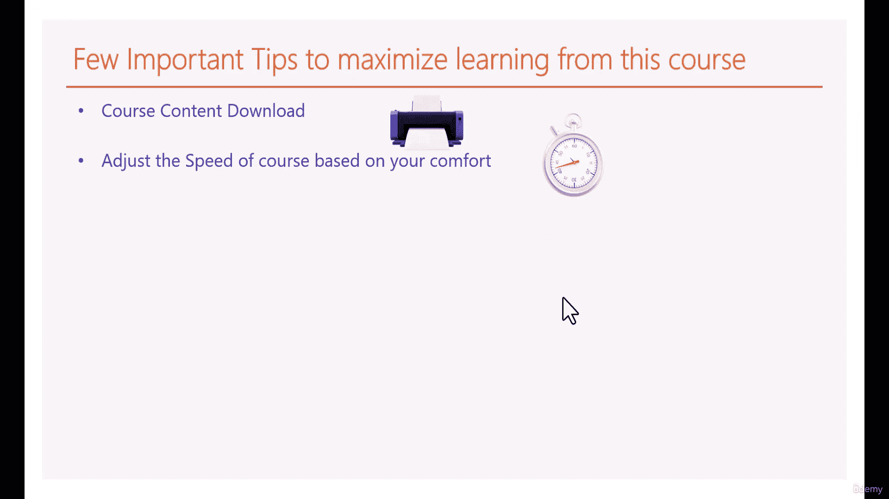
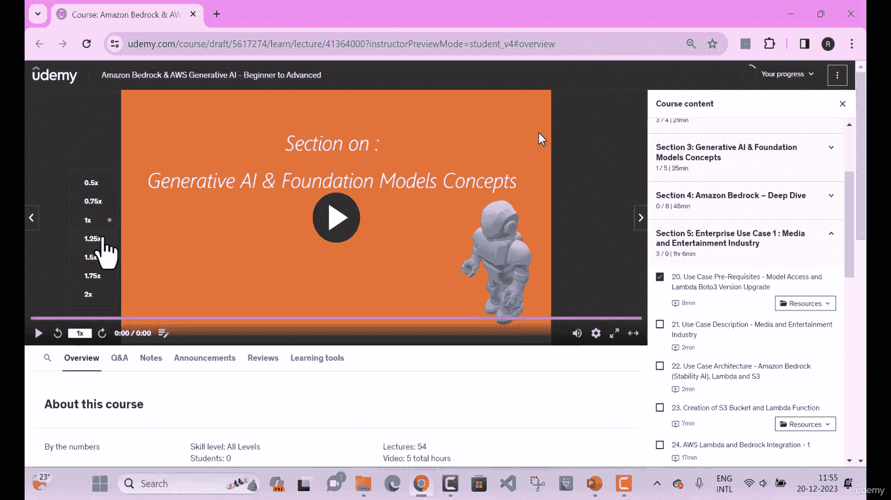
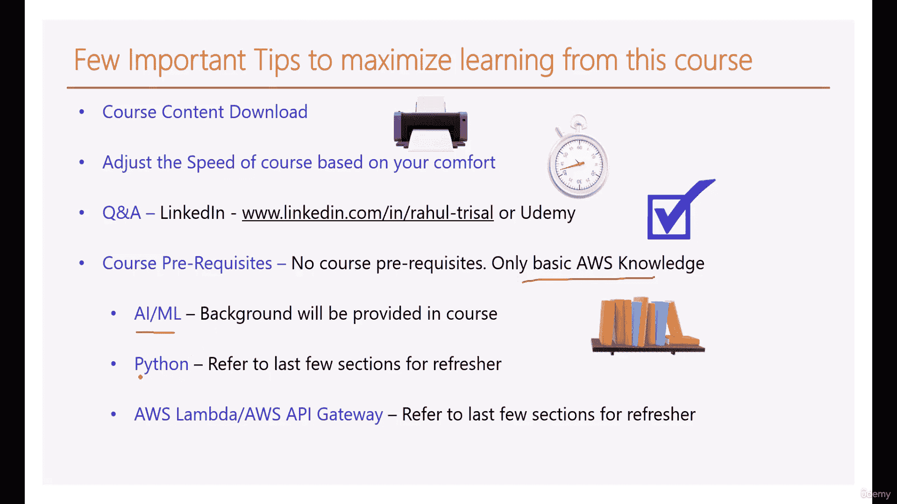
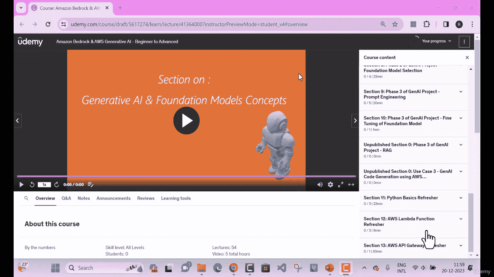
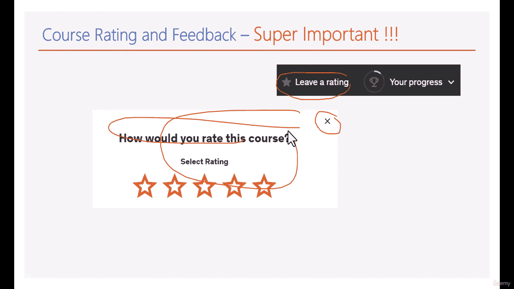

# 🎓 生成式AI在AWS上：Amazon Bedrock、RAG与KIRO [2026]：第1部分 第2讲：优化学习的技巧与下载课程内容

在本节课中，我们将学习如何更好地使用这门课程，包括下载课程材料、调整播放速度、了解先修知识，以及如何通过评分和反馈帮助课程改进。这些内容虽然看起来很简单，但掌握它们能让你学习效率翻倍，少走很多弯路。接下来，我会逐一为你详细说明。

在我们正式开始学习生成式AI和AWS之前，我想先给你几个重要的提示，这些提示能帮助你最大化地从这门课程中获得价值。你可能会觉得这些内容太基础，但请相信我，花几分钟了解这些细节，会让之后的学习顺畅很多。毕竟，良好的开端是成功的一半，把准备工作做好，后面的路才会越走越宽。

## 第一个技巧：如何下载课程内容

首先，我们来看看如何下载课程内容。这门课程中，有两类内容可以下载，它们分别服务于不同的学习阶段。你不需要一次性把它们全部下载下来，而是可以根据自己的需要，在合适的时机去获取对应的资料。下面我就把这两类内容详细讲清楚，你一看就能明白。

### 第一类：PowerPoint幻灯片

第一类是PowerPoint幻灯片，也就是我在讲课过程中使用的课件。你可以在第一节“必看讲座”中找到这些幻灯片，然后从资源文件夹里下载它们。这些幻灯片是课堂演示的核心，里面包含了所有的重要概念、架构图以及关键代码片段。如果你是那种喜欢在课前预习或者课后复习的人，下载这些幻灯片会特别有用。你甚至可以把它们打印出来，在上面做笔记，这样记忆会更加深刻。

### 第二类：特定章节的配套资源

第二类内容则是与特定章节配套的资源文件。比如，你可以在“企业用例1”这个章节里，找到一些Python文件。这些文件通常会在该章节自己的资源文件夹中，所以你需要进入相应的章节内部去查找。这些Python文件可不是摆设，它们能帮你把理论变成实际可运行的代码，让你亲手体验每一个用例是如何实现的。因此，当你在学习某个具体章节时，一定要记得去资源文件夹里看看，说不定会有惊喜等着你。

## 第二个技巧：调整课程播放速度

接下来，我们来聊聊课程播放速度的问题。有些同学可能会觉得我讲课的语速有点快，而另一些同学呢，又可能觉得有点慢。这很正常，因为每个人的接受能力和学习习惯都不一样。幸运的是，你可以在每节课的播放界面里找到一个“播放速率”（Playback Rate）的选项。如果你觉得我讲得太快，跟不上节奏，你可以把速度调慢到0.75倍速，这样每个字都能听得清清楚楚。相反，如果你觉得我讲得太慢，听着有点着急，那你也可以把速度提高到1.25倍速甚至1.5倍速，这样能节省不少时间。总之，这个功能就是让你根据自己的实际情况灵活调整，找到最舒服的听课节奏。记住，适合自己的才是最好的，千万别因为速度不合适而影响了学习体验。

## 第三个技巧：课程先修知识

现在，我们来谈一谈课程的先修知识。这一点可能让不少新手同学感到紧张，但其实完全不用。这门课程没有任何硬性的先修要求，你只需要具备一点点基础常识就够了。如果你完全不了解人工智能（AI），也没有关系，我在课程里会提供一个全面的概述，帮助你快速入门。这部分内容就是专门为零基础的同学准备的，所以你可以放心大胆地跟着学。另外，如果你没有任何Python编程经验，或者不熟悉AWS Lambda和API Gateway，我也为你准备了额外的补充内容。我在这门课程的最后部分，加入了一些Python基础速成、AWS Lambda函数速成以及API Gateway速成讲座。这些内容来自我的另一门关于AWS服务器的Udemy课程，它们能帮助你掌握构建端到端用例所需的基础技能。你可以把这部分内容当作“急救包”，在需要的时候随时回来看一看，保证让你不掉队。所以，不论你之前是否有经验，这门课程都能让你循序渐进地学会所有东西。

## 第四个技巧：课程评分与反馈

最后，也是同样重要的一点，就是课程的评分和反馈。你的评分和反馈对这门课程来说超级重要，因为它们能帮助未来的学习者决定要不要选择这门课程。想象一下，如果评分很高，评论区一片好评，那后来的同学就会更有信心；如果评分很低，大家可能就不敢选了。所以，在你学习的过程中，Udemy可能会弹出一个窗口，邀请你为这门课程打分。如果你已经准备好打分了，那就请你认真地给这门课程一个评分吧。如果你还没准备好，也可以先点击窗口上的“叉号”按钮关掉它，等你想好了，再去页面右上角点击“留下评分”（Leave Rating）按钮，然后给课程打分。不过，我在这里有一个小小的请求：请不要为了关掉弹窗而随便乱打分。因为随意给出一个随机评分，真的会严重影响这门课程的声誉和排名。你的每一个真实评价都对课程的发展至关重要。所以，请大家务必认真对待打分这件事，你的反馈也能帮助我改进课程内容，让今后的课程越来越好。

## 结束语与祝福

我希望你能在这门课程中获得良好的学习体验。如果你有任何问题或者任何建议，我都非常乐意把它们纳入课程中，让课程变得更完善。感谢你的支持，我们下节课见。记住，遇到不懂的地方随时提问，这才是学习进步的正确方式。加油，我们一起探索生成式AI的世界吧！

## 总结

本节课中，我们一起学习了四个优化学习效果的关键技巧：第一，如何下载课程中的幻灯片和特定章节资源；第二，如何根据自身需求调整课程播放速度；第三，了解课程没有硬性先修要求，并且有Python和AWS Lambda等补充材料可供学习；第四，如何正确且负责任地为课程评分和反馈。这些技巧看似琐碎，但每一项都能实实在在地提升你的学习体验。希望你在接下来的课程中能学得开心，收获满满。我们下一讲见！
