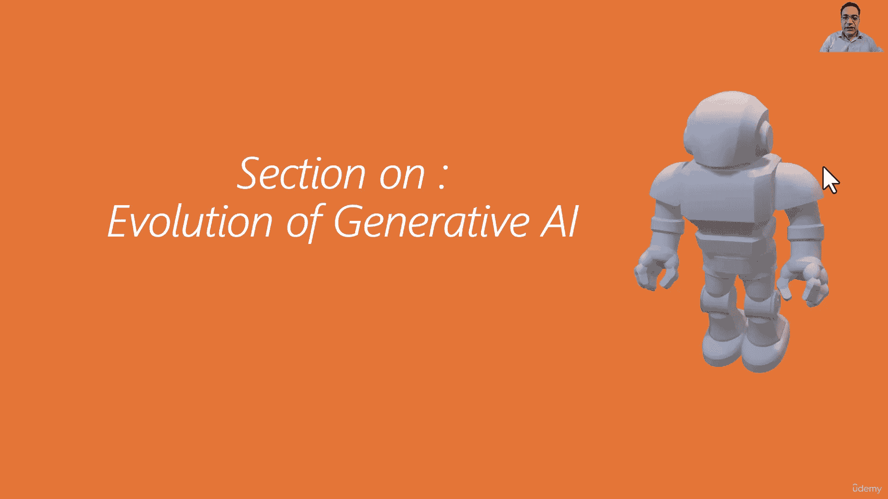

# 🧠 Udemy - Generative AI on AWS - Amazon Bedrock, RAG & KIRO [2026]：Part1 P03 4：什么是人工智能

在本节课中，我们将要学习生成式人工智能的演进。更准确地说，在讨论“什么是生成式人工智能”之前，我们会先熟悉几个关键术语，包括什么是人工智能、机器学习、深度学习。每个术语都会在后续幻灯片里深入展开，现在先建立一个高层理解。你可以把这节课当成一张地图，先知道大致位置，后面再逐个区域细看。

## 🗺️ Udemy - Generative AI on AWS - Amazon Bedrock, RAG & KIRO [2026]：Part1 P03 4.1：关键术语总览

上一节我们说明了本节课的目标，本节中我们来看看几个关键术语之间的层级关系。为了让你一眼看懂，可以先用一个公式表示它们谁包含谁：



\[
\text{人工智能（AI）} \supset \text{机器学习（ML）} \supset \text{深度学习（DL）} \supset \text{生成式AI（GenAI）}
\]

这个公式的意思是，人工智能范围最大，机器学习是它的一个分支，深度学习又是机器学习的分支，生成式人工智能再是深度学习模型中的一个分支。下面先给出这些术语的高层说明，后续内容会逐项展开。

以下是几个关键术语的高层说明：

- **人工智能**：用简化的定义来说，人工智能是让机器模仿人类行为的科学。
- **机器学习**：机器学习是人工智能的子集或分支，重点在于使用数据与算法。数据可以是结构化数据，也可以是非结构化数据；算法可以理解为完成一组任务的计算机程序。也就是说，机器学习用数据和算法让机器模仿人类行为。
- **深度学习**：深度学习是机器学习的子集，使用神经网络来执行任务。神经网络的设计思路参考人脑的工作方式，这部分会在后面的幻灯片里更详细地讨论。
- **生成式AI**：生成式AI是深度学习模型的一个子集，能够生成高质量的文本、图像和视频。它之所以叫生成式AI，是因为它可以生成高质量内容。

为了更直白地理解“算法”和“系统”的关系，可以看下面这段伪代码：

```text
算法 = 完成一组任务的计算机程序
AI系统 = 使用数据 + 算法 -> 让机器模仿人类行为
```

上一节我们介绍了关键术语的层级关系，本节中我们来看看人工智能本身更具体的定义。

## 🤖 Udemy - Generative AI on AWS - Amazon Bedrock, RAG & KIRO [2026]：Part1 P03 4.2：人工智能的定义

上一节我们介绍了几个关键术语的层级关系，本节中我们来看看人工智能本身更具体的定义。前面已经讨论过，人工智能是制造智能机器的科学与工程，尤其是制造智能计算机程序。这些程序要模拟人类智能，并完成决策。换句话说，任何能够模仿人类智能、并像人类一样做出决策的机器，都可以称为人工智能。

这个概念听起来范围很大，但你可以先抓住两个关键词：模仿人类智能，以及像人一样做决策。只要一个机器能做到这两点，它就可以被放进人工智能这个大框里。这个定义不要求机器真的有人类的意识，只要求它的外在行为表现出类似人类的智能和决策能力。

## 🚗 Udemy - Generative AI on AWS - Amazon Bedrock, RAG & KIRO [2026]：Part1 P03 4.3：人工智能的常见例子

上一节我们介绍了人工智能的定义，本节中我们来看看人工智能的一些常见例子。这些例子能帮助你把抽象定义和日常应用对应起来。

以下是人工智能的常见例子：

- **自动驾驶汽车**：自动驾驶汽车从传感器获取数据，然后像人类一样做出实时决策。
- **推荐引擎**：例如Netflix和Amazon的推荐引擎，它们使用人工智能，根据你的观看历史和浏览历史，为你提供接下来可以看什么的定制化洞察。

这两个例子都体现了人工智能的核心：接收数据，并像人一样做出判断或推荐。到这里，我们已经把人工智能的定义和例子串起来了。这就是人工智能的基本含义，希望这些内容对你有用。下节课见，谢谢。

## ✅ Udemy - Generative AI on AWS - Amazon Bedrock, RAG & KIRO [2026]：Part1 P03 4.4：本节总结


上一节我们看了人工智能的常见例子，本节中我们对整节课做一个小结。本节课中我们一起学习了生成式人工智能演进前需要掌握的关键术语，包括人工智能、机器学习、深度学习与生成式AI的层级关系；也学习了人工智能是制造智能机器、尤其是智能计算机程序的科学与工程，它模拟人类智能并做出决策；最后还看了自动驾驶汽车和推荐引擎这两个常见例子。希望这些内容有用，下节课见，谢谢。
