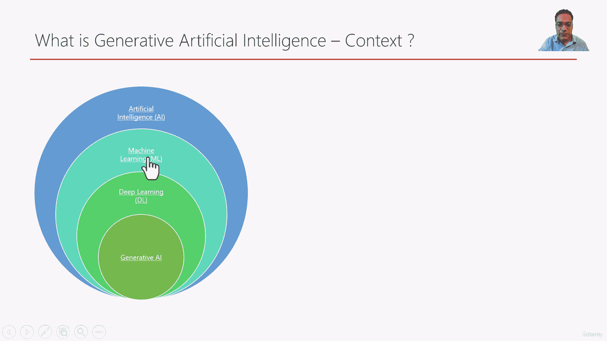
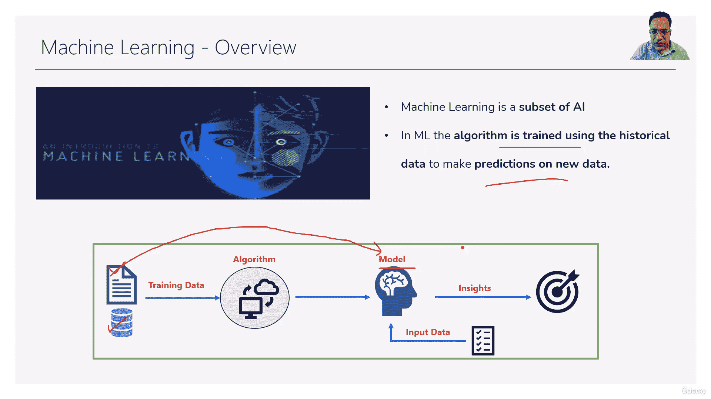
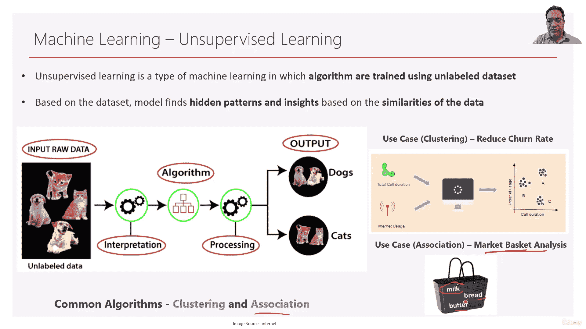
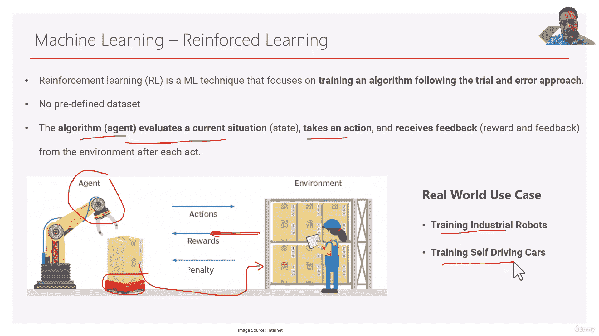
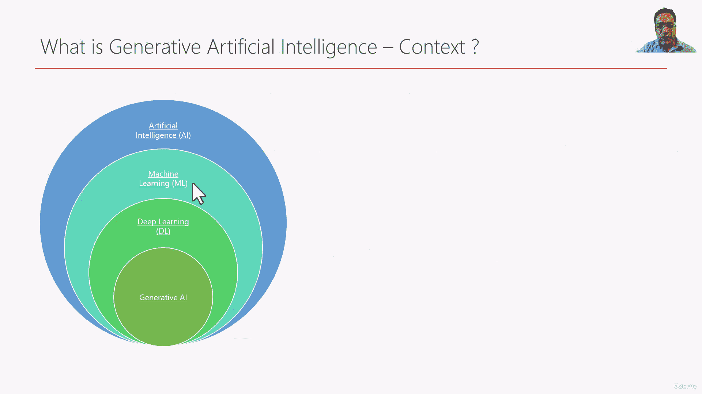

## 🤖 AWS生成式AI实战课程：04-5：机器学习概览与三大学习方法

在本节课中，我们将要学习机器学习的基本概念、工作流程，以及监督学习、无监督学习和强化学习三大类方法。前面我们已经讨论过人工智能，本节我们来看看机器学习在人工智能中的位置。你可以把这一节理解为后面生成式AI和基础模型内容的地基：只有先弄懂机器学习怎样从历史数据里总结规律，后面理解基础模型、RAG等内容才会更顺畅。接下来，我们会先说明什么是机器学习，再说明它的基本工作流程，然后逐一介绍三类机器学习方法，并配上常见算法和真实例子。



上一节介绍了人工智能，本节我们来看看机器学习的定义。机器学习是人工智能的一个子集。在机器学习中，算法会使用历史数据进行训练，然后对新的数据进行预测。换句话说，机器学习关注的是让计算机从历史经验中学习，再把学到的规律用于新情况，而不是把每一步规则都手动写死。这个定义看起来简单，但它已经点出了三个关键角色：算法、训练数据和模型，下面我们就顺着这三个角色看工作流程。

### 🧩 AWS生成式AI实战课程：04-5.1：机器学习的基本工作流程

上一节我们明确了机器学习的定义，本节中我们来看看它的基本工作流程。这里有一个算法，前面说过，算法本质上是一个完成特定任务的计算机程序。你把训练数据喂给这个算法，这些训练数据可以来自互联网的非结构化数据，也可以来自组织数据库中的结构化数据。算法加上训练数据之后，会生成一个独特的模型。这个过程可以用下面的核心概念来描述：

```
model = train(algorithm, training_data)
insights = model(input_data)
```

生成模型之后，你可以把输入数据提供给这个模型，模型会生成一些洞察或结果。如果这些洞察符合你的预期，你就可以在未来使用这个模型；如果这些洞察不符合你的预期，你可以用更多训练数据继续训练这个模型，直到洞察符合你的预期。这个“训练—评估—再训练”的循环很直白：模型不是一次就永远定型的，它需要根据结果不断调整。下面是这个循环的简化描述，方便你记住流程：

- 训练数据加算法，生成模型。
- 输入数据加模型，生成洞察。
- 洞察符合预期，就可以使用模型。
- 洞察不符合预期，就增加训练数据继续训练。

接下来，我们进入机器学习的分类。机器学习基本上有三个大类：第一类是监督学习，第二类是无监督学习，第三类也是最后一类是强化学习。理解这三类方法的高层概念很重要，因为它们是后面要讨论的基础模型的基线，而这些基础模型会用于生成式AI。下面先列出这三类方法，方便你建立整体地图：

- 监督学习：使用带标签的数据训练算法。
- 无监督学习：使用不带标签的数据训练算法，让算法寻找隐藏模式。
- 强化学习：通过试错和反馈来训练算法。

### 🏷️ AWS生成式AI实战课程：04-5.2：监督学习



上一节我们列出了机器学习的三大类方法，本节中我们来看看第一类：监督学习。在监督学习中，算法使用带标签的数据。所谓带标签的数据，基本含义是你有原始数据，并且在把数据喂给算法之前，先给这些数据提供标签或进行标注，这样的数据集就是带标签数据集。你可以把标签理解为“标准答案”，算法在学习时能对照标准答案调整自己。监督学习的核心概念可以用下面的公式描述：

```
labeled_data = {(x_i, y_i)}
model = train(algorithm, labeled_data)
y_pred = model(x_new)
```

我们来看一个图示化的过程。图中有一个带标签的数据集，你在把数据拟合到算法之前先识别标签，也就是告诉算法六边形长什么样、三角形长什么样、正方形长什么样。然后你把所有这些带标签的数据提供给算法，算法在这些带标签数据上训练，并生成一个独特的模型。模型准备好之后，你提供测试数据，模型就能根据训练结果判断输入数据是正方形、三角形还是六边形。这个过程说明，监督学习的关键在于“先告诉算法答案，再让算法学会自己判断”。下面用列表概括这个流程：

- 准备原始数据。
- 给原始数据添加标签或标注。
- 把带标签数据喂给算法进行训练。
- 用测试数据检验模型能否正确识别。

在监督学习中，有两种常见算法：第一种是分类，第二种是回归。下面先列出这两种算法，再分别展开说明：

- 分类算法：把输入数据分到预定义类别中。
- 回归算法：评估一个变量变化时另一个变量受到的影响。

#### 📧 AWS生成式AI实战课程：04-5.2.1：分类算法与垃圾邮件过滤

上一节我们列出了监督学习中的分类和回归，本节中我们来看看分类算法。分类算法做的事情是把输入数据分类到一个预定义类别中。比如你喂一条输入数据给它，它会把这个数据分类为类别A或类别B。原文这里还有一个含义不太清晰的片段“Fture predom”，可以理解为与预测有关，但分类算法的核心动作仍然是先把输入分到预定义类别。分类的核心概念可以写成：

```
y_pred = classifier(x)
y_pred ∈ {类别A, 类别B, ...}
```

真实世界中一个很常见的分类算法用例是Gmail垃圾邮件过滤器。图中有一个机器学习模型，它已经在带标签数据集上训练过。这个模型接收已知的垃圾邮件信号作为输入，例如“3”和其他关键词、用户反馈、内容分析等。然后，基于训练中接收到的数据，它可以把收到的邮件分类到收件箱或垃圾邮件文件夹。这个例子很直观：模型不是凭感觉判断，而是根据训练时见过的带标签样本和信号来做分类。下面列出这个例子的关键步骤：

- 用带标签数据训练垃圾邮件过滤模型。
- 输入已知垃圾邮件信号，例如关键词、用户反馈和内容分析。
- 模型根据训练结果判断邮件去向。
- 邮件被分到收件箱或垃圾邮件文件夹。

#### 📈 AWS生成式AI实战课程：04-5.2.2：回归算法与销售预测

上一节我们看了分类算法，本节中我们来看看回归算法。假设有两个变量A和B，A是自变量，B是因变量，并且B依赖A。回归算法要做的是评估当A变量变化时，B会受到什么影响。回归算法的一个常见用例是预测。图中可以看到广告支出这个例子：你花90美元做广告，销售额增加100。你把所有这些输入数据喂进去并训练模型，模型就能评估广告支出变化时销售额会怎样变化。回归的核心概念可以写成：

```
B = f(A)
```

这里的A可以理解为广告支出，B可以理解为销售额。回归模型学习的是两者之间的关系，然后用这个关系做预测。下面用列表概括回归算法的典型用法：

- 确定自变量和因变量。
- 收集历史数据并训练模型。
- 让模型评估自变量变化对因变量的影响。
- 用模型预测未来结果，例如广告支出变化后的销售变化。

到这里，监督学习的高层概览就讲完了。我们知道了监督学习使用带标签数据，常见算法是分类和回归，分类用于把数据分到预定义类别，回归用于评估变量之间的影响并做预测。接下来，我们转向另一种机器学习技术，也就是无监督学习。

### 🧲 AWS生成式AI实战课程：04-5.3：无监督学习

上一节我们介绍了监督学习，本节中我们来看看无监督学习。在无监督学习中，算法使用不带标签的数据集进行训练。所谓不带标签的数据集，指的是原始数据中没有定义标签，也没有做任何标注。模型拿到这些原始数据后，要基于数据之间的相似性找出隐藏的模式和洞察。你可以把无监督学习理解为“不给标准答案，让算法自己从数据里找共同点”。无监督学习的核心概念可以用下面的代码描述：

```
model = train(algorithm, unlabeled_data)
groups = model(raw_data)
```

我们来看这个过程如何工作。图中我们把不带标签的数据提供给算法，这些原始输入数据是猫和狗混合在一起的图片。我们把数据喂给算法后，算法会解释数据，然后进行一些处理，最后生成一个输出，把图片自动分类成狗和猫。这个分类是利用数据中的相似性完成的。下面用列表概括无监督学习在这个例子中的流程：

- 准备不带标签的原始数据。
- 把原始数据喂给算法。
- 算法解释并处理数据。
- 算法根据相似性自动把图片分成狗和猫等组。

在无监督学习中，有两个关键算法：第一个是聚类，第二个是关联分析。下面先列出这两个算法，再分别说明：

- 聚类：根据某些相似性把输入数据分到一个或多个组中。
- 关联分析：寻找数据中两个变量或特征之间的关系。

#### 📊 AWS生成式AI实战课程：04-5.3.1：聚类与电信客户流失

上一节我们列出了无监督学习中的聚类和关联分析，本节中我们来看看聚类。聚类会依据某些相似性，把输入数据分类到一个或多个组中，就像前面猫狗图片的例子那样。聚类的核心概念可以写成：

```
cluster = cluster_model(x)
cluster ∈ {A, B, C, ...}
```

我们来看一个常见的行业用例。在聚类中，可以用它来降低电信组织的客户流失率。这个用例的工作方式是：把所有客户的总通话时长以及互联网使用情况喂给算法，或者喂给已经开发好的模型。模型根据输入进来的原始数据，按照数据中的某些相似性创建不同的集群。得到A、B、C等不同集群之后，你就可以向每个群体发送定制化的优惠。这个例子的重点在于，聚类不是提前告诉你每个客户属于哪一类，而是让模型从数据中找出相似客户群，再由业务方针对不同群体采取不同策略。下面列出这个用例的关键步骤：

- 收集客户总通话时长和互联网使用数据。
- 把原始数据输入聚类模型。
- 模型根据相似性创建不同客户集群。
- 针对不同集群发送定制化优惠。

#### 🛒 AWS生成式AI实战课程：04-5.3.2：关联分析与市场篮子分析

上一节我们看了聚类，本节中我们来看看无监督学习中的第二个关键算法：关联分析。关联分析中，算法会尝试找出数据中两个变量或特征之间的关系。这个算法最常见的例子是市场篮子分析，零售商常用它来分析哪些产品类别会一起销售。关联分析的核心概念可以用下面的规则形式描述：

```
如果 牛奶，那么 面包 或 黄油
```

我们举一个例子。如果一个人来买牛奶，他最可能同时购买的产品是什么，可能是面包，也可能是黄油。识别出这种关系之后，你就可以把这些产品放在一起销售或组合陈列。下面用列表概括市场篮子分析的思路：

- 收集顾客购买记录。
- 分析哪些产品经常一起出现。
- 找出类似“买牛奶时可能买面包或黄油”的关系。
- 根据关系组合产品或进行捆绑销售。

到这里，无监督学习的关键内容就介绍完了。我们知道了无监督学习使用不带标签的数据，让模型基于相似性寻找隐藏模式，常见算法是聚类和关联分析。接下来，我们看最后一类机器学习技术，也就是强化学习。

### 🎮 AWS生成式AI实战课程：04-5.4：强化学习

上一节我们介绍了无监督学习，本节中我们来看看强化学习。在强化学习中，重点是训练算法，并且采用试错的方法。这里没有预定义的数据集，算法主要从试错中学习。你可以把强化学习理解为“做对了给奖励，做错了给惩罚，算法通过不断尝试找到更好的动作”。强化学习的核心概念可以用下面的代码描述：

```
action = agent(state)
feedback = environment(action)
```

我们来看一个例子。图中有一个算法，或者说一个智能体，可以理解为一个机器人，它需要把橙色盒子推到这一堆箱子的顶层。如果它把盒子推到堆叠的顶层，它就会得到反馈并获得奖励。如果它把盒子推到堆叠的底部，它就会收到惩罚。这个过程就是它学习的方式：算法评估当前情况，采取一个动作，然后接收反馈，反馈可以是正面的，也可以是负面的。下面用列表概括强化学习的试错循环：

- 智能体观察当前情况。
- 智能体采取一个动作。
- 环境返回奖励或惩罚作为反馈。
- 智能体根据反馈调整后续动作。

强化学习有哪些常见用例？第一个就是我们刚刚看到的训练工业机器人。第二个是训练自动驾驶汽车。下面列出这两个常见用例，方便你记忆：



- 训练工业机器人完成推箱子等动作。
- 训练自动驾驶汽车在环境中做出驾驶动作。

这些就是机器学习中的几类技术。到这里，三类方法已经串起来了：监督学习靠带标签数据，无监督学习靠无标签数据找模式，强化学习靠试错和反馈。最后，原文也表达了对本节课的期望，并约定下节课再见。

### ✅ AWS生成式AI实战课程：04-5.5：本节总结





本节课中我们一起学习了机器学习的基本概念、工作流程和三大类方法。我们首先明确了机器学习是人工智能的子集，算法使用历史数据训练，并对新数据进行预测；训练数据和算法一起生成模型，模型再对输入数据生成洞察，洞察不符合预期时可以继续用更多训练数据训练。接着我们学习了监督学习，它使用带标签数据，常见算法是分类和回归，分类把输入分到预定义类别，回归评估变量之间影响并用于预测，我们还看了Gmail垃圾邮件过滤和广告支出与销售预测的例子。然后我们学习了无监督学习，它使用不带标签数据，让模型基于相似性寻找隐藏模式，关键算法是聚类和关联分析，我们还看了电信客户流失和市场篮子分析的例子。最后我们学习了强化学习，它通过试错和奖励惩罚来训练算法，常见用例包括工业机器人和自动驾驶汽车。原文最后希望本节课对你有用，并约定下节课再见，谢谢。

