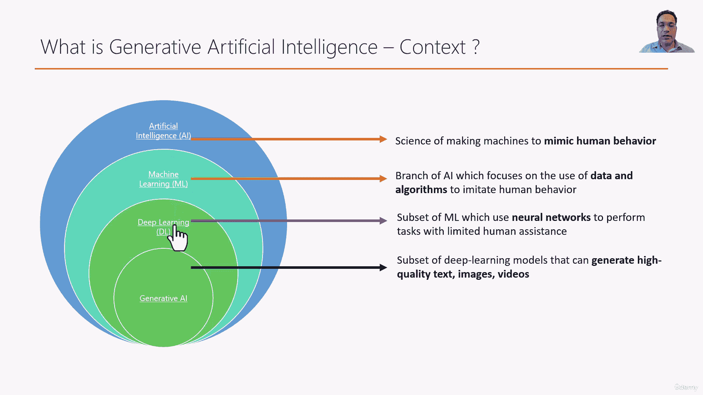
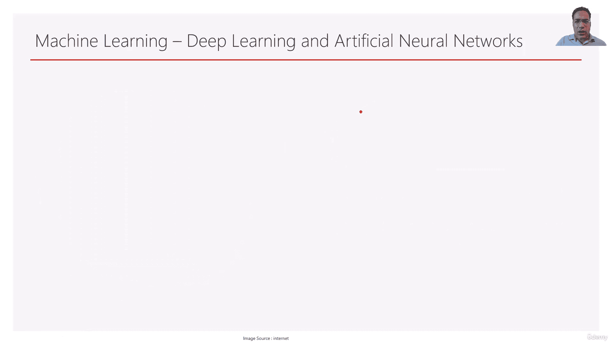
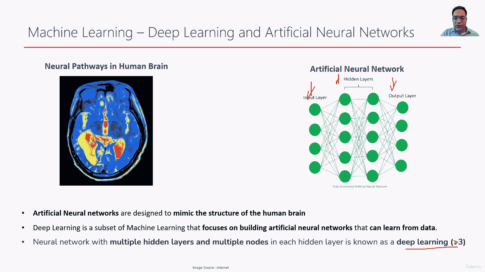
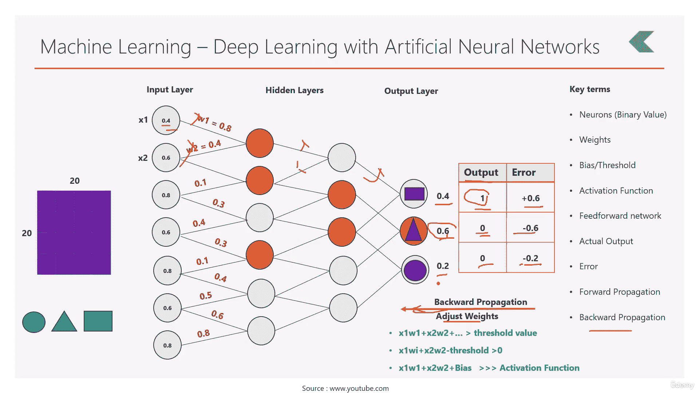

# 🧠 生成式AI在AWS上：第1部分·第5讲：深度学习和神经网络概览





在本节课中，我们将学习机器学习中的一个重要子集——深度学习，并了解支撑它的人工神经网络。我们会先弄清楚人工神经网络是什么，以及它如何模仿人脑工作；然后看看深度学习与传统人工神经网络的区别；接着，通过一个图像识别的例子，一步步梳理神经网络计算、激活和预测的流程；最后，我们会了解当预测出错时，网络如何通过反向传播来调整内部参数。这些基础概念会帮助你在后续课程中更好地理解如何微调 AWS 上的基础模型。

## 1. 从机器学习到深度学习

在深入深度学习之前，我们先要知道一个前置概念——人工神经网络。之所以要先讲它，是因为深度学习说到底就是在构建和训练这类网络。人工神经网络的设计灵感来自人类的大脑，所以我们先来看看人脑是怎么运作的。

我们的大脑由数十亿个神经元（也叫神经细胞）组成。每当我们看到一个物体或一张图像，并成功认出它的时候，大脑中就会有一条神经通路被激活。正是这条被激活的路径，让我们能够识别出眼前的东西。人工神经网络正是模仿了这种模式：它被设计成模拟人脑的结构，用一些“人工神经元”来模拟大脑中神经元的激活和传递过程。

那么，一个人工神经网络具体长什么样呢？我们来看一个典型的示例。

## 2. 人工神经网络的结构

一个典型的人工神经网络由以下几层组成：

- 输入层：位于最前面，由大量神经元组成，每一个神经元本质上就是一个计算单元。
- 隐藏层：位于输入层和输出层之间，可以有一层或多层；每一层又由多个节点组成，这些节点既与输入层相连，也与其他隐藏层相连。
- 输出层：最后连接所有隐藏层，输出最终的结果。

你可以想象成是好几排小球，每一排小球都与下一排的小球用线连起来。第一排是输入，中间的几排是隐藏层，最后一排是输出。每一条连线都代表一个权重，后面我们会讲到权重的作用。



既然搞清楚了结构，下一个问题就是：深度学习跟人工神经网络到底有什么区别？我们来看下一节。

## 3. 深度学习与人工神经网络的区别

深度学习是机器学习的一个子集，它专注于构建能够从数据中学习的人工神经网络。那么，它和普通的人工神经网络有什么区别？判断标准其实很简单：如果整个网络的层数——包括输入层、输出层和隐藏层——超过三层，那么这种技术就被称为深度学习。换句话说，浅层的小网络只能叫人工神经网络，而堆了很多层的网络就进入了“深度学习”的范畴。

这个区分之所以重要，是因为在后面的课程中，我们要学习如何调整基础模型（Foundation Model）。理解人工神经网络的层数和内部权重的含义，会帮助我们掌握微调模型的原理。现在，我们来看看人工神经网络到底是怎么工作的。

## 4. 人工神经网络的工作原理

这一部分稍微有点复杂，但不用担心，我们会用一个简单的图像识别例子把它讲明白。右边列出了我们将要讨论的关键术语，我们先不用管它们，随着例子一步步展开，你自然会理解。

假设有一个神经网络，它的任务是指出输入图像是圆形、三角形还是正方形。输入图像是一个 20×20 像素的正方形，也就是说它由大约 400 个小方块组成。我们可以把这 400 个小方块一一映射到输入层的 400 个节点上：第一个方块对应第一个节点，第二个方块对应第二个节点，第三个方块对应第三个节点，第四个方块对应第四个节点，以此类推。

每个节点的任务都是一样的：给出一个概率分数，判断当前图像属于哪一种形状。比如，第一个节点认为“这是正方形”的概率是 0.4，第二个节点认为是 0.6，第三个节点认为是 0.8。不过，并不是每个节点的判断都同等重要。假设图形出现在图像的中间区域，那么这个区域往往很难确定形状；而如果图形靠近边缘，就更容易判断出正确形状。所以，我们需要给不同的节点分配不同的权重（weight）。

例如，位于边缘的第一个节点权重为 0.8，第二个节点权重为 0.4，第三个节点权重为 0.1，第四个节点权重为 0.3，等等。那么，隐藏层中某个节点的累积分数就可以这样计算：

```
score = x1 * w1 + x2 * w2 + x3 * w3 + ...
```

其中 `x_i` 是前一层传入的值，`w_i` 是对应的权重。举个例子，假设第一个节点传入的 `x1` 是 0.4，`w1` 是 0.8，那么这一项就是 `0.4 * 0.8`；第二个节点 `x2 = 0.6`，`w2 = 0.4`；第三个节点 `x3 = 0.8`，`w3 = 0.1`。把所有这类乘积加起来，就得到了该节点的总值。

计算这些值到底有什么用呢？关键在于，根据输入图像的不同，隐藏层中会有某些节点被激活，而另一些节点不会被激活。为了判断一个节点是否被激活，我们需要用计算出的值与一个阈值比较。如果这个值大于阈值，节点就有机会被激活。用数学语言说，就是：

```
score - threshold > 0
```

有时候我们还会在求和之后加上一个偏置项（bias），这个偏置对同一层所有节点都一样，用来调整偏差。然后，我们会把这个结果送入一个叫做激活函数（activation function）的东西。激活函数的作用是最终决定哪些节点会被激活。比如，在隐藏层中有三个节点被激活了；在下一层中，又有两个节点被激活；最后信号到达输出层。这一条从输入到输出的单向通路，就被称为“神经通路”。

由于信息只能从输入层流向输出层，这种网络结构有时也被称为前馈网络（feed forward network）。

## 5. 前馈网络与反向传播

我们已经看到了神经通路是怎么形成的。假设现在模型给出了这样的输出结果：它预测当前图像有 0.4 的概率是正方形，0.6 的概率是三角形，0.2 的概率是圆形。这显然不对，因为我们输入的实际是一张正方形图片。

这时，我们可以把正确答案告诉模型。因为真实答案是正方形，所以正方形的概率应该是 1；不是三角形，所以三角形的概率就是 0；不是圆形，所以圆形的概率也是 0。由于概率值永远在 0 到 1 之间，我们用 1 表示“是”，用 0 表示“不是”。接着，我们分别计算每个类别的误差：

- 正方形：`1 - 0.4 = 0.6`
- 三角形：`0 - 0.6 = -0.6`
- 圆形：`0 - 0.2 = -0.2`

接下来，要把这些误差值沿着相反的方向传回去。也就是说，误差信息会从输出层传向隐藏层，再传向输入层。在这个过程中，之前定义的那些权重都会被调整，使得下一次模型输出能更接近正确答案。这个过程就叫做反向传播（backward propagation），它本质上是不断调整网络内部权重的过程。

在高层次上理解反向传播非常重要，因为当我们针对自己的生成式 AI 用例来微调 AWS 上的基础模型时，这些模型的内部权重正是通过类似机制来更新的。明白人工神经网络或深度学习模型的权重是怎么变化的，对你后续学习非常有帮助。

## 总结



在本节课中，我们一起学习了深度学习和人工神经网络的基本概念。我们了解到，人工神经网络模仿了人脑神经元的激活方式；知道了它由输入层、隐藏层和输出层组成，并且当层数超过三层时，就可以把它称作为深度学习。我们还通过图像识别的例子，详细推导了神经网络的前馈计算过程，包括加权求和、加偏置、激活函数，以及最终形成神经通路；最后还介绍了反向传播如何利用误差来调整权重。这些知识是后续理解 AWS 上生成式 AI 基础模型微调的重要基础。接下来，我们会在下一讲中继续深入。谢谢大家，我们下节课再见。
