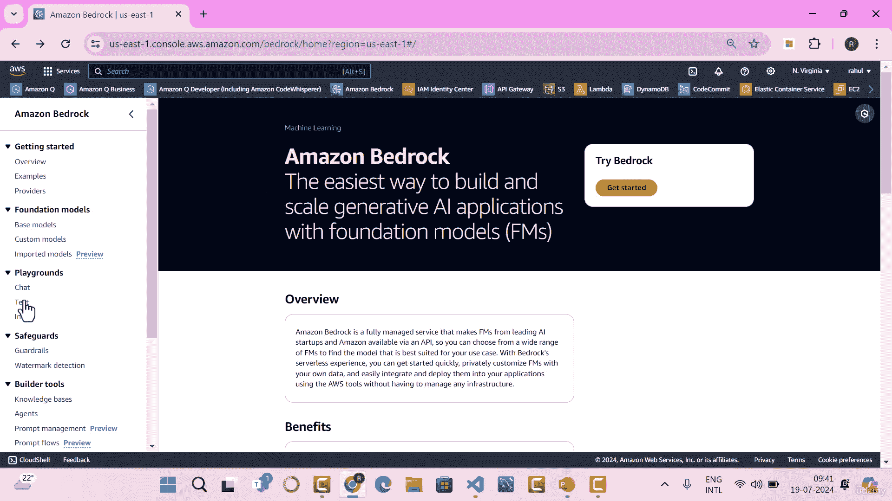
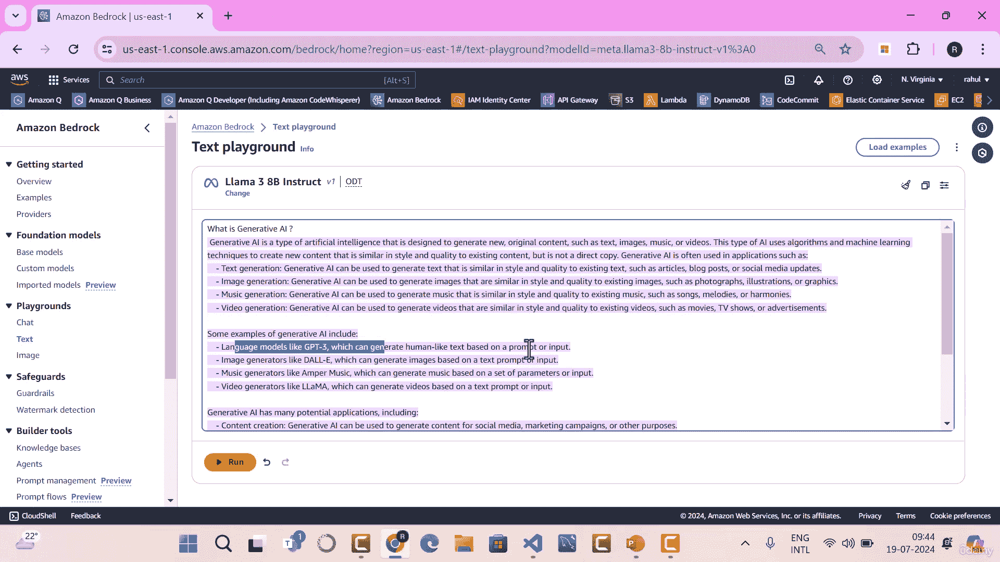

# 🚀 Udemy - AWS 生成式 AI 实战：Amazon Bedrock、RAG 与 KIRO [2026]：P06：什么是生成式 AI


在本节课中我们将要学习生成式 AI 的直观含义，理解“基础模型”这个常见说法，认识几个流行例子，并在 Amazon Bedrock 控制台里用模型本身做一次快速演示。课程会尽量用大白话解释，让初学者先建立整体印象，再逐步把概念和实际操作连起来。


在前面的一节课里，我们简要讨论过生成式 AI 是什么；本节中我们来看看如何更深入地理解它。学习生成式 AI 的一个好办法，是直接把问题交给模型本身来回答，这样既能理解概念，也能看到模型如何组织答案。理解了这种提问方式后，下一节我们把定义收拢成初学者能记住的版本。


## 🧠 一、从提问模型开始理解生成式 AI


在生成式 AI 的术语里，模型通常被称为“基础模型”。为了理解生成式 AI，可以向一个由 AI21 Labs 开发的模型提问，问它“什么是生成式 AI”。模型给出的回答是：生成式 AI 是人工智能的一个分支，这一点和前面课程里学到的内容一致。这个回答还强调，生成式 AI 专注于创建模型或算法。


> 生成式 AI 是人工智能的一个分支，它专注于创建模型或算法。


前面课程里也学过，算法本质上是一个计算机程序，它会用特定数据进行训练，这些数据可以来自互联网，也可以来自组织内部。程序和数据经过独特组合后会创建一个模型；用生成式 AI 的术语来说，这个模型就是基础模型。这个模型能够基于现有数据，或者基于它训练时使用过的数据，模拟或生成新的数据。


为了把核心关系说清楚，可以用下面的公式来描述基础模型的组成。这个公式不是严格数学定义，而是帮助初学者记住“程序加数据形成模型”的直观关系：


```text
基础模型（Foundation Model） = 算法/程序 + 训练数据
```


理解了基础模型的形成方式后，接下来看看生成式 AI 的通俗定义和常见例子。上一节我们通过向模型提问得到了一个直观回答，本节中我们来看看生成式 AI 的定义、输出形式以及市场上常见的代表产品。


## 📚 二、生成式 AI 的通俗定义与常见例子


把前面的内容总结一下，生成式 AI 指的是人工智能的一个分支，尤其是深度学习模型。这类模型可以基于训练时使用过的数据，生成高质量的文本、图像和代码等内容。换句话说，生成式 AI 不只是识别或分类，它还能根据已有数据生成新的内容。


下面的代码块用更直白的方式概括定义、输出形式和输出依据。初学者可以先记住这三个要点，再去看具体产品：


```text
生成式 AI = 人工智能的一个分支，尤其是深度学习模型
输出形式 = 高质量文本、图像、代码等
输出依据 = 模型训练时使用过的数据
```


以下是生成式 AI 中经常被提到的几个代表例子，初学者先分清“应用名”和“模型名”会更容易理解：


- **ChatGPT**：它是一个应用，背后的模型名称是 GPT，来自 OpenAI。

- **Claude**：它来自 Anthropic；如果关注生成式 AI 新闻，会看到它因为所提供的能力而经常引起讨论。


有了定义和例子后，下一节我们进入 AWS 管理控制台做一次快速演示。上一节我们介绍了生成式 AI 的定义和例子，本节中我们来看看在 Amazon Bedrock 里如何通过模型本身完成一次生成过程。


## 🛠️ 三、在 Amazon Bedrock 里动手看一次生成过程


现在进入 AWS 管理控制台，搜索 Amazon Bedrock，然后进入 Amazon Bedrock。进入首页后可以看到，Amazon Bedrock 的定位是用基础模型构建和扩展生成式 AI 应用的最简单方式；这里再次呼应前面的说法：在生成式 AI 术语里，模型常被称为基础模型。


以下是在 Amazon Bedrock 控制台中做快速演示的主要步骤，初学者可以按顺序理解每个操作的目的：


1. 在 AWS 管理控制台中搜索 **Amazon Bedrock**，然后进入 Amazon Bedrock。



2. 进入 Amazon Bedrock 首页，阅读首页对服务的说明：它提供用基础模型构建和扩展生成式 AI 应用的便捷方式。

3. 点击左侧的三条横线，在 **Playgrounds** 下点击 **Text**。

4. 在页面中选择模型。Amazon Bedrock 提供对来自不同公司的基础模型的访问能力。

5. 点击 **Select model**，可以看到不同公司托管在 AWS 上、并通过 Amazon Bedrock 服务访问的基础模型。

6. 点击 **Meta**，可以看到 Llama 2、Llama 3 等模型；点击 Llama 3 并应用选择。


在继续操作之前，补一个核心概念：prompt 本质上就是输入。可以用下面的代码块记住这个对应关系：


```text
prompt（提示词） = 输入
```


清理输入区域后，把同样的问题“什么是生成式 AI”粘贴进去，然后点击 **Run**。接着观察模型以流式方式回答或生成答案，再查看最终答案。模型给出的答案大致如下，这里正是用模型本身来演示生成式 AI：


> 生成式 AI 是一种人工智能类型，它被设计用来生成新的内容，例如文本、图像等。


它还会给出一些流行生成式 AI 模型的例子。演示到这里结束，下面回到整体做总结。希望你喜欢这节课，谢谢。


## ✅ 四、总结




本节课中我们一起学习了生成式 AI 的基本含义：它是人工智能的一个分支，尤其是深度学习模型，可以基于训练数据生成高质量文本、图像和代码。我们还理解了基础模型的直观组成，即算法或程序加训练数据形成模型，并在生成式 AI 术语中常被称为基础模型。随后我们认识了 ChatGPT 和 Claude 这两个常见例子，也在 Amazon Bedrock 控制台里用 Llama 3 完成了一次提问演示，看到 prompt 就是输入，以及模型如何流式生成回答。这些内容为后续继续学习 Amazon Bedrock、RAG 和生成式 AI 应用开发打下基础。
