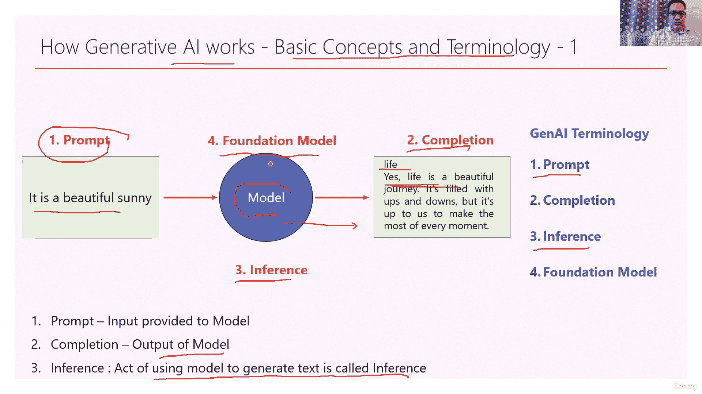
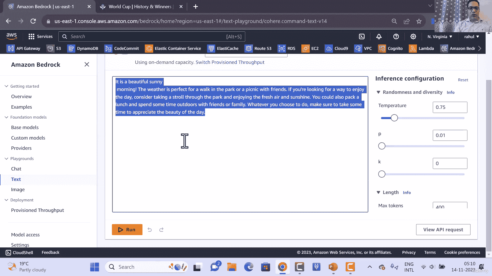
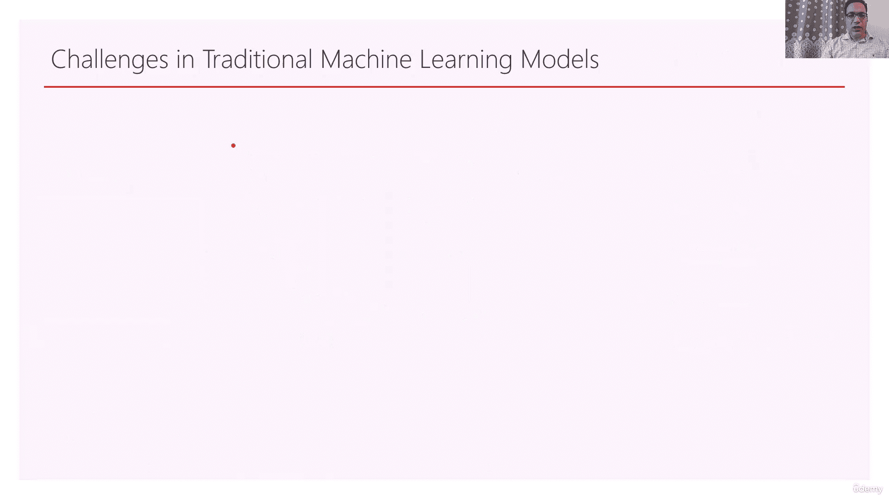
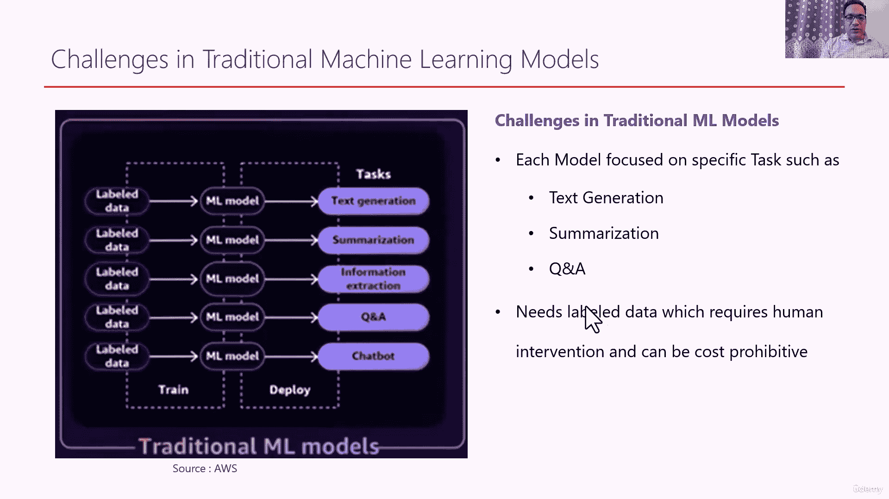
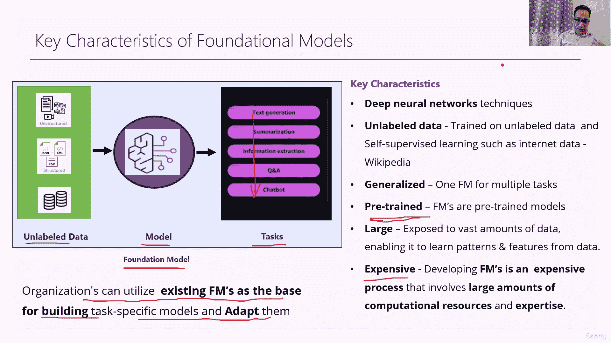
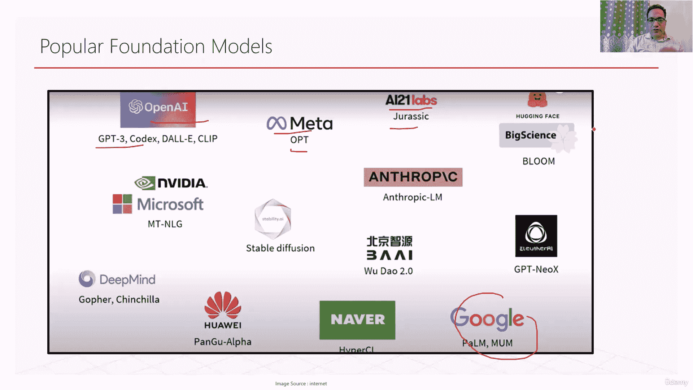

# 🧠 生成式AI on AWS：P07-8：生成式AI如何工作（一）——提示词、补全与推理


在本节课中我们将要学习生成式AI到底是怎么工作的，以及围绕它最常见的一组基本概念和术语。你可以把这节课理解成“入门地图”：先认识模型、输入、输出、推理、基础模型这些词，再通过控制台演示把它们对应起来。课程内容来自 Udemy - Generative AI on AWS - Amazon Bedrock, RAG & KIRO [2026] 的这一节，我们会用大白话把原文意思完整梳理一遍。


## 📌 生成式AI on AWS：P07-8-1：课程概述


这一节先做一个整体铺垫。我们会从最基础的概念开始，逐步理解生成式AI的工作流程，并且把传统机器学习和基础模型放在一起对比。这样做的目的是让初学者不仅记住术语，还能明白这些术语为什么会出现、分别解决什么问题。


## 🧩 生成式AI on AWS：P07-8-2：模型、提示词与补全


上一节我们做了课程概述，本节中我们来看看生成式AI工作流程里最基础的一组术语：模型、提示词和补全。首先说模型。前面课程里已经讨论过，模型可以理解成算法和训练数据的组合。这里我们假设使用场景是文本生成，也就是上一节课看到的那个例子。第一步是给模型提供一些输入，比如输入这样一句话：“It is a beautiful sunny”，我们希望模型把这句话补全。这个我们提供给模型的输入，在生成式AI术语里叫作 **prompt**，也就是提示词，这是第一个需要记住的概念。


接下来，模型收到输入后会生成一些输出。假设模型输出“It is a beautiful sunny life”，然后又说了几句类似“Life is a beautiful journey”的内容。这些例子是临时编出来的，不影响理解。关键点是：模型生成出来的输出，在生成式AI术语里叫作 **completion**，也就是补全结果。所以这里的关系可以直白地写成一条链路。


```text
prompt（提示词/输入） → model（模型） → completion（补全结果/输出）
```


为了把刚刚出现的三个词再串一遍，下面用列表做一个简单总结，方便初学者记忆。


- **模型**：算法和训练数据的组合，负责接收输入并生成输出。
- **prompt**：我们提供给模型的输入，也就是提示词。
- **completion**：模型根据输入生成出来的输出，也就是补全结果。


理解完 prompt 和 completion 之后，本节中我们接着看第三个关键词：推理。这个词在生成式AI里非常常见，理解它有助于把“输入到输出”的整个过程说清楚。


## ⚙️ 生成式AI on AWS：P07-8-3：推理与基础模型




上一节我们介绍了模型、prompt 和 completion，本节中我们来看看推理和基础模型这两个术语。第三个关键词是 **inference**，中文通常叫“推理”。推理的意思是模型生成文本的这个行为。更具体地说，当我们把输入提供给模型，然后模型生成输出，这整个过程就叫作推理。换句话说，prompt 进入模型，模型吐出 completion，这一整套动作就是 inference。可以用下面的公式帮助理解。


```text
inference（推理） = 模型根据 prompt 生成 completion 的整个过程
```


第四个关键术语是 **foundation model**，也就是“基础模型”。到目前为止我们一直说“模型”，但在生成式AI术语里，它通常被称为基础模型。后面我们会深入分析基础模型到底是什么。不过在深入之前，先到控制台里快速看一下这些概念在实际界面中如何对应。下面用列表说明推理和基础模型这两个词的含义，作为进入控制台前的最后一次梳理。




- **推理**：模型根据输入生成文本的行为，以及从输入到输出的整个过程。
- **基础模型**：生成式AI语境下对“模型”的常见叫法，后面会详细展开。


到这里，我们已经把 prompt、completion、inference 和 foundation model 四个关键词串起来了。下一节我们到 AWS 控制台里做一个快速演示，让这些术语不再停留在纸面上。


## 🖥️ 生成式AI on AWS：P07-8-4：在AWS控制台快速演示


上一节我们介绍了推理和基础模型，本节中我们到 AWS 控制台把前面的概念快速演示一遍。进入控制台后，选择文本相关功能，然后选择模型类别，这里显示的就是基础模型。界面中会看到 Amazon Bedrock 支持的三个基础模型。这里可以选择 Cohere，然后选择模型版本。选好基础模型之后，需要给它一个 prompt，也就是输入。这里输入前面用过的同一句话：“It is a beautiful sunny”。这个内容就是输入，也就是 prompt。然后点击运行，它会返回一些输出，这个输出就叫作 completion。下面是在控制台里演示这些概念的步骤，按顺序看即可。




- 进入 AWS 控制台，选择文本相关功能。
- 选择模型类别，这里对应基础模型。
- 查看 Amazon Bedrock 支持的三个基础模型。
- 选择 Cohere，并选择模型版本。
- 在输入框里填入 prompt，例如“It is a beautiful sunny”。
- 点击运行，得到模型返回的输出，也就是 completion。


在控制台里执行后，会看到类似下面的结果和术语对应关系。


> 输入框里的内容叫 prompt；点击运行后模型返回的内容叫 completion；模型根据输入生成文本的整个过程叫 inference。


这里需要补充原文的一个说法：生成出来的所有输出都叫 completion；原文还把模型根据输入或 prompt 生成文本的整个过程也称为 completion。结合前文更准确的理解是，输出是 completion，而整个过程通常叫 inference。控制台演示结束后，下一节我们回过头看传统机器学习模型的挑战，这样才能理解基础模型为什么会出现。


## 🏗️ 生成式AI on AWS：P07-8-5：传统机器学习模型的挑战


上一节我们在控制台看了概念演示，本节中我们回过头看传统机器学习模型的挑战。在传统机器学习模型里，第一件事是识别你要完成的使用场景或任务，比如文本生成、摘要、信息抽取等。识别出任务之后，就要为这个任务创建一个机器学习模型。如果你有五个不同任务，就要创建五个不同的机器学习模型。模型创建好之后，下一步是创建标注数据来训练模型，而且每个使用场景都需要单独的标注数据来训练对应模型。训练完成后任务可以完成，但这里的挑战很明显。下面用列表整理传统机器学习模型做多任务时的主要问题。


- 每个任务都要单独创建一个机器学习模型，五个任务很可能就是五个模型。
- 每个任务都要单独准备标注数据，标注数据可能非常耗时，成本也很高。
- 多任务场景下，模型和数据的管理会变得复杂。




可以用下面的公式概括传统机器学习和基础模型的差别。


```text
传统机器学习：5 个任务 → 5 个模型 + 5 份标注数据
基础模型：1 个基础模型 → 多个任务（文本生成、摘要、信息抽取等）
```


传统机器学习模型的挑战讲完后，本节中我们来看看基础模型的关键特征，以及它如何解决这些挑战。基础模型有时也叫大语言模型，英文缩写是 LLM。它正是为了解决传统机器学习模型在多任务场景下的麻烦而出现的。


## 🧱 生成式AI on AWS：P07-8-6：基础模型的关键特征


上一节我们了解了传统机器学习模型的挑战，本节中我们来看看基础模型的关键特征。第一，基础模型基于深度神经网络技术，比如上一部分讨论过的人工神经网络。第二，基础模型使用无标注数据进行训练，这一点非常关键，因为这意味着可以把互联网上可获得的大量数据用来训练模型。第三，基础模型具有泛化能力，可以完成多个任务，比如文本生成、摘要、信息抽取等。上一节看到传统机器学习模型需要为每个任务单独创建模型，而这里的基础模型可以用一个模型完成这些任务。下面用列表把基础模型的关键特征逐条说明。


- 基于深度神经网络技术，例如人工神经网络。
- 使用无标注数据进行训练，因此可以利用互联网上的大量数据。
- 具有泛化能力，一个基础模型可以完成文本生成、摘要、信息抽取等多个任务。


这些特征可以用一个简单公式来表达。


```text
基础模型 ≈ 深度神经网络 + 大规模无标注数据预训练 + 泛化到多任务
```


这就是我们归类为基础模型的东西。了解了关键特征之后，本节中我们继续看基础模型常见的其他术语，包括预训练、数据规模、成本，以及市面上常见的基础模型。


## 🌍 生成式AI on AWS：P07-8-7：预训练、数据规模、成本与常见基础模型


上一节我们讲了基础模型的关键特征，本节中我们继续看预训练、数据规模、成本和常见基础模型。第一，基础模型是预训练的。当你开始使用基础模型时，它已经用无标注数据训练过了，并且可以完成这些任务。如果你需要把它定制到自己的领域，可以提供一些标注数据。第二，基础模型是在大量数据上训练的，尤其是互联网数据。后面的内容会继续看参数，以及训练基础模型所用的数据量。第三，基础模型非常昂贵，只有少数组织适合自己创建基础模型，因为训练成本很高，还需要大量专业知识。多数组织会使用现有基础模型作为基线来实现生成式AI用例。原文这里也展示了这个情况：多数组织很可能会利用现有的基础模型作为构建任务特定模型的基础，然后再适配到自己的组织中。下面用列表整理这些常见术语。


- **预训练**：开始使用时模型已经用无标注数据训练过，可以完成多种任务；要定制到自己的领域，可以提供标注数据。
- **大规模数据训练**：基础模型在大量数据上训练，尤其是互联网数据，后续还会涉及参数和数据量。
- **成本高**：训练基础模型非常昂贵，需要大量专业知识，只有少数组织适合自己创建。
- **多数组织的做法**：使用现有基础模型作为基线，再构建任务特定模型并适配自己的组织。


了解了这些术语后，我们来看看市面上常见的基础模型有哪些。下面是原文提到的代表模型，方便建立一个整体印象。


- OpenAI 的 GPT 系列，最流行的应用是 ChatGPT，原文也提到现在有 GPT-4。
- Meta 的 Llama。
- AI21 Labs 的 Jurassic，原文提到在 AWS 控制台里会多次看到这些模型。
- Google 的 PaLM 等模型。


这些是原文总结的一些流行基础模型。到这里，我们已经把概念、演示、传统机器学习挑战和基础模型特征都串起来了。下一节做一个小结，并预告后续会继续深入基础模型如何工作。


## ✅ 生成式AI on AWS：P07-8-8：总结






前面几节我们一起把生成式AI的基础工作方式梳理了一遍。本节课中我们一起学习了 prompt、completion、inference 和 foundation model 这几个核心术语，并且在 AWS 控制台里看到了它们如何对应：输入是 prompt，输出是 completion，从输入到输出的过程是 inference，而生成式AI里的模型通常叫基础模型。我们还对比了传统机器学习模型每个任务都要单独建模型、单独准备标注数据的挑战，并了解了基础模型基于深度神经网络、使用无标注数据训练、具有泛化能力等关键特征。最后我们看了预训练、数据规模、成本以及常见基础模型。原文最后提到，下节课会继续深入基础模型如何工作，这一节的内容就是后面深入学习的起点。

