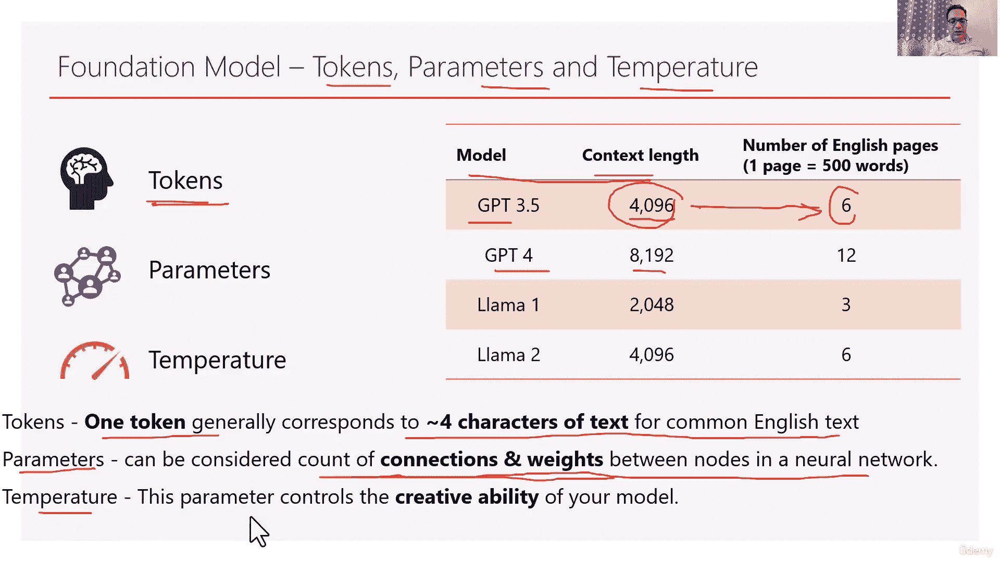
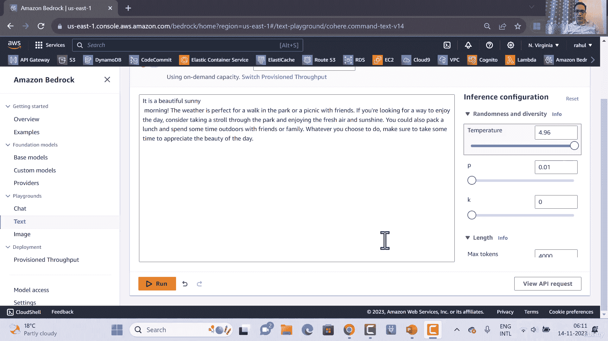

# 🚀 AWS生成式AI实战：P08-9：生成式AI工作原理：基础概念与术语（二）

在本节课中我们将要学习生成式AI和基础模型到底是如何一步步工作的。我们会从提示输入开始，经过分词器、上下文窗口、逐词生成、反分词器，最后得到用户看到的输出，并补充tokens、parameters和temperature这三个常见概念。整个内容会尽量用大白话解释，让你把看似零散的术语串成一个完整流程。

## 🔍 AWS生成式AI实战：P08-9-1：从提示到分词器

上一节我们已经讨论过提示和输入的基本概念，本节中我们来看看一个提示进入基础模型后最先发生什么。首先，我们提供一个提示或输入，并且沿用上一讲的例子，假设提示是“it's a beautiful”，然后期望基础模型把这个句子补全。一旦我们提供这个提示，基础模型内部会使用一个叫分词器（tokenizer）的组件，你可以在流程图下方看到分词器的位置。分词器会把提示里的词转换成数字，也就是token id，例如It会转换成某个数字，is会转换成某个数字，beautiful也会转换成某个数字。需要知道的是，不同模型会为词或字符分配不同的token id，这是模型内部的工作方式。

以下是这一阶段的关键动作，理解这些动作有助于你建立“文本进、数字出”的第一层心智模型。

- 我们提供提示或输入，例如“it's a beautiful”。

- 基础模型内部有分词器（tokenizer）。

- 分词器把词转换成数字，也就是token id。

- It、is、beautiful分别被转换成对应的数字编号。

- 不同模型对词或字符使用不同的token id。

从代码角度看，分词可以简单理解为下面这个过程，这和具体模型的内部实现有关，但方向一致。

```text
"it's a beautiful" -> tokenizer -> [token_id_1, token_id_2, token_id_3, ...]
```

## 🔍 AWS生成式AI实战：P08-9-2：上下文窗口与逐词生成

上一节我们介绍了提示如何被分词器转成数字，本节中我们来看看这些数字进入模型后会经过什么限制，以及模型是怎样生成文本的。整句话被转换成tokens或数字后，这些输入会被送入上下文窗口（context window）。你可以把上下文窗口想成基础模型的短期记忆，它非常重要，因为它决定模型一次可以输入多少token。每个不同的基础模型都有自己的上下文窗口限制，并不是你想输入一千个词就能输入一千个词，一定存在某个上限。

以下是上下文窗口和生成循环中需要抓住的要点，这些要点决定了模型一次能看多少内容，以及它如何一步步写出答案。

- 上下文窗口可以理解为基础模型的短期记忆。

- 上下文窗口决定模型一次能输入多少token。

- 每个基础模型都有上下文窗口限制。

- 不能想输入一千个词就输入一千个词，输入一定有限制。

定义好上下文窗口之后，输入会被传给基础模型。输入传给模型后，模型会根据自己的内部算法生成下一个词，这一点非常关键：模型不是一次性创建整个句子，它只是生成下一个词，或者说是预测下一个词。比如它可能说出“it's a beautiful life”，这时句子中就多了一个新词。我们可能会以为，给基础模型一个输入或提示，它一下子给出一大堆句子，但它实际做的事情是一次生成一个词。然后“it's a beautiful life”这句话会再次传给模型，模型再生成下一个词，接着整个句子又发送给基础模型，模型继续生成句子中的下一个词。

这个过程会持续发生，直到达到最大token大小（max token size），最大token大小可以由我们定义，或者直到模型达到停止序列（stop sequence）。可以想象，发送一个提示后，模型不会无限生成文本，它一定会到达某个限制，这个限制要么来自用户设置的最大token数，要么来自模型自身的停止序列。下面的伪代码展示了这种循环生成的基本逻辑。

```text
输入: prompt_tokens
循环:
    next_token = foundation_model(prompt_tokens)
    prompt_tokens = prompt_tokens + next_token
直到 token数 >= max_token_size 或 遇到 stop_sequence
输出: 已生成的完整文本
```

## 🔍 AWS生成式AI实战：P08-9-3：反分词、完成结果与推理

上一节我们看到模型是一次一个词地生成内容，本节中我们来看看生成结束后的文本如何变成人能读懂的结果。生成完成后，整句已经生成的文本会被送到反分词器（detokenizer）。反分词器做的事情正好和分词器相反，它会把模型内部那些数字转换回词或句子，也就是转换成人类能理解的文本。然后这些输出会发送给用户，正如我们之前学到的，这个输出被称为完成结果（completion），而整个过程被称为推理（inference），这一点和上一讲看到的内容一致。

以下是输出阶段的几个步骤，这些步骤把模型内部的数字重新变成用户可读的文本。

- 生成完成后的整句文本会送到反分词器。

- 反分词器是分词器的完全反向过程。

- 反分词器把数字转换回词或句子。

- 转换后的内容是人类可以理解的。

- 输出会发送给用户。

- 这个输出被称为completion。

- 整个过程被称为inference。

用公式表示，输出阶段可以写成下面这样，重点在于“数字token id重新变回文本”。

```text
token_ids -> detokenizer -> human_readable_text
human_readable_text = completion
整个生成过程 = inference
```

## 🔍 AWS生成式AI实战：P08-9-4：Tokens与上下文长度

上一节我们走完了从输入到输出的完整链路，本节中我们来看看生成式AI和基础模型视角下还需要额外了解的几个概念：tokens、parameters和temperature。这些词在你讨论基础模型时会经常听到，所以先把它们弄明白，后面看模型参数和调用接口时就不会陌生。先看tokens和上下文长度。

一般来说，对于常见英语文本，一个token通常对应大约四个字符。回到前面的提示示例，可以看到“it's”后面有一个空格，我们可以大致认为这部分是一个token；“beautiful”比较长，所以这里可能有两年token；模型内部具体怎么切分属于内部工作，这里只是简要说明；然后可能还有另一个token，并且这里和那里都有空格；于是我们可以假设这些内容大约是四个token。当这个提示作为输入传给基础模型时，可以粗略认为它是四个tokens。但限制是什么？例如GPT-3可以输入的token数是4096，GPT-4是8192。宽泛地说，4096个tokens大约相当于6页、每页500词的内容，这些是互联网上常见的平均统计，用这种方式可以帮助我们理解token和上下文长度的关系。

以下是token与上下文长度里需要记住的要点，这些要点能帮助初学者快速估算输入长度。

- 对于常见英语文本，一个token通常对应大约四个字符。

- 示例提示“it's a beautiful”中，“it's”加空格可以大致看作一个token。

- “beautiful”比较长，可能被切成两个token。

- 空格也可能影响token的切分。

- 可以粗略假设这个示例是四个token。

- 这个提示作为输入传给基础模型时，可以视为四个tokens。

- GPT-3可输入的token数是4096。

- GPT-4可输入的token数是8192。

- 4096个tokens大约相当于6页、每页500词的内容。

- 这些页数换算是来自互联网的平均统计。

用公式表示，可以简单写成下面这样，方便记忆常见模型的一次输入上限。

```text
GPT-3: max_input_tokens = 4096
GPT-4: max_input_tokens = 8192
约 4096 tokens ≈ 6页 × 每页500词
```

## 🔍 AWS生成式AI实战：P08-9-5：Parameters与模型规模

上一节我们了解了token和上下文长度，本节中我们来看看parameters，也就是参数。你在讨论基础模型时会经常听到parameters这个词，它用来展示基础模型的大小。本质上，参数是神经网络中节点之间连接和权重的数量。在深入参数定义之前，先看一张从参数规模角度展示流行基础模型的图表，这能帮助你直观感受模型规模的变化。

以下是参数视角下基础模型的几个要点，这些内容能帮助你理解“模型大小”到底在说什么。

- 基础模型可以分为两类：私有模型和开源模型。

- 私有模型由某个特定组织拥有。

- 开源模型的源代码可以获取。

- 从时间线看，模型规模在明显增长。

- BERT大约有3.4亿参数，来自Google。

- 现在有Bloom等模型，大约有1760亿参数。

- 在三年左右的时间里，模型规模出现了明显增长。

- GPT-2大约有15亿参数。

- PaLM大约有5400亿参数。

- GPT-4是ChatGPT背后的基础模型，大约有1.8万亿参数和120层。

- 在之前讨论人工神经网络的课程中，我们看到的网络大约有4层。

- 上一页内容提到GPT-4大约有120层。

那么参数到底是什么？参数是层数的组合，也是不同层与节点之间连接的组合，还包括分配给每条连接的权重。换句话说，参数是层与层之间连接和权重的组合。参数之所以重要，是因为它展示了基础模型的复杂度，也展示了模型是如何被训练出来的。下面用公式概括参数的含义，重点不是精确计算，而是理解它和层数、连接、权重有关。

```text
参数量 ≈ 层间连接数量 + 连接权重数量
参数量由层数、节点、连接关系与权重共同决定
```

## 🔍 AWS生成式AI实战：P08-9-6：Temperature与输出随机性

上一节我们介绍了参数如何体现模型规模和复杂度，本节中我们来看看temperature，也就是温度。温度控制模型的创造能力，你可以通过滑块来调整模型温度。它本质上决定答案的随机性和多样性。如果你想要非常意外的答案，比如提供一个提示后希望回答高度有创意、随机、不是常见响应，那么可以提高温度，模型会给出非常不寻常的答案。但如果你把温度降低到接近0，模型会给出非常可预测的回答。

以下是温度控制中需要理解的行为，这些行为能帮助你在“稳定回答”和“创意回答”之间做选择。

- 温度控制模型的创造能力。

- 温度可以通过滑块调整。

- 温度决定答案的随机性和多样性。

- 想要意外答案时，可以提高温度。

- 想要高度创意或随机、不寻常的响应时，可以提高温度。

- 提高温度后，模型会提供非常不寻常的答案。



- 把温度降低到接近0时，模型会提供非常可预测的响应。

- 例子：询问世界上最好的足球运动员是谁。

- 温度设为0时，模型很可能回答Lionel Messi。

- 温度设为5时，模型可能给出非常随机的答案。

用公式表示，温度与输出行为的关系可以简单记成下面这样。

```text
temperature ↑ -> randomness / diversity ↑
temperature ↓ -> predictability ↑
```

## 🧾 AWS生成式AI实战：P08-9-7：本课总结



本节课中我们一起学习了生成式AI和基础模型的工作流程：先提供提示，分词器把文本转成token id，输入进入上下文窗口并受到token数量限制，模型基于内部算法一次预测下一个词，循环生成直到达到最大token大小或停止序列，最后反分词器把数字转回人类可读文本，输出称为completion，整个过程称为inference。我们还学习了tokens与上下文长度、parameters与模型规模，以及temperature如何影响答案的随机性和多样性。本节课内容到这里基本结束，希望这些内容对你有用，下一讲再见，谢谢观看。

