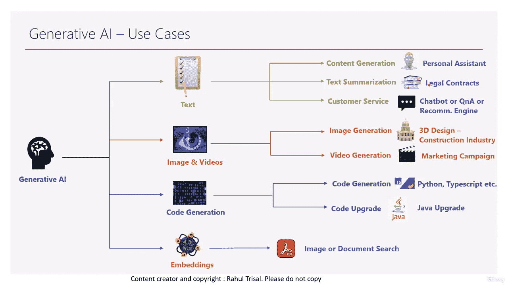
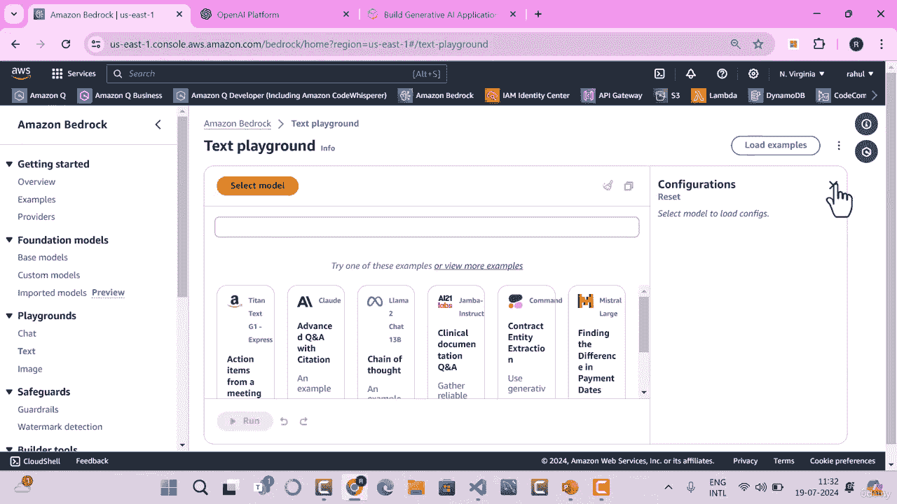
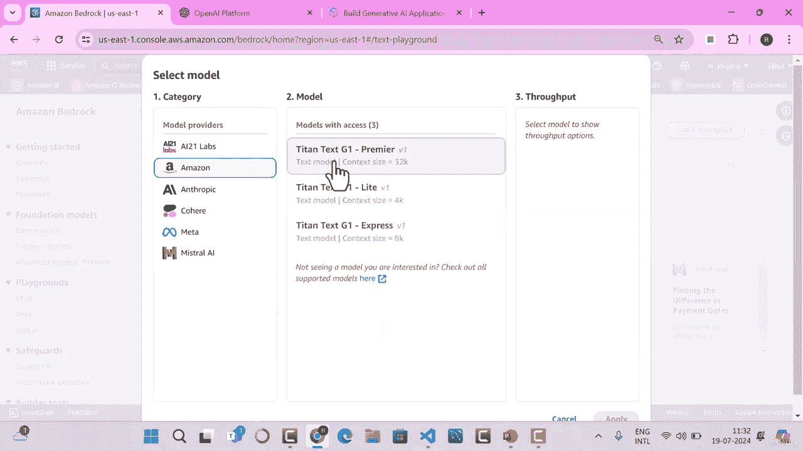
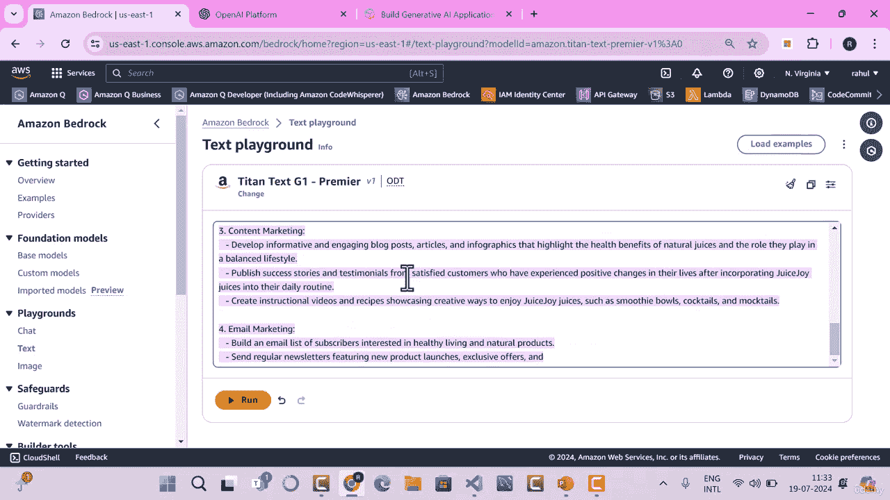
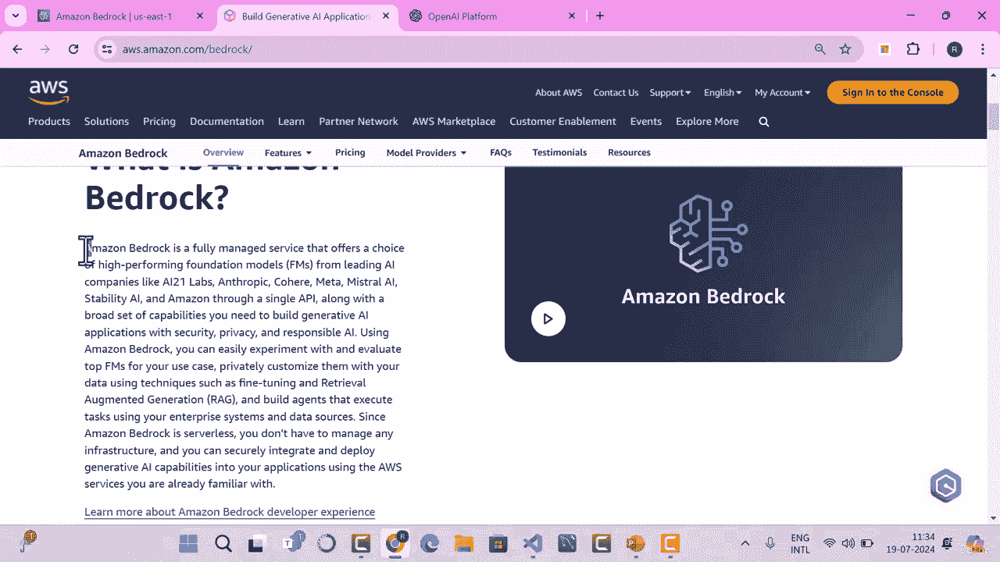
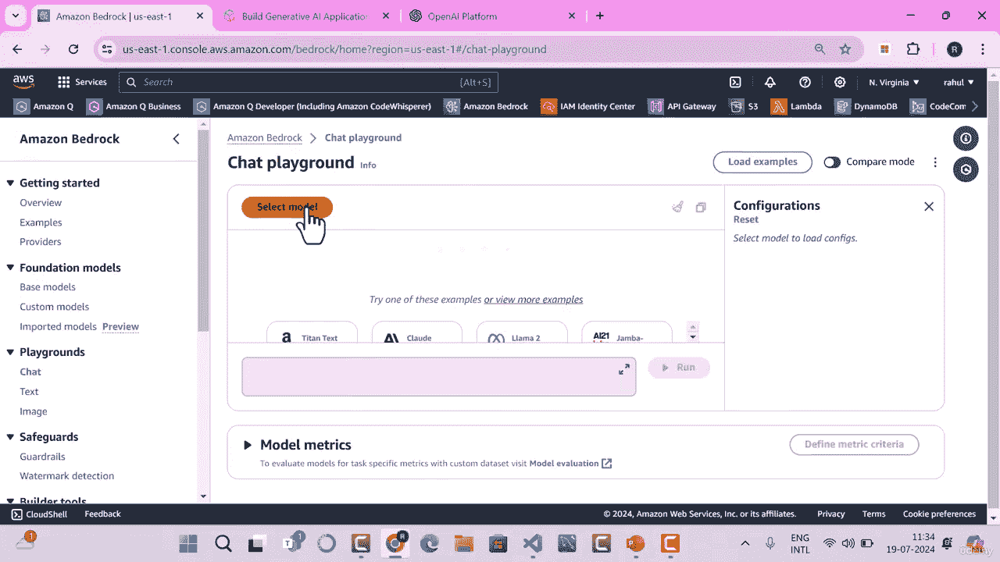
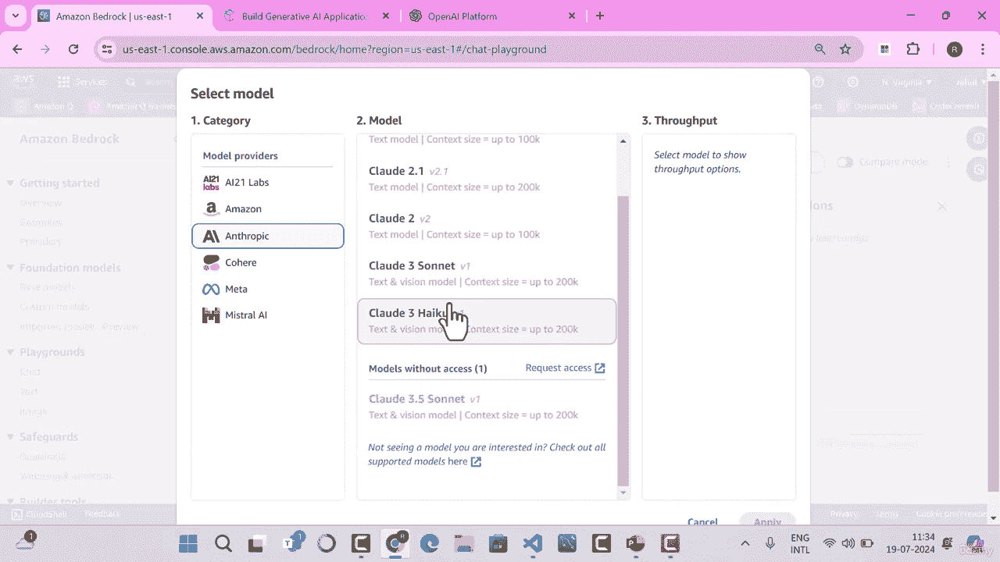
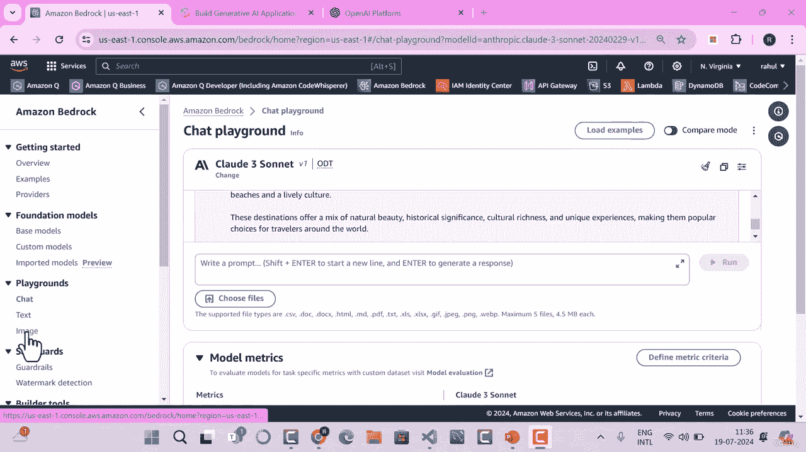
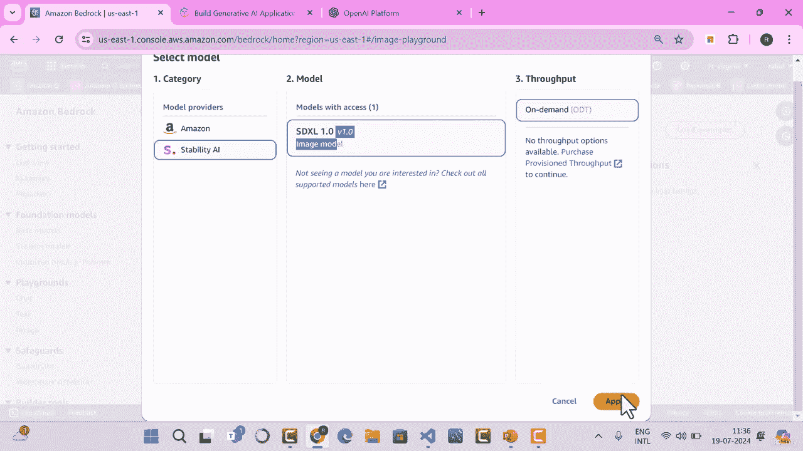
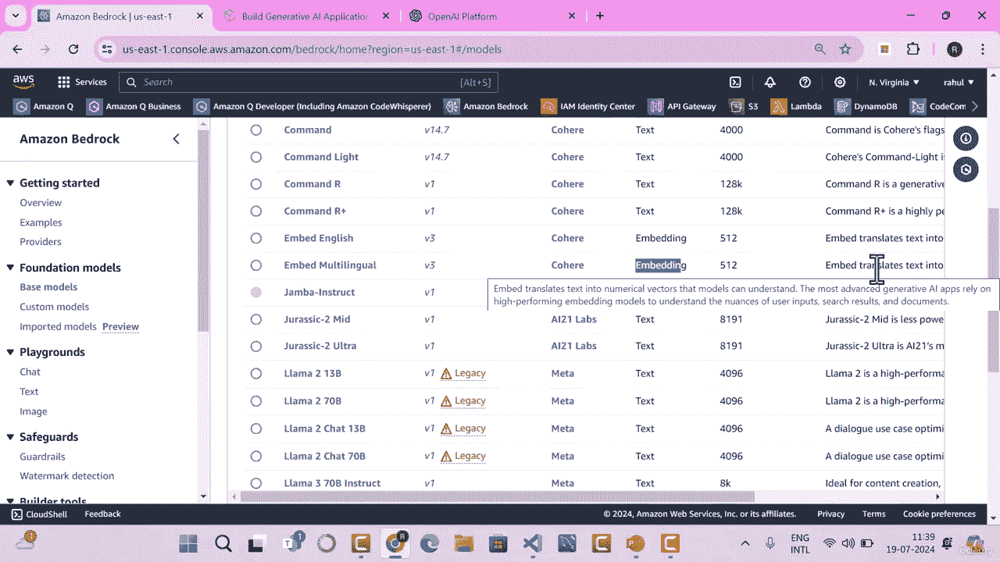

# 生成式AI在AWS上的应用：第09-10讲：生成式AI的典型用例


在本节课中我们将要学习生成式AI的核心用例，也就是生成式AI到底能帮我们做哪些事情。为了便于初学者理解，课程把生成式AI的用例先做了一个简化分类，把它们归成四大类。这个分类不是严格的学术定义，而是一个帮助记忆和快速入门的框架，可以用下面的公式来表示。

\[
\text{生成式AI典型用例}=\{\text{文本},\ \text{图像与视频},\ \text{代码},\ \text{嵌入搜索}\}
\]


理解这个分类之后，我们会先逐一说明每一类用例的含义和典型场景，然后进入Amazon Bedrock控制台，用几个实际操作把这些用例串起来。这样安排的好处是，先建立整体地图，再看具体工具，初学者不容易迷路。


## 生成式AI在AWS上的应用：第09-10讲-01：文本类用例


上一段我们给出了四大类用例的整体框架，本节中我们来看看第一大类，也就是文本类用例。文本类用例是生成式AI最常见、也最容易理解的入口，下面列出文本类里面三个重点方向，以及它们各自适合的场景。


- **内容生成**：可以使用基础模型或生成式AI应用来生成内容。这类能力可以跨岗位、跨行业使用。例如，营销经理希望生成式AI应用为下一次品牌活动生成相关内容，这就是内容生成的典型用法。
- **文本摘要**：文本摘要同样可以跨岗位、跨行业使用。以组织中的法务部门为例，法务部门会收到大量法律合同需要审阅，这些合同可能长达数百页。实际想要的效果是把合同概括成两到三页，以便快速理解法律合同的核心内容，这就是文本摘要的一个典型用例。
- **客服聊天与问答**：第三个方向是客服领域，这也可以跨行业使用，例如零售、银行等。可以面向客户和员工构建聊天机器人或问答应用。可以回想银行应用或零售网站上常见的聊天机器人，它们负责回答用户关于产品的常见查询，这就是客服聊天与问答的典型形态。


以上是文本类的三个重点方向，它们共同说明文本生成、压缩和对话交互是最基础的一层能力。了解了文本类用例之后，接下来我们进入第二大类，也就是图像与视频类用例。


## 生成式AI在AWS上的应用：第09-10讲-02：图像与视频类用例


上一节我们介绍了文本类用例，本节中我们来看看图像与视频类用例。图像和视频让生成式AI从文字走向视觉内容，下面列出这一类的两个主要方向，并给出原文中的行业例子。


- **图像生成**：可以用在图像生成领域。一个例子是建筑行业，生成式AI应用可以生成产品设计或方案设计图，也就是原文所说的PD设计，然后你可以拿这些设计与最终用户或客户进行确认和验证。
- **视频生成**：图像与视频类能力也可以用于视频生成，例如营销活动、产品演示视频、产品营销视频等。也就是说，视频生成可以帮助制作对外传播和产品展示所需的内容。




以上是图像与视频类的主要用法，核心是把提示词或输入转成视觉素材。看完视觉内容之后，下一节我们进入代码类用例，同时也会把嵌入搜索放在这一部分一起说明。






## 生成式AI在AWS上的应用：第09-10讲-03：代码类与嵌入搜索用例


上一节我们看了图像与视频，本节中我们来看看代码类用例和嵌入搜索。代码类用例关注的是让生成式AI理解自然语言需求并产出代码，或者帮助老系统升级；嵌入搜索则关注把内容变成向量后做检索。下面列出这一部分的几个重点方向。




- **代码生成**：生成式AI可以为你生成代码，并且可以跨语言使用，例如Python、TypeScript等。你只需要用自然语言提供提示词或输入。例如，你可以要求它写一个Python程序，从DynamoDB中读取数据，它可以给出完整的代码片段，用来加速开发并提高生产力。下面是一个类似的自然语言提示词示例。



```text
请用 Python 写一个程序，从 DynamoDB 中读取数据。
```






- **代码升级**：代码升级是很多企业面临的现实问题。企业的一大挑战是从遗留代码迁移到更新版本，可能是同一种编程语言的新版本，也可能是另一种编程语言。这时可以使用AWS相关工具，例如Amazon Q Developer，它可以把Java从较低版本升级到较高版本。
- **嵌入搜索**：最后是嵌入，也就是embeddings，可以用来搜索内容，例如在PDF文档中搜索内容，或者对图像做相似度搜索。这些都可以通过嵌入模型完成。嵌入的核心思想是把文本或图像映射成向量，再用向量相似度做检索，可以用下面的公式描述。

\[
\mathbf{e}_x=f(x),\quad \mathbf{e}_y=f(y),\quad \text{相似度}=\cos(\mathbf{e}_x,\mathbf{e}_y)
\]


上面的公式说明，嵌入模型把输入变成向量，然后通过向量之间的相似度来判断内容是否相近。以上是代码类与嵌入搜索的主要用法，后续课程还会更深入地讨论嵌入。理论分类讲清楚之后，下一节我们到Amazon Bedrock控制台里实际看一看这些用例如何演示。


## 生成式AI在AWS上的应用：第09-10讲-04：Amazon Bedrock控制台演示






上一节我们介绍了代码类与嵌入搜索，本节中我们来看看如何在Amazon Bedrock控制台里快速体验这些用例。下面的演示步骤会按照控制台操作顺序展开，每一步都对应一个前面讲过的用例，方便把概念和操作对应起来。


- **进入聊天Playground并选择模型**：先进入Amazon Bedrock控制台，打开Playground，点击Chat。在这里可以选择模型，例如选择Amazon Titan Premier，然后点击应用。
- **内容生成演示**：假设你是营销经理，正在为果汁创建营销活动。输入需求后运行，模型会给出一些想法，例如把名称定为“Juice Joy Taste”，并围绕“自然的喜悦”展开，还会讨论目标受众、活动目标等。这说明生成式AI可以帮助提高生产力。
- **文本摘要演示**：准备一段关于Amazon Bedrock的内容，然后要求模型做摘要。可以输入类似“总结成三行”的要求，再运行，模型会把这段内容概括成几行。这里展示的就是文本摘要用例。
- **客服聊天演示**：进入Chat和Chat Playground，选择一个模型，例如选择Anthropic的某个模型。假设你是一个旅游网站，已经部署了聊天机器人，可以问“世界上最好的度假目的地是哪里”，模型会给出一些回答，例如法国巴黎、纽约等，也会围绕巴黎、意大利罗马等给出说明。还可以继续追问，模型会记住之前问过的内容，具备一定的聊天记忆。
- **图像生成演示**：进入图像与视频区域，这里可以选择Amazon和Stability AI等模型，例如选择Stability AI并应用。接着延续前面果汁营销活动的思路，输入“为广告创建一张果汁图片”，运行后模型会根据输入生成一张图片。
- **代码生成演示预告**：代码生成也可以类似地演示，但课程安排在后面学习其他AWS生成式AI服务时再看，例如在学习Amazon Q Developer之后再展开。
- **嵌入模型查看**：最后查看嵌入侧的基础模型。进入基础模型页面，在模态类型中搜索embeddings，可以看到Titan Embedding嵌入模型，也可以看到来自Cohere的嵌入模型。页面说明提到，最先进的生成式AI应用依赖高性能嵌入模型来理解用户输入、搜索结果和文档中的细微差别。后续课程会讨论检索增强生成、向量和向量数据库等内容，并进一步深入嵌入概念。


以上演示把文本生成、文本摘要、客服聊天、图像生成和嵌入模型查看串了起来，帮助初学者把前面的分类落到实际操作上。完成这些演示之后，下一节我们对本讲内容做一个整体总结。


## 生成式AI在AWS上的应用：第09-10讲-05：本节总结




本节课中我们一起学习了生成式AI的核心用例，并把它们整理成四大类：文本、图像与视频、代码、嵌入搜索。文本类包括内容生成、文本摘要和客服聊天与问答；图像与视频类包括图像生成和视频生成；代码类包括代码生成和代码升级；嵌入搜索则用于PDF内容搜索和图像相似度搜索等场景。我们还进入Amazon Bedrock控制台，演示了选择Amazon Titan Premier生成果汁营销内容、对Amazon Bedrock内容做三行摘要、选择Anthropic模型模拟旅游网站聊天机器人、选择Stability AI生成果汁广告图片，以及查看Titan Embedding和Cohere嵌入模型。课程最后还提示，后续会继续讨论检索增强生成、向量和向量数据库，并更深入地讲解嵌入。通过这些内容，初学者可以对生成式AI的典型用例形成一个直白、完整的入门认识。
