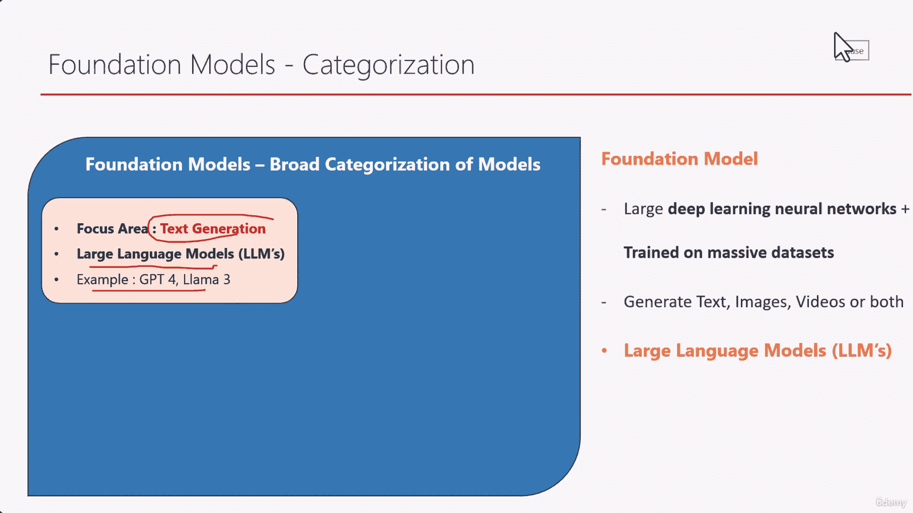
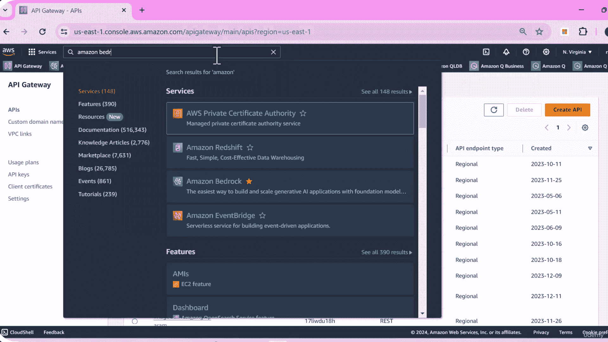
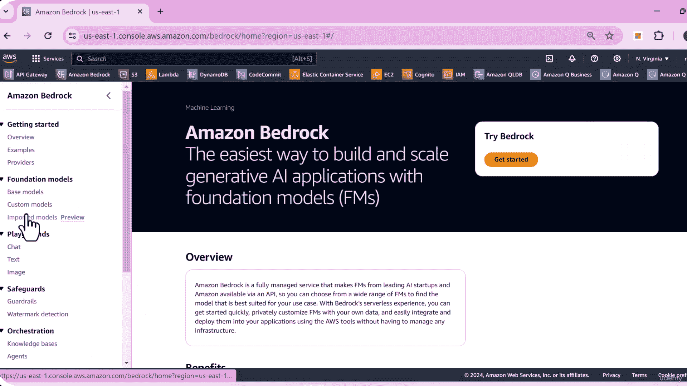
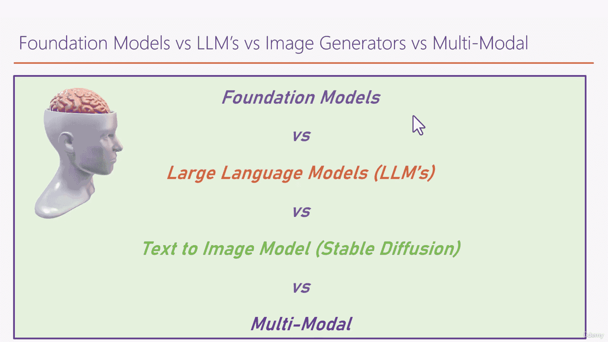

# 生成式AI在AWS上：第10讲：基础模型 vs 大语言模型 vs 扩散模型 vs 多模态模型 🧠

在本节课中，我们将要学习在生成式AI的讨论中经常听到的几个关键术语，分别是基础模型、大语言模型、扩散模型和多模态模型。我们经常能看到有人把这些词混着用，但事实上它们并不完全是一回事。为了让我们在后续的学习中不产生误解，这节课要做的就是正确理解每一个术语的含义。另外，我们还会去Amazon Bedrock控制台转一圈，实际看看这些模型在平台上长什么样。

在前几节课中，我们已经学习了什么是算法、什么是模型，随后还学习了基础模型。我们提到过基础模型有两个关键特征：第一，它基于深度学习神经网络；第二，它是在海量数据集上训练出来的。基础模型可以生成文本、图像、视频，或者同时生成多种类型的内容。换句话说，你可以把基础模型理解为一个大类，是对模型的一种宽泛分类。现在，我们要在这个大类下面做进一步细分，看看具体有哪些不同类型的模型。

先来看第一种类型。如果某个基础模型的专注点是文本生成，那它通常被叫作大语言模型（Large Language Model，简称LLM）。常见的例子包括GPT-4、Llama 3等等。这类模型的核心使用场景是文本摘要、文本生成，反正所有跟文本相关的事情都归它管。用公式来表达就是：



```text
LLM: text_input -> text_output
```





也就是说，给它一段文本，它就会返回一段文本，就是这样。

为了让你对它有更具体的认识，我们去Amazon Bedrock控制台实际看一下。在AWS控制台里搜索“Amazon Bedrock”，进入服务后，点击左侧的三条横线菜单，再选择“Base models”（基础模型）。这时候你会看到AWS提供的所有模型。接着在“Modality”（模态）这个筛选条件里选择“Text”（文本），屏幕上就会列出所有专注于文本的模型，这些模型通常就是大语言模型。可以看到列表中有模型名称、版本，以及拥有这些模型的公司，例如AI21 Labs、Anthropic、Cohere等等，它们的专注领域都写着文本。然后我们点开其中一个，比如AI21，你会看到它的模型属性写着“文本分类”，支持的用例包括开放式问答、摘要、草稿生成等，反正都是围绕文本展开的。到这里，我们应该已经清楚大语言模型是什么了。

看完了第一类，接着看第二类。如果某个基础模型的专注点是图像生成，那它通常被叫作图像生成模型，或者叫扩散模型（Diffusion Model）。一个非常有代表性的图像生成模型是Stability公司推出的Stable Diffusion。这类模型有两种工作方式：文本到图像（text-to-image）和图像到图像（image-to-image）。这是什么意思？其实就是说，你输入一段文本提示，模型为你生成一幅图像；或者你输入一幅图像，模型再根据它生成另一幅图像。用公式表示就是：

```text
Diffusion: text_prompt -> image
Diffusion: image_input -> image_output
```

Stable Diffusion是Amazon Bedrock提供的模型之一。另外，OpenAI也有一个图像生成模型，叫作DALL-E 3。我们再到控制台快速看一眼：点开Stability AI，可以看到它支持的用例包括生成艺术作品、工具、教育应用，模型属性写的是“基于扩散的文本到图像生成”。这样一来，扩散模型是怎么回事也就清楚了。

接下来看第三类。如果某个基础模型同时关注文本和视觉，也就是说它能同时处理文字和图像，那它就被称为多模态模型（MultiModal Model）。目前能同时处理文本和视觉的基础模型其实很少，Claude 3就是其中之一。多模态模型可以接收文本和图像作为输入，然后输出文本，也可以根据任务需要输出其他模态的内容。用公式来表示：

```text
MultiModal: (image, text) -> text
```

我们再去控制台看一眼。Anthropic公司提供了Claude基础模型，你点开Claude Sonnet或者Claude 3 Haiku，会看到它们既能处理图像并返回文本输出，也能接收文本输入并生成输出。在模型属性里写着“图像到文本”、“对话”、“聊天优化”等能力。

多模态模型有一个很有趣的用武之地，那就是医疗行业。举个例子，假设我手臂骨折了，去医院拍了一张X光片。这张X光片可以作为图像输入给多模态基础模型，同时我的医疗记录或者放射科医生给出的诊断报告可以作为文本输入给模型。模型把X光片这个图像输入和诊断报告这些文本输入结合起来，经过综合分析和推理，就能生成一些有价值的见解。这就是多模态模型在医疗行业里的一个很好的应用场景。

我知道刚才控制台的演示过得很快，这是故意为之的，因为本节课只是想给你一个这些术语的高层概览，让你心里有个数。在下一节中，我们会有专门的几节课，带大家一步步走完Amazon Bedrock的控制台操作，到时候我们会看得更细。



最后总结一下：本节课中，我们一起学习了基础模型、大语言模型、扩散模型和多模态模型这几个关键术语，弄清楚了它们各自的分工。大语言模型专注于文本处理，扩散模型专注于图像生成，多模态模型则同时处理文本和图像。我们还去Amazon Bedrock控制台看了看对应模型的实例，比如AI21、Stable Diffusion和Claude 3。这节课的内容基本就这些了。下一节课，我们就开始实际动手操作控制台，敬请期待。谢谢大家。
