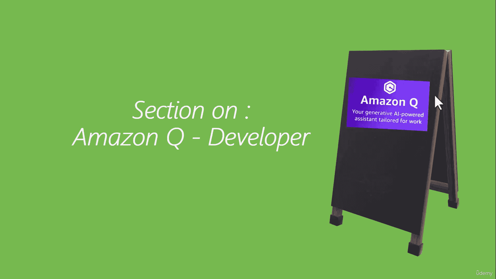
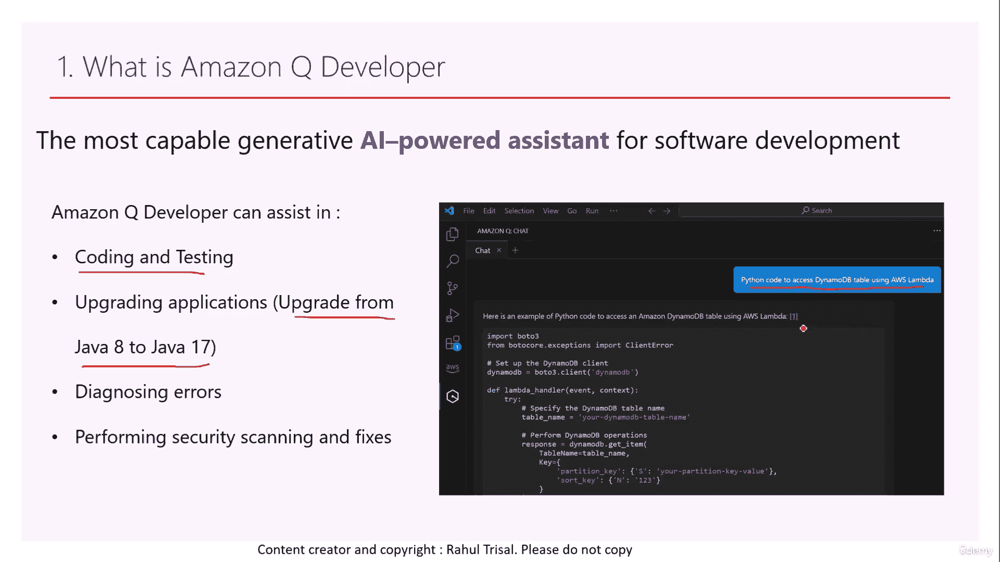
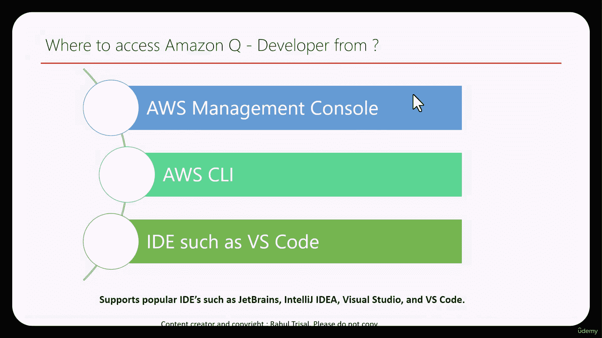

🤖 生成式AI on AWS：Amazon Bedrock、RAG与KIRO [2026]：第100-102讲：Amazon Q Developer 概览

  



在本节课中，我们将一起学习 Amazon Q Developer 这个工具。它是 AWS 官方推出的生成式 AI 编程助手，能够大幅提升开发效率。我们会介绍它能做什么、怎么用，以及一个具体的代码生成示例。通过本节课的学习，即使你是初学者，也能对 Amazon Q Developer 有一个清晰的认识。

  

首先，我们要搞清楚一个最基本的问题：Amazon Q Developer 到底是什么？简单来说，AWS 官方将 Amazon Q Developer 称为“面向软件开发者的、能力最强的生成式 AI 驱动助手”。用大白话讲，它就是一位懂编程的 AI 助手，能帮你写代码、查问题、改代码。你可以把它想象成一位随身携带的资深程序员，不过它是由 AI 驱动的，响应速度飞快，而且随时待命。

  

在了解了它是什么之后，我们来看看它具体能帮你做哪些事情。以下是 Amazon Q Developer 的主要能力，每一项都能让日常开发工作变得轻松不少。

  

- 辅助编码与测试：它能协助你完成代码编写和测试任务，并且支持所有主流编程语言，包括 Java、Python、.NET、TypeScript 等等。这意味着无论你用哪种语言开发，它几乎都能派上用场。  
- 升级遗留应用程序：它能帮助你升级老旧的应用程序。目前它支持将 Java 8 升级到 Java 17 版本。对于很多需要升级遗留技术的企业来说，这是一个极其重要的用例，因为手动升级 Java 版本往往既枯燥又容易出错。  
- 诊断错误：当你的代码出现问题时，它能帮你定位并诊断错误。你不用再盯着控制台日志发愁，直接问它就能得到有针对性的分析。  
- 安全扫描与修复：它还能执行安全扫描，找出代码中的安全漏洞，并给出修复建议。在网络安全越来越重要的今天，这项功能简直是开发者的福音。

  

为了让你更直观地理解它的能力，我们来看一个例子。我给 Amazon Q 发了一个请求，让它生成一段 Python 代码，这段代码的作用是访问 DynamoDB 表。以下就是它为我生成的代码（原文此处写作“使用 Ado Lada”，根据语境推测可能是指 Boto3 库）。

  

```python
import boto3

# 创建 DynamoDB 资源
dynamodb = boto3.resource('dynamodb')

# 指定表名
table = dynamodb.Table('YourTableName')

# 获取一个项目
response = table.get_item(Key={'id': '123'})
print(response['Item'])
```

  



当然，上面的代码只是一个简单的示意。实际使用时，Amazon Q 会根据你的具体需求生成更完整的代码。从这个小例子可以看出，你只需要用自然语言描述需求，它就能输出可运行的代码片段，是不是很方便？

  

接下来，一个很实际的问题来了：我们应该如何访问并使用 Amazon Q Developer 呢？好消息是，访问方式有很多种，你可以根据自己的使用习惯灵活选择。下面我们来逐一看看。

  

- 通过 AWS 管理控制台访问：你可以在 AWS 管理控制台中直接使用它，不需要额外安装任何东西，打开网页就能体验。  
- 通过命令行界面（CLI）访问：如果你喜欢在终端里敲命令，也可以通过 CLI 来调用 Amazon Q Developer。  
- 安装到主流 IDE 中使用：你还可以把它安装到常用的集成开发环境（IDE）中。目前它支持 VS Code、JetBrains、IntelliJ IDEA、Visual Studio 等主流 IDE。这样在写代码的时候，就可以在不离开编辑器的情况下随时向 AI 求助，体验非常流畅。

  



到这里，本节课的主要内容就介绍完了。最后我们快速总结一下：我们学习了什么是 Amazon Q Developer，知道了它是 AWS 提供的生成式 AI 编程助手。我们了解了它的主要功能，包括编码测试、升级遗留应用、诊断错误和安全扫描修复。我们还看到了一个生成 Python 代码的示例，并学习了通过控制台、CLI 或 IDE 使用它的几种方式。希望这节课能让你对 Amazon Q Developer 有一个全面的初步认识。在下节课中，我们会继续深入探索相关主题。感谢观看，再见！
