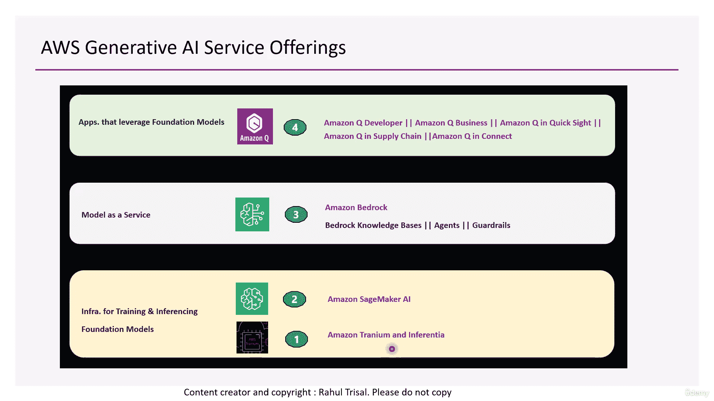
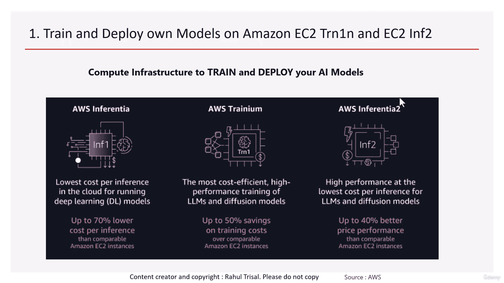
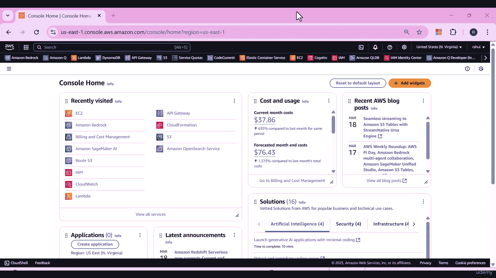
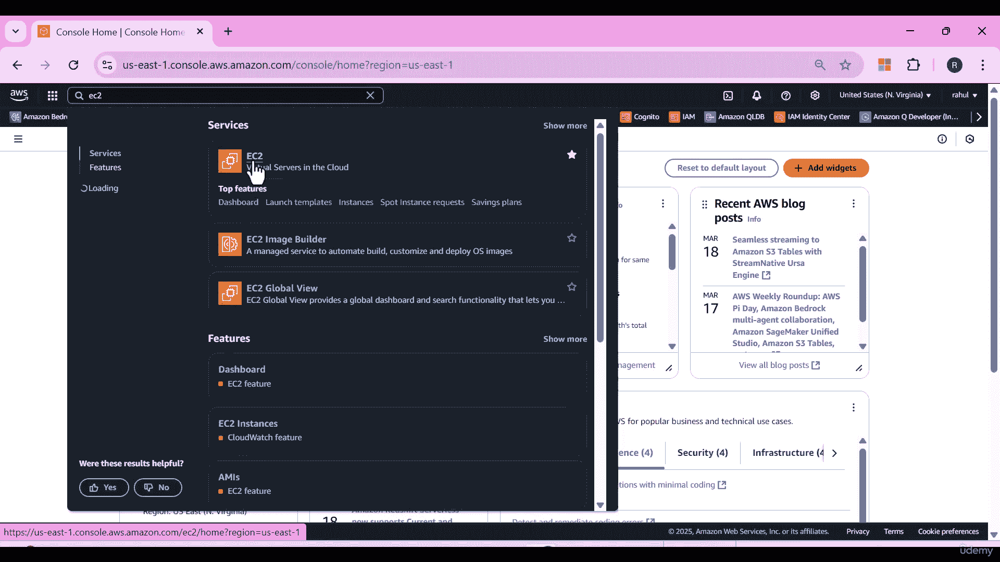
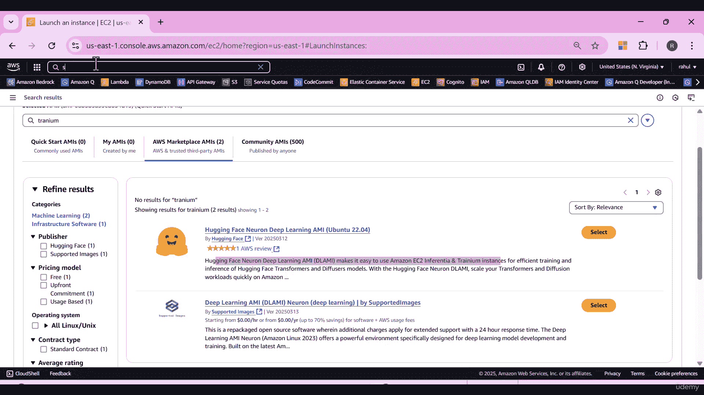
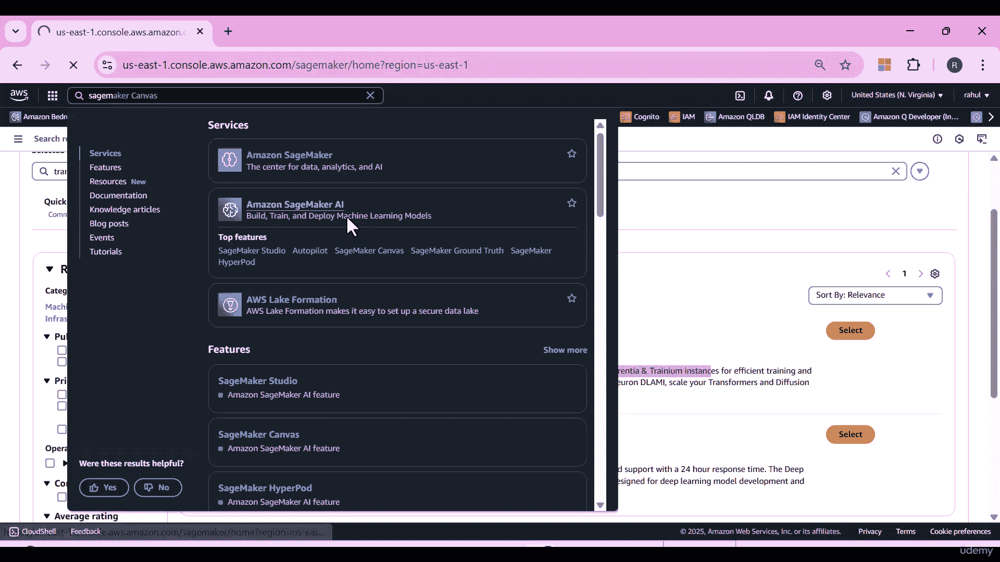
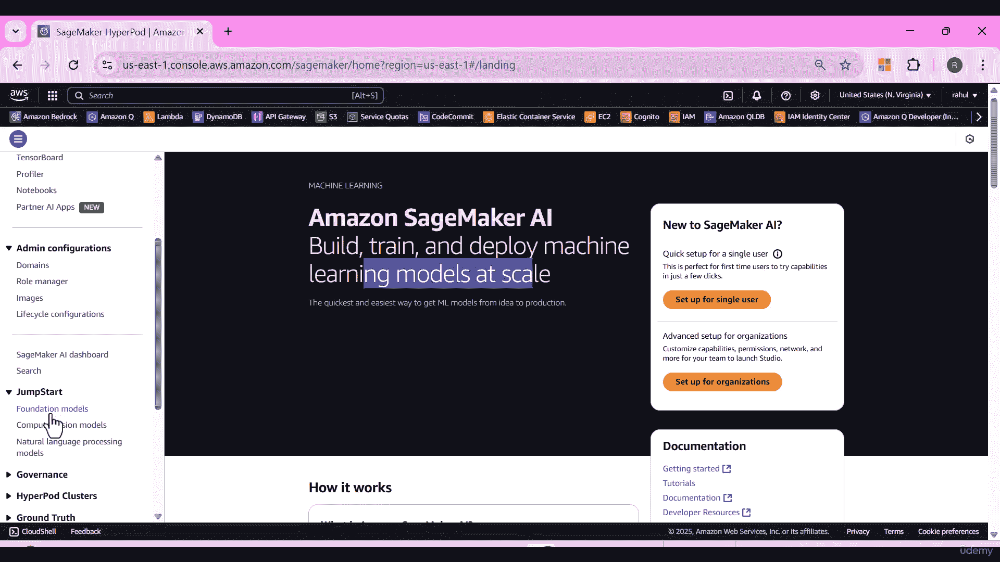
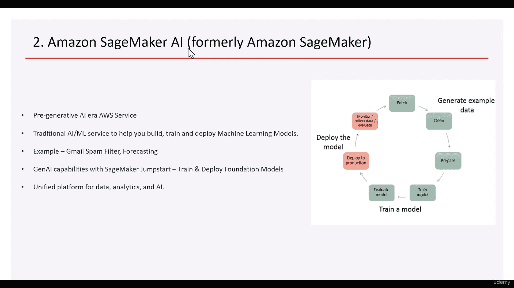
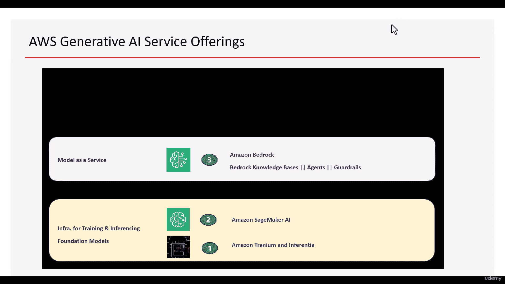
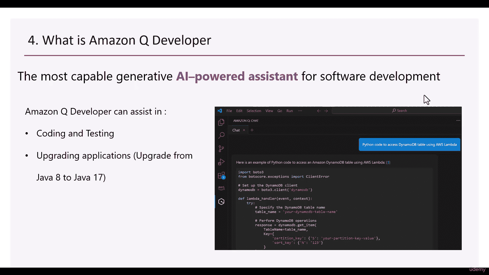

# AWS生成式AI实战（Amazon Bedrock、RAG与KIRO）：第11-12讲：AWS生成式AI服务全景 🧭


在本节课中我们将要学习AWS生成式AI服务的整体版图，目的是在下一节深入Amazon Bedrock之前，先建立一个全局认识。换句话说，后面会讲很多具体服务和功能，如果一开始不知道它们分别位于哪一层，就容易把基础设施、模型服务和应用产品混在一起。原文先给出一个总览：AWS通过三个层次提供生成式AI服务，并且在这三个层次中一共包含四种不同的服务。下面我们先看整体结构，再逐个层次拆开说明。为了直观理解，可以把三层服务栈记成下面这样。


```text
AWS生成式AI服务栈
┌──────────────────────────────────────┐
│ 应用层：Amazon Q                      │
├──────────────────────────────────────┤
│ 模型即服务层：Amazon Bedrock           │
├──────────────────────────────────────┤
│ 基础设施层：Trainium/Inferentia + SageMaker AI │
└──────────────────────────────────────┘
```


理解这个服务栈之后，初学者就能先判断一个问题：自己需要的是算力、是托管模型API，还是开箱即用的应用。接下来我们按照从底层到上层的顺序，介绍这三层分别包含什么，以及每层适合解决什么问题。以下是三层服务的总览说明。


- 第一层是用于训练和推理基础模型的基础设施。举例来说，如果你想构建自己的AI模型或基础模型，就需要某种计算基础设施，而AWS正是在这一层提供这类能力。在这一层中，AWS有两个服务：第一个是Amazon Trainium和Inferentia，第二个是Amazon SageMaker AI。  
  

- 第二层是模型即服务。Amazon Bedrock、Amazon Bedrock Knowledge Bases、Agents和Guardrails就是在这一层发挥作用。它是一个无服务器服务，AWS会托管所有基础模型，负责扩缩容、监控、修补等工作，你只需要通过API访问模型。  
  

- 第三层是利用基础模型构建的应用。这一层对应的服务是Amazon Q。AWS会为你预构建应用，这个应用在背后利用大语言模型，但对你来说它是一个完整应用。你需要做的是把它与数据源集成，并确定谁可以访问这个应用，然后就可以开始使用。  




上面是整体框架，接下来我们深入一点看每一层。先看Amazon Trainium和Inferentia，因为它们是理解底层算力的起点。以下是关于这两类计算基础设施的介绍。


AWS提供Trainium和Inferentia2，它们本质上是用于训练和部署AI模型的计算基础设施，所以可以简单把它们看作计算服务。原文给出的关键点是：与可比的Amazon EC2实例相比，训练成本最高可节省约50%。可以用一个简单关系表示：`训练成本节省比例 ≈ 50%`。你可以把它们理解成针对深度学习模型优化过的EC2实例：用Trainium训练模型，用Inferentia把模型部署到生产环境。  





在控制台演示中，操作路径是这样的：进入AWS控制台，搜索EC2，点击EC2，再点击正在运行的实例，然后启动实例；在AMI搜索中搜索Trainium，可以看到Hugging Face Neuron Deep Learning AMI，这个AMI让使用Amazon EC2 Inferentia和Trainium实例变得更容易。你可以从这里选择，从而获得一个EC2 Inferentia或Trainium实例。  



接下来我们看Amazon SageMaker AI。Amazon SageMaker AI以前叫Amazon SageMaker，在2024年12月re:Invent大会上改名为Amazon SageMaker AI。它基本上是生成式AI时代的AWS服务，可以用来构建AI/ML服务，也就是构建、训练和部署机器学习模型。前面讨论过机器学习模型可以用于Gmail垃圾邮件过滤、预测等场景。2023年生成式AI出现后，SageMaker AI增加了SageMaker JumpStart能力，可以训练和部署基础模型。生成式AI热潮出现后，AWS又推出了Amazon Bedrock，后者现在是生成式AI的旗舰服务，而Amazon SageMaker更多用于传统AI/ML服务，不过它也有一些生成式AI相关能力。  

AWS把SageMaker定位为数据分析和AI的统一平台。为了帮助初学者理解，可以快速看一下它的核心能力。它主要在三个区域工作：第一，从各种数据源摄取数据，例如销售点数据、事务型数据库、数据仓库；第二，把数据摄取到SageMaker后，清洗数据并准备数据；第三，从预构建模型中选择模型，用已摄取的数据训练模型，评估模型，认为可以部署后再部署并监控生产环境中的模型。整个过程可以概括成下面的流程。


```text
数据摄取 -> 数据清洗与准备 -> 选择预构建模型 -> 训练 -> 评估 -> 部署 -> 监控
```


在控制台演示中，搜索SageMaker后可以看到Amazon SageMaker AI，页面说明是“大规模构建、训练和部署机器学习模型”。在左侧可以看到JumpStart，它提供基础模型相关能力。点击基础模型后，可以看到SageMaker JumpStart中可用的各种基础模型。这里的典型场景是：当你要构建、训练和部署自己的模型时，可以使用Amazon SageMaker。  

上一节我们介绍了底层算力和SageMaker AI，本节中我们来看看模型即服务层，也就是Amazon Bedrock。Amazon Bedrock是一个无服务器服务。控制台中可以看到Amazon Bedrock提供的各种基础模型，这些模型由AWS托管。你只需要从控制台或CLI发出请求即可。原文给出的示例是询问“谁是史上最好的网球运动员”，然后指定模型ID并使用Cohere模型，把请求发送给Amazon Bedrock，Bedrock会把请求发送到后端，然后返回响应。也就是说，你不需要自己托管模型，扩缩容、修补以及其他活动都由Bedrock负责。可以用下面的伪代码表示这种调用方式。


```python
response = bedrock.invoke_model(
    modelId="cohere-model-id",
    body={"prompt": "谁是史上最好的网球运动员？"}
)
```


理解了Bedrock的模型即服务定位后，再往上看应用层就更容易了。最后我们看Amazon Q，它有不同形态。如果你是开发者，会用到Amazon Q Developer；如果你是业务人员，会用到Amazon Q Business；如果你是BI人员，会用到Amazon Q in QuickSight；如果你从事供应链，会用到Amazon Q in Supply Chain；如果你是Amazon Connect用户，会用到Amazon Q in Connect。以下是不同用户场景对应的Amazon Q形态。


- 开发者场景：Amazon Q Developer。  
  

- 业务人员场景：Amazon Q Business。  
  



- BI场景：Amazon Q in QuickSight。  
  



- 供应链场景：Amazon Q in Supply Chain。  
  

- Amazon Connect用户场景：Amazon Q in Connect。  






接下来看Amazon Q Business的能力。它是一个全托管的、由生成式AI驱动的助手，可供业务用户使用；它可以为你生成内容、总结数据，也可以与企业数据进行聊天。它可以连接Salesforce数据，也可以连接S3等数据源，通过自然语言和聊天机器人连接这些数据源。它还可以连接Jira以及其他应用。你可以把它简单理解成带有企业控制能力的ChatGPT，也就是你对大语言模型如何使用你的数据有更多控制。以下是Amazon Q Business的能力概括。


- 全托管生成式AI助手，面向业务用户。  
  



- 支持生成内容和总结数据。  
  

- 支持与企业数据聊天，例如Salesforce、S3等数据源。  
  

- 支持通过自然语言聊天机器人连接数据源。  
  

- 可连接Jira等应用。  
  

- 类似带企业控制能力的ChatGPT，对数据使用方式有更多控制。  


然后还有Amazon Q Developer。原文称它是AWS最有能力的、由生成式AI驱动的软件开发助手。它的能力包括：作为代码生成器，例如原文给出一个查询“用AWS Lambda访问DynamoDB表的Python代码”，它返回了代码；它还能生成测试用例，也可以用于升级应用代码。可以用下面的形式概括这个示例。


```text
用户请求：用AWS Lambda访问DynamoDB表的Python代码
Amazon Q Developer：生成对应代码
```




本节中我们一起学习了AWS生成式AI服务的三层结构和四种服务，从底层Trainium、Inferentia和SageMaker AI，到模型即服务层的Amazon Bedrock，再到应用层的Amazon Q家族。可以把本讲核心记成一句话：底层提供算力，中间层托管基础模型并通过API使用，上层提供预构建应用。原文最后说明本讲内容到这里，下一讲再见，谢谢。希望这个总览能帮助你在后续学习Amazon Bedrock时，快速把新概念放回正确的位置。
