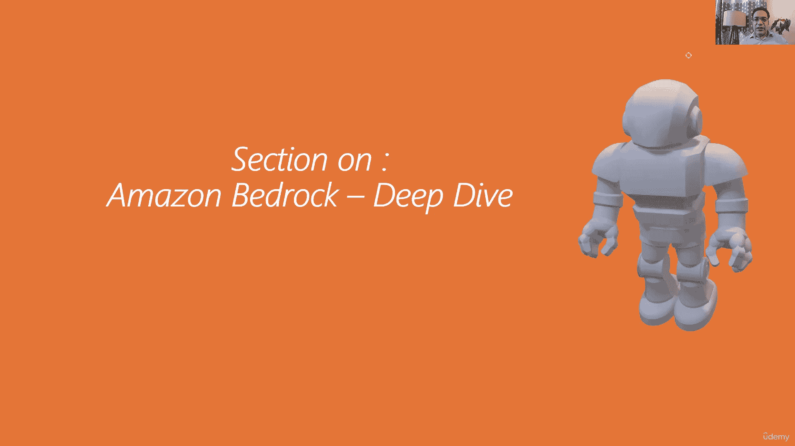
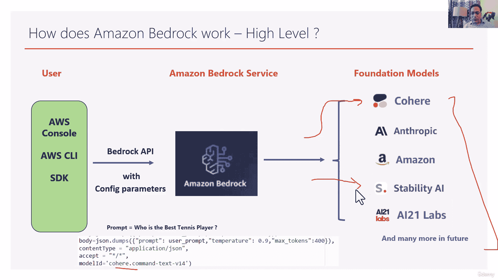
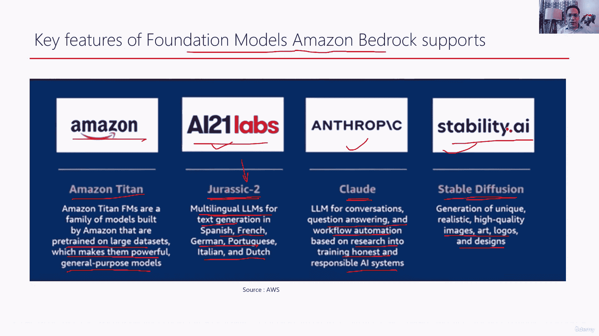

## 📖 AWS生成式AI实战：00：本节概述

在本节课中我们将要学习Amazon Bedrock的基础概念和整体工作方式。课程会先说明Amazon Bedrock是什么，以及它作为AWS全托管无服务器服务意味着什么；然后介绍它如何通过API让用户访问Amazon和第三方提供商的基础模型；接着用一个高层流程图解释用户请求如何进入Bedrock服务，并按照模型ID被路由到对应基础模型；最后会概览当前支持的主要基础模型及其关键优势，为后续深入学习模型选择和参数配置打下基础。整节内容会尽量用直白的大白话解释，让初学者也能跟上。

## 🧠 AWS生成式AI实战：01：什么是Amazon Bedrock

在上一节概述中我们知道了本节要学习Amazon Bedrock，本节中我们来看看它的定义。Amazon Bedrock是AWS提供的一项全托管、无服务器服务。为了直观理解，可以写成下面的形式：

```text
Amazon Bedrock = 全托管服务 + 无服务器服务 + 通过API访问基础模型
```

这里的“无服务器服务”并不表示没有服务器，而是表示用户不需要自己购买服务器、安装系统、打补丁和维护运行环境。AWS会负责配置、监控、打补丁以及其他运行管理工作，最终用户只需要使用这个服务，并按实际使用量付费。换句话说，用户成本可以理解为：



```text
用户成本 = 按实际使用量付费
```

Amazon Bedrock的第二项关键能力，是让来自Amazon和第三方提供商的基础模型可以通过API访问。Bedrock服务会托管大量来自Amazon和第三方基础模型提供商的基础模型，然后通过API让最终用户访问这些模型。也就是说，用户不需要自己部署模型，只需要调用API就能使用托管在Bedrock中的基础模型。

那么，目前可以通过这个API访问哪些第三方模型提供商和模型来源。以下是目前可以通过Bedrock API访问的模型来源：

- Amazon：提供Amazon自家基础模型。
- Anthropic：提供Claude相关基础模型。
- Cohere：提供Cohere基础模型。
- Stability AI：提供Stable Diffusion相关基础模型。
- AI21 Labs：提供Jurassic2相关基础模型。

未来会有更多模型可用，但当前可以使用的是上述这些来源。这里先建立模型来源的整体印象，后续再结合具体模型看它们适合什么场景。

## 🔌 AWS生成式AI实战：02：通过API访问基础模型与请求参数

上一节我们介绍了Amazon Bedrock是什么，以及它托管基础模型并通过API提供访问，本节中我们来看看用户请求是怎样组织的。用户可以通过AWS控制台、AWS CLI或者AWS SDK访问Bedrock服务。用户使用Bedrock API发出请求时，还会添加一些配置参数。

原文给出的一个示例是：用户提供一个提示词，内容是“谁是最好的网球运动员”，同时添加一些配置参数。配置参数中的一个重要内容是模型ID，模型ID用来告诉Bedrock服务要使用哪个模型。由于幻灯片中展示了所有可用的基础模型，用户只需要在请求里加上自己想用的模型ID即可。除了模型ID，还有其他参数，例如temperature和max_tokens等。这些配置参数都会影响基础模型的输出或响应，后续会有单独的课程深入讲解这些参数，本节只需要先认识到用户请求由提示词和配置参数共同组成。可以写成：

```text
API请求 = 提示词 + 模型ID + 配置参数(temperature, max_tokens, ...)
```

换句话说，基础模型的最终响应可以理解为提示词、模型ID和配置参数共同作用的结果：

```text
响应 = 基础模型(提示词, 模型ID, temperature, max_tokens, ...)
```



这里需要强调的重点是：用户发出一个API请求，请求中包含提示词和一些配置参数；请求随后进入Amazon Bedrock服务；Bedrock服务查看这些配置参数，然后把请求传递给托管在AWS账户中的基础模型。这个流程看起来简单，但它把模型托管、请求路由和参数控制连接在了一起，是理解Bedrock使用方式的基础。

## 🏗️ AWS生成式AI实战：03：Amazon Bedrock高层工作原理

上一节我们看了请求由提示词和配置参数组成，本节中我们来看看Amazon Bedrock在高层是如何工作的。用户可以通过AWS控制台、AWS CLI或AWS SDK访问服务。用户使用Bedrock API发出请求，请求中包含提示词和配置参数，然后请求进入Amazon Bedrock服务。Bedrock服务会查看这些配置参数，再把请求传递给托管在AWS账户中的基础模型。

幻灯片中展示了很多基础模型，并且可以看到某个请求的模型ID是Cohere，因此这个请求会被发送到Cohere对应的模型。如果请求里提供的是其他基础模型ID，那么请求就会发送到请求中定义的其他模型。整个高层流程可以概括为：

```text
用户 -> Bedrock API -> Amazon Bedrock服务 -> 按模型ID路由 -> 对应基础模型 -> 返回响应
```

这个图表来自AWS，它提供了一些细节，用来说明Amazon Bedrock支持的基础模型有哪些关键特性。稍后我们会深入讨论如何为具体用例选择合适的基础模型；现在先看这些不同基础模型之间的关键差异。理解这些差异之后，用户才能判断某个模型更适合通用文本任务、多语言文本生成、问答与工作流自动化，还是图像生成任务。

## 🗂️ AWS生成式AI实战：04：支持的基础模型与关键特性

上一节我们介绍了Bedrock的高层请求路由流程，本节中我们来看看当前主要基础模型各自的关键优势。以下是这些基础模型在高层的核心优势：

- Amazon Titan：Amazon提供Amazon Titan基础模型，它在大规模数据集上进行了预训练，因此模型能力较强，可以作为通用目的模型使用。对于通用场景，它是一个合适的候选。这里的通用场景可以包括文本摘要，也可以包括内容生成等各种任务。换句话说，只要任务属于常见的通用文本处理范围，就可以先考虑Titan这一类模型。

- AI21 Labs Jurassic2：AI21 Labs提供名为Jurassic2的基础模型。AI21 Labs是组织名称，这些是组织名称，而这些是它们为Jurassic2提供的模型名称。Jurassic2的一个好用例是多语言大语言模型或文本生成基础模型，它支持多种语言，视频中可以看到这些是它支持的语言。比如用户要创建一个聊天机器人，并且这个机器人需要支持不同语言访问，那么Jurassic2可能是一个合适的用例。

- Anthropic Claude：Anthropic提供Claude基础模型。它的优势包括问答和工作流自动化，并且这些能力基于对训练诚实或负责任AI系统的研究。因此，如果用户需要问答能力或工作流自动化能力，就可以考虑这个模型。

- Stability AI Stable Diffusion：Stability AI提供Stable Diffusion基础模型，它专注于创建图像、logo和设计。因此，如果任务与图像生成相关，就应该使用这个模型。

显然，选择模型还有多个标准，后续幻灯片会继续讨论。本节给出的是各基础模型关键优势的高层说明。到这里，你应该对Amazon Bedrock有了一个高层概览。模型选择不是只看一个维度，而是要把任务类型、语言需求、输出形式和后续配置参数放在一起考虑。

## ✅ AWS生成式AI实战：05：本节总结



前面几节我们介绍了Amazon Bedrock的定义、API请求结构、高层工作原理以及主要基础模型的关键优势，本节中我们做一个总结。本节课中我们一起学习了Amazon Bedrock是AWS提供的全托管无服务器服务，AWS负责配置、监控、打补丁等运行管理工作，用户按实际使用量付费；Bedrock托管来自Amazon和第三方提供商的大量基础模型，并通过API让最终用户访问；用户请求由提示词、模型ID以及temperature、max_tokens等配置参数组成，Bedrock服务会根据配置参数把请求路由到AWS账户中托管的对应基础模型；当前主要模型来源包括Amazon Titan、AI21 Labs Jurassic2、Anthropic Claude和Stability AI Stable Diffusion，它们分别适合通用任务、多语言文本生成、问答与工作流自动化、图像生成等不同场景。后续课程会继续深入配置参数和模型选择标准。本节内容在实际使用中会有帮助，下节课再见，感谢阅读。

