🎓 生成式AI在AWS上 - Amazon Bedrock、RAG与KIRO [2026]：Part 1 P13-14：Bedrock控制台演练1 🖥️


在本节课中，我们将一起走进 Amazon Bedrock 的 AWS 管理控制台，进行一次完整的实操演示。我们会看到这个服务到底长什么样，它的主页上有哪些功能模块，以及左侧菜单栏里的每一项分别能做什么。这里要提前说明，我只会给大家一个高层次的总体概览，不会深入到每一个按钮背后的原理。如果你暂时觉得某些概念不太明白，完全不用着急，因为在后面的章节中，我们会用这些能力去构建一些真实的用例，到时候自然就会更清楚。这一节主要的目标，是让你先从视觉上对 Amazon Bedrock 建立整体印象。除了界面浏览，我还会演示如何获取各种基础模型的访问权限。请记住，这些模型默认情况下并不会自动对你开放，你需要手动去申请访问权。现在，让我们正式进入 AWS 控制台。


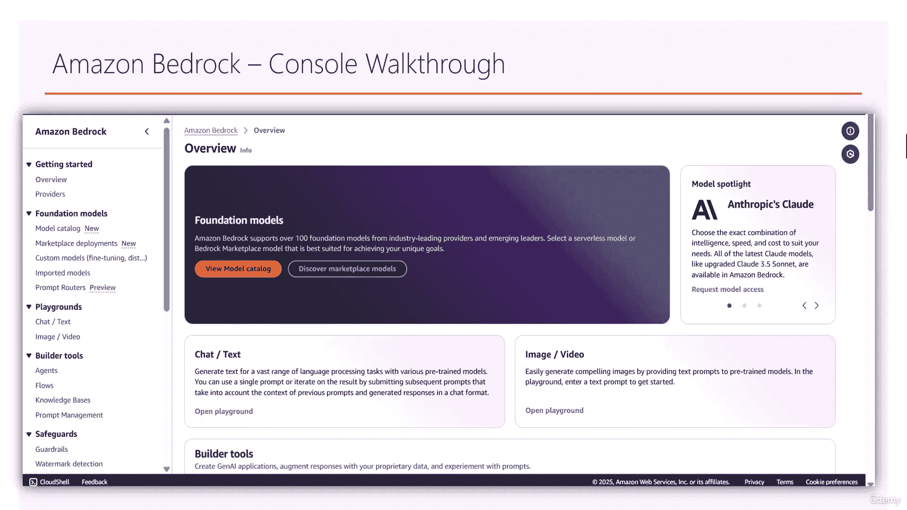

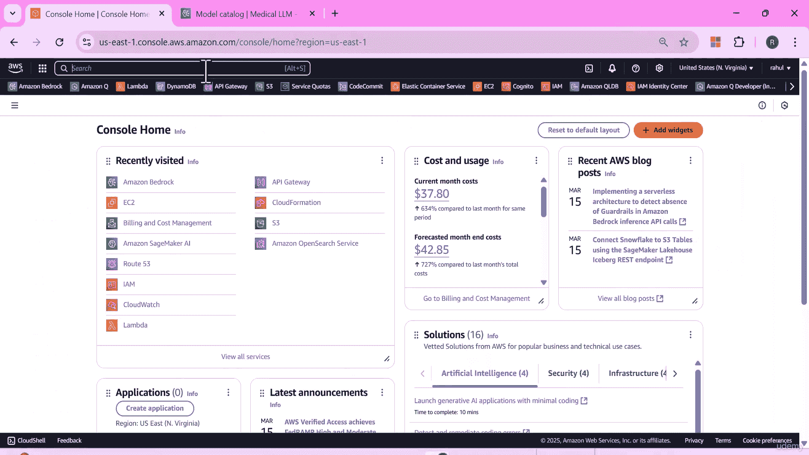

## 🚀 进入 Amazon Bedrock 控制台


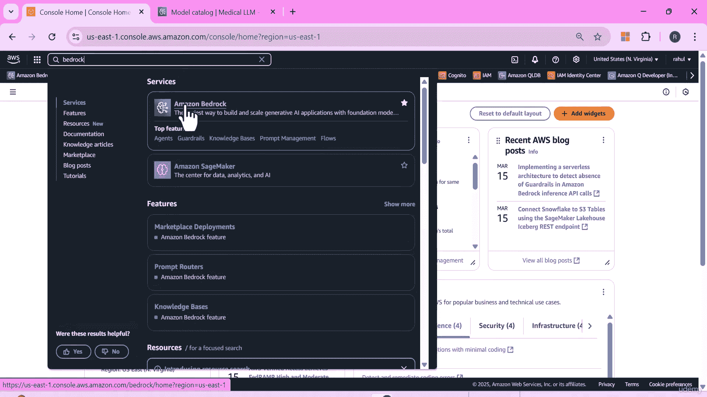

首先，我已经打开 AWS 管理控制台，接下来要做的就是在顶部的搜索框中输入“bedrock”。搜索完成之后，页面里会显示出 Amazon Bedrock 这个服务，我直接点击它进入服务页面。现在屏幕上看到的是 Amazon Bedrock 的首页，首页上会有一段简短的项目说明，内容大概是：Amazon Bedrock 支持超过 100 个基础模型，这些模型来自行业领先的提供商和新兴领导者。这个数字本身就很能说明问题，意味着你可选的模型种类非常丰富。接下来，我会带着大家逐个点击左侧的菜单栏，看看每个部分具体提供什么功能。我们先来看最上方的“Getting Started”（入门）区域，这里面有一个“Overview”（概述）页面。在这个页面上，你会看到聊天（Chat）、图像构建器（Image Builder）等工具，这些工具实际上就是左侧菜单功能的镜像，方便你在同一个页面上快速访问。


## 🏢 模型提供商与无服务器模式


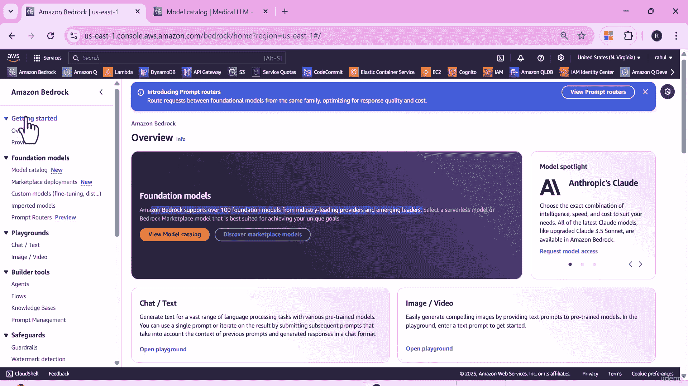

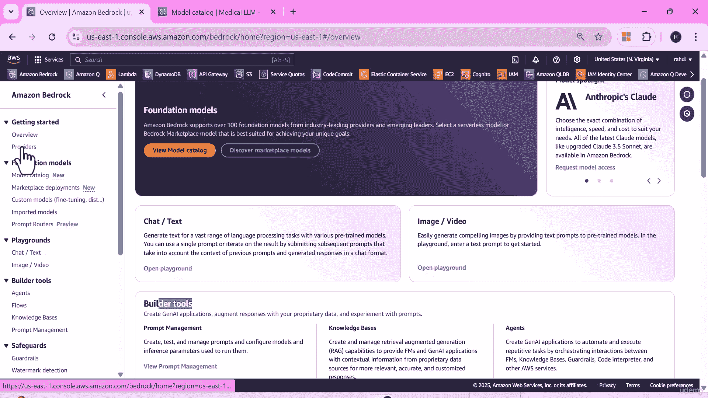

接着，我点击左侧菜单中的“Providers”（提供商）。进入之后，可以看到这里大约有 8 个提供商。所谓“提供商”，就是那些把自己的模型托管到 Amazon Bedrock 上的 AI 公司。这些提供商里面，有一家是 AWS 自己的，也就是 Amazon。剩下的提供商，有些是初创公司，比如 21 Labs 和 Anthropic，也有一些是大型科技公司，比如 Meta、DeepSeek、Stability 等。对于每一家公司，你都可以在页面上看到三样信息，我来给你逐一说明：

- 第一样是公司名称，比如这里显示的 Meta、Anthropic 等。
- 第二样是这家公司提供的模型数量，例如 Meta 提供了 9 个模型。
- 第三样是“Serverless”（无服务器）标识，表示这些模型都可以通过无服务器方式访问。

那“无服务器”到底是什么意思呢？简单来说，对于这 8 家公司提供的所有模型，AWS 会全权负责模型的托管、自动扩缩容、安全防护等一系列底层工作。你不需要自己部署任何服务器，也不需要管理任何基础设施。作为使用者，你只需要通过 API 发送请求或者提示词，就能拿到模型返回的结果。这里的计费方式也非常直接，就是按照你发送给模型的请求数量来收费，没有固定月费或预付费。每发一次提示词或请求，可能就只需要花费几美分。我们可以用这样一条公式来表示它的计费模型：

```text
总费用 = 请求次数 × 每次请求单价
```

我点击一下 Meta，页面就会跳转到 Meta 的模型列表页。再点击一下里面的某个模型，就能看到这个提供商所有可用模型的详细信息。比如这里能看到 Llama 3.3，这是一个 700 亿参数的 instruct 模型。所谓 700 亿参数，你可以粗略地理解为模型内部有 700 亿个可调节的旋钮，参数越多，模型通常越聪明，但运行成本也会更高。接着往下看，页面会展示这个模型适合做什么任务，比如指令遵循和任务执行、改进的推理能力等。如果看 Llama 3.3 Vision Instruct，它主要用于聊天和代码生成优化。页面还会模型提供模态（Modality）信息，也就是这个模型到底支不支持处理文本，能不能同时处理文本和视觉内容，或者能不能做图像生成、视频生成，又或者是否支持文本与视觉的组合输入。这些属性信息，能帮助你在后续选择模型时做出更合适的判断。

现在返回上一页。对于所有提供商，你都可以采用同样的方式进入它们的专属页面，查看它们提供的具体模型列表以及每个模型的能力说明。比如 Anthropic 大约提供 10 个模型，你可以在页面上逐一查看这些模型，评估它们的区别和适用场景。


## 🔑 获取模型访问权限


接下来，我打算向下滚动左侧菜单，点击“Model access”（模型访问权限）。这里要特别强调，如果你是第一次使用 Amazon Bedrock，那么默认情况下你对模型是没有任何访问权限的。你必须在控制台里主动申请，系统才会帮你开通。在我这个演示账号里，你可以看到我已经被授予了很多不同服务的访问权限，页面上会显示已经授权了哪些模型。但对于新用户，你会看到一个按钮，用来修改模型访问权限。我点击“Modify model access”（修改模型访问权限），然后就能进入模型选择页面。在这里，我可以勾选自己需要的模型，比如我选择三个目前还没有访问权限的模型，勾选完成之后，点击“Next”（下一步），再点击“Submit”（提交）。提交之后，稍微等一会儿，这些模型就会出现在你的已授权列表里了。

这里有一个非常重要的建议，就是尽量选择“North Virginia”（北弗吉尼亚）区域。为什么？因为大部分基础模型都是先在这个区域上线，然后再逐步推广到其它区域。如果你选了一个比较偏的区域，可能会发现很多模型根本找不到。另外，如果你是第一次使用这个服务，你可能会看到类似“Enable access to all models”（启用对所有模型的访问）和“Enable access to specific models”（启用对特定模型的访问）这样的选项。如果你只是想快速体验，可以直接点击“Enable all models”（启用所有模型），然后点击“Next”，最后提交即可。这样你就能访问平台上所有模型了。请记住，这是实现任何用例的第一步，哪怕你只是想从控制台调用模型，也必须先完成这个模型访问开通流程。


## 🎮 使用 Playground 测试模型

等到模型访问权限开通之后，接下来我们进入“Playground”（游乐场）看看。我待会儿还会回到“Foundation models”（基础模型）部分继续讲解，现在先集中看看 Playground。Playground 是 AWS 提供的一个交互式测试环境，目的是让你在正式开发 AI 应用之前，先通过图形界面测试各种模型的效果，看看它们在不同问题上的回答表现。这个功能对初学者特别友好，因为不需要写代码就能体验大模型。在 Playground 页面上，你能看到两个主要选项：

- Chat and Text（聊天和文本）
- Image and Video（图像和视频）

我们先点击“Chat and Text”。进入之后，你可以从页面顶部的模型下拉列表中选择一个模型。还记得之前提到的 8 个模型提供商吗？在这里你都可以选。比如我选择 Meta，然后从 Meta 的模型列表里选择一个我已经有访问权限的模型，点击它并选择“Apply”（应用）。应用完成之后，我就可以在对话框里输入问题。比如我问“谁是最好的足球运动员？”，你可以看到模型正在逐字生成回答。在这个过程中，左侧边栏会显示一些参数，比如“Randomness and diversity”（随机性和多样性），其中包含“Temperature”（温度）和“Top P”这两个关键参数。

温度和 Top P 都是用来控制回答创造性的参数，后续课程我们会详细讨论，但这里可以先给出一个直观的理解。你可以把它们想象成“创意旋钮”：温度越高，回答越发散、越有随机性；温度越低，回答越保守、越确定。Top P 则是控制候选词集合的大小。我们可以用下面这段代码来表示它们的核心意思：

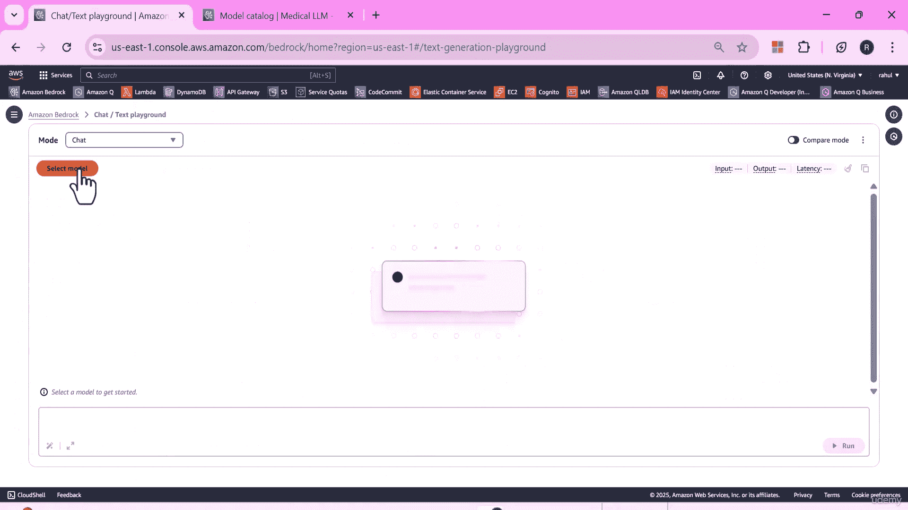

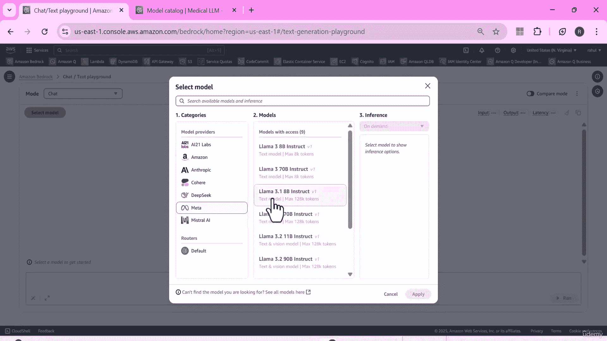

```python
temperature = 0.7   # 温度：越高越随机，越低越确定
top_p = 0.9         # Top P：从累计概率达到 90% 的候选词中采样
```

除了随机性参数，左边还有一个“Length”（长度）设置，用来控制你希望模型回答多长。我当前看到的示例是大约 52 个 token。所谓 token，你可以理解为模型处理文本时使用的“单词碎片”，一个 token 可能是一个完整的单词，也可能是一个单词的一部分。然后我们还有“Guardrails”（护栏）配置，如果你不想让模型输出某些有毒词汇、敏感话题等，你可以在这里设置规则，把这些内容屏蔽掉。这个功能对生产环境来说非常实用。

现在，如果回到 Playground 的主页面，我们会看到另一个选项“Image and Video”。点击进入之后，同样可以选择模型。这里目前有两个模型，比如我选择 Amazon 的 Nova Canvas，这是 AWS 新发布的一个图像生成模型。我点击它，再点击“Apply”。接下来，我可以在输入框中输入一个请求，比如“创建一张狗在日落下的图像”，然后点击运行按钮。你可以看到模型很快就生成了三张图像，我可以直接点击下载保存。我也可以在这里切换模型，比如换成另一个模型重新测试同样的问题，然后对比不同模型的输出效果。

我想再次强调，Playground 的主要目的就是让你尝试不同的模型，然后判断哪个模型最适合你的具体用例。所以你可以随时更换模型，提出同样的问题，观察不同模型的回答差异，从而找到最符合业务需求的那一个。


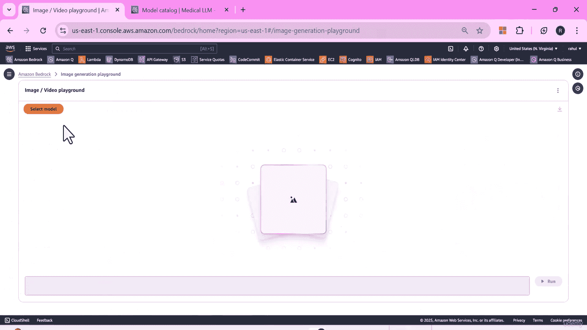

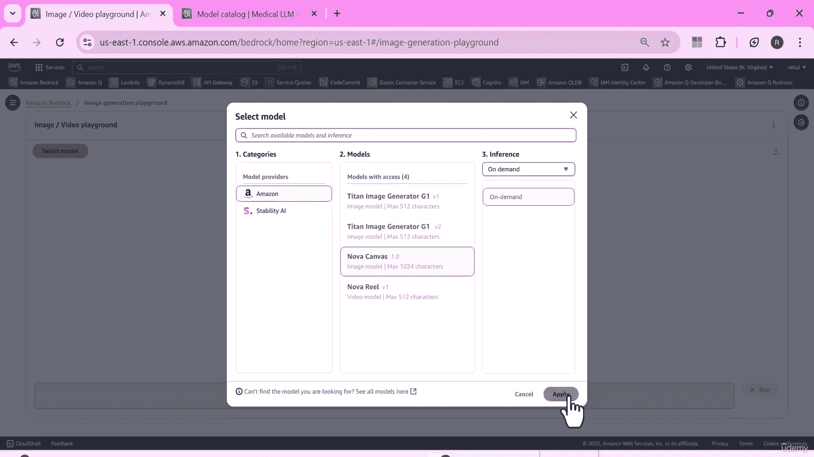

## 📚 基础模型目录与 Bedrock Marketplace

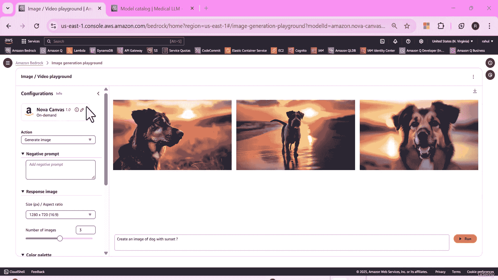

好的，我们现在返回菜单。接下来是“Foundation models”（基础模型）这个模块。在基础模型下面，有一项叫做“Model catalog”（模型目录）。点击进去之后，你会看到两个选项：一个是“Serverless”（无服务器），另一个是“Bedrock Marketplace”（Bedrock 市场）。无服务器选项就是我们之前看到的那一组模型，也就是那 8 家公司提供的所有模型。你可以看到这里大约有 47 个模型，这些是 AWS 官方提供访问的核心模型，也是大多数用户最常使用的模型。但 AWS 并不满足于此，他们还想给你提供更多选择，因此推出了 Bedrock Marketplace。在这个市场里，大约有 137 个模型。如果你逐个浏览这些模型，会发现里面有来自 Nvidia 的模型，有面向医疗领域的 Medical LM、医学文本模型，还有来自 IBM 的模型。这些市场模型通常不是普通用户日常高频使用的，因为它们的领域属性更强。如果你正好有某个特殊领域的需求，就可以选择它们。

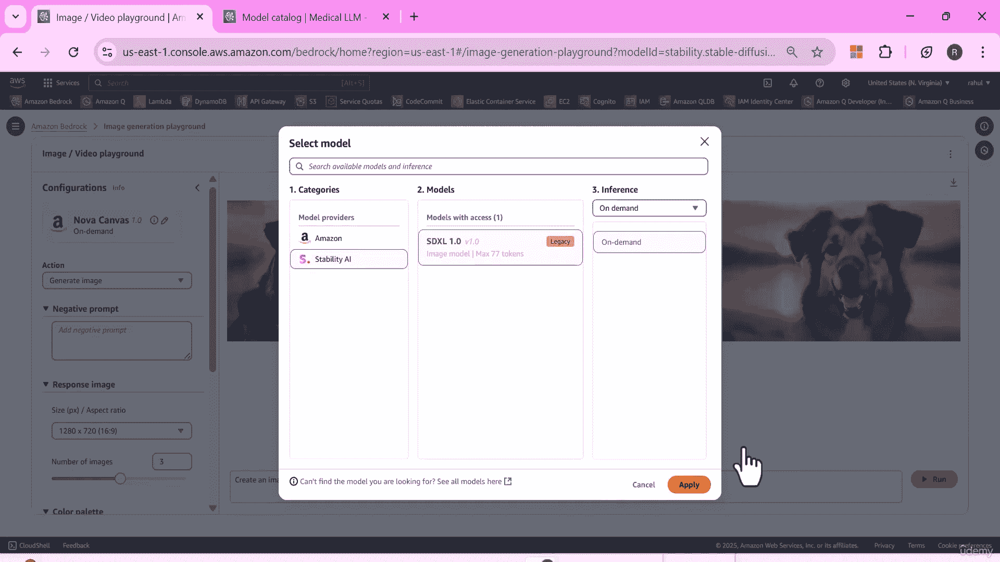

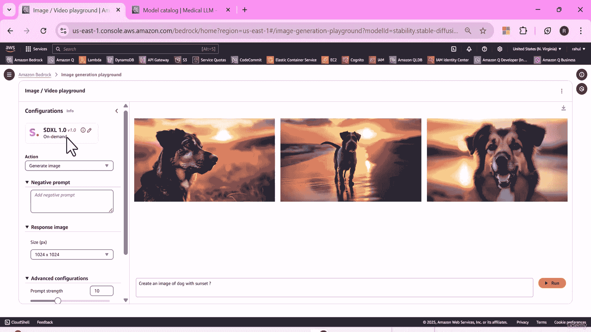

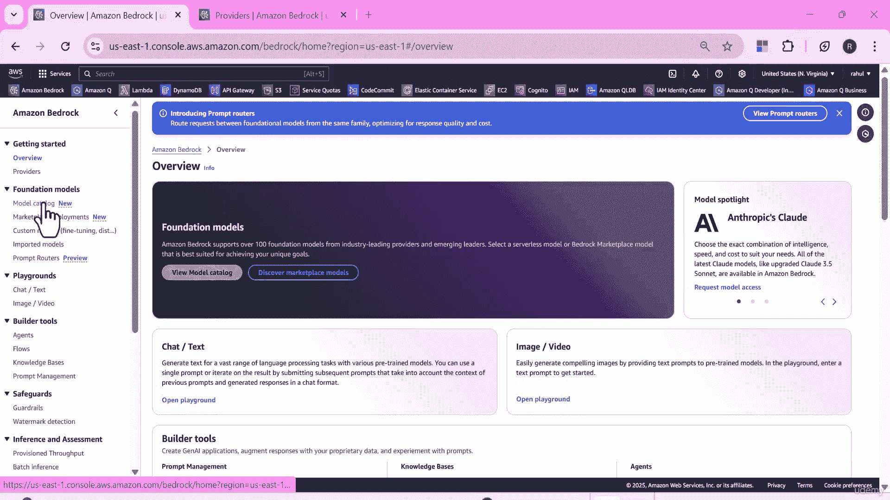

这种市场模型面临的一个挑战是，它们采用的是“Marketplace Deployment”（市场部署）方式。我来演示一下我的意思。当你点击进入一个市场模型时，如果要使用它，你需要先订阅这个模型。页面上会有一个“View subscription”（查看订阅）按钮，你需要点击订阅。然后，你还不能直接在 Bedrock 上使用这个模型，而必须将其部署到 Amazon SageMaker 服务中。部署完成之后，你会获得一个端点（Endpoint），然后才能在 Bedrock 里通过这个端点来调用模型。这个过程是会额外产生费用的，而且费用是按小时计算的。你会看到页面上列出了各种成本，包括 SageMaker 实例的按小时基础设施费用，以及模型提供商自己收取的设备费用。你需要在三个不同规格的实例中选择一个来完成部署，所以总成本大概可以表示为：

```text
总成本 = 基础设施按小时费用 + 模型提供商按小时费用
```

相比之下，无服务器模型就简单得多，你只需按照实际使用量付费，不需要关心底层实例。看看这个医疗模型，你会发现它的定位非常明确，就是为了医学领域服务的。Bedrock Marketplace 里的模型往往就是这样，专注于某个特定任务或领域，而不是像基础模型那样通用。

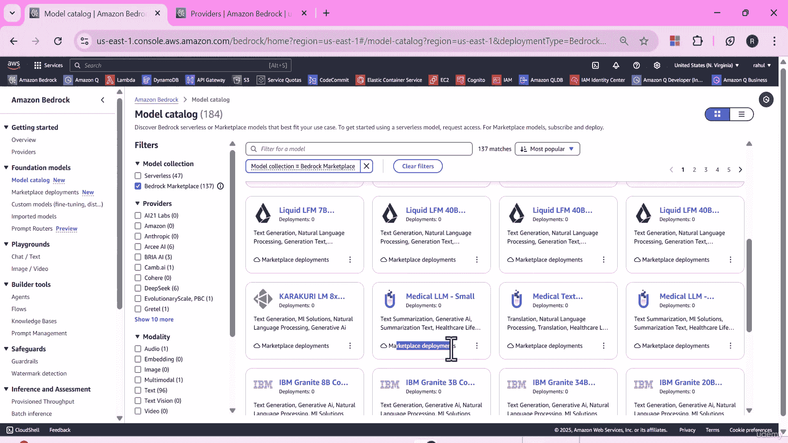

到这里，你应该能理解 AWS 的主打模型是无服务器模型，但如果你在某些特定领域找不到合适的模型，可以到 Bedrock Marketplace 上找找看，那里可能有不包含在无服务器列表里的专用模型。


## 🛠️ 市场部署与成本警告

接下来，左侧菜单里还有一个“Marketplace deployment”（市场部署）的页面。如果你从 Marketplace 中选择了任何模型，那么在这个页面里就能看到它们。操作路径也很简单：先点击“View model catalog”（查看模型目录）进入我们刚才看到的模型列表，然后订阅并部署，部署时就会产生按小时收费。部署完成后，你就可以在这个页面管理你的模型。换句话说，所有来自 Marketplace 的模型都会集中显示在这里，方便你集中管理。

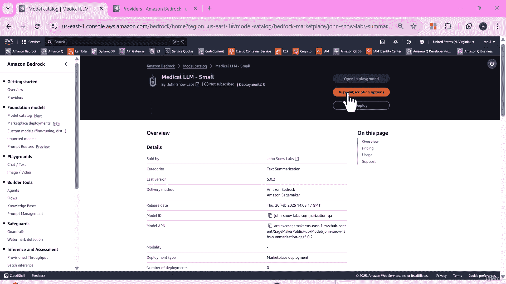

但是，我在这里要给出一个明确的忠告：如果你只是单纯想学习 Amazon Bedrock，我不建议你去使用任何来自 Marketplace 部署的模型，因为按小时计费的成本非常容易累积，对于学习用途来说不够经济实惠。所以，在初学阶段，还是老老实实使用无服务器模型就好。


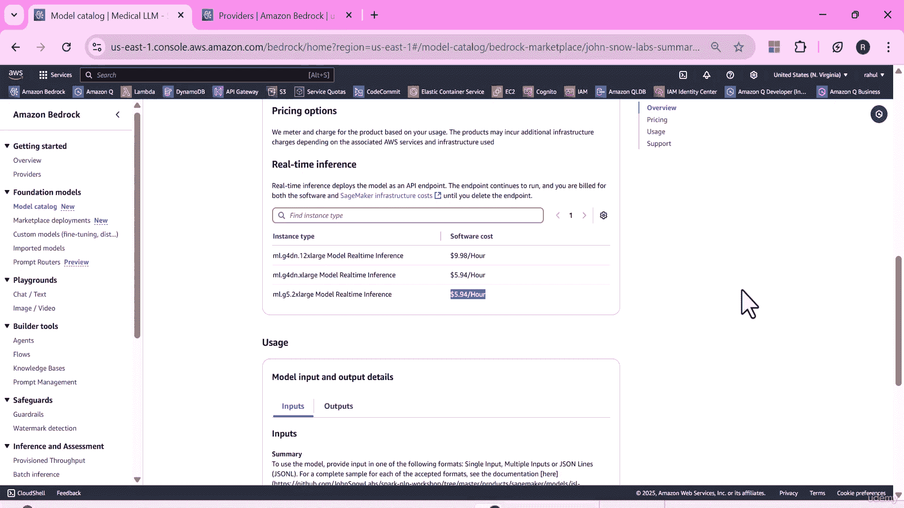

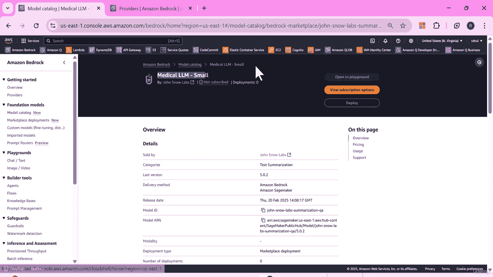

## 🧠 自定义模型：微调、持续预训练与蒸馏

下面我们来看“Custom models”（自定义模型）。之前我们从那 8 个提供商那里看到的无服务器模型，通常被称为“基础模型”（Base Model），因为这些模型都是在通用数据上进行训练的。通用数据指的是来自互联网的大规模公开文本，覆盖话题很广，但不一定深入某个专业领域。举个例子，假设你想构建一个文本摘要应用，这个应用要能够记录医生和患者之间的对话，把语音转成文字，然后自动生成摘要。如果你直接使用基础模型来做这件事，它很可能无法准确理解医学术语，因为它此前没有专门学过医学领域的知识。在这种情况下，你需要自己创建一个自定义模型。Amazon Bedrock 给了你三种方案，分别是：

- 微调（Fine-tuning）
- 持续预训练（Continued pretraining）
- 蒸馏（Distillation）

我们先说微调。所谓微调，本质上是使用带标签的数据来训练基础模型。带标签的数据是什么意思？就好比你有一组数据，里面每条数据都已经标注好了——“这是某种疾病名称，它的含义是什么”。假设你有几千条这样的记录，你把它们输入到基础模型上继续训练，最终你会得到一个高度定制化的模型，这个模型能够准确识别这些疾病名称。我们可以用下面这个公式来概括微调过程：

```text
CustomModel = BaseModel + LabeledData
```

第二种方案是持续预训练。持续预训练也可以改善模型在某个特定领域的理解能力，但它使用的是未标注数据，也就是没有人工标签的原始文本。而微调使用的是有标签的数据。两者最大的区别就在这里：微调有监督信号，持续预训练没有监督信号。

第三种方案是蒸馏（Distillation），这是 Amazon Bedrock 新加入的能力。我们用一个大白话的例子来解释蒸馏。假设你正在构建一个聊天机器人，后台使用了一个很大的模型，比如 1000 亿参数的模型，来生成回答。这个模型效果很好，但运行成本非常高，而且响应速度也比较慢。这时候，你可以换一个 80 亿参数的小模型，小模型成本低、速度快，但缺点是小模型的回答质量可能不够好，无法处理太复杂的问题。那么，怎么让这个小模型变得更聪明呢？你可以自己“造”数据来训练它。具体做法是：先用那个大的语言模型生成一批合成数据，也就是让大模型回答很多问题，生成一批高质量的回答。然后用这些回答去训练那个小模型。这个过程就叫做蒸馏。我们可以用公式表示：

```text
SmallModel = LargeModelResponse + SmallModelTraining
```

以上就是自定义模型的三种方式。后面课程里我们会更深入地讨论这些方法，现在你只需要有一个整体印象即可。

再往下看，左侧菜单里还有一个“Imported models”（导入模型）的选项。假设你之前在 Amazon SageMaker 中训练过一个模型，但现在你想把 Amazon Bedrock 作为你的核心服务，并且希望把所有大语言模型统一放到 Bedrock 里管理。那么“导入模型”就派上用场了。这个功能允许你从 S3 存储桶或者 Amazon SageMaker 中导入模型，导入完成后，你就可以从 Amazon Bedrock 服务中直接访问这些模型。一旦导入成功，你应该就能在“Imported models”页面上看到所有导入模型，页面上也可以看到“Import model”（导入模型）按钮。


## 📦 导入模型与提示路由器

接下来，我们再来看一个比较新的能力，叫做“Prompt routers”（提示路由器）。目前这个功能还处于预览阶段，是最近才刚刚推出的。提示路由器的作用，是在同一个系列的基础模型之间路由请求，目标是优化响应质量和成本。我点击一下默认配置，可以看到目前它支持两个服务提供商，分别是 Anthropic 和 Meta。

那这个功能具体怎么用呢？我们来想象一个场景。假设我们已经构建了一个聊天机器人，用户有时候会提出非常复杂的问题，有时候提出的又很简单。目前，我们只使用一个模型，比如一个 700 亿参数的 instruct 模型。所有问题，不管简单还是复杂，都发给这个模型。大模型当然能回答所有问题，但问题在于，这种规模的模型响应速度比较慢，而且成本非常昂贵。我们就想：能不能让简单的问题走一个小模型？这时候提示路由器就派上用场了。它会自动判断：这个问题是不是用一个 80 亿参数的小模型就能回答？比如 Llama 3.1 8B。如果问题确实复杂，那就再路由到 700 亿参数模型。你可以设置具体的路由条件，比如“响应质量差异”设为 0。当响应质量差异为 0 时，简单查询就发送给 8B 模型，复杂查询就发送给 70B 模型。用伪代码来表示就是这样：

```python
def route_query(query):
    if response_quality_difference == 0:
        if query.is_complex():
            return "llama-3-70b"
        else:
            return "llama-3-8b"
```

通过这种路由机制，你的响应时间能够得到改善，同时成本也大幅降低。简单问题不需要动用大模型，小模型快速完成，大模型只处理真正复杂的请求，各司其职，整体效率自然就上来了。


## 🏁 总结

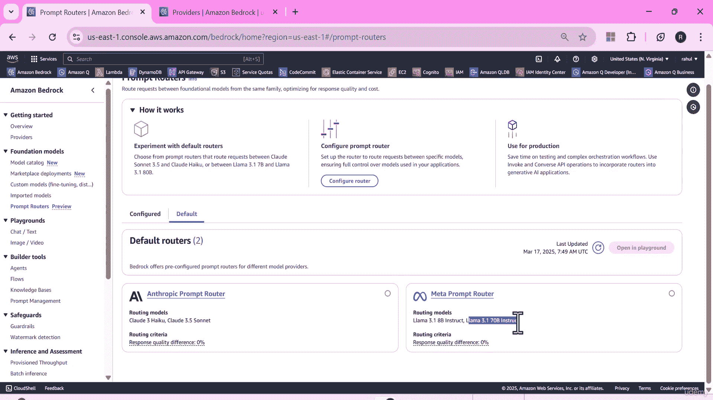

本节课中，我们一起完整地浏览了 Amazon Bedrock 控制台的各个核心模块。我们从进入控制台开始，看到了它的首页和左侧菜单；然后认识了 8 个模型提供商，理解了无服务器的概念和按请求计费的方式；接着学习了如何获取模型访问权限，特别是为什么要选择北弗吉尼亚区域；之后我们动手体验了 Playground，分别在聊天文本和图像视频两个场景中测试了模型；再然后我们查看了基础模型目录和 Bedrock Marketplace，知道了无服务器模型和市场部署模型的区别，也了解了市场部署会产生按小时费用；接着我们介绍了自定义模型的三种方式：微调、持续预训练和蒸馏；最后还看了导入模型以及提示路由器这两个实用功能。通过这次控制台演练，你应该已经对 Amazon Bedrock 的全貌有了一个整体认识。在接下来的课程中，我们会基于这些模块构建具体的应用案例，慢慢把今天看到的这些概念串起来。

