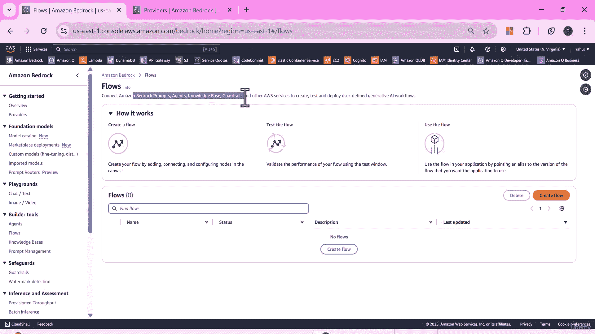
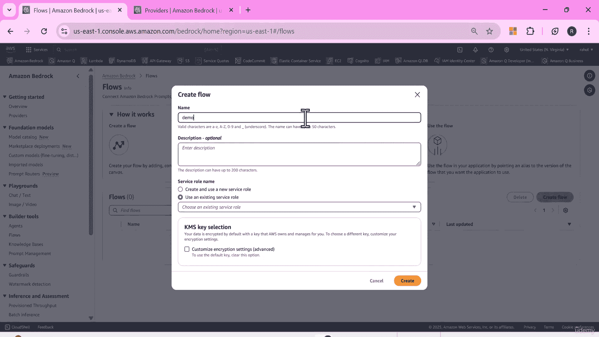
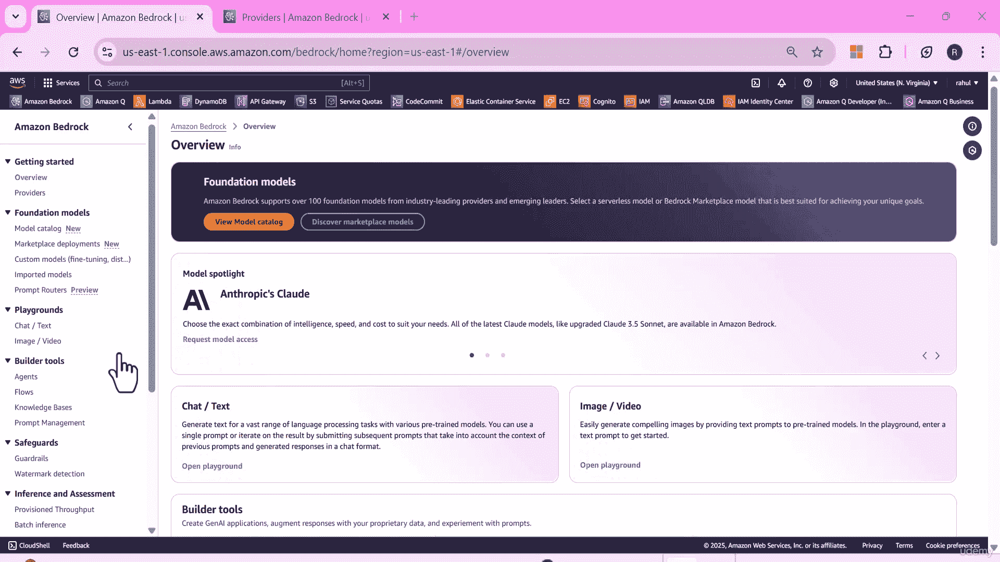

## 🧭 AWS生成式AI实战：01：课程概述与学习路线


在本节课中我们将要学习 Amazon Bedrock 控制台里的构建器工具、知识库、提示管理、护栏、水印检测、推理与评估以及设置等能力。你可以把这一节理解成一张地图：先知道 Bedrock 里有哪些常用模块，再在后面的课程里逐个深入。上一节我们完成了课程概述，本节中我们来看看整节课的学习路线，以及这些能力分别解决什么问题。

以下是本节需要先建立的整体认识：

- 本节课会围绕 Amazon Bedrock 控制台中的构建器工具展开，后续会分别介绍 Agents、Flows、Knowledge Bases、Prompt Management、Guardrails、Watermark Detection、Inference and Assessment、Settings 等模块。
- 这些模块有的负责搭建 AI 应用，有的负责接入企业数据，有的负责管理提示词，有的负责安全控制，还有的负责生产部署和日志记录。
- 本讲的目标是高层概览，不要求一次记住所有细节，后面会结合用例深入大多数能力。


为了先建立直觉，可以用下面的伪代码理解 Bedrock 控制台的整体定位：

```text
Bedrock Console = 模型访问 + 应用构建 + 企业数据接入 + 安全控制 + 运维评估
```

介绍完整体路线后，下一节我们进入构建器工具里的 Agents。


## 🤖 AWS生成式AI实战：02：构建器工具中的Agents




上一节我们介绍了课程目标和学习路线，本节中我们来看看构建器工具中的 Agents。接下来进入构建器工具，作为构建器工具的一部分，可以看到 Agents。AWS 在 2024 年 12 月的 re:Invent 上推出了 Amazon Bedrock 多代理框架，你可以使用这个自定义框架创建 AI 应用。通俗地说，Agents 就是让多个“小助手”分工协作，每个代理负责一部分任务，最后由框架把它们组织起来。



以下是 Agents 部分需要了解的关键点：

- 接下来进入构建器工具，作为构建器工具的一部分，可以看到 Agents。
- AWS 在 2024 年 12 月的 re:Invent 上推出了 Amazon Bedrock 多代理框架。
- 你可以使用这个自定义框架创建 AI 应用。


可以用下面的伪代码表示多代理框架的用法：

```python
app = BedrockMultiAgentFramework(agents=[agent_a, agent_b])
```

介绍完 Agents 后，下一节我们进入 Flows。


## 🔄 AWS生成式AI实战：03：使用Flows构建生成式AI工作流


上一节我们介绍了 Agents，本节中我们来看看 Flows。接下来是 Flows，Flows 允许你使用 Amazon Bedrock 的提示、代理、知识库和护栏构建生成式 AI 工作流。它是一个低代码、无代码方案，也就是说，很多工作可以通过拖拽和配置完成，不需要从零写大量代码。下面展示的是一个本地解决方案，你可以使用逻辑，然后有编排器、代理和提示；你也可以用 Lambda 函数写代码处理数据，可以使用知识库、S3 等；最后通过拖放就能构建 AI 工作流解决方案。

以下是 Flows 部分需要了解的关键点：

- 接下来是 Flows，Flows 允许你使用 Amazon Bedrock 的提示、代理、知识库和护栏构建生成式 AI 工作流。
- 它是一个低代码、无代码方案。
- 可以看到这是一个本地解决方案，你可以使用逻辑，然后有编排器、代理和提示。
- 你可以用 Lambda 函数写代码处理数据，可以使用知识库、S3 等。
- 通过拖放就能构建 AI 工作流解决方案。


可以用下面的配置示意理解 Flows 的组成：

```yaml
flow:
  input: user_query
  orchestrator: logic
  steps: [prompt, agent, knowledge_base, guardrail]
  data: lambda_function | s3
```

介绍完 Flows 后，下一节我们进入 Knowledge Bases。


## 📚 AWS生成式AI实战：04：使用Knowledge Bases接入企业数据


上一节我们介绍了 Flows，本节中我们来看看 Knowledge Bases。接下来是知识库，知识库允许你将大语言模型与企业数据集成。举个例子，你正在构建一个基于 HR 的应用，并且使用大语言模型，但你还可能需要把它连接到请假应用，或者连接到 PDF 等非结构化数据，这些数据可能位于 SharePoint 中。这时你可以使用知识库把大语言模型或基础模型与企业数据源集成起来。它是 AWS 托管方案，底层集成等由 AWS 管理，你只需要点选，然后就应该能够构建这些应用。后续课程中我们会看到一个基于知识库构建的用例。

以下是 Knowledge Bases 部分需要了解的关键点：

- 接下来是知识库，知识库允许你将大语言模型与企业数据集成。
- 例如你正在构建基于 HR 的应用，并使用大语言模型，但还需要连接请假应用，或者连接 PDF 等非结构化数据，这些数据可能位于 SharePoint 中。
- 你可以使用知识库把大语言模型或基础模型与企业数据源集成。
- 它是 AWS 托管方案，底层集成等由 AWS 管理，你只需要点选即可构建应用。
- 后续课程中我们会看到一个基于知识库构建的用例。


可以用下面的公式理解知识库的基本作用：

```text
response = FoundationModel(user_query, context=retrieve(enterprise_data))
```

介绍完 Knowledge Bases 后，下一节我们进入 Prompt Management。


## 📝 AWS生成式AI实战：05：使用Prompt Management管理提示模板


上一节我们介绍了 Knowledge Bases，本节中我们来看看 Prompt Management。接下来是提示管理，你可以把提示管理理解成一个仓库，用来存储你创建的所有提示。之前我们提到过模型提供商通过 Amazon Bedrock 服务提供模型访问，每个模型都期望用户输入以特定格式或提示发送给模型，以便获得最佳响应。因此，你可以创建提示模板，然后把它们存储在这个仓库中。

以下是 Prompt Management 部分需要了解的关键点：

- 接下来是提示管理，你可以把提示管理理解成一个仓库，用来存储你创建的所有提示。
- 之前提到过，模型提供商通过 Amazon Bedrock 服务提供模型访问。
- 每个模型都期望用户输入以特定格式或提示发送给模型，以便获得最佳响应。
- 因此，你可以创建提示模板，然后把它们存储在这个仓库中。


可以用下面的代码示意提示模板的创建与存储：

```python
prompt_template = PromptTemplate(template="...", variables=["question"])
repository.save(prompt_template)
```

介绍完 Prompt Management 后，下一节我们进入 Guardrails。


## 🛡️ AWS生成式AI实战：06：使用Guardrails进行安全控制


上一节我们介绍了 Prompt Management，本节中我们来看看 Guardrails。接下来是安全防护，在安全防护下面有护栏。假设你已经使用大语言模型构建了一个应用，也许是一个聊天机器人，并且你想防止终端用户向模型发送有毒问题，例如涉及宗教、种族或脏话等内容。这时你可以使用护栏来阻止这些主题、词语，或者进行 PII 脱敏。

以下是 Guardrails 部分需要了解的关键点：

- 接下来是安全防护，在安全防护下面有护栏。
- 假设你使用大语言模型构建了一个应用，也许是一个聊天机器人，并且想防止终端用户向模型发送有毒问题。
- 这些问题可能涉及宗教、种族或脏话等。
- 你可以使用护栏来阻止这些主题、词语，或者进行 PII 脱敏。


可以用下面的伪代码理解护栏策略：

```python
guardrail(policy={
  "block_topics": ["religion", "race"],
  "block_words": ["profanity"],
  "pii": "redact"
})
```

介绍完 Guardrails 后，下一节我们进入 Watermark Detection。


## 🖼️ AWS生成式AI实战：07：使用Watermark Detection检测图像来源


上一节我们介绍了 Guardrails，本节中我们来看看 Watermark Detection。接下来是水印检测，它可以检测图像是否由 Bedrock 上的 Titan 图像生成器或 Nova Canvas 模型生成。如果互联网上有一张图像，你想检查它是由人类开发的，还是由这两个模型之一生成的，那么你可以直接上传到这里，它会告诉你这张图像是由这些模型生成的，还是来自其他来源。需要记住，它不会检查互联网上每个模型生成的图像，只检查这两个模型。

以下是 Watermark Detection 部分需要了解的关键点：

- 接下来是水印检测，它可以检测图像是否由 Bedrock 上的 Titan 图像生成器或 Nova Canvas 模型生成。
- 如果互联网上有一张图像，你想检查它是由人类开发的，还是由这两个模型之一生成的，可以上传到这里。
- 它会告诉你这张图像是由这些模型生成的，还是来自其他来源。
- 需要记住，它不会检查互联网上每个模型生成的图像，只检查这两个模型。


可以用下面的函数示意水印检测的输入输出：

```python
is_ai_generated = watermark_detection(
    image,
    models=["TitanImageGenerator", "NovaCanvas"]
)
```

介绍完 Watermark Detection 后，下一节我们进入推理与评估中的 Provisioned Throughput。


## 💰 AWS生成式AI实战：08：推理与评估之Provisioned Throughput


上一节我们介绍了 Watermark Detection，本节中我们来看看推理与评估里的预置吞吐量。接下来是推理与评估，这里先看预置吞吐量。之前我们谈过服务器部署，但现在假设你想把它部署到生产环境，并且希望有一些专用容量来部署模型，那么你可以使用预置吞吐量，但它非常非常昂贵。如果你把模型作为预置吞吐量的一部分部署，可能每个月要花费数百到数千美元。

以下是 Provisioned Throughput 部分需要了解的关键点：

- 接下来是推理与评估，这里先看预置吞吐量。
- 之前我们谈过服务器部署，但现在假设你想部署到生产环境，并希望有专用容量来部署模型。
- 这时可以使用预置吞吐量，但它非常非常昂贵。
- 如果把模型作为预置吞吐量的一部分部署，可能每个月要花费数百到数千美元。


可以用下面的公式粗略理解成本：

```text
monthly_cost = provisioned_capacity_units × unit_price × hours
```

介绍完 Provisioned Throughput 后，下一节我们进入 Batch Inference。


## 📦 AWS生成式AI实战：09：使用Batch Inference批量处理文档


上一节我们介绍了 Provisioned Throughput，本节中我们来看看 Batch Inference。接下来是批量推理。假设你有一个用例，需要总结数百份法律文档，那么你可以使用 Amazon Bedrock 服务的批量推理能力，它会分批处理所有这些文档，比每次只处理单份文档更高效。

以下是 Batch Inference 部分需要了解的关键点：

- 接下来是批量推理。
- 假设你有一个用例，需要总结数百份法律文档。
- 你可以使用 Amazon Bedrock 服务的批量推理能力，它会分批处理所有这些文档。
- 这比每次只处理单份文档更高效。


可以用下面的代码示意批量推理：

```python
results = batch_inference(documents=[doc1, doc2, ..., docN])
```

介绍完 Batch Inference 后，下一节我们进入 Cross-Region Inference。


## 🌍 AWS生成式AI实战：10：使用Cross-Region Inference应对配额限制


上一节我们介绍了 Batch Inference，本节中我们来看看 Cross-Region Inference。接下来是跨区域推理。Amazon Bedrock 对你可以向大语言模型发起多少请求有一定的配额，但如果你需要发送超过该阈值的请求，那么你可以使用跨区域推理。它允许你把请求发送到不同区域，从而作为特定区域配额阈值的一种变通方案。

以下是 Cross-Region Inference 部分需要了解的关键点：

- 接下来是跨区域推理。
- Amazon Bedrock 对你可以向大语言模型发起多少请求有一定的配额。
- 如果你需要发送超过该阈值的请求，可以使用跨区域推理。
- 它允许你把请求发送到不同区域，作为特定区域配额阈值的一种变通方案。


可以用下面的伪代码理解跨区域路由：

```text
route(request) -> region_b if quota_exceeded(region_a, request)
```

介绍完 Cross-Region Inference 后，下一节我们进入 Evaluation。


## 📊 AWS生成式AI实战：11：使用Evaluation评估模型与RAG应用


上一节我们介绍了 Cross-Region Inference，本节中我们来看看 Evaluation。然后是评估，你可以使用模型评估来评估正在使用的大语言模型，也可以评估一个基于 RAG 构建的应用，也就是你把大语言模型与内部企业数据源集成后的应用。评估会根据你选择的某些参数，帮助你评估模型的响应。后续章节我们会详细介绍这部分内容。

以下是 Evaluation 部分需要了解的关键点：

- 然后是评估，你可以使用模型评估来评估正在使用的大语言模型。
- 你也可以评估一个基于 RAG 构建的应用，也就是把大语言模型与内部企业数据源集成后的应用。
- 评估会根据你选择的某些参数，帮助你评估模型的响应。
- 后续章节我们会详细介绍这部分内容。


可以用下面的代码示意评估过程：

```python
score = evaluate(
    model_or_rag_app,
    metrics=["accuracy", "relevance", "..."]
)
```

介绍完 Evaluation 后，下一节我们进入 Settings 中的模型调用日志。


## 🧾 AWS生成式AI实战：12：使用Model Invocation Logging记录模型调用


上一节我们介绍了 Evaluation，本节中我们来看看 Settings 里的模型调用日志。最后是设置，模型调用日志用于收集你账户中所有模型调用的元数据、请求和响应。如果你启用它，那么你发送给模型的所有请求以及收到的响应，都会存储在 S3、CloudWatch 或两者中。

以下是 Model Invocation Logging 部分需要了解的关键点：

- 最后是设置，模型调用日志用于收集你账户中所有模型调用的元数据、请求和响应。
- 如果你启用它，那么你发送给模型的所有请求以及收到的响应都会保存下来。
- 这些内容会存储在 S3、CloudWatch 或两者中。


可以用下面的代码示意启用日志：

```python
model_invocation_logging.enable(
    destinations=["S3", "CloudWatch"]
)
```

介绍完 Model Invocation Logging 后，下一节我们对本节课做个总结。


## ✅ AWS生成式AI实战：13：课程总结与后续学习建议


上一节我们介绍了模型调用日志，本节中我们对整节课做总结。本节课中我们一起学习了 Amazon Bedrock 控制台中的构建器工具、Agents、Flows、Knowledge Bases、Prompt Management、Guardrails、Watermark Detection、Provisioned Throughput、Batch Inference、Cross-Region Inference、Evaluation 以及 Model Invocation Logging。需要说明，在上两讲中，目标只是给你一个高层概览；如果你有很多内容没有理解，也没有关系，我们会在构建用例时深入大多数这些能力。下讲见，谢谢。

以下是本节课的收尾要点：



- 本节课中我们一起学习了 Amazon Bedrock 控制台中的构建器工具、Agents、Flows、Knowledge Bases、Prompt Management、Guardrails、Watermark Detection、Provisioned Throughput、Batch Inference、Cross-Region Inference、Evaluation 以及 Model Invocation Logging。
- 在上两讲中，目标只是给你一个高层概览。
- 如果你有很多内容没有理解，也没有关系，我们会在构建用例时深入大多数这些能力。
- 下讲见，谢谢。


