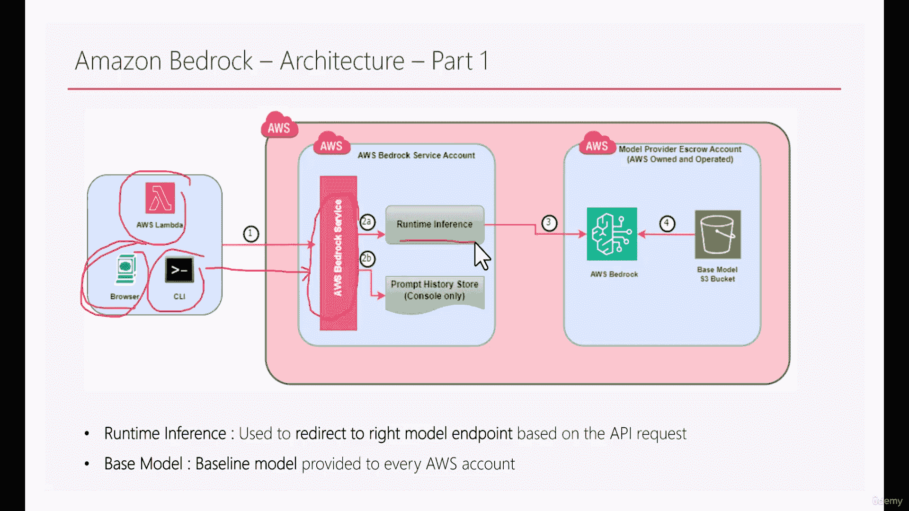
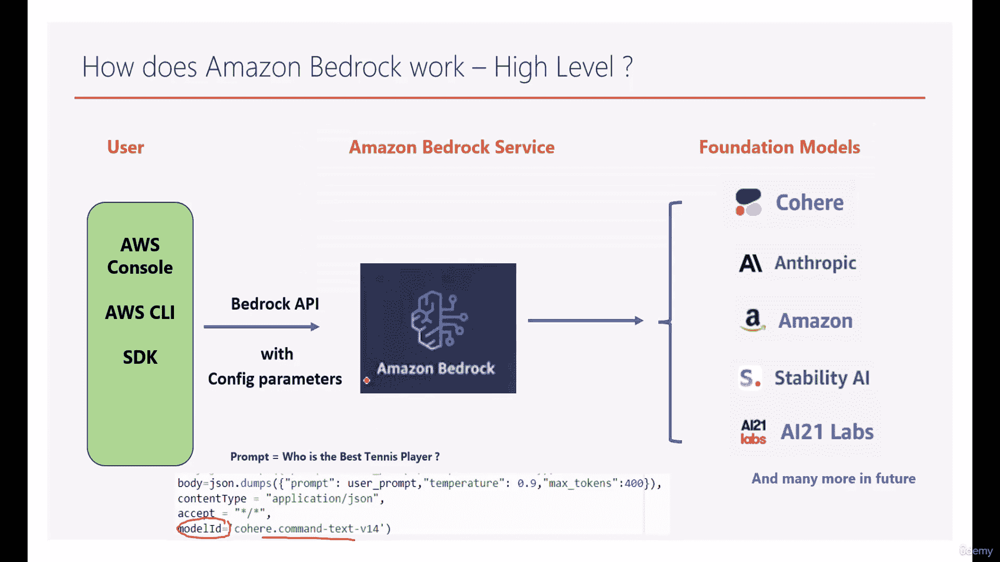
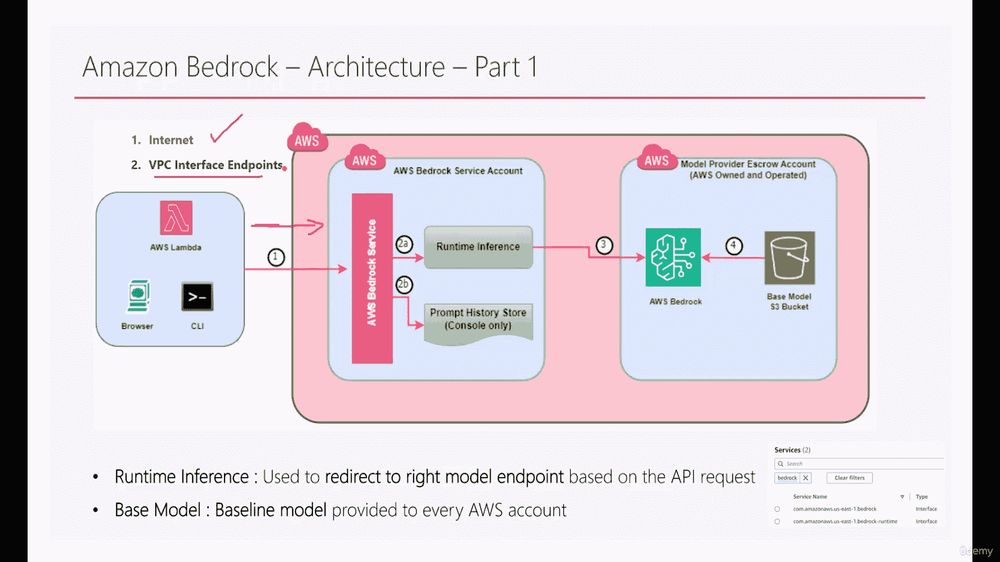
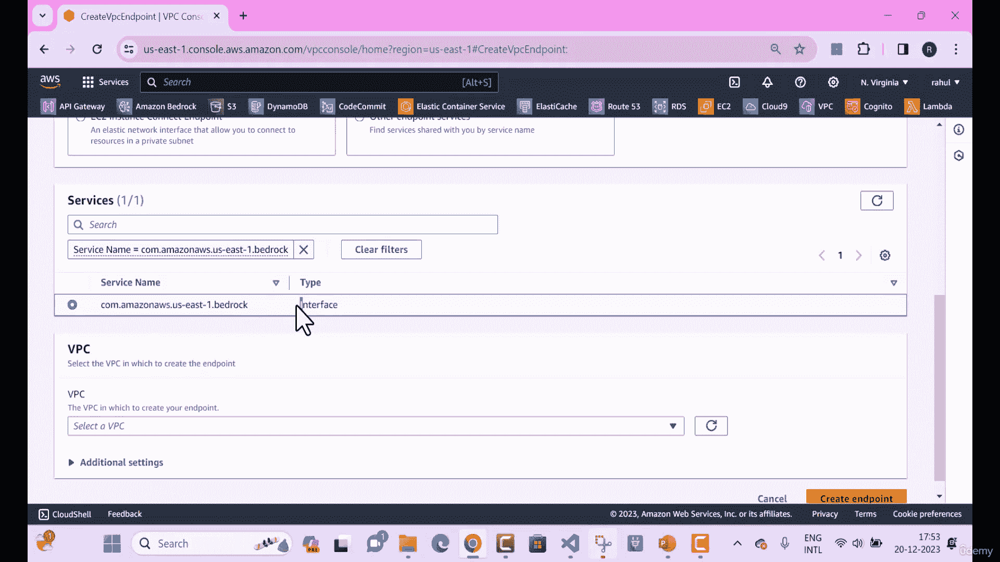
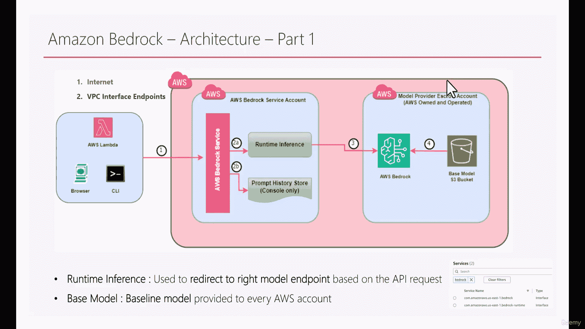

# 🧱 Udemy - 生成式 AI on AWS - Amazon Bedrock、RAG 与 KIRO [2026]：第15-16讲：Amazon Bedrock 架构

## 📌 Udemy - 生成式 AI on AWS - Amazon Bedrock、RAG 与 KIRO [2026]：第15-16讲：课程概述

在本节课中，我们将要学习 Amazon Bedrock 的架构。这一讲是架构内容的第一部分，重点放在基础模型怎么被使用；在后续关于微调的小节里，还会讨论架构的第二部分，也就是基础模型和微调模型之间的关系。为了不让概念一下子堆在一起，我们会先看 AWS 服务通常怎么部署，再看 Bedrock 和基础模型放在哪里，最后看请求如何进入 Bedrock、如何被路由，以及如何通过私有网络访问。对初学者来说，先建立这张“部署位置 + 请求路径”的大图，后面再看控制台和代码会轻松很多。

## 🧭 Udemy - 生成式 AI on AWS - Amazon Bedrock、RAG 与 KIRO [2026]：第15-16讲：两种 AWS 服务部署方式

上一节我们概述了整节课的路线，本节中我们来看看任何 AWS 服务通常的两种部署方式。在从网络视角深入 Bedrock 架构之前，需要先理解这个背景，因为它决定了后面的请求到底走进哪个账户、经过哪条网络路径。下面是两种常见模式：

- **模式一：部署在客户自己的 VPC 里。** 作为客户，无论是我、你，还是财富500强客户，只要拥有一个 AWS 账户，就可以在这个账户里创建 VPC，然后启动 EC2、RDS 这类 AWS 服务，这个服务会部署在你自己的 VPC 中。
- **模式二：部署在 AWS 管理的账户里。** 像 AWS Lambda、API Gateway 这样的服务，你可以从自己的账户启动和使用，但服务实际部署在 AWS 自己管理的账户中，这种账户有时被称为 AWS 服务账户。

用代码表示这两种模式会更直观：

```text
模式一：客户 AWS 账户 -> 创建 VPC -> 启动 EC2/RDS 等服务 -> 服务部署在客户 VPC
模式二：客户账户发起使用 -> 服务实际部署在 AWS 托管账户（如 Lambda/API Gateway/Bedrock）
```

理解了这两种模式后，我们就能把 Bedrock 放进正确的位置。Amazon Bedrock 采用的是第二种方式，它部署在由 AWS 管理的账户中，这个账户可以称为 AWS Bedrock 服务账户。也就是说，你从自己的账户调用 Bedrock，但 Bedrock 服务本身运行在 AWS 管理的环境里。这个区别看起来只是“放在哪里”的问题，但它会影响后面模型账户、权限和网络端点的理解。

## 🏗️ Udemy - 生成式 AI on AWS - Amazon Bedrock、RAG 与 KIRO [2026]：第15-16讲：Bedrock 与基础模型部署位置

上一节我们介绍了 AWS 服务的两种部署方式，本节中我们来看看 Bedrock 使用的基础模型部署在哪里。无论是 Anthropic 的 Claude，还是 Stability AI 的 Stable Diffusion，这些基础模型同样部署在 AWS 拥有并运营的账户中，这个账户可以称为模型提供商托管账户，由 AWS 拥有和管理。基础模型实际部署在这个 AWS 管理账户内的一个 S3 桶里。这个基础模型对所有 AWS 账户来说都是同一个模型；如果你保持相同的参数和相同的提示词，大概率会得到非常相似的响应。可以用下面的公式概括：

```text
Bedrock 服务账户 = AWS 拥有并管理
模型提供商托管账户 = AWS 拥有并管理
基础模型 = 存放在模型提供商托管账户内的 S3 桶中
相同提示词 + 相同参数 -> 大概率得到相似响应
```

这里的关键点是“模型放在 AWS 管理的账户里，而不是放在你的账户里”。你的请求只是调用它，并不会把基础模型下载到你自己的 VPC 或账户中。也正因为所有客户面对的是同一个基础模型，所以在参数和提示词相同的情况下，响应通常会比较接近。理解这一点后，我们继续看客户到底可以通过哪些入口调用这个基础模型。

## 🔌 Udemy - 生成式 AI on AWS - Amazon Bedrock、RAG 与 KIRO [2026]：第15-16讲：调用基础模型的三种入口

上一节我们弄清楚了模型放在哪里，本节中我们来看看调用基础模型有哪些入口。简单说，客户有三种方式向基础模型发起请求，这三种方式只是入口不同，最终都会进入 Bedrock 服务。以下是三种调用方式：

- **通过浏览器调用。** 你可以在浏览器中的控制台里试用基础模型。
- **通过 AWS CLI 调用。** 你可以在命令行里发起请求。
- **通过 AWS 服务发 API 请求。** 例如通过 AWS Lambda 这类服务向 Bedrock 发出 API 请求。

把请求路径画成代码，大致如下：

```text
浏览器 / AWS CLI / AWS 服务（如 Lambda）
        -> API 请求
        -> Amazon Bedrock 服务
        -> Runtime Inference
        -> 托管基础模型的 AWS 账户
        -> 返回响应
```

这三种入口的存在说明，Bedrock 并不是只能从控制台使用，它也可以被应用程序调用。对初学者来说，可以先把它理解成一个“统一入口”：不管你是点控制台、敲命令行，还是写 Lambda 代码，请求都会走到 Bedrock 服务，然后由 Bedrock 内部继续处理。接下来我们就看 Bedrock 内部是怎样判断该调用哪个模型的。

## ⚙️ Udemy - 生成式 AI on AWS - Amazon Bedrock、RAG 与 KIRO [2026]：第15-16讲：Runtime Inference 如何路由请求

上一节我们介绍了调用基础模型的三种入口，本节中我们来看看请求进入 Bedrock 后如何被路由。请求到达 Bedrock 服务后，会交给一个叫 Runtime Inference 的组件处理。这个组件要做的事情是判断用户到底在调用哪一个基础模型，因为你在发起请求时会在请求里提供 model ID。Runtime Inference 会查看这个 model ID，然后把请求发送到托管该基础模型的 AWS 账户。比如你请求的是 Cohere 的 Command 基础模型，它就会把请求发到托管这个模型的账户，然后获取响应。可以用下面的代码描述这个过程：

```text
请求 = {
  model_id: "cohere.command",
  prompt: "你的提示词",
  parameters: { ... }
}

Bedrock Runtime Inference:
  1. 读取请求中的 model_id
  2. 找到托管该基础模型的 AWS 账户
  3. 把请求发送到该账户
  4. 获取基础模型响应
  5. 把响应返回给发起请求的入口
```

从运行角度看，Bedrock 中运行的是存储在 S3 桶里的基础模型实例。请求得到响应后，这个响应会返回你发起请求时使用的入口，可能是浏览器、AWS CLI，也可能是 Lambda 这类 AWS 服务。这样设计的好处是，调用方不需要自己管理模型放在哪里，只需要提供模型标识和请求内容。理解完请求路由后，我们再看一个和调试、试用有关的记录功能。

## 💾 Udemy - 生成式 AI on AWS - Amazon Bedrock、RAG 与 KIRO [2026]：第15-16讲：Prompt History Store 记录什么

上一节我们看了 Runtime Inference 如何把请求路由到模型账户，本节中我们来看看 Prompt History Store 的作用。Bedrock 里还有一个叫 Prompt History Store 的东西，它会保存你对基础模型发起的查询。不过这里有一个重要限制：它只记录通过控制台发起的查询，也就是你在控制台里试用、把玩基础模型时产生的查询。下面用公式表示这个范围：

```text
Prompt History Store = 记录通过控制台发起的查询
不记录通过 API 等方式发起的查询
```

> 注意：Prompt History Store 的查询记录范围仅限控制台试用场景，不要把生产 API 请求的审计和它混为一谈。

这个功能对学习和调试比较方便，因为你在控制台里试过的提示词可以回看。但它不是所有请求的完整历史记录，尤其是通过 API 发起的请求不在这个范围内。了解这一点后，我们继续看 API 请求可以通过哪些网络路径进入 Bedrock。

## 🌐 Udemy - 生成式 AI on AWS - Amazon Bedrock、RAG 与 KIRO [2026]：第15-16讲：互联网与 VPC 接口端点



上一节我们介绍了 Prompt History Store 的记录范围，本节中我们来看看调用 Bedrock 的 API 请求有哪两种网络方式。你可以通过互联网发起 API 请求，也可以通过 VPC Interface Endpoints 发起 API 请求。以下是两种方式：



- **通过互联网发起请求。** 请求会走公网路径进入 Bedrock。
- **通过 VPC 接口端点发起请求。** 如果你想让请求走 AWS PrivateLink，也就是 AWS 的私有网络，就必须使用 VPC Interface Endpoints。

用代码表示网络路径如下：

```text
互联网路径：客户端 -> 公网 -> Amazon Bedrock
私有路径：客户端 -> VPC Interface Endpoint -> AWS PrivateLink -> Amazon Bedrock
```

这两种方式解决的是“请求走哪张网”的问题。走互联网更直接，走 PrivateLink 则可以让请求不经过公网。对于需要私有网络访问的场景，VPC 接口端点就是关键配置。下面我们就在控制台里看一下创建 Bedrock 接口端点的步骤。

## 🧪 Udemy - 生成式 AI on AWS - Amazon Bedrock、RAG 与 KIRO [2026]：第15-16讲：在控制台创建 Bedrock 接口端点



上一节我们说明了互联网和 VPC 接口端点两种网络路径，本节中我们来看看在控制台里怎样创建 Bedrock 的接口端点。以下是在 VPC 控制台中的操作步骤：

1. 打开 AWS 控制台，进入 VPC 仪表盘页面。
2. 点击 Endpoints，然后点击 Create Endpoint。
3. 在搜索框中输入 bedrock。
4. 在结果中可以看到服务名 `com.amazonaws.us-east-1.bedrock`，类型为 Interface。
5. 选择这个接口端点服务，就可以按界面继续创建端点。

创建好这类接口端点后，你就可以使用 AWS PrivateLink 向 Bedrock 发起请求，而不需要经过互联网。这个演示的目的不是让你记住每个按钮的位置，而是让你知道 Bedrock 的私有访问入口在 VPC 的 Endpoints 里配置。看到服务名和 Interface 类型后，就能确认这是通过私有网络访问 Bedrock 的接口端点。

## ✅ Udemy - 生成式 AI on AWS - Amazon Bedrock、RAG 与 KIRO [2026]：第15-16讲：课程总结





本节课中，我们一起学习了 Amazon Bedrock 架构的第一部分。我们首先理解了 AWS 服务的两种部署方式：一种部署在客户自己的 VPC 里，另一种部署在 AWS 管理的账户里；Bedrock 属于后者，运行在 AWS Bedrock 服务账户中。接着我们看了基础模型部署在 AWS 拥有并运营的模型提供商托管账户里，实际存放在 S3 桶中，并且对所有 AWS 账户都是同一个基础模型。然后我们梳理了三种调用入口：浏览器、AWS CLI 和通过 AWS 服务发 API 请求；请求进入 Bedrock 后由 Runtime Inference 根据 model ID 路由到托管模型的账户，再把响应返回发起请求的入口。我们还了解了 Prompt History Store 只记录控制台查询，以及 API 请求可以走互联网或 VPC Interface Endpoints，并通过 AWS PrivateLink 实现私有访问。最后在控制台里看到了 Bedrock 接口端点的服务名和 Interface 类型。希望本课有用，下节课见，谢谢。

