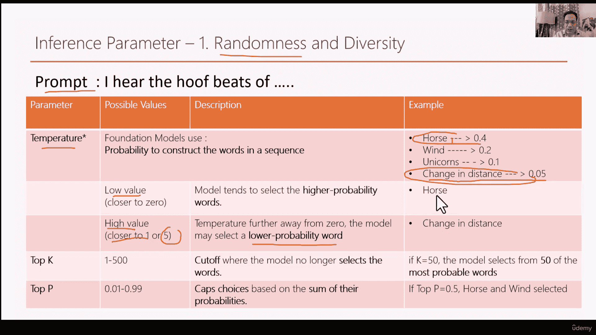
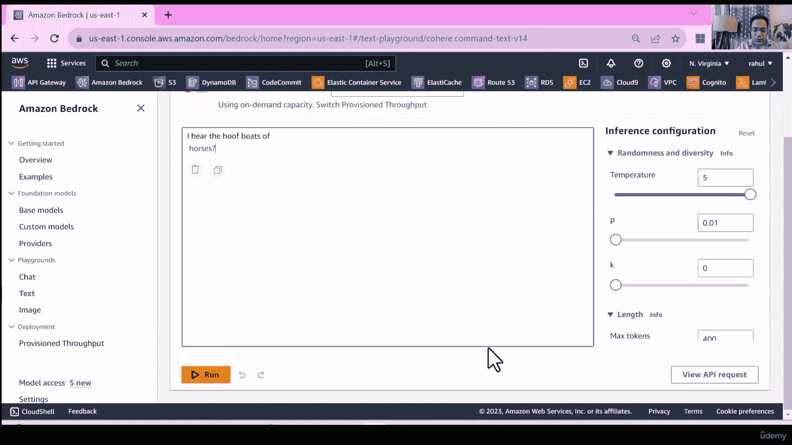
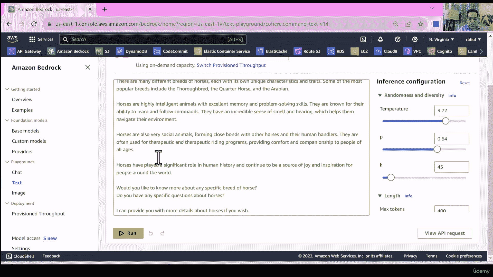
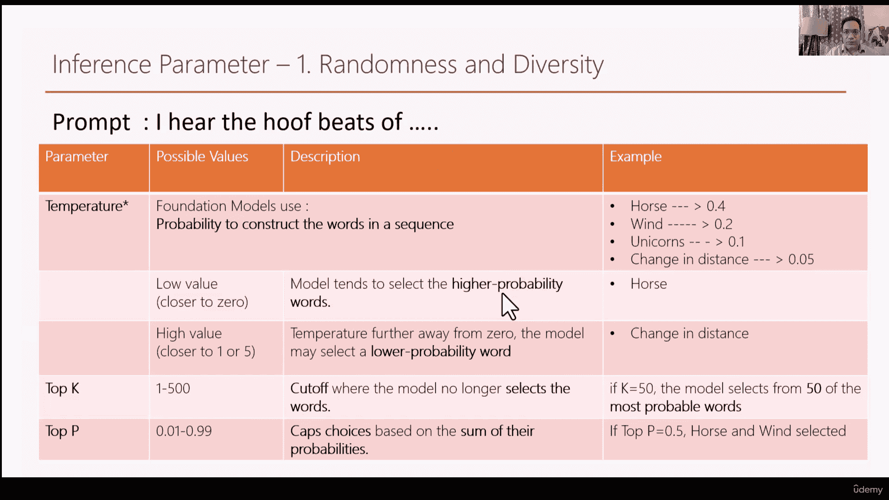

# 🎛️ AWS 生成式 AI 实战：第16课：温度参数与推理随机性

在本节课中，我们将学习 Amazon Bedrock 中基础模型与推理参数之间的关系。对应内容来自 Udemy 课程《Generative AI on AWS - Amazon Bedrock, RAG & KIRO》第16课。推理参数会影响基础模型生成的响应，同样的提示词在不同参数下可能得到不同答案。本节课会先给出推理参数的整体分类，再重点讲解随机性和多样性中的 temperature，同时串联 top K 和 top P，最后进入 Amazon Bedrock 控制台观察这些参数的实际表现。初学者可以把推理参数理解成模型生成答案时的“旋钮”，旋钮的位置不同，答案的风格、随机程度和长度就会变化。

## 🧭 AWS 生成式 AI 实战：第16课·第1节：推理参数总览

上一段概述提到推理参数会影响模型输出，本节先把这些参数分个类。原文把推理参数大致分为三个区域，分别控制随机性、响应长度和重复程度。下面先给出三类推理参数的整体分类，方便初学者先建立一张地图。

- **随机性和多样性**：由 temperature、top K、top P 三个因素影响，决定模型在多个候选词之间怎样选择。
- **响应长度**：涉及 response length、length penalty、stop sequences 等参数，用来控制回答的长短和停止位置。
- **重复控制**：通过 repetition penalty 控制响应中重复词的数量，避免模型反复说同样的内容。

这三类参数会共同决定最终响应。本节课的主线是随机性和多样性，因为原文把它称为最重要的部分。接下来先看随机性和多样性的核心例子，再进入 Amazon Bedrock 控制台验证。

## 🎲 AWS 生成式 AI 实战：第16课·第2节：随机性和多样性为什么重要

上一节把推理参数分成三类，本节深入第一类，也就是随机性和多样性。原文强调这部分最重要，因为它直接决定模型在多个可能词之间如何选择。为了看清这一点，可以先使用一个补词例子。假设提示词是下面这句话，模型需要补全最后一个词。

```text
Prompt: I hear the hoof beats of ___
```

模型在生成下一个词时，会先想出一大批可能填入的候选词，原文说可能有 50 个到 100 个甚至更多。为了便于说明，这里假设模型只生成五个候选词，然后给每个候选词一个概率值。原文示例中的概率大小关系可以表示成下面这样，部分词看起来不自然，这里按示例保留，重点看概率高低。

```text
候选词与示例概率：
horse               0.40
wind                0.20
unicorn             0.10
（其他候选词）       0.05
change in distance  0.05
剩余候选词的概率合计 0.20
```

这些概率相加等于 1。温度参数会改变模型对这些候选词的偏好。温度接近 0 时，随机性和多样性较低，模型更偏向最高概率的词，在示例里就是 horse。温度较高时，随机性和多样性增加，低概率词被选中的机会变大，极端情况下可能落到概率最低的候选词上，原文用 change in distance 表示这种极端情况。可以用下面的公式描述温度对概率分布的影响，其中 \(T\) 表示 temperature，\(z_i\) 表示候选词的原始分数。

\[
P_T(w_i)=\frac{\exp(z_i/T)}{\sum_j \exp(z_j/T)}
\]



公式不用死记，只需理解：\(T\) 越小，高概率词更突出；\(T\) 越大，分布越平，低概率词也有机会。不同基础模型的温度范围不同。有些模型的温度范围是 0 到 1，Cohere 模型的温度范围是 0 到 5。原文用 Cohere 的高温度 5 来说明“极度随机和多样”的情况。到这里，温度对随机性的影响已经有了直观认识，下一节进入控制台看实际效果。


## 🖥️ AWS 生成式 AI 实战：第16课·第3节：在控制台观察 temperature

上一节用概率和公式解释了温度，本节把同样的思路放进 Amazon Bedrock 控制台。控制台里的操作不复杂，关键是观察同一个提示词在不同 temperature 下的响应变化。下面是控制台里的操作顺序。

1. 打开 Amazon Bedrock 控制台，选择一个基础模型。
2. 进入文本生成区域，选择 Cohere 模型。
3. 在输入框中填写示例提示词 `I hear the hoof beats of`。
4. 在右侧的 Inference configuration 中找到 randomness and diversity，再找到 temperature。
5. 先把 temperature 设为 0，运行模型，观察响应。
6. 再把 temperature 提高到模型上限，例如 Cohere 的 5，刷新并重新运行，观察响应是否变化。

在演示中，temperature 设为 0 时，模型返回了包含 horse 或 horses 的响应，符合“低温度更偏向高概率词”的预期。提高 temperature 后，模型有时仍然返回 horse 或 horses，没有每次都给出明显不同的答案。原文提醒，示例模型不一定足够准确，实际测试时有时不会完全按预期变化，但参数作用的方向仍然可以观察。控制台里温度的表现会有波动，接下来看 top K 如何从候选词数量上限制模型。

## 🔝 AWS 生成式 AI 实战：第16课·第4节：top K 如何截断候选词

控制台演示之后，继续看随机性里的第二个参数 top K。temperature 决定模型偏向高概率词还是低概率词，top K 则先决定候选词池子有多大。top K 的取值范围因模型而异，原文提到 Cohere 的 top K 范围是 1 到 500。top K 的作用是给出一个截断点，模型不再从超过这个截断点的词中选择。下面用几个数字说明 top K 的截断逻辑。

- 如果模型生成了 500 个候选词，top K 设为 50，模型只看概率最高的 50 个候选词。
- 如果示例中只有 4 个候选词，top K 设为 3，模型只保留前 3 个候选词。
- 在保留下来的候选词里，temperature 较低时倾向选最高概率词，例如概率为 0.4 的 horse。
- temperature 较高并接近上限时，模型可能选到候选池底部的词，例如 unicorn。



可以用公式表示 top K 保留的集合，其中 \(P\) 是候选词概率分布，\(K\) 是保留数量。

\[
S_K=\operatorname{TopK}(P,K)
\]

top K 管的是“候选数量”，temperature 管的是“在候选里偏向高概率还是低概率”。两者组合会改变最终填入提示词的词。理解 top K 后，下一节看按概率累计截断的 top P。

## 🎯 AWS 生成式 AI 实战：第16课·第5节：top P 如何按概率累计截断

上一节 top K 是按候选词数量截断，本节看 top P。top P 同样做截断，只是截断依据从“数量”变成“概率累计值”。原文提到 top P 的取值范围通常在 0.01 到 0.99 之间，具体范围也会因基础模型而变化。top P 会按概率从高到低累加候选词，直到累计概率达到设定值。可以用公式表示最小保留集合 \(S_P\)，条件是集合内候选词的概率和大于或等于 \(p\)。

\[
S_P=\min\left\{S\subseteq V:\sum_{w\in S}P(w)\ge p\right\}
\]


下面用示例概率说明 top P 的计算方式。

- 示例中 horse 的概率是 0.4，wind 的概率是 0.2。
- 如果 top P 设为 0.5，先把 horse 和 wind 的概率相加，得到 0.6。
- 0.6 已经超过 0.5，所以只保留这两个词。
- 模型再在这两个词中根据 temperature 等参数选择最终输出。

在控制台演示中，继续使用同一个提示词，把 top K 调到 50 或 45，模型只会在限定数量的候选词中补全。调整 temperature 后，响应会发生变化。原文演示中出现了类似 `I hear the sound of horses galloping` 的响应。随后把 top P 改为 0.64，模型会按概率累计到 0.64 为止选择候选词，响应也会随之改变。到这里，随机性和多样性参数的主要机制已经展开，最后做一个收束。

## ✅ AWS 生成式 AI 实战：第16课·第6节：本节课总结





到这里，本节课的主线已经完整。本节课中我们一起学习了 Amazon Bedrock 中的推理参数以及它们对基础模型响应的影响。推理参数大致分为三类：随机性和多样性、响应长度、重复控制。随机性和多样性由 temperature、top K、top P 共同影响。temperature 越低，模型越偏向高概率词；temperature 越高，低概率词越有机会被选中。top K 按候选词数量截断候选池，top P 按概率累计值截断候选池。控制台演示中，温度、top K 和 top P 的组合会改变模型输出，实际模型也可能出现不完全符合示例预期的情况。随机性和多样性的推理参数到这里应当已经清楚，下一节课继续，感谢观看。

