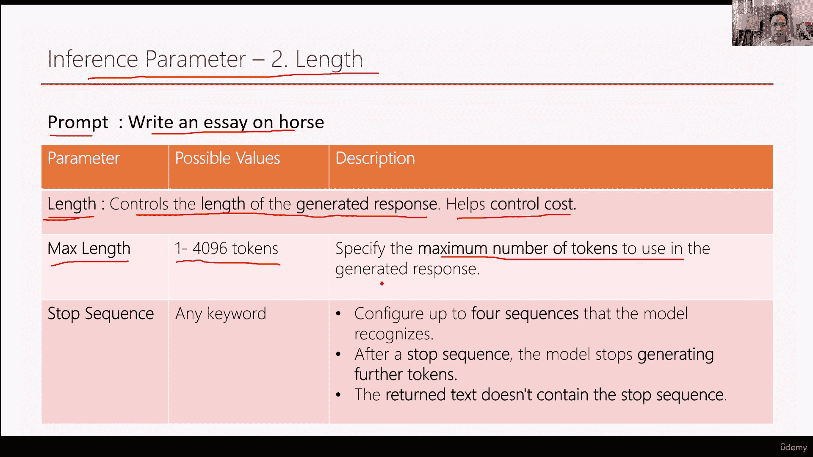
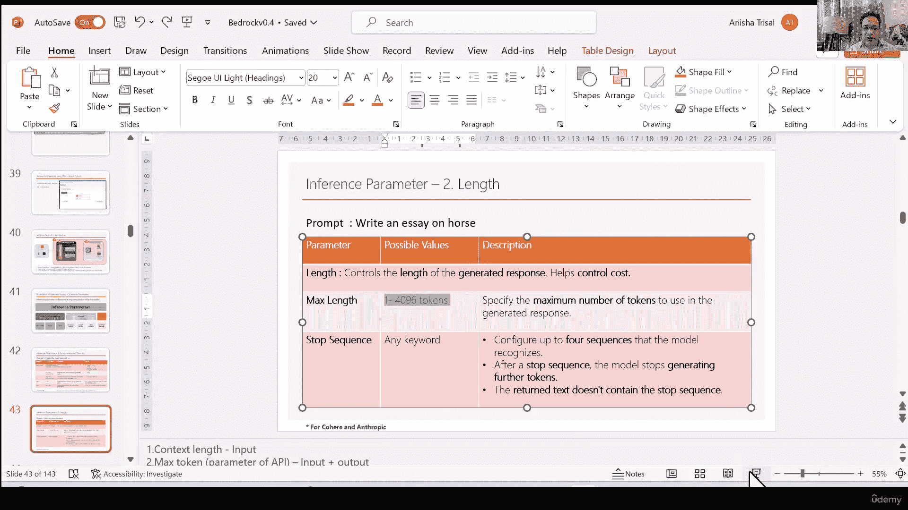
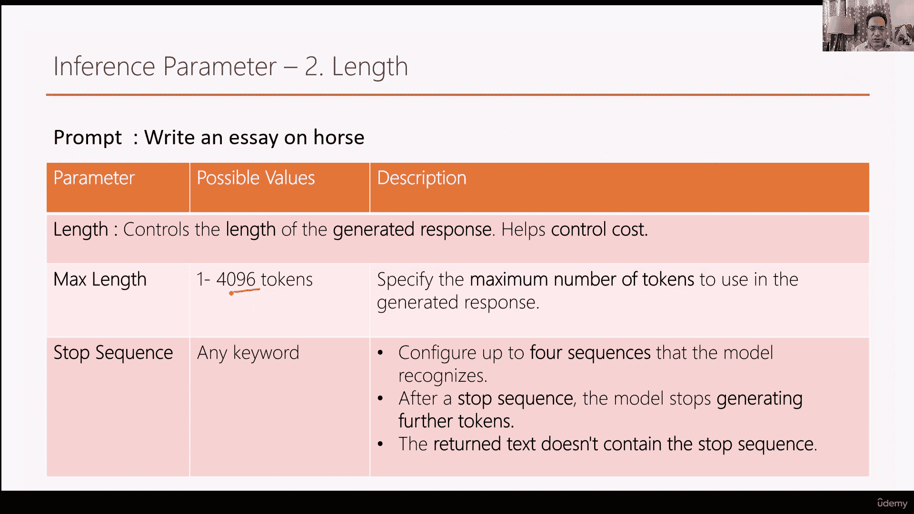
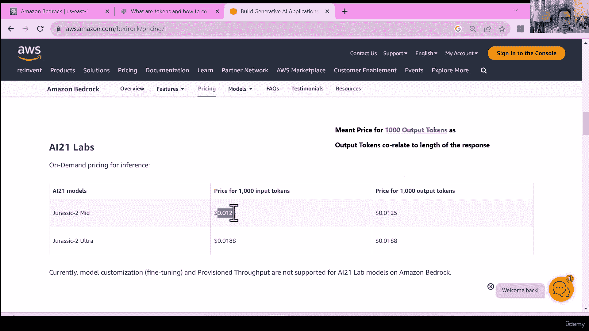
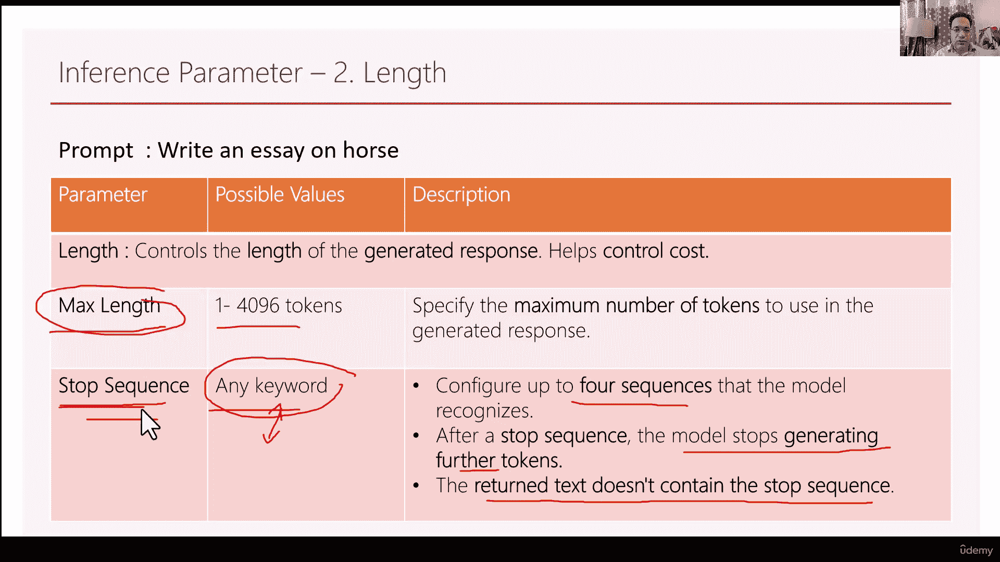
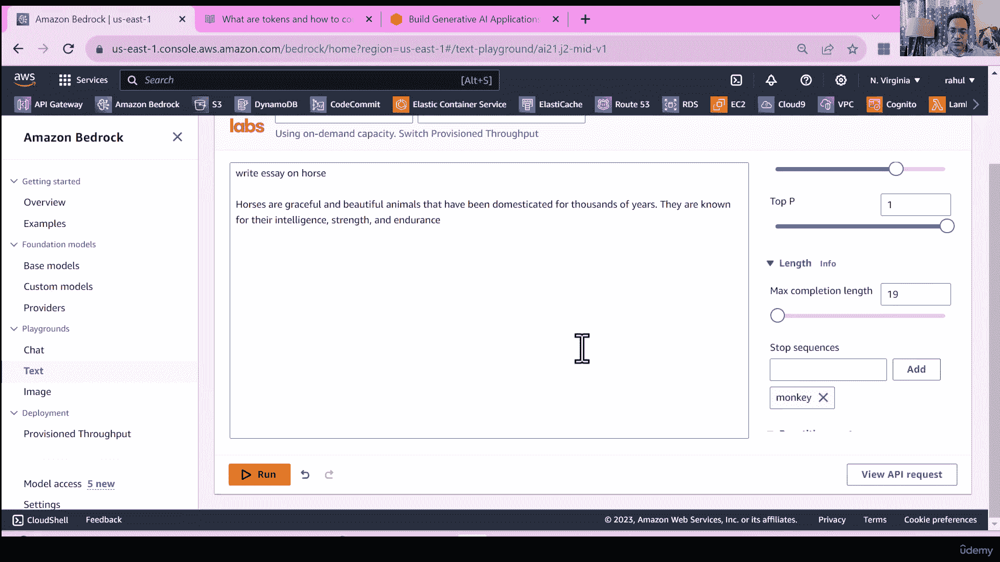
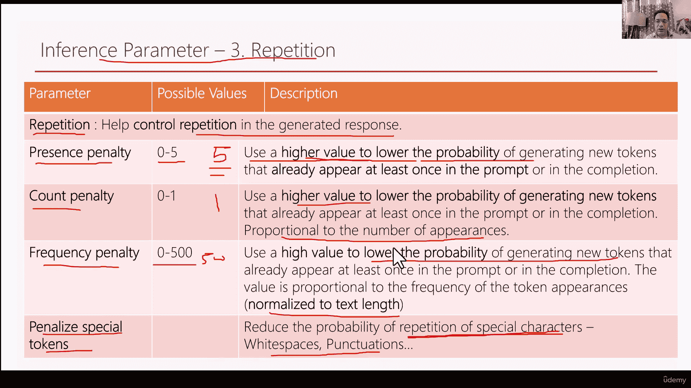
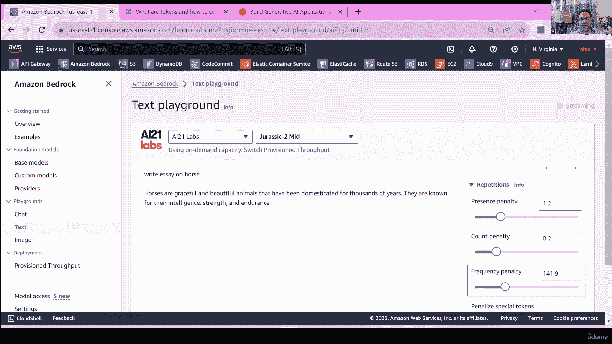

🎓 生成式AI在AWS上：第1部分：第17-18讲：Amazon Bedrock 推理参数（二）


在本节课中，我们将继续学习Amazon Bedrock中的推理参数。上一讲我们介绍了第一个推理参数，这一讲我们重点来看第二个参数——**长度（Length）**，以及停止序列（Stop Sequences）和重复控制（Repetition）的相关内容。这些参数在调整模型输出行为时非常关键，掌握它们可以帮助你更精细地控制生成结果，同时也能有效控制调用成本。我们将从长度参数的定义讲起，然后通过控制台实际演示，最后再介绍重复惩罚的四个子参数。整个过程中，我们会用最直白的大白话来说明，确保初学者也能轻松听懂。


## 📏 第1节：长度参数（Length）


首先，我们来理解一下长度参数的作用。所谓长度参数，就是用来控制生成响应长度的参数。你可以为模型指定一个期望的响应长度上限，这样做的好处是，既能让输出符合你的预期，又能避免模型生成过多无用的内容，从而节省成本。简单来说，响应越长，你需要支付的计算费用就越高，所以合理设置长度参数是控制成本的重要手段之一。


那么，具体如何控制响应长度？答案是定义`max_length`参数（在Bedrock控制台中通常显示为`maximum completion length`）。这个参数指定了生成响应时最多可以使用多少个token。在大多数基础模型中，`max_length`的取值范围通常在**1到4096个token**之间，但具体数值会因模型而异。例如，某些模型可能支持更大的上限，而某些模型则限制得更严格。这一点需要在实际使用时查阅对应模型的文档。




这里需要先解释一下什么是token。在之前的OpenAI或ChatGPT等接口中，我们已经了解过**1个token大约等于4个英文字符**。也就是说，如果设置`max_length`为4096，那么生成的响应长度大约不应超过**3000个单词**。如果你把`max_length`调小，生成的内容就会短很多，成本自然也就降下来了。这种长度限制相当于给模型戴上了一道“紧箍咒”，防止它漫无边际地写下去。


成本方面，我们后续会详细讨论，但这里可以先看一个大概的定价方式。以AI21 Labs为代表，大多数基础模型都是按token数量计费的。定价通常基于每千个输入token和每千个输出token。例如，每千个token大约需要花费**0.0125美元**。这意味着响应越长，消耗的token越多，最终的费用也就越高。因此，`max_length`参数在控制成本上起着至关重要的作用。我们可以用下面的公式来概括这种关系：


```python
# 响应成本近似计算
cost = (input_tokens + output_tokens) * price_per_token
# 其中 output_tokens <= max_length
# token数量越多，cost越高
```


接下来，我们再看与长度相关的另一个参数——**停止序列（Stop Sequences）**。


## ✋ 第2节：停止序列（Stop Sequences）




停止序列是一种让模型提前停止生成的机制。你可以定义任意一个关键词列表，当模型在生成过程中遇到你定义的某个关键词时，它就会立刻停止生成后续的token。举个例子，如果你设置了停止词为“结束”，那么模型一旦生成“结束”这个词，后面的内容就不会再输出了。需要注意的是，返回的文本中**不会包含**这个停止序列本身，也就是说，你看到的最终结果不会带着那个触发停止的关键词。






在Bedrock中，你最多可以配置**4个停止序列**。这为你提供了很大的灵活性，比如你可以设置多个不同的停止词，以应对不同的终止条件。用代码表示，就像这样：


```python
stop_sequences = ["结束", "END", "stop", "q"]
# 模型遇到任意一个词，就会停止生成
```


可以看到，长度相关的参数其实有两个：一是`max_length`，用来限制最大token数；二是停止序列，用来指定提前结束的触发词。两者结合使用，可以非常精准地控制输出内容。为了让你更直观地理解这些参数，我们到控制台里实际操作一下。




## 🖥️ 第3节：控制台演示——长度参数与停止序列


假设我现在已经进入Amazon Bedrock的控制台，在模型列表中选择**AI21 Labs**的模型。你会看到在推理参数设置区域，有一个名为**Length**（长度）的参数，在这里就可以定义`maximum completion length`（最大完成长度）。对于AI21 Large这个模型，这个值的范围通常在1到8191个token之间。


同样的，你也可以在下方添加停止序列。比如输入“monkey”作为停止词，点击添加后，这个关键词就会出现在列表中。一旦生成内容中出现了“monkey”，模型就会立即停止生成后续内容。这个功能非常实用，比如你想让模型生成到某个固定短语就结束，就可以通过设置停止序列来实现。


接下来，我们实际测试一下长度参数的效果。我先给模型发送一个提示词，让它写一篇关于马的作文。默认情况下，模型可能会生成很长的一篇内容。假设我把最大完成长度设置为200个token左右，然后重新发送同样的提示词，你可以看到模型给出的响应大约有14行，确实比较长。接着，我再把这个最大长度调小，比如调到一个很小的值（比如9个token），然后刷新页面，再次输入相同的提示词，你会发现这次模型的响应就被压缩到了仅仅两行。这说明，通过调整`max_length`，我们可以很容易地控制输出内容的篇幅，从而在“内容详细”和“节约成本”之间做出权衡。


至于停止序列，我们也可以简单测试一下。添加一个类似“one key”这样的关键词，之后只要模型生成到这个关键词，生成过程就会立刻终止，非常直观。


## 🔁 第4节：重复参数（Repetition）


接下来，我们看最后一个推理参数——**重复参数（Repetition）**。这个参数并不是所有模型都支持的，在Bedrock中，只有少数模型提供了该配置，比如**AI21 Labs**的模型就有。那么，重复参数到底有什么用？它主要用来控制生成内容中单词的重复程度。通俗地说，就是模型输出时，有多少词汇可能会重复出现。你可以通过调整这个参数，让模型的输出更丰富，避免重复啰嗦。在重复参数下面，实际上包含四个子参数，下面我们逐一介绍。


### 🧮 4.1 Presence Penalty（存在惩罚）


第一个子参数是**存在惩罚（Presence Penalty）**。它的取值范围在**0到5**之间。你设置的数值越高，模型生成一个已经在提示词或输出中出现的token的概率就越低。举个例子，如果你把这个值设为5，那么模型几乎不会重复使用那些已经出现过多次的词语。这有助于让生成内容更具多样性，通俗来说，就是让模型别老揪着几个词不放。


### 🔢 4.2 Count Penalty（计数惩罚）




第二个子参数是**计数惩罚（Count Penalty）**。它的取值范围在**0到1**之间。与存在惩罚类似，数值越高，单词重复的概率越低。但不同的是，计数惩罚的力度与某个词在文本中出现的**次数**成比例。也就是说，一个词出现得越多，它再次被生成的惩罚就越重，从而有效抑制高频率词汇的重复。这个参数特别适合用来减少那些无意义的填充词，比如“然后”“那个”等。


### 📊 4.3 Frequency Penalty（频率惩罚）


第三个子参数是**频率惩罚（Frequency Penalty）**。它的取值范围在**0到1**之间（具体范围可能因模型而异）。同样，如果你提供一个较高的值，比如1，那么模型生成一个已经在提示词或输出中出现过的token的概率就会被降低。这个惩罚的效果是经过**归一化处理**的，它会基于文本的长度来平衡惩罚力度。这样，无论你生成的是短文本还是长文本，重复抑制的效果都会比较合理。简单来说，频率惩罚会根据文本长度对重复程度做一个“标准化”的管控。


### ✨ 4.4 Penalize Special Tokens（惩罚特殊标记）


第四个子参数是**惩罚特殊标记（Penalize Special Tokens）**。这个选项会降低特殊字符（比如空格、标点符号等）重复出现的概率。你可以通过这个开关，控制模型在生成内容时是否过度使用某些标点或空白字符，让输出看起来更规范、更易读。例如，有时候模型会生成一大堆逗号或句号，开启这个选项就能很好地抑制这种问题。


我们可以用下面的伪代码来理解这几个惩罚参数对生成概率的影响：


```python
# 简化表示：生成某个token的得分
score = original_score
if token in previous_tokens:
    score -= presence_penalty * 1
    score -= count_penalty * count(token)
    score -= frequency_penalty * (count(token) / text_length)
# 特殊标记的惩罚类似
```


## 🕹️ 第5节：控制台演示——重复参数




现在，我们再回到控制台来看一下重复参数的实际位置。如果你在控制台中切换到**Cohere**或**Anthropic**的模型，你会发现它们的推理参数设置里**没有**重复配置这一项。但是，选择**AI21 Labs**的模型时，你就可以看到**Repetition**（重复）这个参数区域。在这里，你可以看到存在惩罚`presence penalty`、计数惩罚`count penalty`、频率惩罚`frequency penalty`，以及惩罚特殊标记的选项。你还可以自定义要惩罚哪些特殊标记，以便精细控制哪些特殊字符需要被抑制。


这样，我们就完整地介绍了Amazon Bedrock中的长度参数、停止序列以及重复参数。希望这些内容对你使用Bedrock有所帮助，下节课我们将继续探索更多推理参数。


## 📝 总结




本节课我们一起学习了Amazon Bedrock中几个重要的推理参数。首先，我们介绍了长度参数`max_length`，它用于限制生成响应的最大token数，从而控制响应长度和成本。我们还了解了token与字符的换算关系，以及按token计费的基本概念。接着，我们学习了停止序列`stop_sequences`，它允许我们定义关键词，让模型在遇到这些关键词时提前停止生成。最后，我们探讨了重复参数`Repetition`，它包含存在惩罚、计数惩罚、频率惩罚和惩罚特殊标记四个子参数，可以用来有效减少生成内容中的重复现象。通过控制台的实际演示，我们看到了这些参数在不同模型上的支持情况，以及它们如何直观地影响模型输出。希望这节课能帮助你更好地使用Amazon Bedrock生成高质量、符合成本预期的内容，我们下节课再见。

