# Amazon Bedrock 生成式 AI 实战：第18-20讲：💰 Amazon Bedrock 定价

## Amazon Bedrock 生成式 AI 实战：第1节：🧭 课程概述

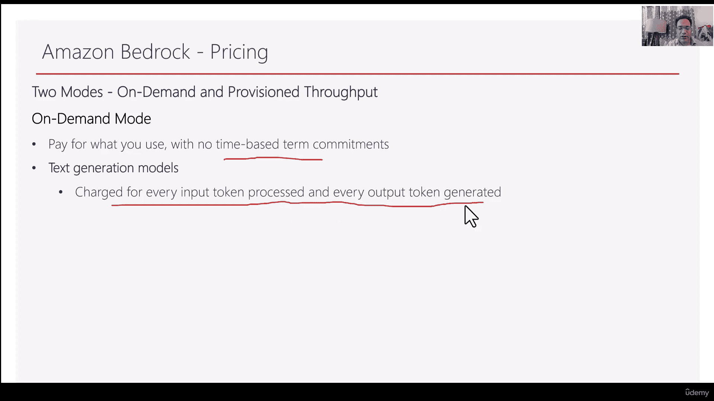

在本节课中我们将要学习 Amazon Bedrock 的定价方式。原文首先指出，Amazon Bedrock 的定价分为两种模式：按需模式和预置吞吐模式。按需模式的核心思想是用多少付多少，适合刚开始使用、流量不稳定或者想先做实验的场景。预置吞吐模式则更关注稳定吞吐和长期承诺，适合生产应用或者需要部署自定义模型的场景。为了帮助初学者理解，本节会先讲清楚两种模式的基本概念，然后分别看文本、图像、嵌入和预置吞吐的价格，最后用一个具体例子把费用计算串起来。接下来我们就从按需模式开始看。

## Amazon Bedrock 生成式 AI 实战：第2节：💳 按需模式总览

上一节我们了解了两种定价模式的整体区别，本节中我们来看看按需模式。按需模式就是只为实际使用量付费，没有基于时间的承诺，也没有基于单位数量的承诺。原文强调，从定价角度看，按需模式下面有三个需要理解的部分。以下是按需模式需要重点关注的三个计价领域：

- **文本**：文本生成模型按输入 token 和输出 token 分别收费。
- **图像**：图像生成模型通常按生成的图片数量收费。
- **嵌入**：嵌入模型按处理的输入 token 数量收费。

这三个领域看起来多，但拆开以后并不复杂。文本是最常见的一类，因为大多数对话、摘要和生成任务都会产生输入 token 与输出 token。图像是按张数计价，适合直观理解。嵌入则是把文本转成向量时使用的能力，收费口径主要看输入 token。理解这三个领域以后，再看具体价格页面就不会迷路。


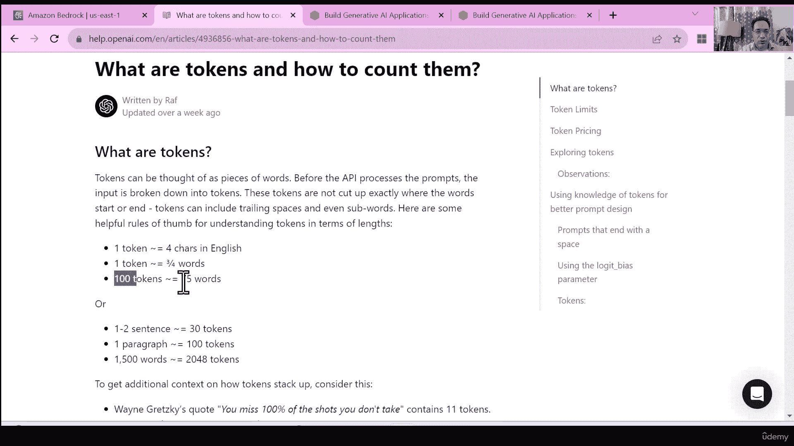

## Amazon Bedrock 生成式 AI 实战：第3节：📝 文本、图像与嵌入计价

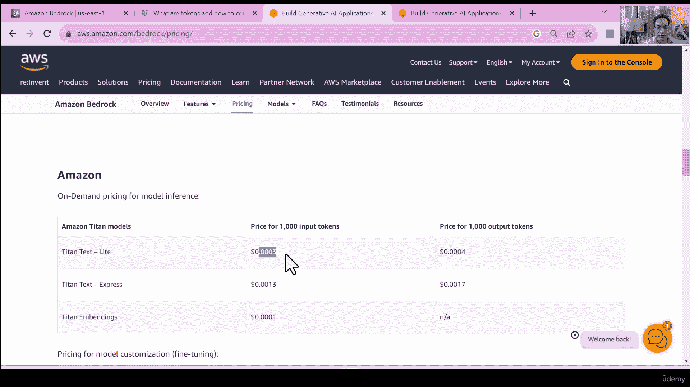

上一节我们拆出了按需模式的三个计价领域，本节中我们具体看看文本、图像和嵌入的价格。原文提到，在 Amazon Bedrock 定价页面上可以看到按需模式和预置吞吐模式，还能看到模型定制相关内容。打开定价页面后，可以看到 AI21 Labs 的按需推理价格。原文以 AI21 Labs 的两个 Jurassic 系列模型为例，说明每 1000 个输入 token 的价格为 0.0125 美元，每 1000 个输出 token 的价格也是 0.0125 美元。输入 token 通常对应提示词，输出 token 通常对应模型生成的内容，二者价格在这个例子里比较接近。

为了更直观地理解 token 和单词的关系，原文参考了网页上的换算说明：大约 100 个 token 对应 75 个单词，随后又以 1000 个 token 约等于 750 个单词来说明价格。也就是说，750 个单词左右的输入，费用只有很小的量级；输出费用也类似。原文还提到，对于同样的约 750 个单词，Amazon 的价格甚至更低。这里的关键不是记住某一个具体数字，而是理解按需文本定价的基本公式。以下是文本生成费用的计算公式：

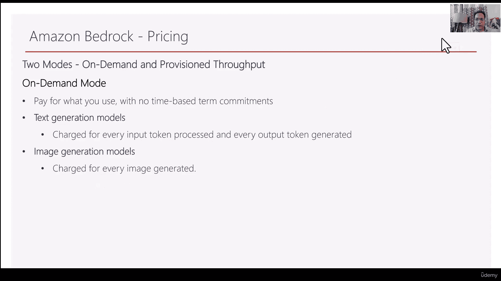

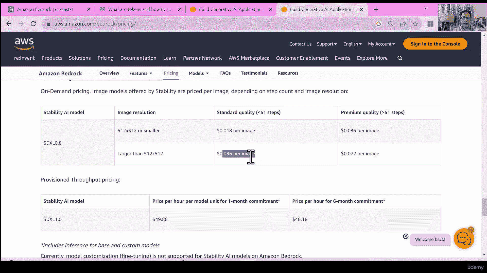

```text
文本总费用 = (输入Token数 ÷ 1000) × 每千输入Token价格
           + (输出Token数 ÷ 1000) × 每千输出Token价格
```

接下来看图像生成。原文说明，图像生成使用的是 Stability AI 的 Stable Diffusion 模型，价格按每张生成的图片计算。对于 512×512 或更小分辨率，每张图片价格为 0.0018 美元；对于更大的图片，每张价格为 0.036 美元。原文强调，这个价格也非常便宜。图像生成费用的理解方式可以用下面的公式表示：

```text
图像生成费用 = 生成图片数量 × 单张图片价格
```

最后看嵌入。原文指出，嵌入的收费方式略有不同，因为嵌入按每一个被处理的输入 token 收费。原文举例说，对于 Cohere Command 模型，处理 4000 个输入 token 的费用约为 0.0015，按原文口径描述，这个量级非常低。这里可以看到按需模式整体上很便宜。嵌入费用的基本公式如下：

```text
嵌入费用 = (输入Token数 ÷ 1000) × 每千输入Token价格
```

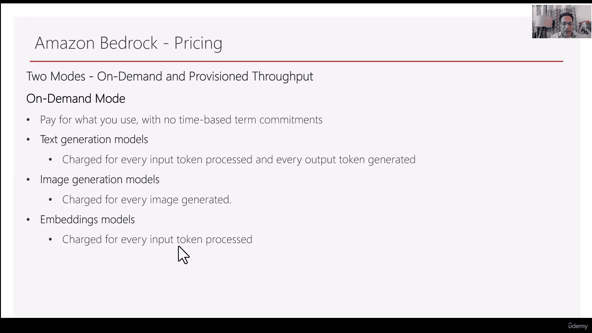

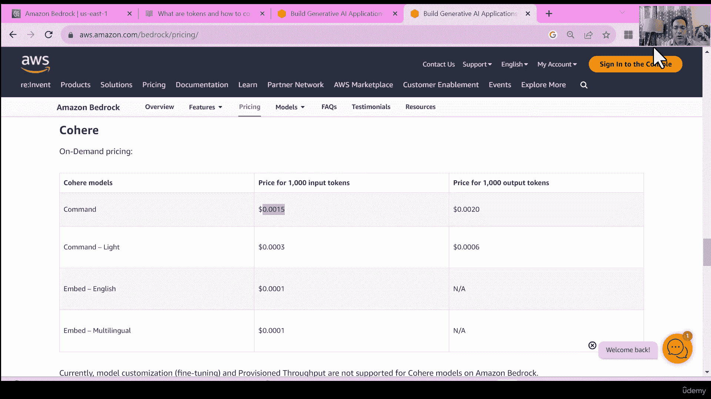

> 提示：价格数字会随模型、区域和时间变化，实际费用请以 Amazon Bedrock 定价页面和控制台显示为准。

## Amazon Bedrock 生成式 AI 实战：第4节：🏭 预置吞吐模式

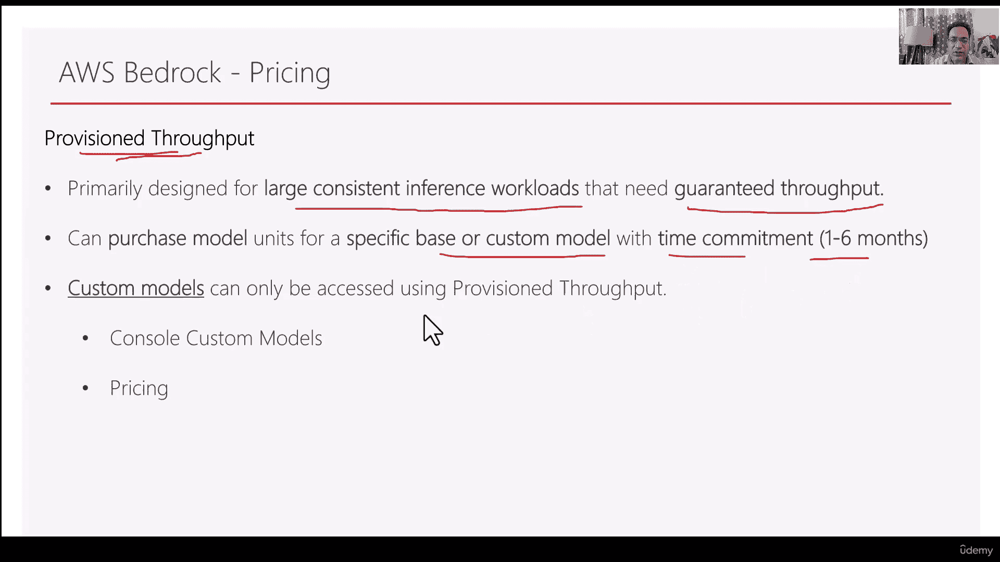

上一节我们看完了按需模式下的文本、图像和嵌入计价，本节中我们来看看预置吞吐模式。原文先问了一个问题：预置吞吐模式适合什么场景。简单说，预置吞吐模式主要面向需要大量、稳定、持续推理负载，并且需要保证吞吐量的应用。如果你希望生产应用获得有保障的吞吐能力，就应该考虑预置吞吐模式。以下是预置吞吐模式的两个典型使用场景：

- **生产应用需要稳定吞吐**：当应用需要大量且持续的推理请求，并且希望吞吐量有保证时，预置吞吐模式更合适。
- **需要部署自定义模型**：当你用标注数据定制基础模型并创建自定义模型后，如果要把这个自定义模型部署上线，就需要使用预置吞吐模式，不能通过按需模式部署。

除了使用场景，预置吞吐模式还需要时间承诺，原文提到承诺期通常在一到六个月之间。也就是说，预置吞吐不是随开随停的完全按量模式，而是需要提前购买一定吞吐能力，并承诺使用一段时间。原文随后通过控制台展示了自定义模型和预置吞吐的购买流程：进入 Bedrock 服务，点击自定义模型，可以看到之前定制模型的步骤，第二步就是购买预置吞吐。在购买页面中，可以给预置吞吐命名、选择模型、选择承诺月份。原文示例中选择一个月承诺后，页面显示每小时成本为 63 美元，每日成本为 1500 美元，预计每月成本为 45990 美元。以下是预置吞吐费用的粗略估算公式：

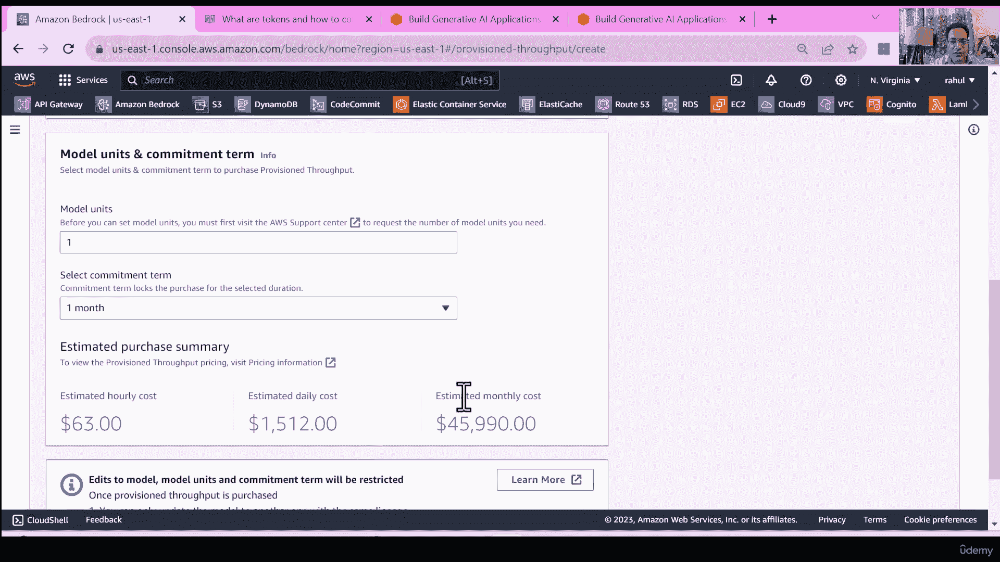

```text
每月预估费用 ≈ 每小时价格 × 24 × 30
```

原文还比较了不同模型的预置吞吐价格。对于 AI21 Labs，页面上只看到按需定价，没有显示预置吞吐价格；对于 Amazon 的某些模型，可以看到预置吞吐价格；对于 Titan X Light，价格略低于 7 美元和 6.4 美元等。对于 Anthropic，预置吞吐价格按模型和承诺期变化，原文示例中一个月承诺约为每小时 40 美元，六个月承诺约为每小时 22 美元。这里要理解的重点是，预置吞吐的价格通常与模型、承诺时长和购买吞吐量有关，不能用按需模式的单价直接套用。

## Amazon Bedrock 生成式 AI 实战：第5节：🧮 定价示例

上一节我们了解了预置吞吐模式的使用场景和价格结构，本节中我们用一个按需定价示例把前面的公式用起来。原文给出的例子是：一个应用开发者向 Amazon Bedrock 发起请求，使用 AI21 Labs 的 Jurassic-2 Mid 模型做摘要，输入为 10K token，输出为 2K token，问总费用是多少。这里 K 表示千，所以输入是 10000 个 token，输出是 2000 个 token。根据前面的价格，每 1000 个输入 token 为 0.0125 美元，每 1000 个输出 token 也是 0.0125 美元。以下是这个示例的计算过程：

```text
输入费用 = (10000 ÷ 1000) × 0.0125 = 10 × 0.0125 = 0.125 美元
输出费用 = (2000 ÷ 1000) × 0.0125 = 2 × 0.0125 = 0.025 美元
总费用 = 0.125 + 0.025 = 0.15 美元
```

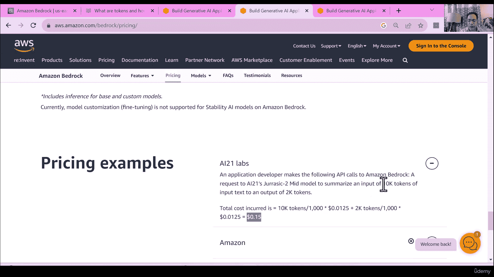

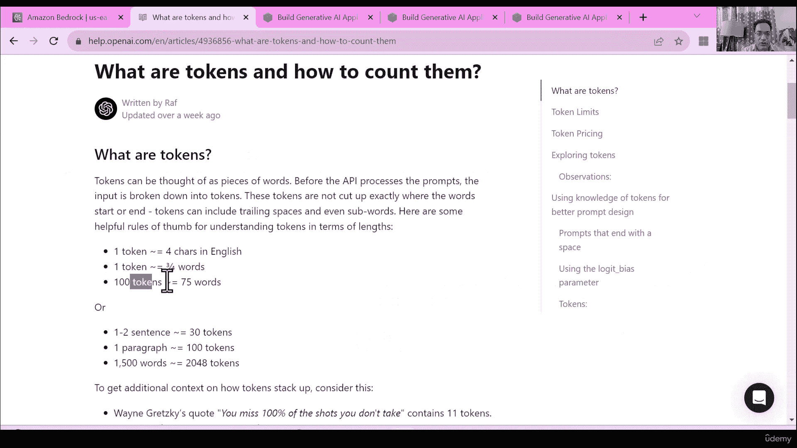

所以这个请求的总费用为 0.15 美元。原文进一步用单词数帮助理解：10000 个 token 大约等于 7500 个单词，2000 个 token 大约等于 1500 个单词。也就是说，输入是一段约 7500 个单词的长文本，输出是约 1500 个单词的摘要，而每个请求的费用只有 0.15 美元。原文最后还用很小的费用量级来强调按需模式便宜，提到约 0.5 美分的说法；结合公式计算，示例总费用为 0.15 美元，具体金额和 token 换算请以控制台和定价页为准。理解这个例子的关键，是记住“输入 token 费用加输出 token 费用”这个基本思路。

## Amazon Bedrock 生成式 AI 实战：第6节：✅ 本讲总结

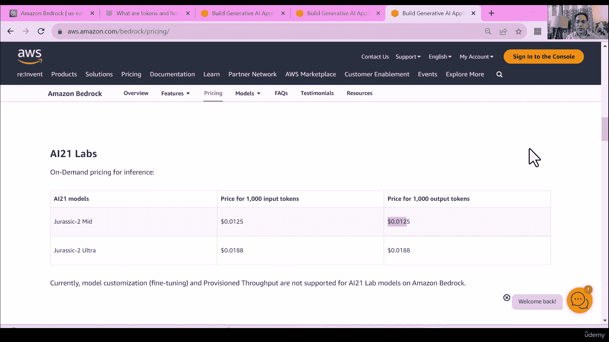

本节课中我们一起学习了 Amazon Bedrock 的定价模式。我们首先了解了按需模式和预置吞吐模式的区别：按需模式用多少付多少，没有时间和单位承诺；预置吞吐模式面向稳定吞吐、生产应用和自定义模型部署，并且需要一到六个月的时间承诺。然后我们拆解了按需模式下的文本、图像和嵌入计价，看到文本按输入和输出 token 收费，图像按张数收费，嵌入按输入 token 收费。接着我们看了预置吞吐模式的使用场景和控制台价格示例，最后用 AI21 Labs 的摘要请求演示了总费用计算。希望这些内容能帮助初学者建立清晰的定价框架，在实际使用 Amazon Bedrock 时知道该看哪些价格项、该用哪个公式估算费用。

