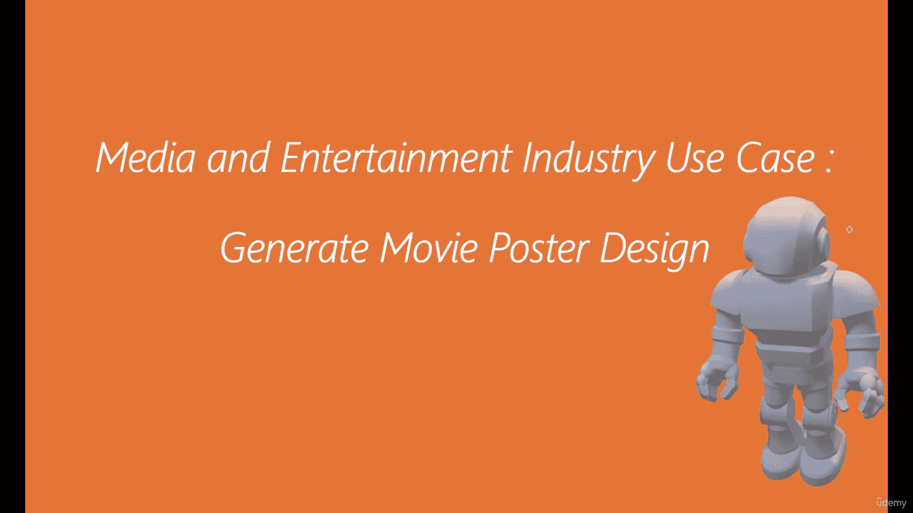
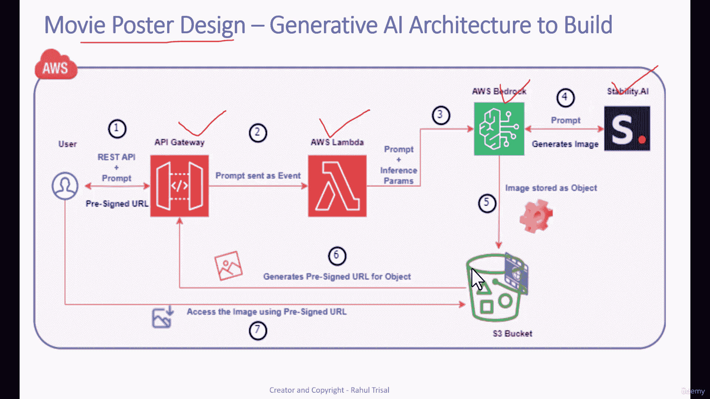
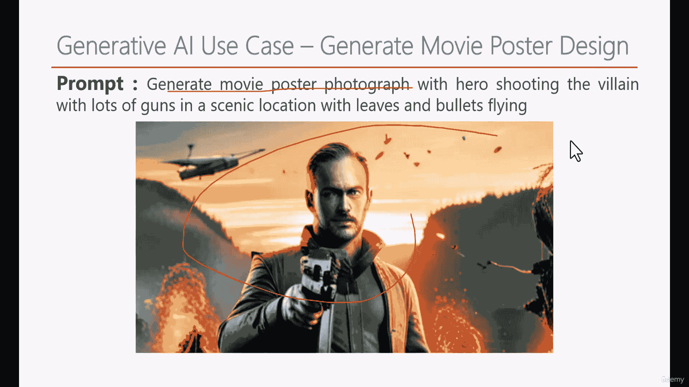

# 🎬 Udemy 生成式 AI on AWS（Amazon Bedrock、RAG 与 KIRO [2026]）课程：Part 1 / P19–P21：媒体与娱乐行业用例章节介绍

在本节课中，我们将要学习媒体与娱乐行业的用例章节介绍，并了解如何用 Amazon Bedrock 构建端到端用例。这个章节的目标很明确：帮助学习者掌握把多个 AWS 服务串起来、完成一个完整业务场景的方法。为了便于初学者理解，下面会用直白的方式拆解章节目标、开始前的准备、端到端海报设计流程以及生成结果示例。上一节我们完成了前面的基础内容，本节中我们来看看这个媒体与娱乐行业用例章节的整体安排。

## 📚 Udemy 生成式 AI on AWS（Amazon Bedrock、RAG 与 KIRO [2026]）课程：Part 1 / P19–P21：本节目标

本章首先欢迎你进入媒体与娱乐行业用例这一节。这个章节的目标，是帮助你学习如何用 Amazon Bedrock 构建端到端用例。所谓端到端，就是把用户输入、业务逻辑、模型调用和结果存储等环节串成一条完整链路，让一个想法能够从提示词一路走到最终输出。理解这个目标之后，下一步自然要看看动手之前需要准备什么，因此下面进入先决条件部分。

## 🧰 Udemy 生成式 AI on AWS（Amazon Bedrock、RAG 与 KIRO [2026]）课程：Part 1 / P19–P21：开始前的两个先决条件

上一节我们明确了本章要构建端到端用例，本节中我们来看看开始构建之前需要完成的准备。原文强调，在开始构建端到端用例之前，如果你想要跟着一起操作，那么有几个先决条件需要先满足。以下是开始前需要满足的两个先决条件：

- 第一个先决条件是：你需要拥有对基础模型的访问权限。如果你还没有这个权限，可能需要向 AWS 请求开通这些基础模型的访问权限。
- 第二个先决条件是：你需要把 Lambda 函数所用的 Boto3 版本升级上去，原文写作 Bodo 3 version。完成这些先决条件之后，课程还会详细讨论这两个准备项。



为了更直观地表示这两个先决条件，可以用下面的代码块来描述核心检查项：

```text
基础模型访问权限 = 已开通（没有则向 AWS 请求）
Lambda 函数环境 = Boto3 版本已升级
```

上面的准备项看起来简单，但它们决定了后面的端到端应用能否顺利调用模型并完成业务逻辑。一旦你完成这些先决条件，接下来就会进入真正的端到端用例构建环节。下面我们来看看这个媒体与娱乐行业用例具体要做什么。

## 🎞️ Udemy 生成式 AI on AWS（Amazon Bedrock、RAG 与 KIRO [2026]）课程：Part 1 / P19–P21：端到端电影海报设计用例

在完成先决条件之后，我们将构建一个端到端用例，用于设计虚构的电影海报。这个用例会使用 API Gateway、Lambda、Amazon Bedrock，并使用 Stability AI 提供的 Stable Diffusion 作为基础模型，同时使用 AWS S3。把这些服务组合起来，就可以让用户提交提示词，经过 API 和计算逻辑，调用 Bedrock 中的 Stable Diffusion 生成海报图像，再把结果保存到 S3。以下是这个端到端用例的主要组成与流程：

```text
用户提示（Prompt）
    ↓
Amazon API Gateway
    ↓
AWS Lambda（Boto3 版本已升级）
    ↓
Amazon Bedrock（Stability AI Stable Diffusion）
    ↓
Amazon S3
    ↓
生成的虚构电影海报
```

这个流程的核心概念可以用一个简单公式概括：`端到端海报应用 = API Gateway + Lambda + Bedrock + Stable Diffusion + S3`。理解这个组合方式后，就能明白每个服务在链路中的位置：API Gateway 负责入口，Lambda 负责业务逻辑，Bedrock 负责调用基础模型，Stable Diffusion 负责生成图像，S3 负责存放输出。接下来我们来看看这个应用生成出来的结果示例。

## 🖼️ Udemy 生成式 AI on AWS（Amazon Bedrock、RAG 与 KIRO [2026]）课程：Part 1 / P19–P21：生成结果示例与下一讲

上一节我们介绍了端到端电影海报设计用例的组成，本节中我们来看看输出结果。原文展示了一个输出，这个输出是基于我们提供给已构建端到端应用的提示词生成的。也就是说，用户给出提示词后，应用沿着前面的链路完成处理，并生成了对应的海报结果。这个结果示例可以帮助学习者直观看到端到端应用的实际效果。最后，原文说明会在下一讲再见，并表示感谢。到这里，本章介绍的完整脉络就清楚了：先确认目标，再准备权限和环境，然后搭建端到端应用，最后查看生成输出。





## ✅ Udemy 生成式 AI on AWS（Amazon Bedrock、RAG 与 KIRO [2026]）课程：Part 1 / P19–P21：本节总结

本节课中我们一起学习了媒体与娱乐行业用例章节介绍。我们了解到本章目标是使用 Amazon Bedrock 构建端到端用例；开始前需要拥有基础模型访问权限，并在没有权限时向 AWS 请求开通；还需要升级 Lambda 函数的 Boto3 版本。完成准备后，我们使用 API Gateway、Lambda、Amazon Bedrock、Stability AI 的 Stable Diffusion 和 AWS S3 构建虚构电影海报设计用例，并查看了基于提示词生成的输出示例。下一讲再见，谢谢。

