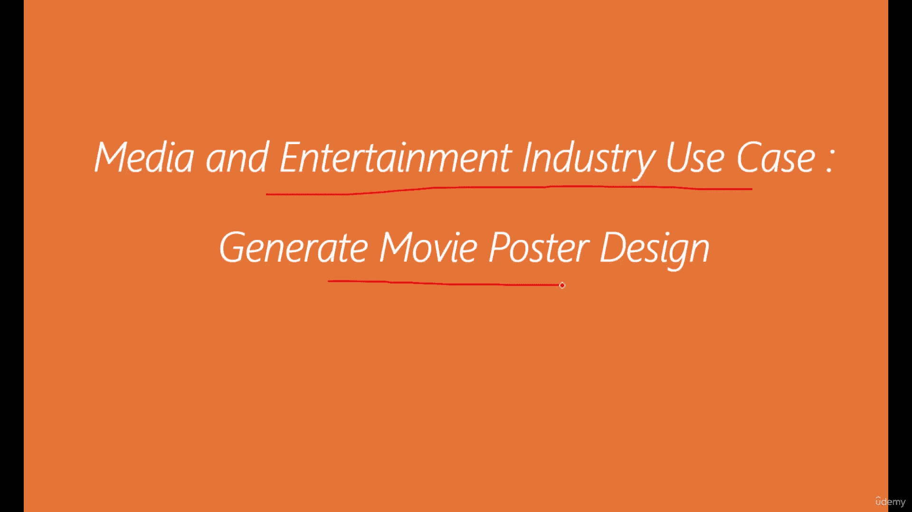
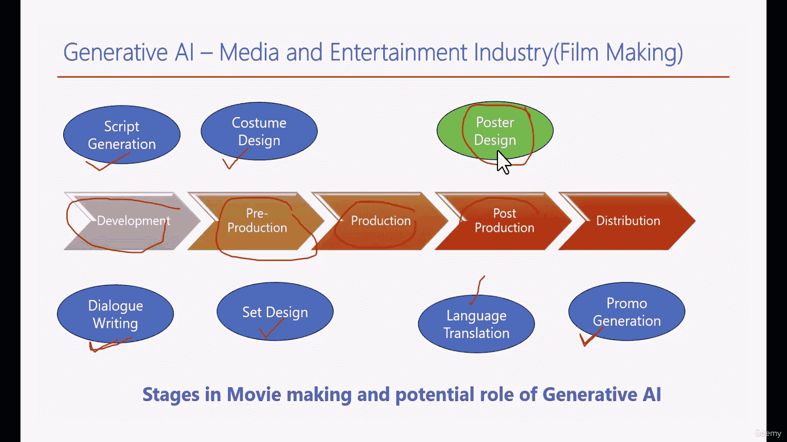
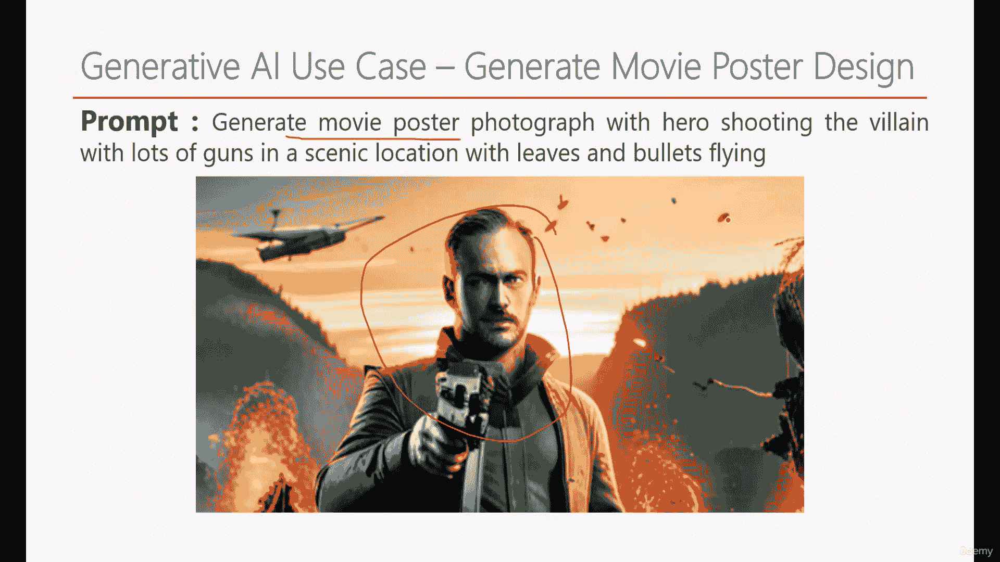

🎬 生成式AI在AWS上的实践：第20讲：媒体与娱乐行业用例

在本节课中，我们将一起学习一个非常有意思的端到端用例——在媒体与娱乐行业中使用生成式AI来制作电影海报。我们会先聊聊电影制作的整体流程，然后看看生成式AI在哪些环节能帮上忙，最后再聚焦到我们要构建的具体应用上。这个应用能根据你输入的一段描述，自动生成一张风格化的电影海报。为了让内容更清楚，我们还会用一段简单的代码来概括整个流程。

我们都很喜欢看电影。不管是周末窝在沙发上刷大片，还是去电影院感受IMAX的震撼，电影总能带来独特的体验。正因为大家都爱看电影，所以我想在媒体与娱乐行业里打造一个完整的端到端用例，应该会很有意思。这个想法很自然——既然电影是大家熟悉的东西，那我们干脆用AI来参与电影制作中的某个环节，看看能碰撞出什么火花。

在本节课程中，我们会构建一个端到端的应用程序，它能够根据我们提供的提示词（prompt）生成电影海报。说白了，你告诉它“我要一张科幻风格的海报，主角站在废墟城市里”，它就能给你画出来。这个应用将整合生成式AI的能力，让我们直观感受到AI在创意设计上的潜力。

为了把这个用例做好，在深入细节之前，我们先广泛了解一下电影制作中通常会经历哪些步骤。这就像做菜之前先看看整个菜谱，心里有个谱，后面操作起来才不慌。电影制作其实是一个相当复杂的流程，但我们可以把它拆解成几个大的阶段，然后看看生成式AI能在哪些阶段插一脚。

第一阶段是开发阶段。这个阶段是整个电影项目的起点，主要是确定故事、写剧本、谈投资等等。显然，开发阶段里面包含很多琐碎的步骤，比如市场调研、剧本评估、角色设定等等。但具体来说，生成式AI最能在两个地方帮上忙：一个是剧本生成，另一个是对话写作。在这两个领域，AI可以快速生成初稿、提供剧情走向建议，或者帮编剧写出更有趣的台词，从而大幅提升创作效率。



```python
# 用伪代码描述电影制作流程与AI介入点
阶段 = ["开发", "预制作", "制作", "后期制作", "海报设计"]
AI介入点 = {
    "开发": ["剧本生成", "对话写作"],
    "预制作": ["服装设计", "场景设计", "创意构思"],
    "制作": ["实拍/拍摄"],
    "后期制作": ["语言翻译", "宣传物料生成"],
    "海报设计": ["基于prompt的海报生成"]
}
```

接下来是预制作阶段。在开发阶段搞定剧本之后，就要开始为正式拍摄做准备了。在这个阶段里，你可以使用生成式AI来进行服装设计、场景设计，以及围绕这些方面获取灵感。比如，你输入“古罗马风格的长袍，带金色刺绣”，AI就能给出几种设计方案供美术组参考。这大大缩短了前期头脑风暴的时间，也让创意团队能尝试更多可能性。

然后就是制作阶段。这个阶段实际上就是把电影拍出来。在制作阶段，AI的介入相对较少，毕竟实拍还是需要真人、摄影机和灯光等等。不过，一些辅助性的AI工具（比如智能剪辑、自动对焦辅助）也能提升拍摄效率，但核心还是靠导演和摄影师的现场把控。

接下来是后期制作阶段。当电影拍完之后，还需要做大量的加工工作。如果这部电影要在不同语言的国家和地区上映，那么就可以使用生成式AI来进行语言翻译。这不仅仅是字幕翻译，还包括配音时的口型对齐、语气调整等。同时，你还可以使用生成式AI来做宣传推广素材的生成，比如利用AI应用来制作预告片、短视频片段、社交媒体宣传图等。这些内容以前需要专门的后期团队花很多时间制作，现在AI可以快速生成初版，人工再稍作修改就能用。

最后，还有一个非常关键的环节——海报设计。海报是吸引潜在观众走进电影院的重要工具，一张好的海报能瞬间抓住人的眼球，让人产生“这片子好像不错”的冲动。所以，在这个用例中，我们将构建一个端到端的应用程序，帮助我们根据提供的提示词来设计电影海报。用户只需要输入一段文字描述，比如“一场发生在月球基地的悬疑故事，冷蓝色调，主角背对镜头”，应用就会生成一张符合描述的海报。

现在，让我们实际看看效果。这里有一张电影海报的示例，它就是从我们要构建的这个应用程序中生成出来的。我当时只是提供了一个提示词，让AI根据某个场景来生成一张电影海报，然后它就给出了这样的结果。是不是很神奇？整个过程看起来就像变魔术一样，但背后其实就是大语言模型加图像生成模型在协同工作。

在下一节课中，我们将来看看这个应用程序的架构设计。到时候我们会把整个技术栈、各个组件如何配合、数据如何流转讲清楚。希望本节课对你有所帮助，我们下节课见。感谢大家的观看。





本节课中，我们一起了解了电影制作的几个主要阶段——开发、预制作、制作、后期制作和海报设计，并重点讨论了生成式AI可以在其中哪些环节发挥作用。最后，我们还预告了接下来要构建的海报生成应用。简单总结一下：生成式AI在电影行业里能干很多活，从写剧本到做海报，都能帮上忙。接下来我们就要深入技术层面，看看这个应用到底是怎么搭起来的。
