# 🎬 生成式AI on AWS：第21-23节：用例架构——Amazon Bedrock、Stability AI、Lambda 与 S3

在本节课中，我们将要学习一个完整的生成式AI用例架构，这个架构就是我们要在本用例中亲手搭建的目标。它会串联终端用户、REST API、AWS API Gateway、Lambda、Amazon Bedrock、Stability AI 的 Stable Diffusion 基础模型以及 S3 桶，最终让用户拿到一张可访问、可分享的电影海报。下面我们先从整体目标看起，再一步步拆开请求链路、模型调用和结果存储，帮助初学者把每个环节的作用和前后关系弄清楚。

## 🧭 生成式AI on AWS：第21-23节：整体架构目标

上一段我们知道了本用例最终要做出可分享的电影海报，本节先看清整个架构的起点和终点。这个生成式AI架构就是我们在本用例中要构建的系统，它从终端用户发起请求开始，到用户拿到S3中电影海报的预签名URL结束。整个流程并不复杂，核心就是把“用户想要什么”变成“模型生成什么”，再把“生成结果”安全地交给用户访问。

从角色上看，流程中有一个终端用户，这个用户会调用REST API，并在请求里提供一个提示词，用来说明他想设计什么类型的电影海报。这个提示词就是后续图像生成的方向，也是整个系统最先接收到的业务输入。为了让初学者更容易理解，可以把这个过程看成：用户先用自然语言描述海报需求，系统再把这个描述转成模型能处理的参数。

## 🚪 生成式AI on AWS：第21-23节：请求如何进入系统

上一节我们明确了用户会用提示词描述海报需求，本节来看看这个请求在网络和计算服务之间怎么走。这个请求会先发送到AWS API Gateway，然后AWS API Gateway会把提示词作为事件发送给Lambda函数。也就是说，API Gateway在这里承担入口和转发的角色，Lambda则负责接收事件并执行后续逻辑。

当Lambda函数接收到作为事件的提示词后，它还会拿到我们在Lambda代码中定义好的推理参数。随后，Lambda会把提示词和这些推理参数这两类信息一起发送给Amazon Bedrock。这里可以用一个简单的伪代码来表示Lambda的核心动作，帮助大家直观看懂输入和输出之间的关系。以下是这个调用关系的代码化描述：

```text
用户 -> REST API -> AWS API Gateway -> Lambda
Lambda 输入 = { prompt, inference_parameters }
Lambda 输出 = 调用 Amazon Bedrock
```

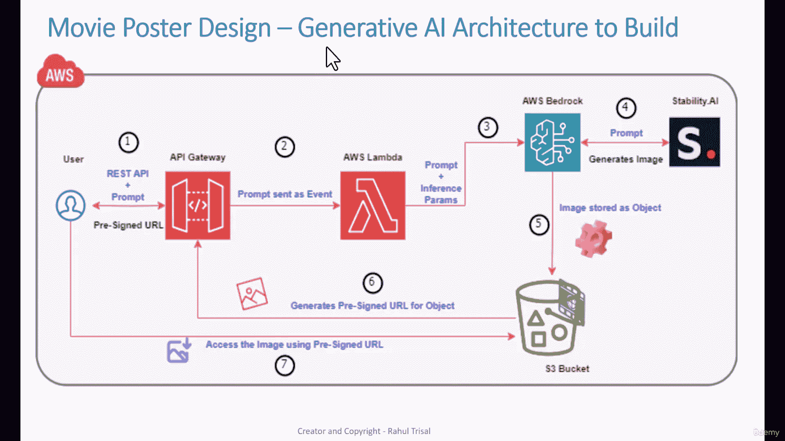

这段伪代码表达的重点是：用户提供提示词，Lambda补充推理参数，二者共同组成调用模型所需的请求。推理参数可以理解成控制生成效果的配置项，虽然原文没有展开具体字段，但它们在Lambda代码中已经定义好，并会和提示词一起传给Bedrock。这样设计的好处是，入口层不需要关心模型细节，真正的模型调用逻辑集中在Lambda中。

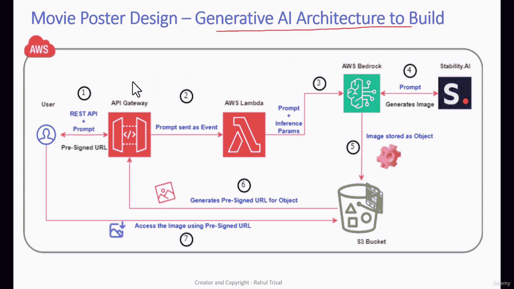

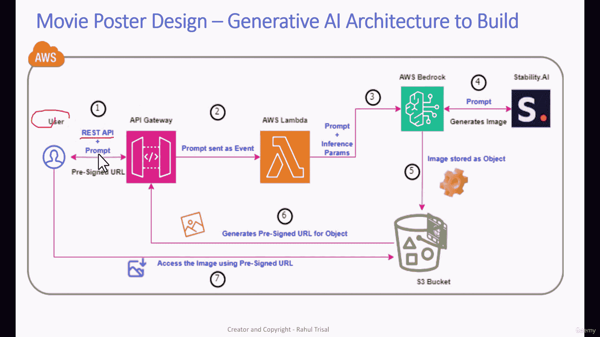

## 🧠 生成式AI on AWS：第21-23节：调用Bedrock与Stability AI模型

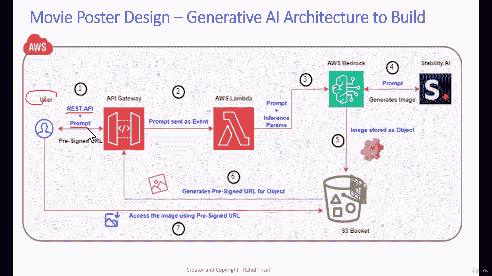

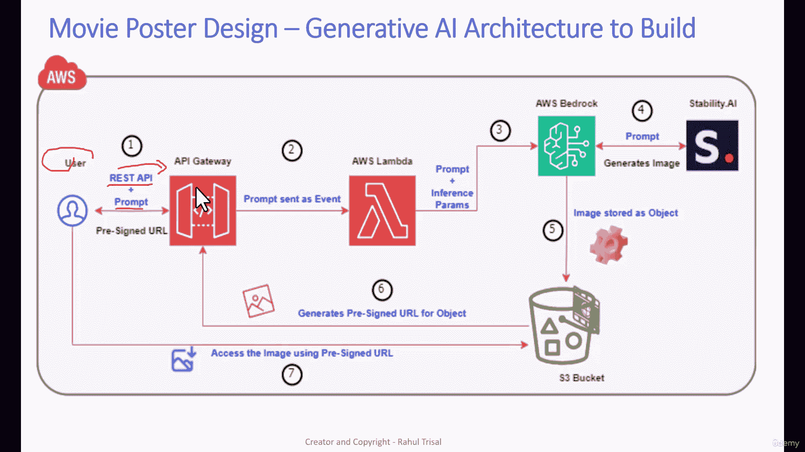

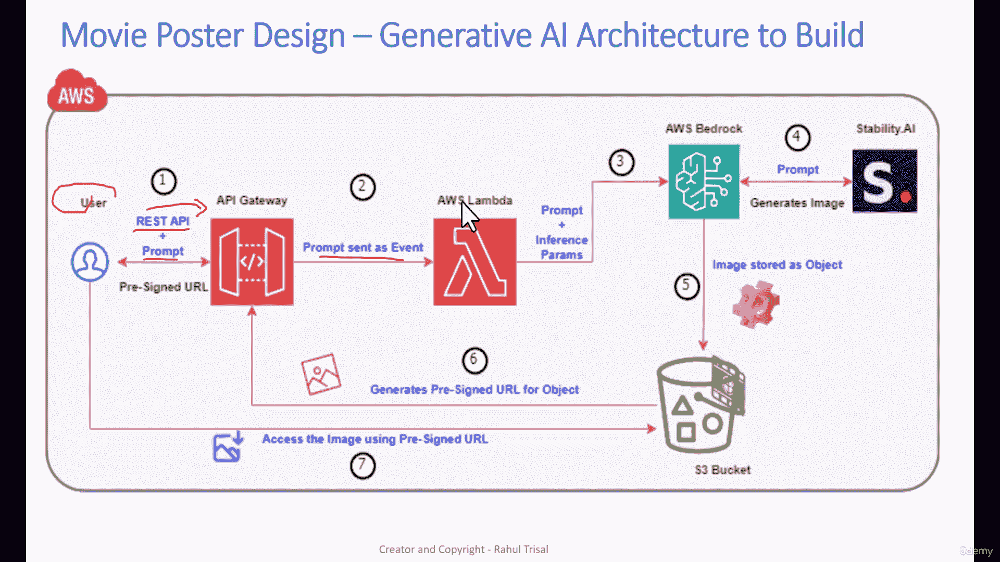

上一节我们看到了Lambda如何把提示词和推理参数送到Amazon Bedrock，本节继续看Bedrock之后发生了什么。Amazon Bedrock服务会与Stability Diffusion基础模型交互，这个基础模型由Stability AI拥有，并且用于创建高质量图像。换句话说，Bedrock在这里是模型服务的接入层，真正负责图像生成的是Stability AI提供的Stable Diffusion基础模型。

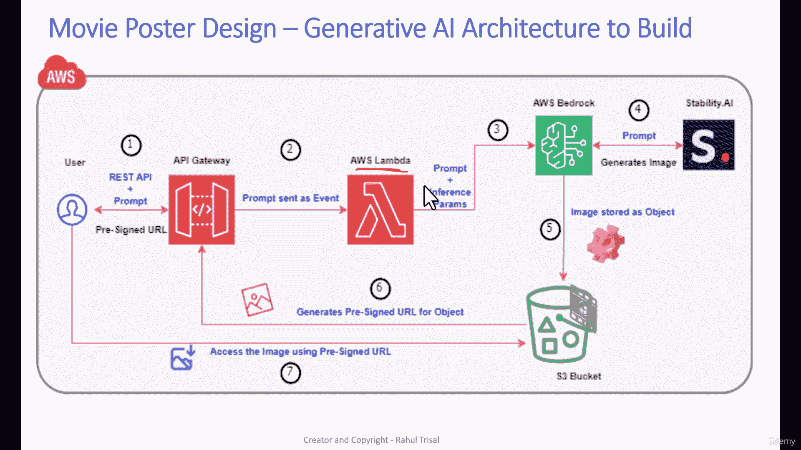

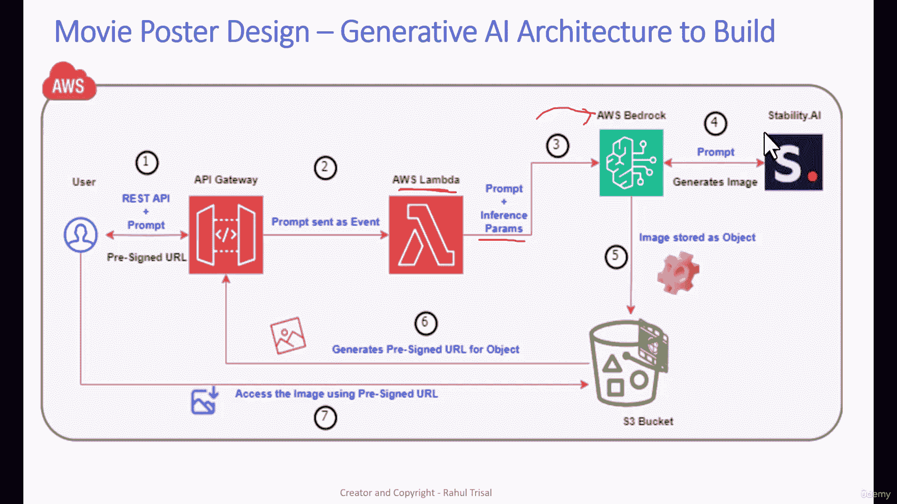

可以把这一层关系理解成下面的公式，它强调了“请求进入Bedrock，再由Bedrock调用具体基础模型”的路径。以下是这个调用链的公式化表达：


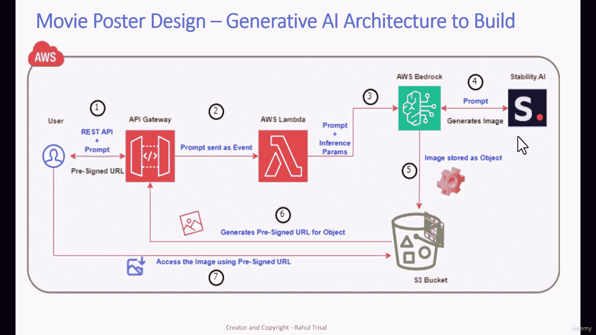

```text
Amazon Bedrock + Stable Diffusion 基础模型 -> 高质量图像
```

当Stability AI的基础模型生成图像后，系统会把这张图像发送出去，并把它作为对象存储到S3桶中。这里要注意“作为对象”这个说法，它说明图像在S3里不是一段普通文本，而是以对象形式保存的文件。对初学者来说，可以简单理解为：模型生成了一张海报图片，系统把这张图片放进S3这个云存储桶里，等待后续访问。

## 🔗 生成式AI on AWS：第21-23节：生成预签名URL并返回用户

上一节我们完成了图像生成和S3存储，本节来看看用户怎样拿到并访问这张海报。当图像已经存储在S3桶中之后，系统会为这个对象生成一个预签名URL。这个预签名URL不是普通URL的简单复制，它带有访问授权和时效控制，因此适合把私有对象临时分享给别人。

如果你不知道什么是预签名URL，可以把它理解成“和URL很相似，但有两个关键特点”的链接。以下是预签名URL的两个特点，先了解它们有助于理解后面的返回流程：

- 第一，对象的所有者可以分享这个URL，并允许其他人访问这个特定对象。
- 第二，我们可以为这个URL设置过期时间，用来控制这个对象通过该URL可被访问的时长。

用公式来表示，预签名URL可以看作“对S3对象签名并附加过期时间”的结果。以下是这个概念的形式化描述：

```text
PresignedURL = Sign(S3Object, ExpirationTime)
```

系统会为这个S3对象生成预签名URL，然后把它发送回AWS API Gateway。接着，AWS API Gateway会把这个预签名URL返回给用户。用户拿到链接后，只需要点击这个预签名URL，就可以访问S3桶中的对象。在这个用例里，这个对象就是由Stability AI基础模型创建出来的电影海报。

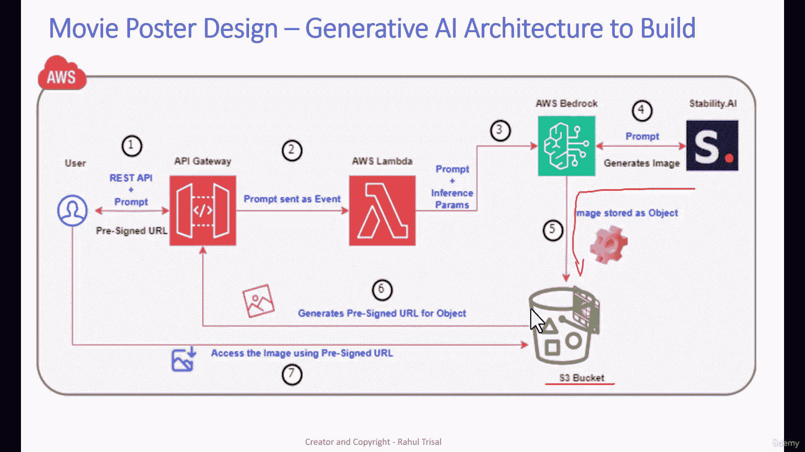

## 📤 生成式AI on AWS：第21-23节：分享海报与下一步

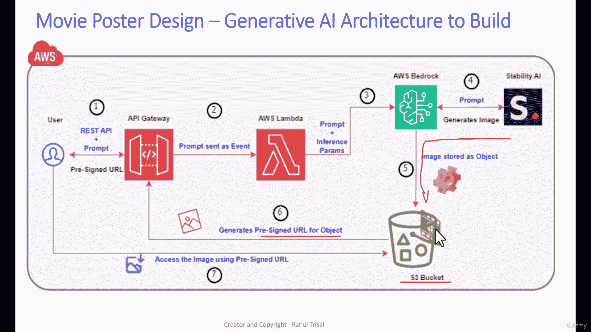

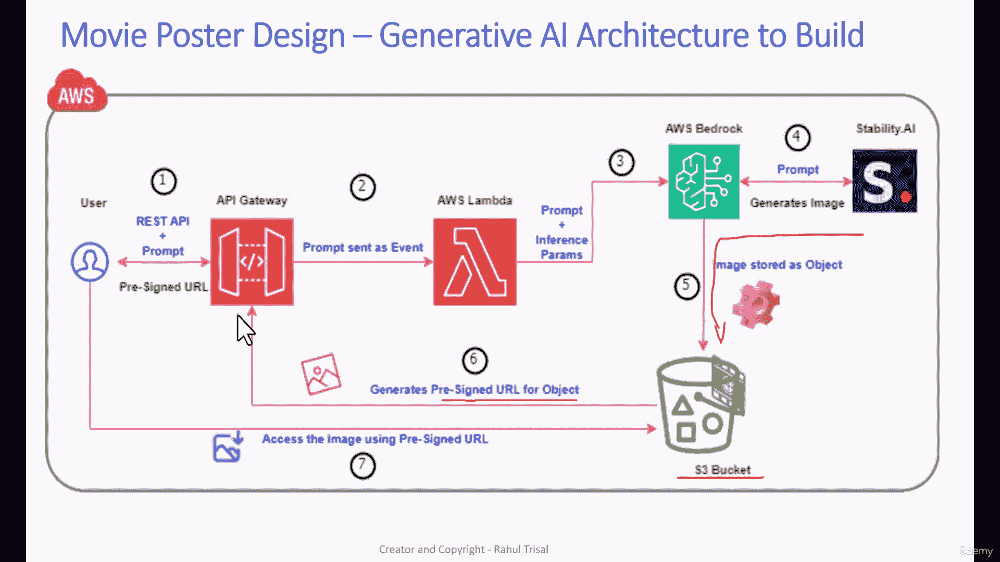

上一节我们让用户通过预签名URL访问到了S3中的电影海报，本节补充这个用例的分享场景和后续安排。用户可以把这条URL分享给任何其他需要访问这张电影海报的人，让对方进行评审。这样，海报的访问就不再局限于最初发起请求的用户，而是可以在授权和时效范围内流转。

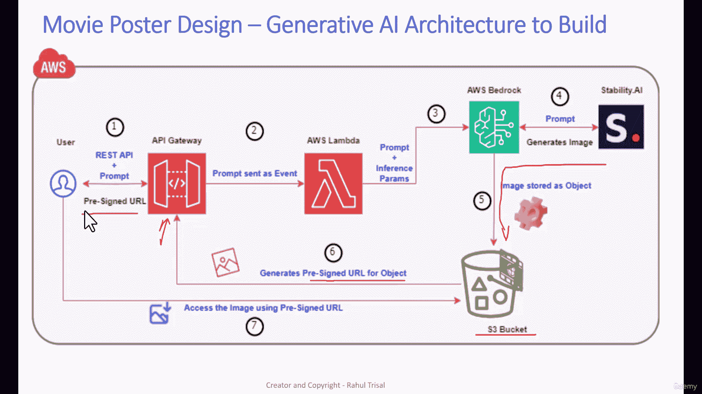

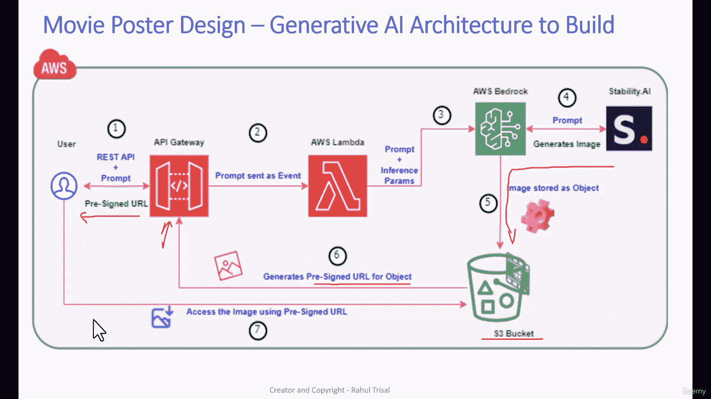

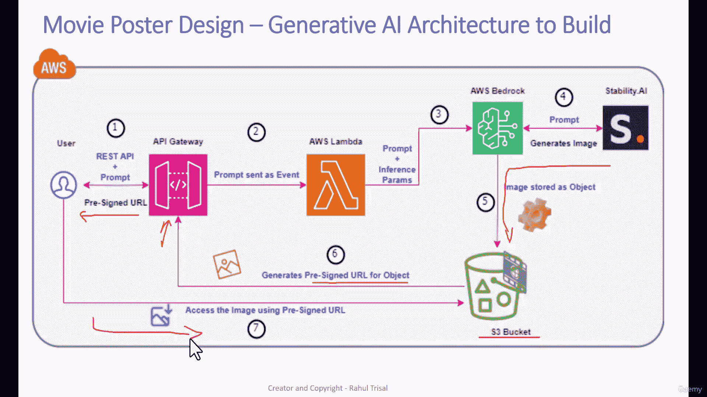

> 这里的关键点是：预签名URL既能让对象所有者分享访问权限，又能通过过期时间控制访问窗口。

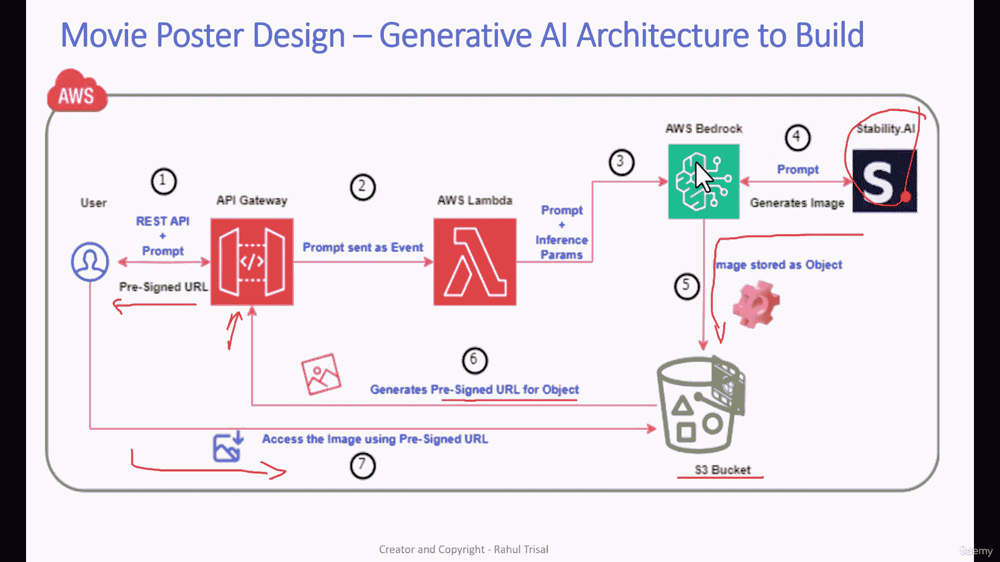

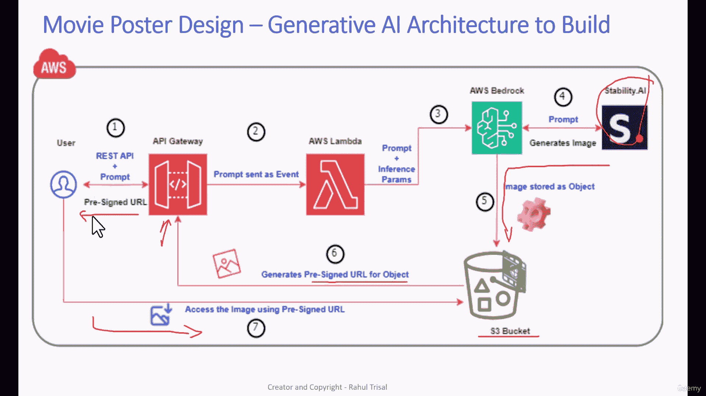

以上就是我们要构建的完整用例架构。从用户提交提示词，到API Gateway转发事件，再到Lambda调用Amazon Bedrock和Stability AI基础模型，最后把生成的图像作为对象存入S3并生成预签名URL返回给用户，整条链路已经完整串联起来。下一节中，我们将开始真正构建这个用例，把今天拆解的架构一步步落地。

## ✅ 生成式AI on AWS：第21-23节：本节总结

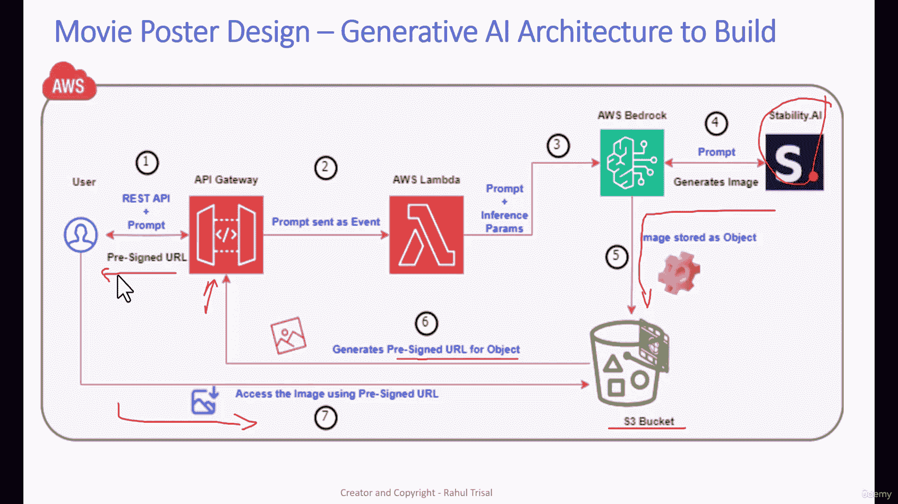

本节课中我们一起学习了这个生成式AI用例的完整架构：终端用户通过REST API提交电影海报提示词，AWS API Gateway把提示词作为事件转发给Lambda，Lambda结合推理参数调用Amazon Bedrock，Bedrock再与Stability AI的Stable Diffusion基础模型交互并生成高质量图像；图像作为对象存入S3后，系统生成带分享能力和过期时间的预签名URL，经API Gateway返回给用户，用户点击访问并分享海报供评审。下一节我们将进入实际构建阶段。

