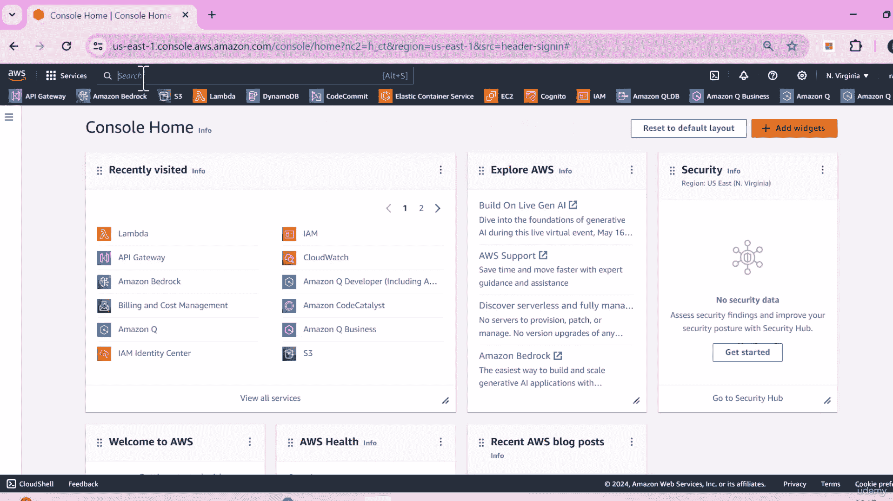
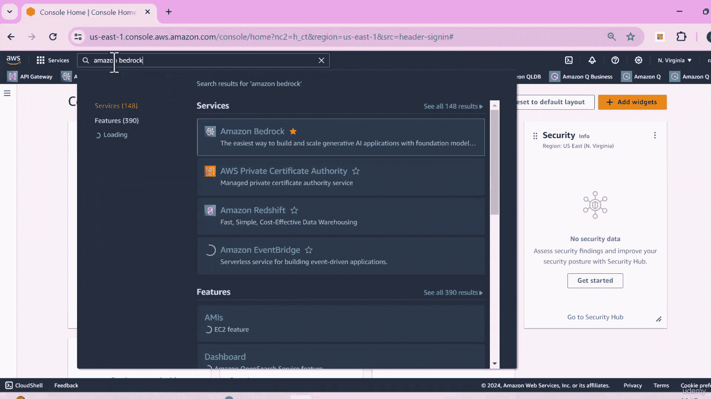
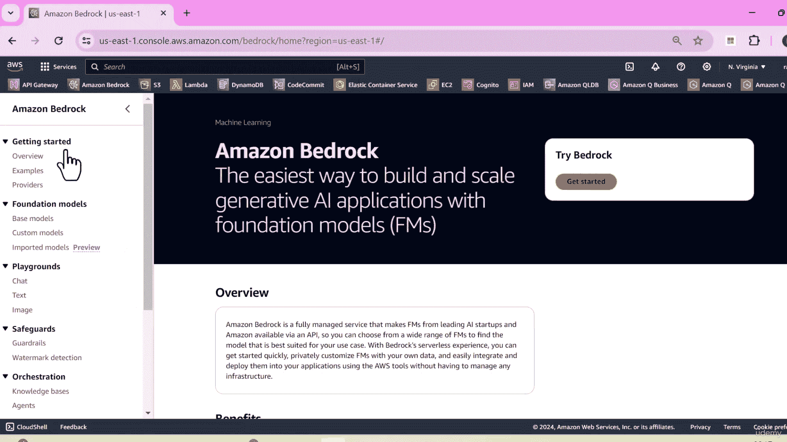
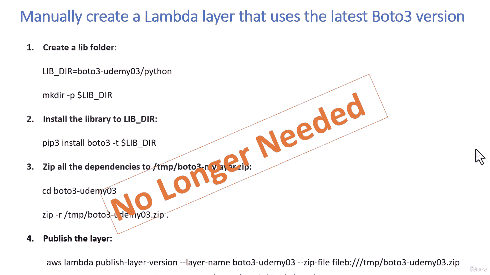

# 🚀 AWS生成式AI实战：第22讲：用例前置条件与准备


在本节课中我们将要学习在正式实现生成式AI用例之前需要满足哪些前置条件。这里所说的前置条件，不是某一个具体业务功能，而是后面动手做Amazon Bedrock相关用例之前必须先准备好的基础设置。先把这些基础设置做好，后面调用模型、写Lambda函数和跑示例时就不容易卡住。本节会围绕Amazon Bedrock模型访问权限，以及Lambda函数中Boto3版本要求的变化展开。

## 🔐 AWS生成式AI实战：22.1：申请Amazon Bedrock模型访问权限

上一节概述了前置条件的范围，本节中我们来看看第一个也是最基础的前置条件：申请Amazon Bedrock基础模型访问权限。无论接下来实现哪一个用例，都需要先从Amazon Bedrock服务请求基础模型访问权限。这里的关键点是，这些基础模型默认不会直接开放访问，必须手动申请。下面演示如何请求访问权限。



这里假设已经拥有AWS账户。在AWS账户主页，使用搜索栏搜索`Amazon Bedrock`。搜索到后点击进入Amazon Bedrock。进入Amazon Bedrock主页后，点击左侧的三条横线菜单，向下滚动到`Model access`并点击。进入后可以看到，当前账户已经拥有大多数模型的访问权限，但Amazon Bedrock还会不断添加更多模型。



当前是在北弗吉尼亚区域，并且已经拥有访问权限。为了展示首次申请访问权限时的界面，需要切换区域，因为必须在想要使用模型的区域申请访问权限。切换区域后，滚动到`Model access`，首次申请时可以选择“启用特定模型访问”：点击后选择需要访问的模型，点击下一步，再点击提交。另一个选项是“启用所有模型访问”：点击后所有模型会被选中，点击下一步，再点击提交。提交后可以看到，大多数模型的访问权限会立即授予。这就是从Amazon Bedrock服务请求模型访问权限的方法。



完成申请后，返回并切换到`US East (N. Virginia)`区域，后续大多数用例会使用这个区域。需要特别注意的是，在这个用例以及后续用例中，无论使用哪一个基础模型，都要回到`Model access`检查该基础模型是否已经获得访问授权。如果没有授权，调用时就会收到错误，提示该模型无法被调用。可以用下面的条件来理解这个核心概念：

```text
模型可调用 = 目标区域已授予该基础模型访问权限
```

也就是说，区域和模型两个条件要同时满足，缺一不可。

## 🧰 AWS生成式AI实战：22.2：在目标区域检查模型授权

上一节介绍了如何申请模型访问权限，本节中我们来看看实际使用前如何检查授权状态。模型访问权限是按区域管理的，因此需要确认当前工作区域与申请区域一致。检查和申请都围绕`Model access`页面进行，操作不复杂，但很容易漏掉。以下是检查模型授权时需要关注的要点。

- 确认当前AWS区域是后续要使用的区域，例如`US East (N. Virginia)`。

- 打开Amazon Bedrock左侧菜单中的`Model access`页面。

- 在列表中检查准备使用的基础模型是否显示为已授予访问权限。

- 如果目标模型没有授权，需要先申请该模型访问权限，再继续后续用例。

这一点在单个用例中看起来只是小步骤，但在后续多个用例中会反复用到。提前养成检查习惯，可以避免调用模型时出现难以定位的权限错误。

## 🔄 AWS生成式AI实战：22.3：Lambda函数中Boto3版本升级说明

上一节说明了模型访问权限的检查方式，本节中我们来看看另一个曾经重要的前置条件：Boto3版本升级。以前如果使用AWS Lambda函数访问Amazon Bedrock服务，需要升级Lambda中的Boto3版本。这个要求从2023年9月Amazon Bedrock服务发布起，一直持续到2024年5月。原因是当时Lambda自带的Boto3版本需要升级后才能兼容Amazon Bedrock。

现在情况已经变化。AWS已经升级了所有Lambda函数上的Boto3版本，使其与Amazon Bedrock兼容，因此这个Boto3版本升级步骤不再需要。也正因为如此，后续所有讲座内容已经修改，以反映这个变化。可以用下面的代码概念表示旧要求与当前情况：

```python
# 旧前提（2023-09 至 2024-05）
# 使用Lambda访问Bedrock时，需要保证：
boto3_version >= Bedrock兼容版本

# 当前情况
# AWS已为所有Lambda函数升级Boto3版本
# 该手动升级前提不再需要
```

换句话说，现在使用Lambda访问Amazon Bedrock时，不需要再单独执行Boto3版本升级这个前置操作。知道这个变化后，后面看到旧资料里的升级步骤时就不会困惑。

## ✅ AWS生成式AI实战：22.4：本讲总结



本节课中我们一起学习了实现Amazon Bedrock用例前需要了解的前置条件。首先，无论实现哪个用例，都需要在Amazon Bedrock的`Model access`页面申请基础模型访问权限，并且要在目标区域检查对应模型是否已经授权；否则调用模型会报错。其次，曾经需要在Lambda函数中升级Boto3版本才能访问Amazon Bedrock，但AWS现在已经统一升级Lambda中的Boto3版本，因此该步骤不再需要，后续讲座也已按此修改。本讲内容到此结束，下一讲继续。

