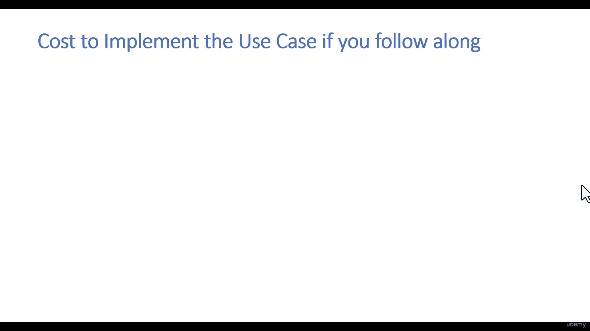
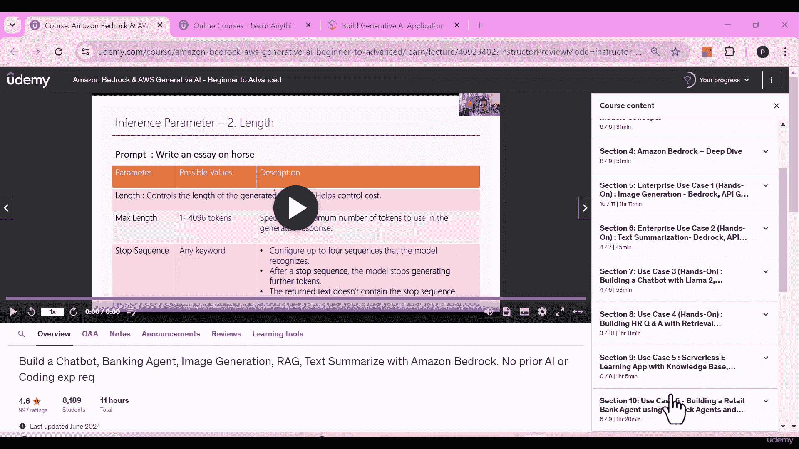
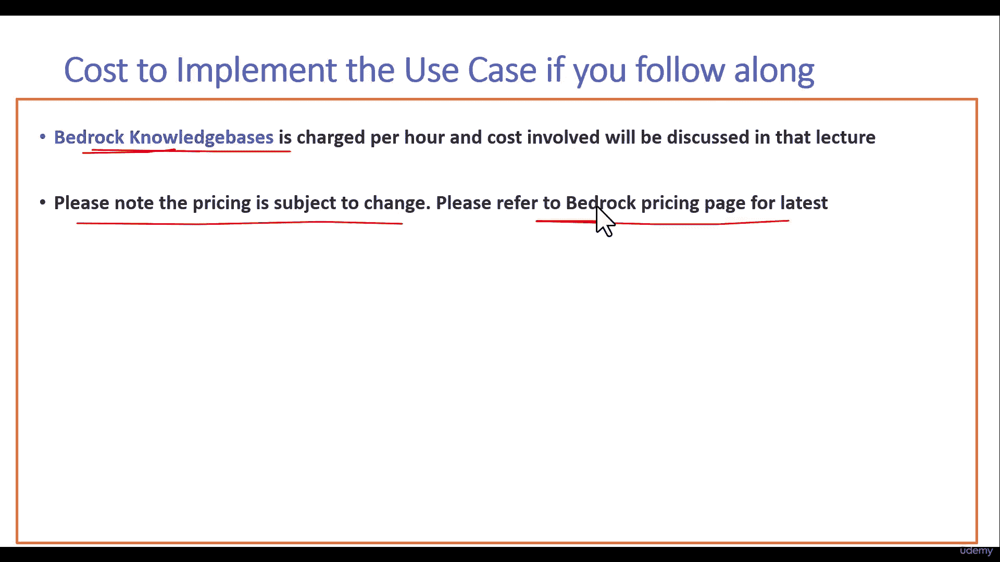
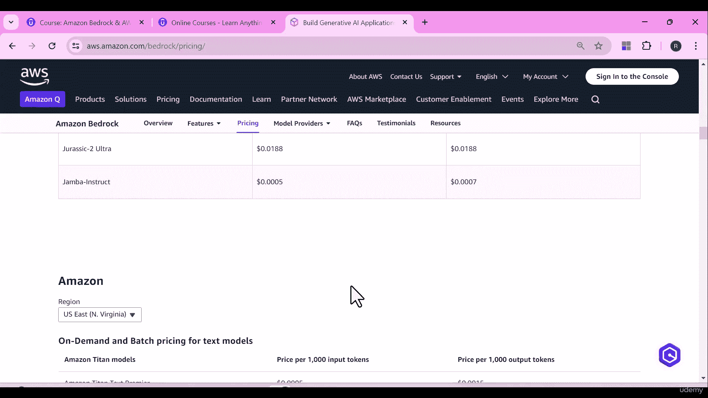

# 🧮 AWS生成式AI实战：第23-25讲：跟随实操用例的实施成本


## 🎯 AWS生成式AI实战：第23-25讲：本讲概述




在本节课中，我们将要学习跟随课程实现用例时大概需要花多少钱。很多学习者都会问我这个问题：如果跟着课程一步一步实现用例，成本到底是多少。这个问题很实际，因为大家在做实验时既希望把功能跑通，也会担心云服务调用产生额外费用，所以提前了解成本范围很有必要。


本课程会展示六个不同用例的实现方式，本讲先讨论前四个用例的成本。具体来说，第一个是企业用例一，主题是图像生成；第二个是企业用例二，主题是文本摘要；第三个用例是构建聊天板；第四个用例是带检索增强生成（RAG）的HR问答应用。原文也提到，用例五和用例六会使用Amazon Bedrock Knowledge Base，它们的定价方式不同，属于按请求收费且相对更贵的服务，所以这两个用例的成本会在各自章节中单独讨论。在明确本讲目标后，我们先把成本估算的适用范围讲清楚。


## 📌 AWS生成式AI实战：第23-25讲：成本适用范围


上一节我们说明了本讲要讨论前四个用例的成本，本节中我们来看看这些成本估算到底适用于哪些场景。原文明确提到，这套成本估算适用于图像生成、文本摘要、聊天机器人、HR问答RAG应用这几类用例。下面列出本讲讨论成本的前四个用例，方便你建立整体印象。


- 🖼️ 企业用例一：图像生成。


- 📄 企业用例二：文本摘要。


- 💬 用例三：构建聊天板。


- 🧑‍💼 用例四：带检索增强生成的HR问答应用。




以上四个用例在实现时，成本大体上差不多。接下来需要特别说明适用范围：这套估算并不适用于所有Bedrock相关场景。以下是成本估算覆盖与不覆盖的用例范围，方便你快速判断。


- ✅ 适用：图像生成、文本摘要、聊天机器人、HR问答RAG应用。


- ❌ 不适用：使用Amazon Bedrock Knowledge Base和Bedrock Agents的用例。


换句话说，如果你跟着课程做的是前四个用例，那么可以参考本讲的成本范围；如果你做的是用例五和用例六，它们会使用Amazon Bedrock Knowledge Base，定价方式不同，需要看对应章节的说明。把适用范围说明白之后，接下来看Bedrock的计费逻辑。


## 💰 AWS生成式AI实战：第23-25讲：Bedrock计费方式与示例


上一节我们介绍了成本估算的适用范围，本节中我们来看看Bedrock具体如何计费。原文提到，在之前的某一讲中已经讨论过，Bedrock的定价基于你发出的API请求数量。也就是说，调用次数越多，费用越高；调用次数少，费用就低。为了直观理解，可以先记住这个核心关系：**总成本大约由API请求次数决定**。可以用下面的公式表示。


```text
总成本 ≈ API请求次数 × 单次API请求费用
```


原文以AI21 Labs为例说明计费。按照原文说法，每个API请求会收取0.0125美元；如果发出100次请求，会被收取1.88美元；如果只发出10次请求，则成本是0.188美元。这里把原文给出的计费示例整理成代码块，方便初学者对照理解，具体数字以原文示例为准。


```text
单次API请求费用示例 = 0.0125美元（原文AI21 Labs示例）

100次请求成本示例 = 1.88美元（原文示例）

10次请求成本示例 = 0.188美元（原文示例）

常见请求量假设 = 20～30次

单个用例成本上限假设 = 不超过1美元（请求量少于约50次）
```


原文还提到，通常构建用例时需要超过20到30次请求，所以可以比较安全地假设你会需要20到30次请求。基于这个请求量，对于前面讨论的四个用例，只要API请求数量合理、少于大约50次，每个用例的成本应该不会超过1美元。原文再次强调，这套定价说明不适用于使用Bedrock Knowledge Base和Bedrock Agents的用例。理解计费逻辑和示例后，下面把成本估算与注意事项整理出来。


## 🧾 AWS生成式AI实战：第23-25讲：成本估算与注意事项


上一节我们看了Bedrock按API请求数量计费的方式和原文示例，本节中我们来看看实际估算时要注意什么。综合原文信息，前四个用例的实现成本大体相同，单个用例在合理请求量下预计不超过1美元；但最终费用仍然取决于你实际发出的API请求数量，所以练习时控制请求次数很重要。以下是在实操前需要记住的几点事项，建议在动手前快速过一遍。


- 💵 前四个用例的成本大体相同，合理请求量下单个用例预计不超过1美元。


- 🔁 Bedrock按API请求数量收费，请求越多费用越高。


- 🧪 构建用例时通常需要20到30次请求，可以把这作为常见请求量假设。


- 🚫 这套估算不适用于使用Amazon Bedrock Knowledge Base和Bedrock Agents的用例。


- 📉 Bedrock定价可能发生变化，实际费用要以最新定价页面为准。


原文还提醒，可以到Bedrock定价页面查看最新价格。你可以在Google搜索“bedrock pricing”，然后进入对应页面。该页面会给出大多数AWS基础模型的按需定价，你能看到AI21 Labs、Amazon等模型的价格，也可以选择自己正在访问的区域。原文希望这个问题到这里已经回答清楚，并约定下一讲再见。记住这些注意事项后，最后做本讲总结。


## ✅ AWS生成式AI实战：第23-25讲：本讲总结






本节课中我们一起学习了跟随课程实现用例时的成本问题。我们明确了本讲讨论前四个用例：图像生成、文本摘要、聊天板、HR问答RAG应用；这四个用例的成本大体相同，在合理API请求量下单个用例预计不超过1美元。我们还学习了Bedrock按API请求数量计费，原文以AI21 Labs为例给出了请求次数与费用的示例，并提醒通常需要20到30次请求。最后我们强调了这套估算不适用于Amazon Bedrock Knowledge Base和Bedrock Agents相关用例，Bedrock定价也可能变化，实际价格要参考最新定价页面。希望这些内容能帮助你在跟做课程时对成本有一个清晰、直观的预期。

