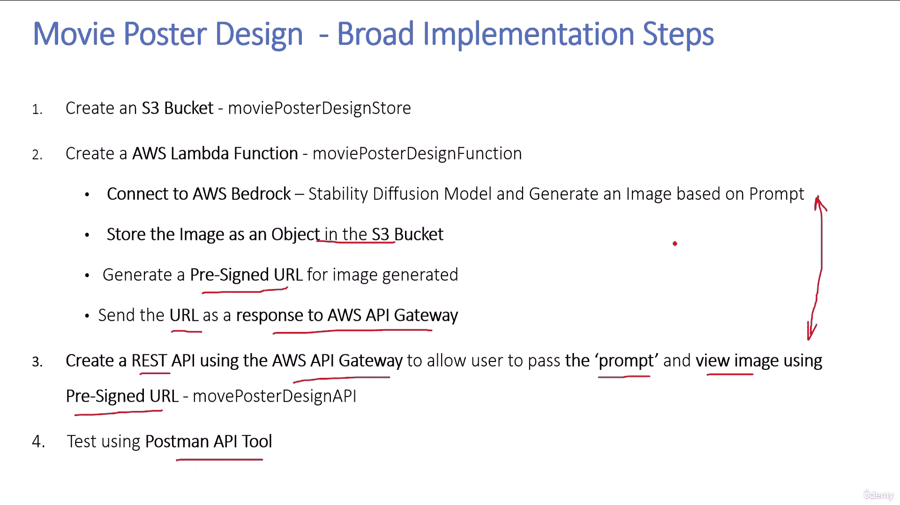
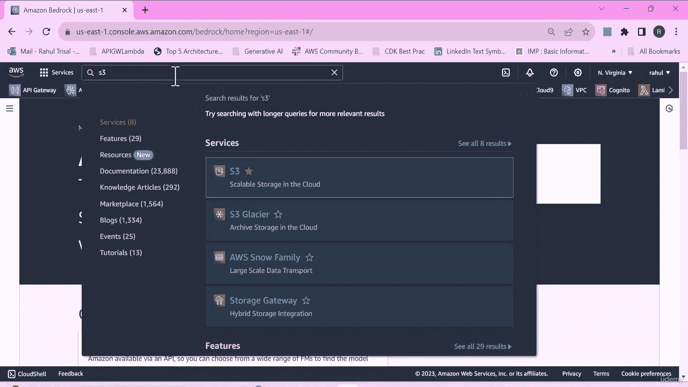
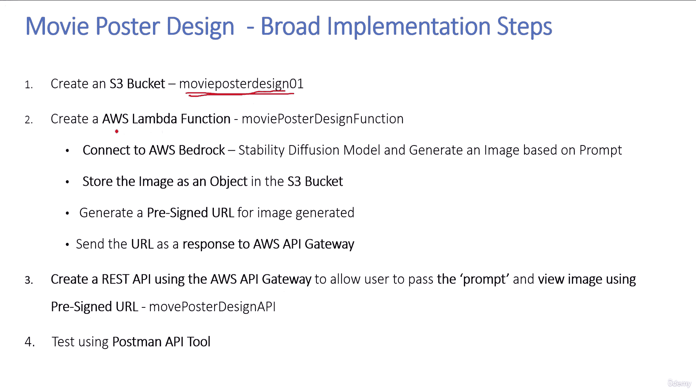
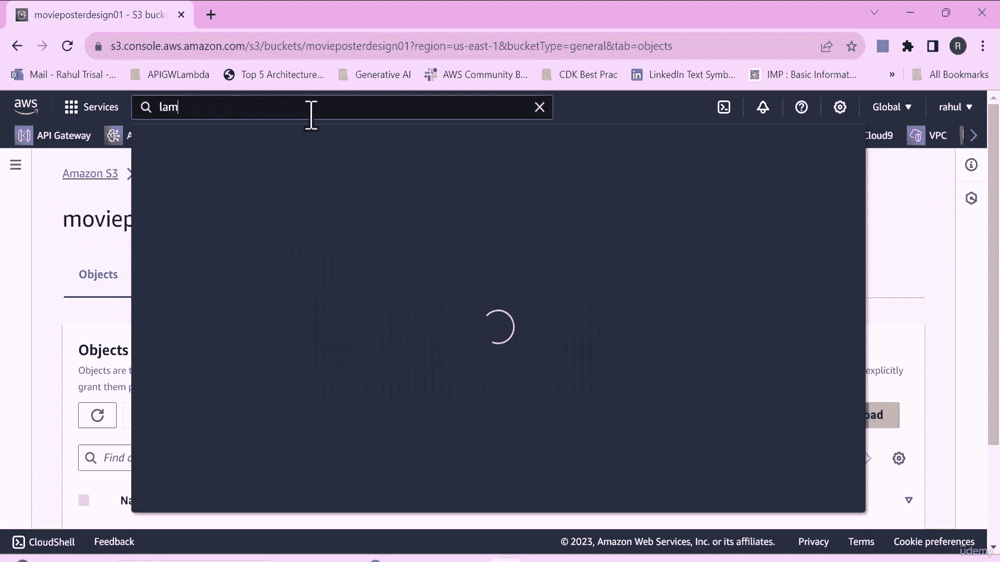
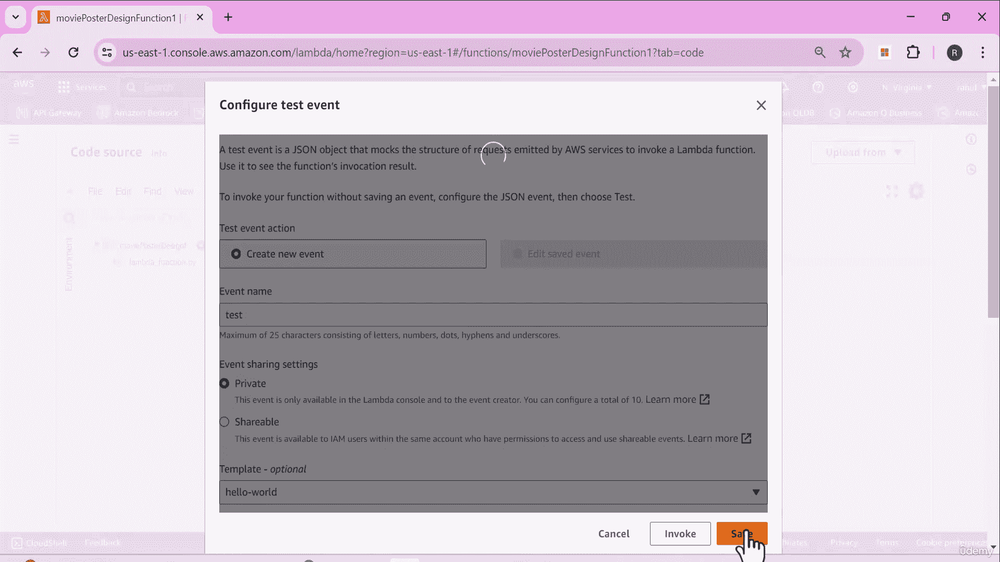
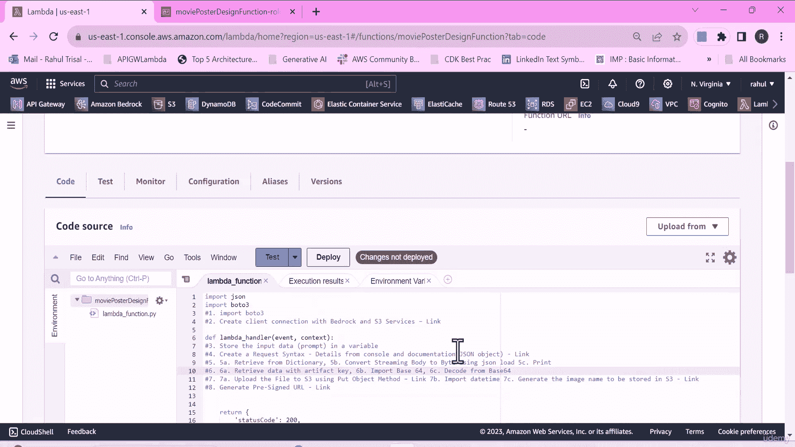

# 🧱 生成式AI在AWS上的实践：第24-26节：创建S3存储桶与Lambda函数


在本节课中我们将要学习一个“海报生成”用例在AWS上的完整落地步骤，重点是把Stable Diffusion生成的海报设计保存到S3，并用Lambda把Amazon Bedrock、S3和API Gateway串起来。整个教程会从总体流程讲起，再进入控制台创建S3存储桶、创建Lambda函数、检查Boto3版本、配置超时与权限，最后为编写Bedrock调用代码做准备。内容会尽量用直白的话解释每一步在做什么，以及为什么这样做。


## 🗺️ 生成式AI在AWS上的实践：24.1：实现步骤总览


在进入具体控制台操作前，本节先看这个用例的总体实现步骤。原文首先让我们查看这个用例的宏观实现步骤，也就是先不写代码，先把整个系统需要哪些部件、每个部件负责什么讲清楚。这个用例的总体流程可以用下面的公式表示。


\[
\text{提示词}\rightarrow\text{Amazon Bedrock}\rightarrow\text{Stable Diffusion}\rightarrow\text{生成图片}\rightarrow\text{S3对象}\rightarrow\text{预签名URL}\rightarrow\text{API Gateway}
\]






下面是本用例的总体实现步骤，按顺序列出每一步要完成的事情。


1. 创建S3存储桶，用来存储所有由Stability Diffusion AI基础模型生成的海报设计。
2. 创建AWS Lambda函数，这个函数有多个目标：连接AWS Bedrock服务，连接Stability Diffusion模型并根据提示词生成图片；图片生成后，把图片作为对象存入前面创建的S3存储桶；为这个S3对象生成预签名URL；把这个URL作为响应传给AWS API Gateway。这四个动作都通过编写Lambda函数代码、使用Boto3来完成。
3. 最后创建REST API，使用AWS API Gateway，使得外部可以传入提示词，并通过预签名URL查看图片。
4. 最后使用Postman API进行测试。


这里补充解释一下，S3可以理解成AWS上的对象存储桶，图片、文件都可以放进去；Lambda可以理解成不用自己管服务器就能运行的函数；预签名URL可以理解成给S3对象生成一个临时可访问的链接。总体步骤清楚后，下一节我们进入控制台创建S3存储桶。






## 🪣 生成式AI在AWS上的实践：24.2：创建S3存储桶


上一节我们梳理了总体实现步骤，本节进入控制台创建S3存储桶。现在进入控制台创建S3存储桶。当前在控制台界面，搜索S3。点击创建存储桶。给存储桶取一个名称，例如使用类似 `poster-design-ll-001` 的名称。检查配置后创建存储桶。存储桶创建完成后，再次搜索可以看到它已经出现在列表中。复制并保存这个存储桶名称，后面Lambda代码中会用到。现在我们已经有了这个S3存储桶。下面是创建S3存储桶时名称配置的代码示意。


```python
bucket_name = "poster-design-ll-001"
```


这个名称只是示例，实际名称需要符合S3命名规则并且全局唯一。S3存储桶准备好后，下一节我们创建Lambda函数。


## ⚡ 生成式AI在AWS上的实践：24.3：创建Lambda函数




上一节我们创建了S3存储桶，本节创建Lambda函数并检查Boto3版本。下一步需要创建AWS Lambda函数。搜索Lambda，点击Lambda，进入Lambda界面。点击创建函数。把函数命名为类似 `movie-poster-design` 的名称，运行时选择Python 3.11，然后创建函数。Lambda函数创建完成。函数创建完成后，查看前提知识部分提到的下一步：2024年5月之前，需要升级Lambda函数使用的Boto3版本，但现在不再需要升级。不过为了确认，仍然可以快速检查Boto3版本是否仍然大于1.28.63。具体做法是复制命令，查看当前Boto3版本。在此之前，先 `import boto3`。如果还不了解Boto3，它本质上是Python访问各种AWS服务的软件开发工具包。导入Boto3后，输入刚才复制的命令，然后部署。Lambda函数的更改已经部署。接下来测试：点击测试，把测试事件命名为 `test event`，保存。测试事件保存成功。运行测试。函数日志显示Boto3版本为1.34.42，远大于1.28.63，而1.28.63是访问Amazon Bedrock服务的最低版本要求。下面是版本检查代码。


```python
import boto3
print(boto3.__version__)
```


版本检查通过后，说明Lambda具备访问Bedrock的基础条件。Lambda创建并测试完成后，下一节配置超时和权限。


## ⏱️ 生成式AI在AWS上的实践：24.4：配置超时与权限


上一节我们创建了Lambda并完成版本检查，本节配置Lambda的超时限制和权限。原文为编写Lambda函数列出了几个大步骤，第一步是创建IAM角色并增加超时限制。回到Lambda函数，点击配置，点击常规配置并编辑，增加超时限制。默认超时是3秒，这里改为1分3秒。原因是这个Lambda函数需要访问Bedrock服务、从Bedrock生成图片、把图片存入S3存储桶、再生成预签名URL，这些操作需要时间，如果保持默认3秒，很可能超时。修改后保存。下一步给Lambda函数足够权限，使其可以访问Bedrock服务，也可以访问S3存储桶。保存权限并创建由IAM生成的默认角色。点击添加权限、附加策略。当前先给管理员访问权限，后面再把这个管理员权限改成更细粒度的权限。生产环境中不应该直接给管理员权限，这一点需要明确，但当前先这样配置，之后再修改。添加权限后，Lambda拥有管理员访问权限，可以访问该账户中的任何AWS服务。配置示意如下。


```text
Timeout: 3s -> 63s
权限：AdministratorAccess（临时） -> 后续改为细粒度策略
```


临时权限配置完成后，下一节为Lambda中的Bedrock调用准备代码。


## 🧩 生成式AI在AWS上的实践：24.5：编写Bedrock调用代码的准备


上一节我们配置了超时和权限，本节准备编写Bedrock调用代码。下一步需要为Lambda函数编写调用Bedrock的代码。为了写这个Lambda函数，原文粗略列出了大约8个步骤，用来指导每一步需要做什么。首先复制前两步到Lambda函数的代码标签页。删除不再需要的默认函数或示例函数，然后粘贴。前两步按这个方式处理。回到原文，复制这些步骤，这些步骤适合放在Lambda处理函数之后，粘贴到这里。还有几个步骤，从原文引用并粘贴到这里。现在准备工作完成，开始编写Lambda函数代码。这里用代码注释表示这8步的大致流程。


```python
# 1. 导入boto3等依赖
# 2. 创建Bedrock运行时客户端
# 3. 组装Stable Diffusion请求
# 4. 调用模型生成图片
# 5. 将图片写入S3桶
# 6. 生成S3预签名URL
# 7. 组装API响应
# 8. 返回URL给API Gateway
```


这一节内容已经比较长，原文表示步骤已经齐全，将在下一节继续编写代码。代码准备完成后，下一节继续实现，本节到这里结束。


## 📚 生成式AI在AWS上的实践：24.6：本节总结




上一节我们完成了Bedrock调用代码的准备工作，本节做总结。本节课中我们一起学习了这个海报生成用例的总体实现步骤，创建了用于存储海报设计的S3存储桶，创建了Python 3.11运行时的Lambda函数，检查了Boto3版本是否大于1.28.63，确认日志中的版本为1.34.42，配置了Lambda超时从3秒改为1分3秒，临时附加了管理员权限并说明后续要改为细粒度权限，还为编写Bedrock调用代码准备了大约8个步骤。原文在这里表示希望本节内容有用并致谢，同时说明课程内容较长，后续代码编写将在下一节继续。感谢阅读。
