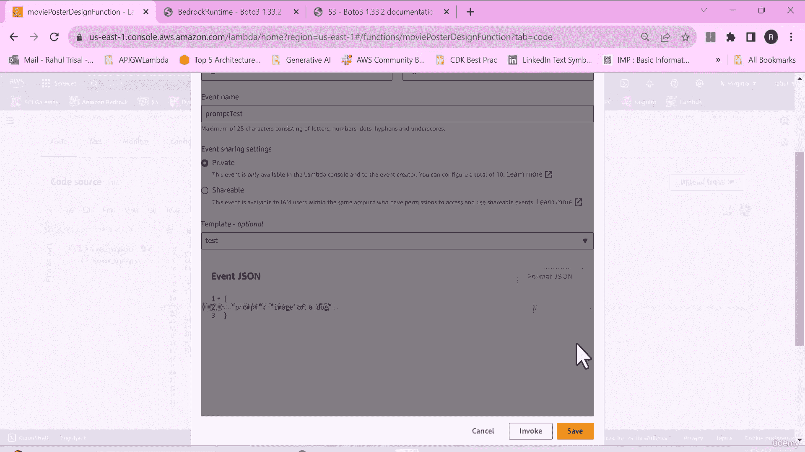
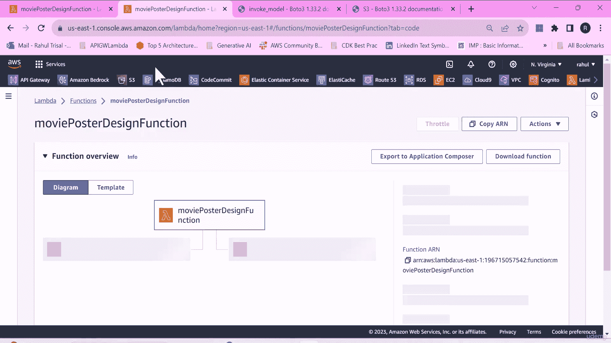
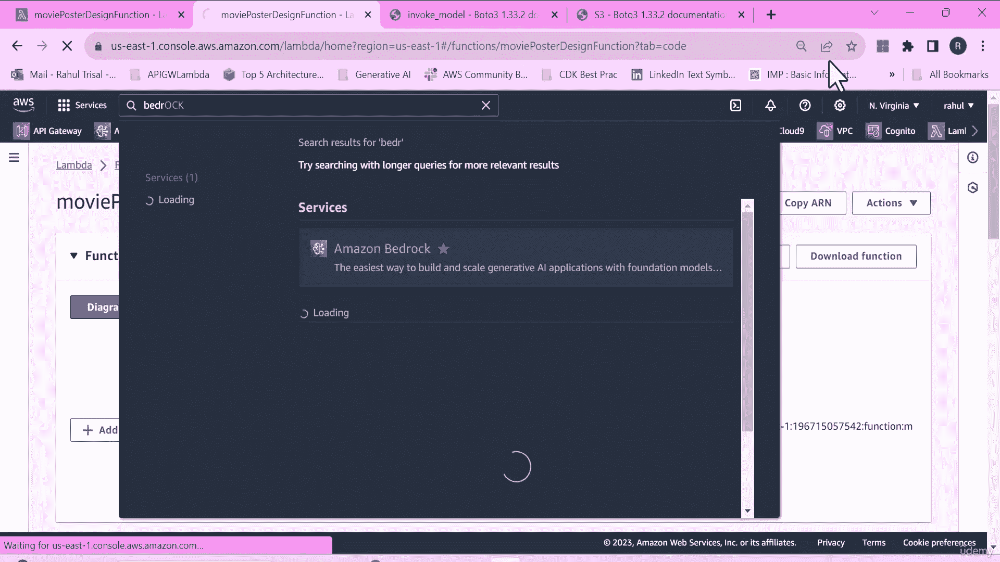
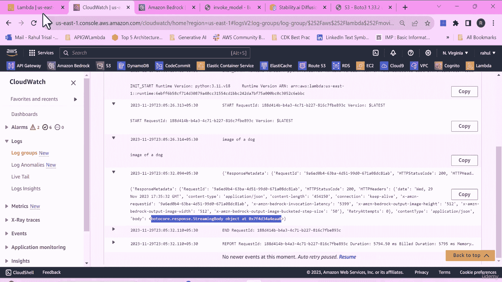

# 🚀 AWS生成式AI实战：第25-27节：AWS Lambda与Amazon Bedrock集成（一）

在本节课中我们将要学习如何把 AWS Lambda 和 Amazon Bedrock 连接起来，完成从 Lambda 函数接收提示词、调用 Bedrock 模型、再到查看返回结果的基本流程。此时前面的步骤已经全部列好，接下来进入实际实现阶段。这个流程看起来步骤不少，但只要按顺序完成，每一步都只解决一个小问题，整体就会比较清晰。本节会从导入 Boto3 开始，依次创建客户端、读取事件中的提示词、构造 Bedrock 请求，并通过测试事件和 CloudWatch 日志确认集成是否成功。

## 🔧 AWS生成式AI实战：第25节：导入Boto3并创建AWS服务客户端

上一节已经把整体步骤梳理完成，本节开始实现第一步。第一步是导入 Boto3，因为 Boto3 是后面用来连接各种 AWS 服务的 Python 库。原文中已经把导入 Boto3 的代码放在对应位置，我也把这一步移动到更方便跟随的位置，方便你在阅读时按顺序操作。我在这里提供了文档链接，你也可以直接搜索 AWS Boto3 Bedrock 文档来查看官方说明。打开文档后可以看到，第一步是导入 Boto3，这一点前面已经完成；下一步是创建与目标服务的客户端连接。

创建客户端时，变量名可以任意取，关键是使用 Boto3 的 `client` 方法，并传入服务名称。对任何 AWS 服务来说，连接方式都类似，只需要把服务名称替换成对应的服务即可。因为这里要连接两个服务，即 S3 和 Bedrock，所以变量名稍微区分一下，分别使用 `client_bedrock` 和 `client_s3`。以下是本步骤要完成的动作：

1. 导入 Boto3 库。
2. 使用 `boto3.client("bedrock-runtime")` 创建 Bedrock 客户端。
3. 使用 `boto3.client("s3")` 创建 S3 客户端。
4. 确认变量名可以任意命名，但服务名称必须与 AWS 文档一致。

```python
import boto3

client_bedrock = boto3.client("bedrock-runtime")
client_s3 = boto3.client("s3")
```

完成客户端创建后，Lambda 函数就具备了调用 Bedrock 和 S3 的基础连接能力。下一步需要处理 Lambda 函数从外部收到的输入数据，也就是用户传入的提示词。上一节我们完成了客户端准备，本节中我们来看看如何从 Lambda 事件中取出提示词并记录日志。



## 📝 AWS生成式AI实战：第26节：从Lambda事件读取并记录提示词

上一节创建了 Bedrock 和 S3 客户端，本节处理 Lambda 函数收到的输入数据。按照架构流程，用户会调用 REST API，并在请求中提供提示词，例如说明需要设计什么样的电影海报。这个提示词会作为事件传给 AWS Lambda 函数，Lambda 再把提示词传给 Amazon Bedrock 服务。这个事件会通过 Lambda handler 函数的 `event` 参数传入，因此需要把事件中的提示词保存到一个变量中。可以给这个变量取名为 `input_prompt`，然后从事件中读取对应的键；这个事件本质上是一个 JSON 对象，所以需要使用键来取值。这里的键可以叫 `prompt`，也可以使用其他名称，只要调用方和函数内部保持一致即可。

```python
input_prompt = event["prompt"]
```

接下来添加日志输出，使用 `print` 打印输入内容，以便确认输入是否正确传到了 Lambda 函数。以下是本步骤要完成的动作：

1. 从 `event` 中读取 `prompt` 字段。
2. 把提示词保存到 `input_prompt` 变量。
3. 使用 `print` 输出提示词，确认参数传递正确。
4. 部署 Lambda 函数。
5. 配置测试事件，事件键使用 `prompt`，值使用 `Image of a dog`。
6. 运行测试并查看日志输出。

```python
input_prompt = event["prompt"]
print(input_prompt)
```

测试事件是 Lambda 函数提供的一个示例事件，目的是方便进行测试。配置测试事件时，删除默认内容，把键改为 `prompt`，值写为 `Image of a dog`，保存后运行测试。测试结果中可以看到函数打印出了 `Image of a dog`，这说明提示词已经正确传入 Lambda 函数。到这里输入部分已经验证通过，下一步需要创建访问 Bedrock 服务的请求语法。上一节确认了提示词能够传入 Lambda，本节中我们来看看如何构造 Bedrock 的 `invoke_model` 请求并验证返回结果。





## 🧱 AWS生成式AI实战：第27节：构造Bedrock InvokeModel请求并验证响应

上一节日志验证了输入传递正常，本节进入 Bedrock 请求构造阶段。打开 Bedrock 文档并选择 `invoke_model` 方法，可以看到请求语法大致是定义一个响应变量，然后调用客户端的 `invoke_model` 方法，并传入四个参数：`body`、`contentType`、`accept` 和 `modelId`。其中 `body` 是必填字段，文档说明它的类型应当是 bytes 或可 seek 的类文件对象；后面还需要仔细查看参数细节。`contentType` 表示请求中输入数据的主要类型，也就是响应结构应该如何定义，默认值为 `application/json`，并且是字符串类型。`accept` 表示期望响应体使用的 MIME 类型，默认值同样是 `application/json`，也保留默认值即可。`modelId` 是模型标识符，用于告诉 Bedrock 要连接哪个基础模型；这里使用 Stability Diffusion 模型，因此需要在 `modelId` 中指定对应模型标识。以下是 `invoke_model` 请求中需要关注的四个参数：

- `body`：必填字段，类型应为 bytes 或可 seek 的类文件对象，内容是模型请求体。
- `contentType`：请求输入数据的 MIME 类型，默认值为 `application/json`，使用字符串形式。
- `accept`：期望响应体的 MIME 类型，默认值为 `application/json`，使用字符串形式。
- `modelId`：模型标识符，指定要连接的基础模型，使用字符串形式。

```python
response_bedrock = client_bedrock.invoke_model(
    body=body,
    contentType="application/json",
    accept="application/json",
    modelId="你的Stable Diffusion模型ID"
)
```

模型 ID 需要到 Bedrock 控制台获取。进入 Bedrock 首页后，打开图片游乐场，选择 Stability AI 并应用，生成一张图片后，在右侧三个点菜单中选择 `View API request`，即可看到并复制模型 ID。模型 ID 是字符串类型；以后界面可能变化，模型 ID 的位置也可能调整，需要在图片游乐场中查找。以下是定位模型 ID 的提示：

> 在 Bedrock 控制台的图片游乐场生成图片后，点击右侧三个点并选择 `View API request`，从中复制模型 ID。

`body` 的格式可以参考文档中的 Stability Diffusion 参数说明。文档会给出请求体格式，并说明需要把 `body` 字段填充为 JSON 对象。复制该格式后，把其中的提示词字符串替换为 `input_prompt`，这样 Lambda 收到的提示词就会进入模型请求体。请求体中的 `text_prompts` 是键值结构，其中 `text` 对应的值需要替换成实际提示词。以下是 Stable Diffusion 请求体中三个常见参数的含义：

- `cfg_scale`：决定最终图像与提示词的贴合程度。数值越低，图像越可能出现随机变化；数值越高，图像越贴近提示词描述。最大值为 30，默认值为 10。
- `steps`：决定图像采样次数。生成最终图像前会进行多次采样步骤，步骤越多，结果通常越准确。最小值为 10，最大值为 150，默认值为 30。
- `seed`：随机种子，通常由模型自行设置为随机数，一般不需要手动指定。如果要生成与之前相似的图像，除了使用相同的 `cfg_scale` 和 `steps`，还需要使用与之前相同的 `seed`。最小值为 0，默认值为 0。

\[
\text{CFG scale 越大，生成图越贴近提示词}
\]

\[
\text{steps 越多，生成过程越充分，结果通常更准确}
\]

```python
import json

body = json.dumps({
    "text_prompts": [{"text": input_prompt}],
    "cfg_scale": 10,
    "steps": 30,
    "seed": 0
})

response_bedrock = client_bedrock.invoke_model(
    body=body,
    contentType="application/json",
    accept="application/json",
    modelId="你的Stable Diffusion模型ID"
)

print(response_bedrock)
```

这里需要特别检查客户端变量名。前面的请求代码中如果写成了 `client`，需要改成已经定义的 `client_bedrock`。另外，`body` 需要是 bytes 或可 seek 的类文件对象，而当前请求体是 JSON 对象，因此需要使用 `json.dumps` 把 JSON 对象转换成字符串形式，再传给 `body`。完成这些修改后即可部署函数。部署后打印响应，并在运行前先查看文档中的响应语法：响应是一个字典，包含 `body` 和 `contentType`，其中 `body` 是流式类型，`contentType` 为 `application/json`。以下是测试与检查响应时需要观察的内容：

- 函数日志中是否打印出输入提示词 `Image of a dog`。
- 响应字典中是否包含 `body` 字段。
- `body` 是否为流式对象。
- 响应中是否包含 `contentType` 字段。
- 如有需要，进入监控页面查看 CloudWatch 日志以确认详细信息。

测试时使用已配置的测试事件，提示词仍为 `Image of a dog`。运行后可以看到函数日志和返回响应，日志中会显示输入提示词、源代码位置以及响应内容。进一步进入监控页面，打开 CloudWatch 日志并查看日志组，可以更清楚地看到第一次输入 `Image of a dog`、源代码以及 `input_prompt` 的值。响应部分可以看到 `body` 数据和相关详细信息，文档中说明的 `body` 是流式响应体，这与实际返回结构一致。至此，Lambda 与 Bedrock 的基础集成已经验证通过。



本节课中我们一起学习了 AWS Lambda 与 Amazon Bedrock 集成的第一部分：导入 Boto3、创建 Bedrock 与 S3 客户端、从 Lambda 事件中读取提示词、打印日志、配置测试事件、构造 `invoke_model` 请求、理解 Stability Diffusion 的 `cfg_scale`、`steps` 和 `seed` 参数、使用 `json.dumps` 处理请求体，并通过函数日志和 CloudWatch 日志确认响应结果。整个流程的核心是把 Lambda 收到的提示词放进 Bedrock 请求，再检查返回的流式响应，为后续继续扩展集成逻辑打下基础。
