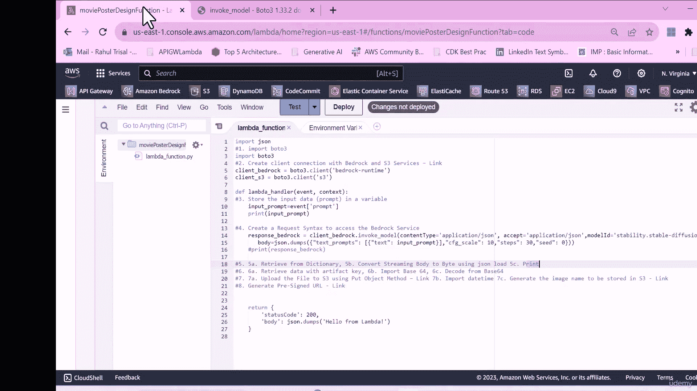
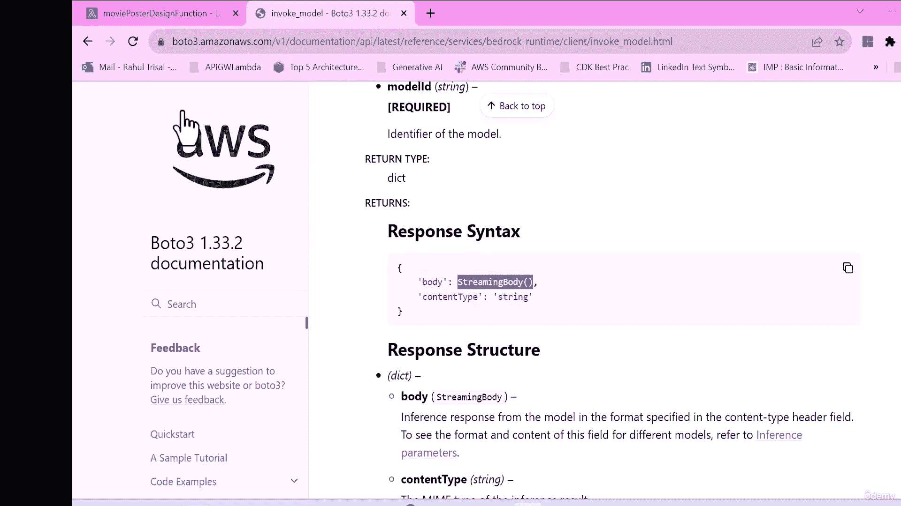
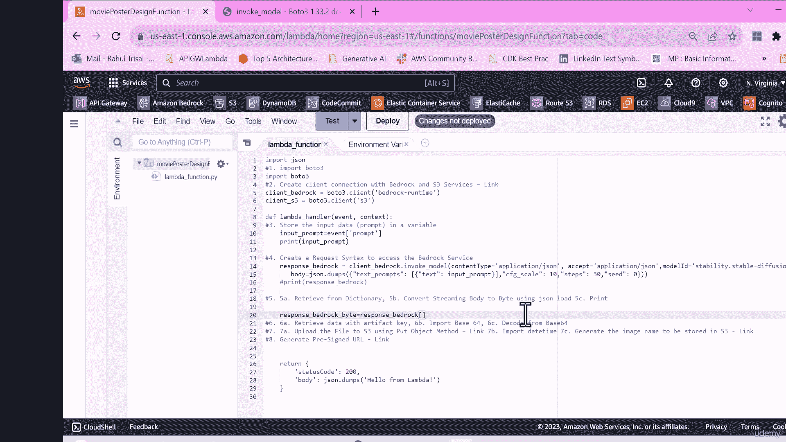
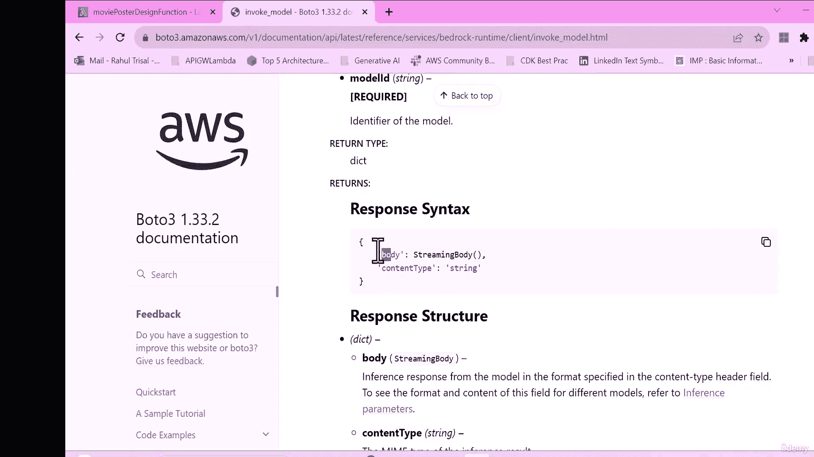
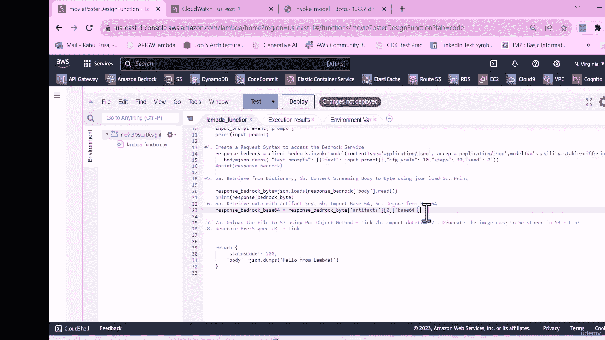
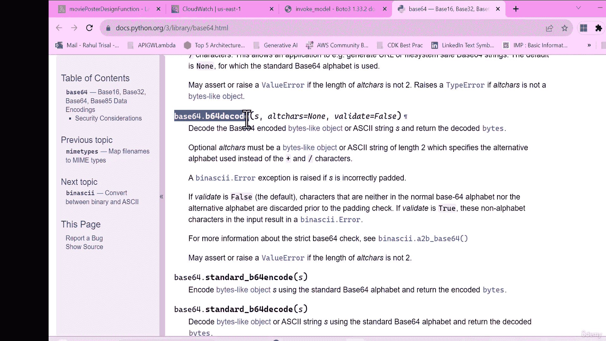
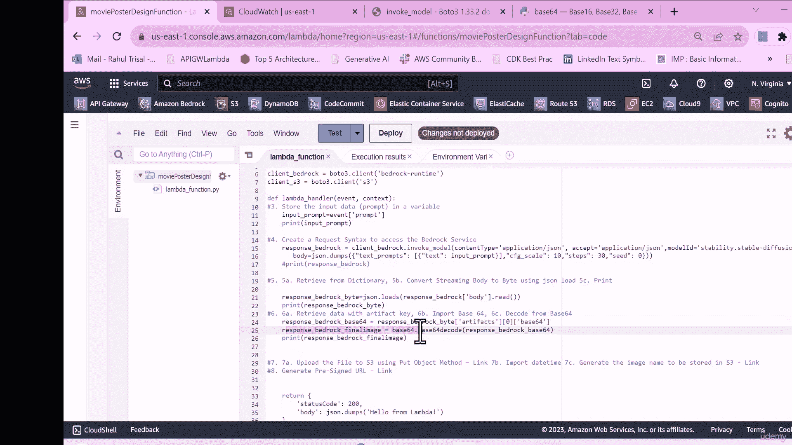
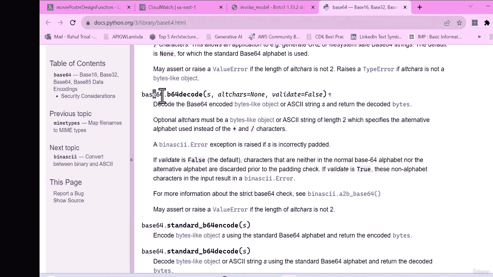
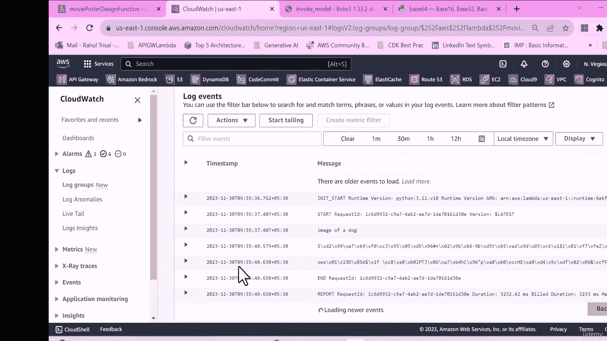

# 🌩️ 在 AWS 上使用生成式 AI：Amazon Bedrock、RAG 与 KIRO：第 26-28 节：AWS Lambda 与 Bedrock 集成（二）🔗

在本节课中我们将要学习，当 AWS Lambda 已经拿到基础模型返回的 response 之后，怎样一步步处理这个 response。具体来说，我们会先从字典形式的响应中取出 `body`，再读取流式 body 并解析成 JSON，然后打印结果并到 CloudWatch 日志里检查；接着从响应中的 `artifacts` 里取出 base64 编码的图像数据，使用 `base64.b64decode` 解码成最终图像，最后为把图像保存到 S3 bucket 做好准备。整个流程适合初学者理解 Lambda 与 Bedrock 集成后的响应处理方式。

## 📦 在 AWS 上使用生成式 AI：Amazon Bedrock、RAG 与 KIRO：第 26-28 节：先认识响应字典和 body



上一节已经拿到基础模型返回的 response，本节中我们来看看这个 response 的结构。文档和实际返回都表明，response 是一个字典；从代码里的方括号和文档示例可以看到，字典里包含 `body` 和 `content` 标签等内容。换句话说，响应不是直接的一段文本，而是键值对集合，我们需要按 key 取值。

在 Bedrock 的响应字典中，我们真正要处理的是 `body` 这个 key 对应的值，它本身是一个 streaming body。下面是本步骤要完成的事情。

- 从 response 字典中检索 `body` 的值。  
- 确认拿到的 `body` 是 streaming body。  
- 为后续读取和解析这个 streaming body 做准备。  



如果暂时不熟悉怎样从字典里取值，可以回看课程最后一节的 Python refresher。这里已经确认 response 是字典，所以只要提供 key 即可；这个 key 就是 `body`，取出后就能得到 body response。

核心取值方式可以写成：

```python
response_body = response["body"]
```



## 📖 在 AWS 上使用生成式 AI：Amazon Bedrock、RAG 与 KIRO：第 26-28 节：读取流式 body 并解析 JSON



上一节我们取出了 `body`，本节中我们来看看如何把它变成可打印、可继续处理的数据。streaming body 不能像普通字符串一样直接查看，所以要先调用 `.read()` 方法读取内容；读取后得到的是字节形式的数据，然后使用 `json.loads` 把内容解析成 Python 对象。原文提到的“转换成 bytes 并使用 json.loads”可以理解为：先读取流式 body，再解析 JSON 内容。

下面是这一环节需要执行的步骤。

- 对 streaming body 调用 `.read()` 方法。  
- 使用 `json.loads` 解析读取出来的内容。  
- 把解析后的结果保存到变量中。  
- 使用 `print` 打印结果，检查 response 是否正确。  

实现代码可以写成下面这样：

```python
import json

response_body = response["body"]
response_bytes = response_body.read()
response_json = json.loads(response_bytes)

print(response_json)
```

这里的 `response_json` 就是解析后的响应数据，便于检查里面有哪些 key 和 value。接下来需要部署 Lambda 并测试，因为只看代码不能确认线上返回是否符合预期。

## 🧪 在 AWS 上使用生成式 AI：Amazon Bedrock、RAG 与 KIRO：第 26-28 节：部署测试并查看 CloudWatch 日志

上一节完成了读取和解析代码，本节中我们来看看怎样验证运行结果。部署 Lambda 后进行一次测试，就能拿到 response；如果输出在控制台里看不清楚，可以到 CloudWatch logs 里查看完整日志。日志中第一个看到的是 event，然后能看到我们的 response。

在 CloudWatch 日志里检查响应时，可以按下面的顺序观察。

- 找到日志中的 event 和 response。  
- 确认 response 是字典结构。  
- 查看第一个 key 是 `result`，并观察它的 value。  
- 查看下一个 key 是 `artifacts`，并观察它的 value。  
- 注意 `artifacts` 内部是一个列表，列表中的数据是 base64 编码内容。  

日志说明，响应字典里除了 `result`，还有 `artifacts`；而 `artifacts` 的 value 是一个 list。要取出图像数据，需要先用 `artifacts` 这个 key 检索，再取列表位置 0 的元素，最后从该元素中取 `base64` 这个 key。这个结构对初学者来说容易绕，可以把路径记成：

```python
response_json["artifacts"][0]["base64"]
```

## 🖼️ 在 AWS 上使用生成式 AI：Amazon Bedrock、RAG 与 KIRO：第 26-28 节：用 artifact key 取出 base64 图像数据

上一节在日志中确认了 `artifacts` 的结构，本节中我们来看看代码里怎样取出 base64 值。我们会回到 Lambda 代码，把变量命名为 `response_bedrock` 或类似名称，表示这是 Bedrock 返回的响应；因为后续拿到的数据是 base64 编码，所以也可以把相关变量命名为 `base64` 相关名称，方便理解。复制已有的 key 可以减少手写出错，也可以直接粘贴 key 来完成取值。

以下是取出 base64 编码值的具体步骤。

- 使用 `response_bedrock["body"]` 先拿到 body。  
- 从解析后的数据中用 `artifacts` key 检索。  
- 因为 `artifacts` 是一个列表，所以取位置 0 的值。  
- 得到字典后，再用 `base64` 这个 key 取出 base64 编码值。  
- 把取出的值保存到变量中，准备解码。  

对应代码可以写成：

```python
response_base64 = response_json["artifacts"][0]["base64"]
```



取出这个值之后，我们就得到了 base64 编码的图像数据。不过 base64 只是文本形式的编码，不能直接当作图片查看，所以下一步必须解码。

## 🔓 在 AWS 上使用生成式 AI：Amazon Bedrock、RAG 与 KIRO：第 26-28 节：导入 base64 并解码得到最终图像


上一节取到了 base64 编码值，本节中我们来看看怎样解码。如果不知道 base64 是什么，或者不知道怎样解码，可以查看课程提供的文档链接；核心方法是使用 `base64.b64decode`，并把 base64 值作为参数传进去。写代码前需要先导入 `base64` 库，然后把解码结果保存为最终图像变量，例如 `final_image`，因为这个图像后面不需要再做额外处理。



下面是解码环节的操作清单。

- 在代码中导入 `base64` 库。  
- 调用 `base64.b64decode` 方法。  
- 把前面取出的 base64 值作为参数传入。  
- 将解码结果保存为 `final_image`。  
- 打印 `final_image`，检查是否能得到有意义的结果。  

实现代码可以写成：

```python
import base64

final_image = base64.b64decode(response_base64)

print(final_image)
```

在部署前应快速复查代码，确认取 base64 响应并解码的逻辑正确。原文中特别提醒：方法名应是 `b64decode`，而不是写成 `base64` 之类；如果方法名写错，需要及时修改，然后打印 response 检查。确认代码看起来没有问题后，再次部署并测试。



## ☁️ 在 AWS 上使用生成式 AI：Amazon Bedrock、RAG 与 KIRO：第 26-28 节：确认最终响应并为保存到 S3 做准备



上一节完成了 base64 解码，本节中我们来看看测试结果和下一步。部署完成后进行测试，如果得到最终 response，就说明解码流程已经跑通；还可以再到 CloudWatch logs 里查看最终响应，确认输出符合预期。到这一步，我们已经拿到了最终图像数据。

接下来要做的不是继续处理图像，而是把这个图像保存或存储到 S3 bucket 中。原文在这里结束于准备前往 S3 保存的步骤，因此本节把下一步明确为：把 `final_image` 写入 S3。可以用下面的伪代码表示后续方向：

```python
# 下一步方向：将 final_image 保存到 S3 bucket
# s3_client.put_object(Bucket=bucket_name, Key=object_key, Body=final_image)
```



本节课中我们一起学习了 Lambda 与 Bedrock 集成后的响应处理流程：先确认 response 是字典，使用 `response["body"]` 取出 streaming body；再调用 `.read()` 读取并用 `json.loads` 解析；随后打印结果并到 CloudWatch 日志检查；再从 `artifacts[0]["base64"]` 取出 base64 图像数据；最后导入 `base64`，用 `base64.b64decode` 解码得到 `final_image`，并为保存到 S3 bucket 做好准备。整个流程的关键就是按字典 key 和列表位置一层层取值，再把 base64 文本还原成图像字节。

