# 🚀 生成式AI在AWS上的实践：Amazon Bedrock、RAG与KIRO [2026]：第27-29节：将Bedrock生成的图像存储到S3桶

在本节课中，我们将要学习如何把由AWS Bedrock调用Stability AI基础模型生成的最终图像保存到S3桶中。在前面的步骤中，我们已经得到了由模型生成的图像，但图像目前还只存在于内存或临时变量里，并没有形成持久化的文件。因此，这一节的核心任务就是把这张图像安全地放进S3桶，并确保每次生成的文件名都不重复，方便后续随时取用和进行进一步处理。


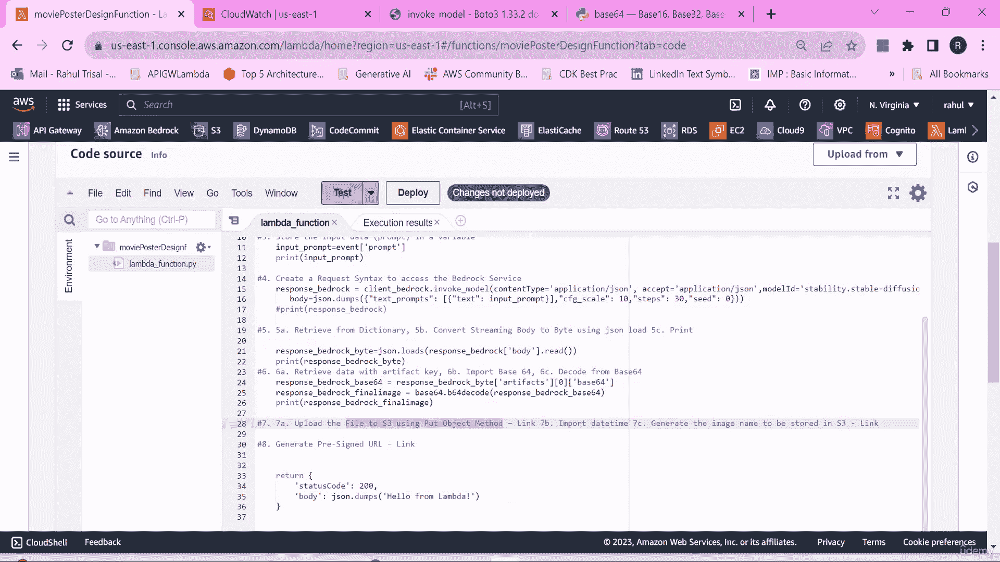

首先，我们需要明确完成这个任务到底要考虑哪些方面。其实，存储图像这件事并不像把文件拖进文件夹那么简单，其中主要有三件事需要确定：第一，图像要发送到哪个S3桶；第二，图像在S3桶里保存时该叫什么文件名；第三，我们还需要生成一个预签名URL，并把它发送给AWS API Gateway。在这里需要特别说明的是，S3桶本身并不会自动生成文件名，如果不想办法自己指定一个唯一的名字，那么后面上传的对象就可能会相互覆盖。这节课我们会重点实现前两步，第三步只是先预告一下目标，具体的实现细节会留到后续章节再展开。

接下来，我们来看看具体怎么做。

## 🧩 第一步：理解存储需求

在正式开始写代码之前，我们先来梳理一下存储图像的整个思路。为了让步骤更加清晰，我们可以把刚才提到的三件事拆解开来，一条一条地理解。下面是这三个问题的具体说明：

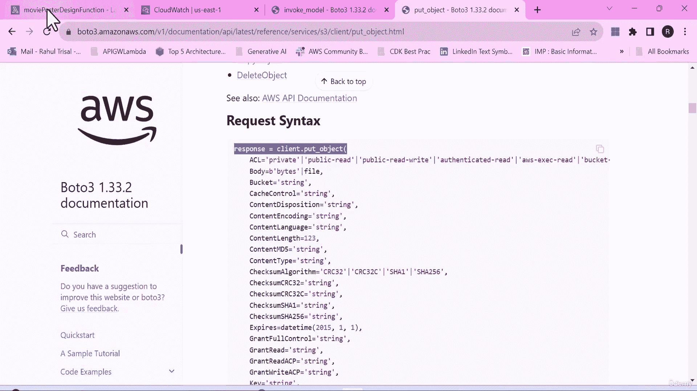

- **确定目标桶**：我们需要指定一个唯一的S3桶名称，告诉AWS把图像放在哪里。这个桶名通常来自之前课程中已经创建好的资源，在编写代码时需要手动填入。
- **确定文件名（Key）**：S3桶中的每个文件都叫“对象”，每个对象都有一个唯一的“键”（Key），也就是文件名。由于S3不会自动生成文件名，我们必须自己拼接出一个不重复的名字，否则后写入的对象会直接覆盖旧对象。
- **生成预签名URL**：为了让后续的API Gateway能够访问这个图像，可能需要生成一个预签名URL。不过本节课我们先不展开这部分，重点放在图像的存储操作上，让整体的链路先跑通。

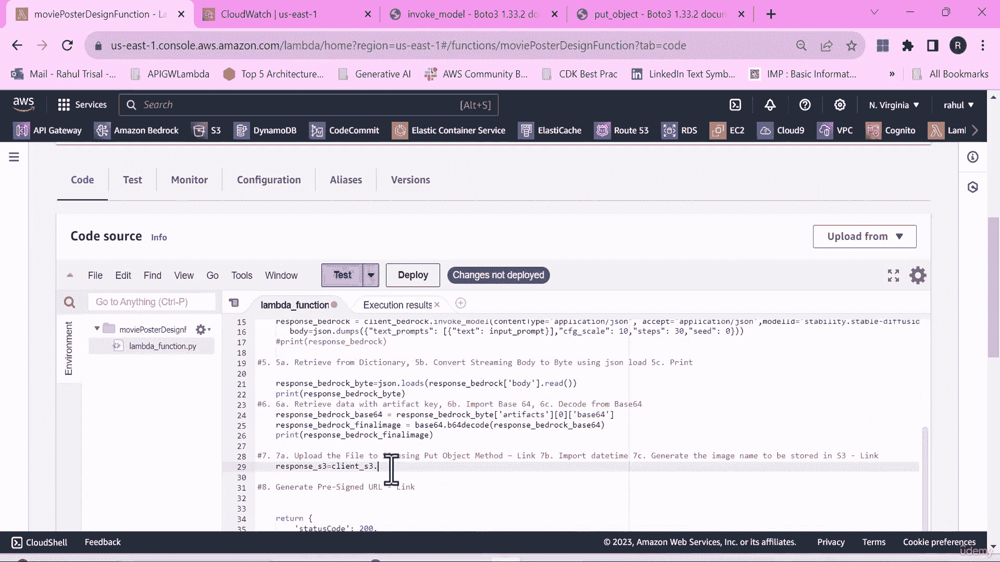

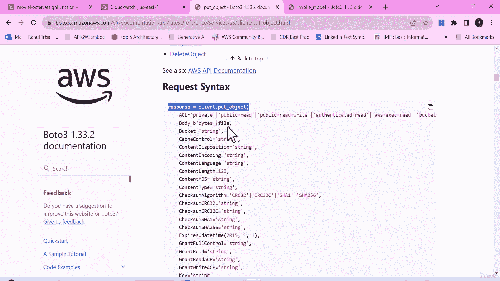

有了这三方面的清晰认识，接下来就可以编写代码来执行存储操作了。

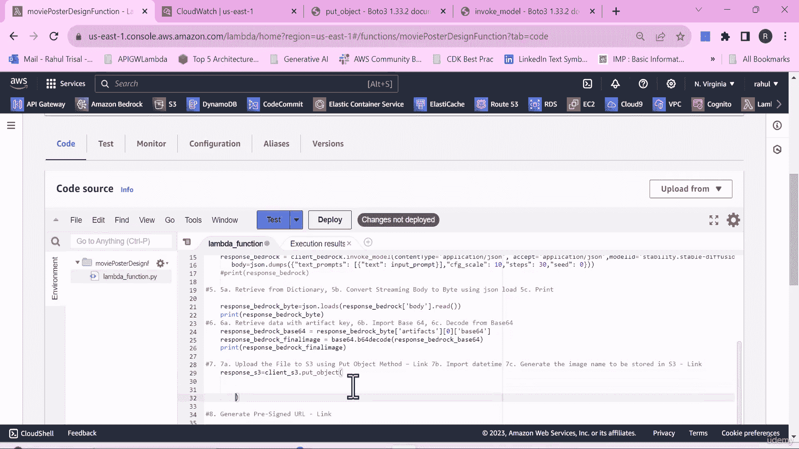

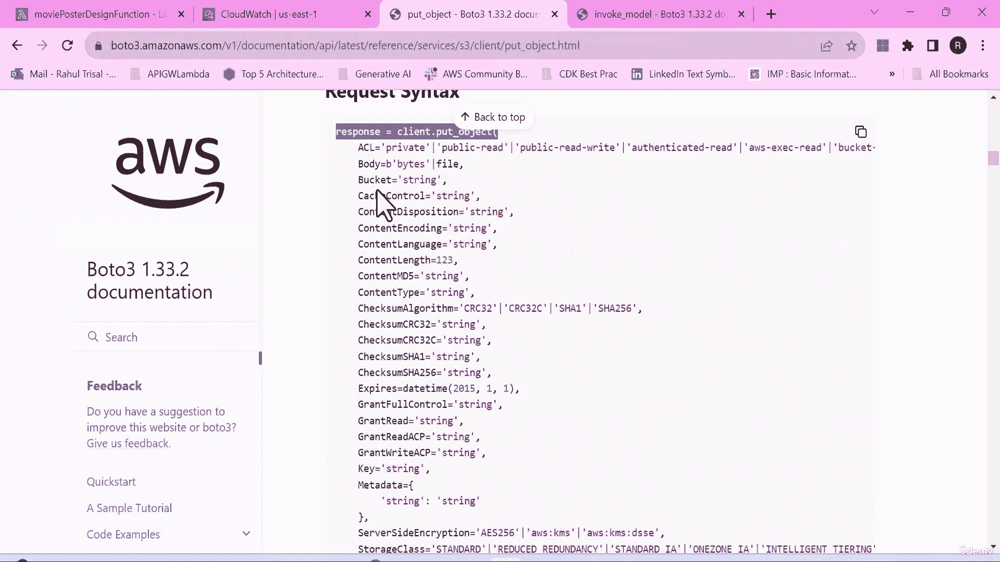

## 🛠️ 第二步：使用boto3的put_object方法

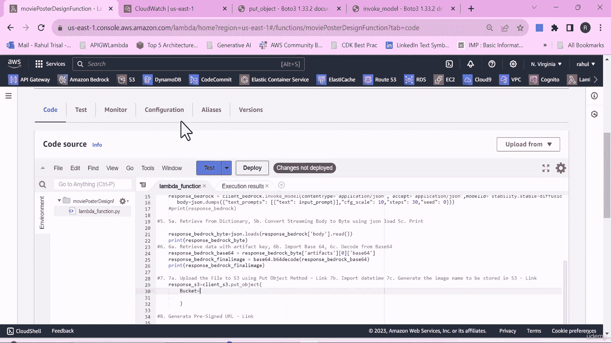


既然要存储图像，我们就需要使用AWS官方提供的Python SDK，也就是boto3。在boto3的S3文档中，有一个专门用于向桶中添加对象的方法，叫做`put_object`。在正式使用这个方法之前，我们先来回顾一下它的请求语法。在boto3客户端上调用`put_object`方法时，可以传入很多可选参数，但我们实际上只需要关注三个核心参数，因为这三个参数已经能够完整地描述一次上传操作。

下面这段代码展示了`put_object`的基本用法：

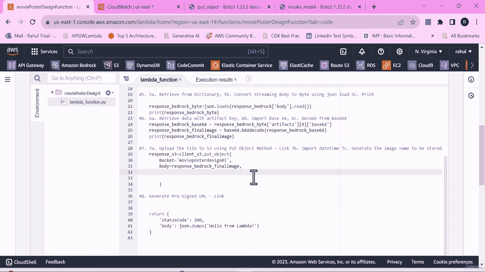

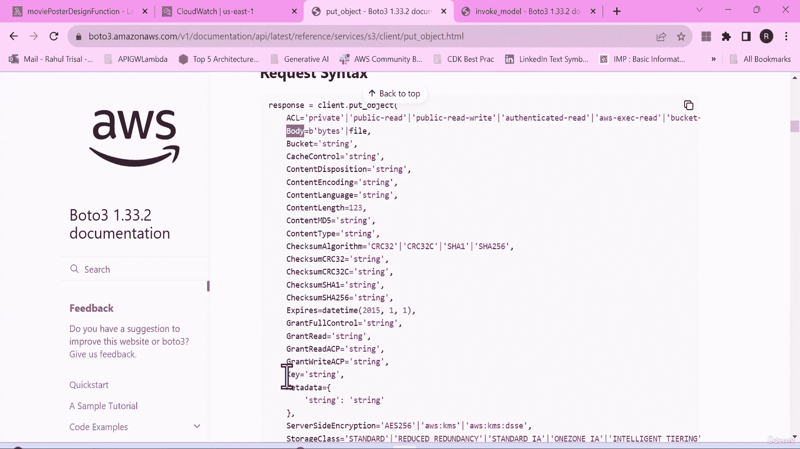

```python
s3.put_object(
    Bucket="your-bucket-name",
    Body=image_data,
    Key="image-key.jpg"
)
```

这里有几个重要的概念需要解释一下。`Bucket`很好理解，就是我们要存入的S3桶的名称，它通常是一个字符串。`Body`则是图像本身的二进制数据，在Python中对应的是字节类型（bytes），它直接来自之前调用Bedrock接口时得到的响应体。`Key`则是对象在桶中的完整路径和文件名，它同样也是一个字符串。如果你去翻阅S3的官方文档，就会发现`Bucket`和`Key`都是必填字段，`Body`也是需要提供的，这正好对应了我们前面列出的三项需求。

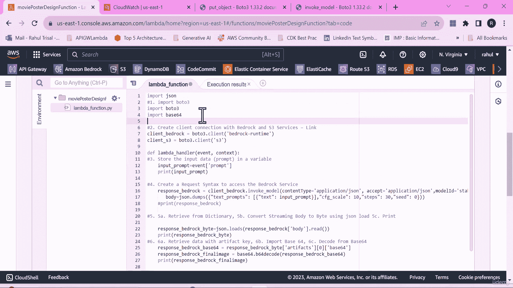

那么，在我们的代码中具体怎么连接S3呢？其实在之前的课程中，我们已经创建好了boto3客户端，也就是通过`boto3.client("s3")`建立起来的连接。现在，我们只需要在这个客户端上调用`put_object`方法，然后把三个参数依次传进去就可以了。整个过程非常直白，没有任何复杂的逻辑。

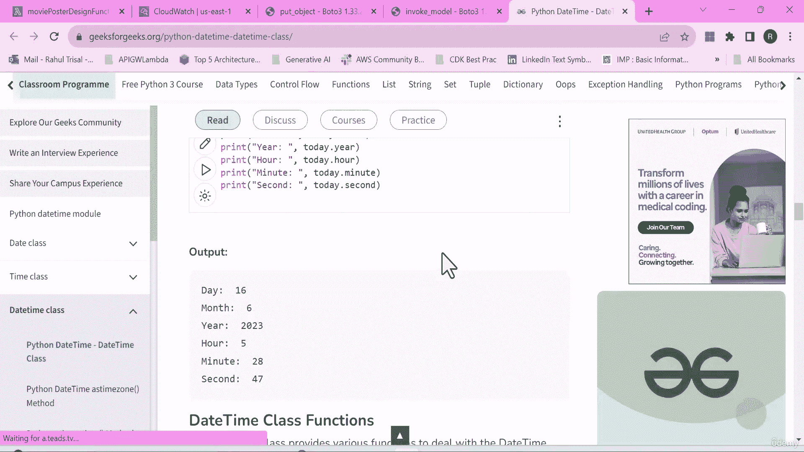

## 📝 第三步：构造唯一的文件名

现在问题来了，我们的`Key`参数需要一个具体的值，但S3并不会自动帮我们生成名字。如果每次生成的文件名都一样，那么后生成的图像就会覆盖先前的图像，这显然不是我们想要的结果。因此，我们必须自己构造一个唯一的文件名。比较简单的一种做法是把时间戳加入到文件名中，比如用“poster”作为前缀，再加上年、月、日、时、分、秒，这样即使在同一天内多次运行，也不会出现重名的情况。

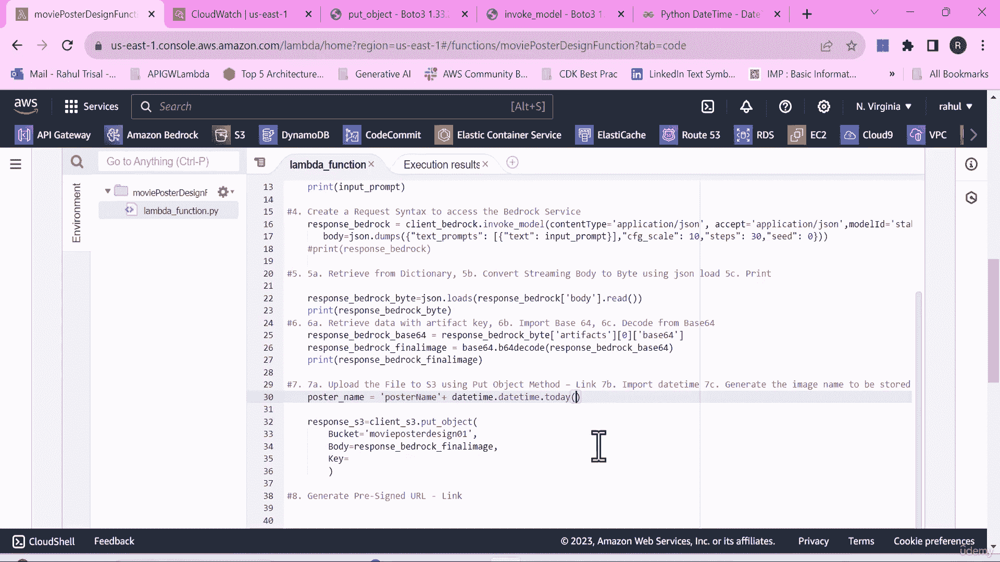

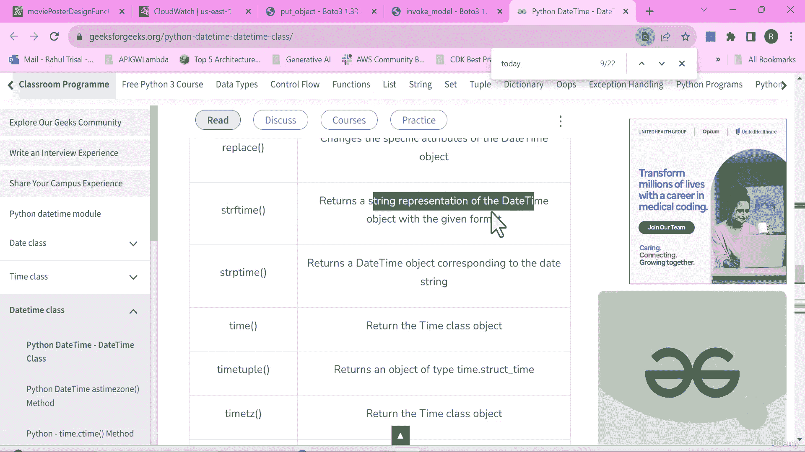

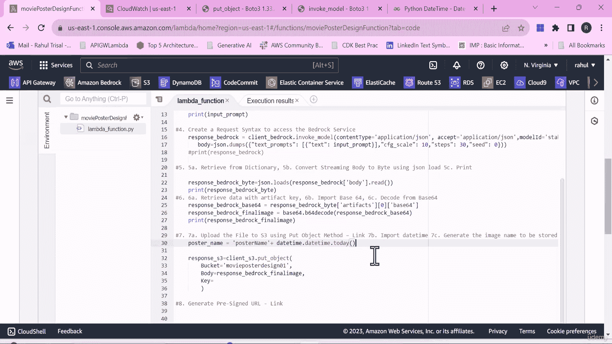

为了实现这个功能，我们需要导入Python标准库中的`datetime`模块。如果你对这个模块不太熟悉，也没有关系，它最常用的能力就是获取当前系统时间，并且可以通过`strftime`方法把时间对象格式化成任意我们想要的字符串。

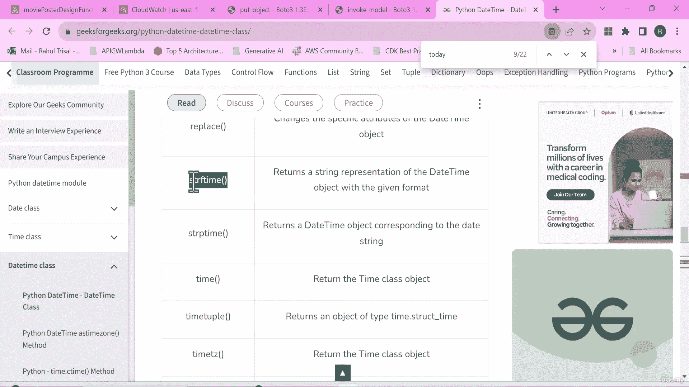

下面这段代码演示了如何构造唯一的文件名：

```python
from datetime import datetime

poster_name = "poster" + datetime.today().strftime("%Y-%m-%d-%H-%M-%S")
```

上面这行代码的意思很直白：先取出今天的日期和时间，然后按照`年-月-日-时-分-秒`的格式转换成字符串，最后把字符串“poster”拼在前面。这样一来，无论程序在什么时刻运行，只要时间不同，生成的文件名就一定是不同的。我们把这个`poster_name`变量作为`Key`参数的值传入`put_object`，就可以确保每次上传的对象都有唯一的标识。

接下来，我们快速回顾一下整个逻辑：我们准备使用`put_object`方法，其中`Bucket`来自之前创建好的S3桶，`Body`来自Bedrock生成的图像数据，`Key`则使用刚刚通过时间戳构造出的`poster_name`。这个流程非常清晰，代码写好后就可以直接部署了。

## 🚀 第四步：部署并测试Lambda函数

代码全部完成后，我们把这个Lambda函数部署到AWS上，然后手动触发一次测试。测试成功的标志有两个：一是函数执行后能够收到一个正常的响应，二是S3桶中应该出现一个名为`poster`加上当前时间戳的图像文件，并且这个文件确实是一张可查看的图片。

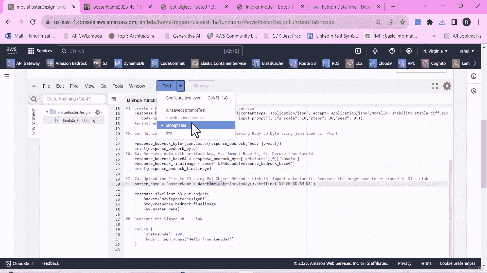

我们去S3控制台，搜索之前创建的桶名（它通常以`poster`开头），可以看到桶里已经新增了一个对象。这个对象会按照我们传入的`Key`以层级目录的形式展示，比如`poster/2026-11-10-14-30-25`这样的结构。点击这个对象，然后再点击下载，就可以把图像保存到本地了。为了验证图像内容是否正确，我们可以直接打开下载好的文件查看。

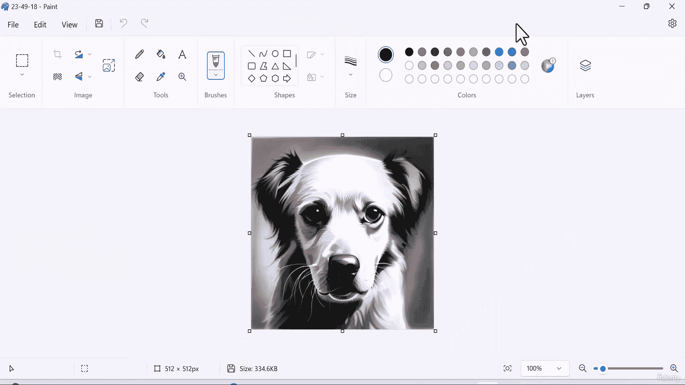

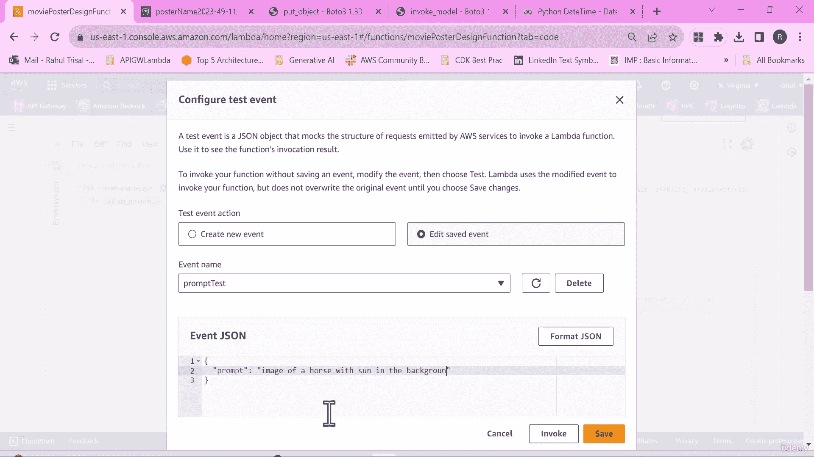

为了进一步验证整个流程确实能够正常工作，我们可以在代码中修改提示词，然后重新测试。比如，之前我们使用的提示词是“image of a dog”（一张狗的图像），下载查看到的结果确实是一只狗。如果这时候我们把提示词改成“image of a house with the sun in the background”（一座背后有太阳的房子），保存并再次部署测试，然后回到S3桶，就会发现桶里多出了一个新的对象，时间戳也更新了。下载后再次打开，可以看到生成的图像正是带有太阳背景的房屋。这说明文件名唯一的设计确实起了作用，每次运行都会生成新的图像，而不会去覆盖旧文件。

## ✅ 总结

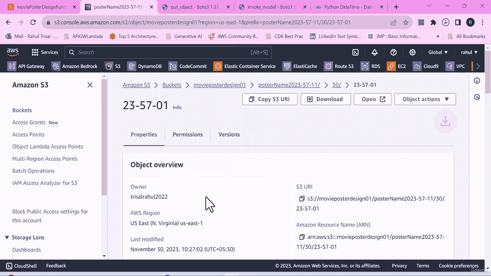

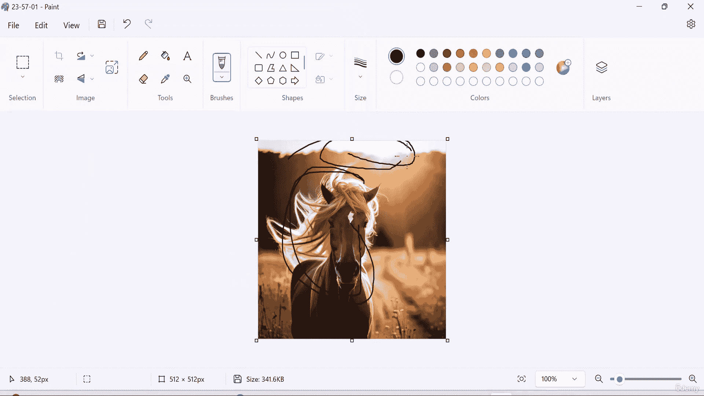

本节课中，我们一起学习了如何将AWS Bedrock生成的图像存储到S3桶。我们首先梳理了存储过程中需要解决的三个问题：确定目标桶、确定文件名、生成预签名URL。然后，我们查阅了boto3文档，最终确定使用`put_object`方法，并详细解释了`Bucket`、`Body`、`Key`三个核心参数的含义。接着，我们利用`datetime`模块构造了包含时间戳的唯一文件名，从根源上避免了命名冲突的问题。最后，我们通过部署和测试Lambda函数，实际验证了图像成功上传到S3桶并可以正常下载。希望这节课的内容能够帮助你掌握S3对象存储的基本操作，为后续的RAG和KIRO应用打下坚实的基础。

