# Generative AI on AWS：Part 1 P28：为S3桶中的图片生成预签名URL 🚀

在本节课中，我们将学习如何为已经存放在 S3 桶中的 AI 生成图片创建一个预签名 URL。这个 URL 会被发送给 API Gateway，用户拿到之后，就能通过它访问到对应的图片。我们会先编写生成预签名 URL 的代码，然后进行测试，最后调整 Lambda 函数的返回值，为下一步集成 API Gateway 做铺垫。

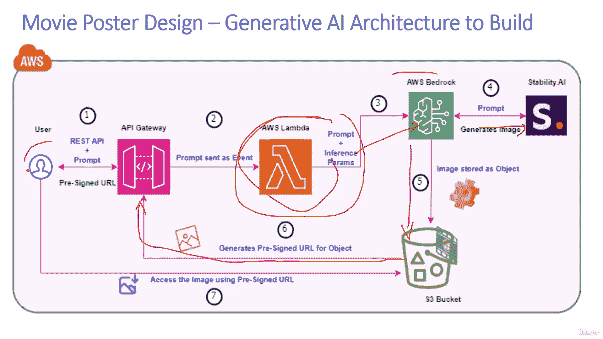

## 1️⃣ 回顾已完成的工作

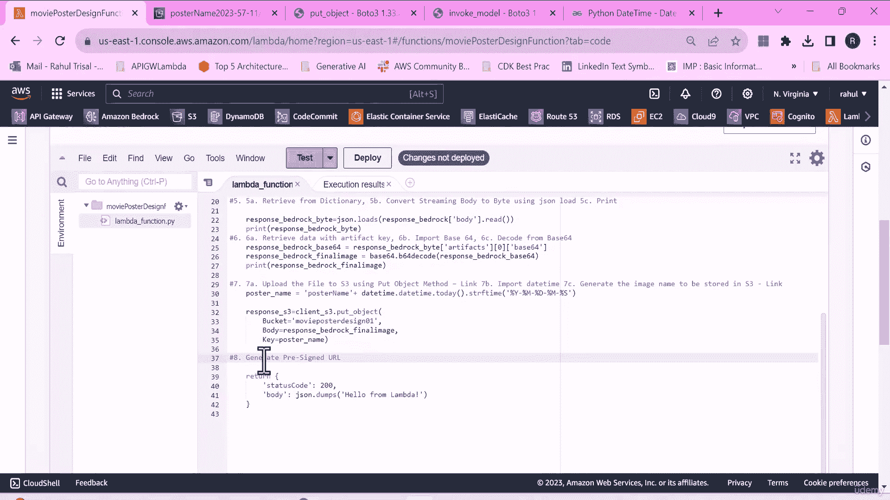

在正式开始之前，我们先花点时间回顾一下已经完成的内容。到目前为止，我们已经实现了大部分任务，成功创建了一个 Lambda 函数。这个函数已经和 Bedrock 提供的 Stability AI 模型完成了集成，可以根据我们传入的提示词生成图片，并且把生成好的图片保存到 S3 桶中。换句话说，图片生成和图片存储这两块工作已经完成了。

现在，我们面临一个新的问题：用户应该如何访问这张图片？显然，我们不能直接把整个 S3 桶设为公开，那样不安全。我们需要一种更优雅的方式，让用户可以在一定时间内、通过一个临时链接访问这张图片。这个临时链接就是预签名 URL。于是，接下来我们要做的，就是为这张图片生成一个预签名 URL，然后把这个 URL 发送给 API Gateway，用户通过它就能访问图片了。

## 2️⃣ 预签名 URL 的基本概念 🔗

预签名 URL 是 S3 提供的一种临时访问链接。它的作用是让你可以在不开放桶权限的情况下，把某个对象临时分享给别人。URL 中带着一串签名，签名里写明了允许的操作以及过期时间。只要超过有效期，这个链接就会失效，用户就无法继续访问对象了。

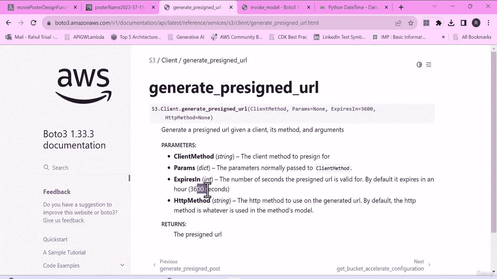

我们可以在 S3 客户端的 API 文档中，找到生成预签名 URL 的方法。打开文档后，在方法列表中搜索“generate”，会看到两个相关方法：一个是 `generate_presigned_post`，另一个是 `generate_presigned_url`。本节课我们使用的是后者，因为我们的目标是生成一个可直接访问对象的预签名 URL，而不是表单上传地址。

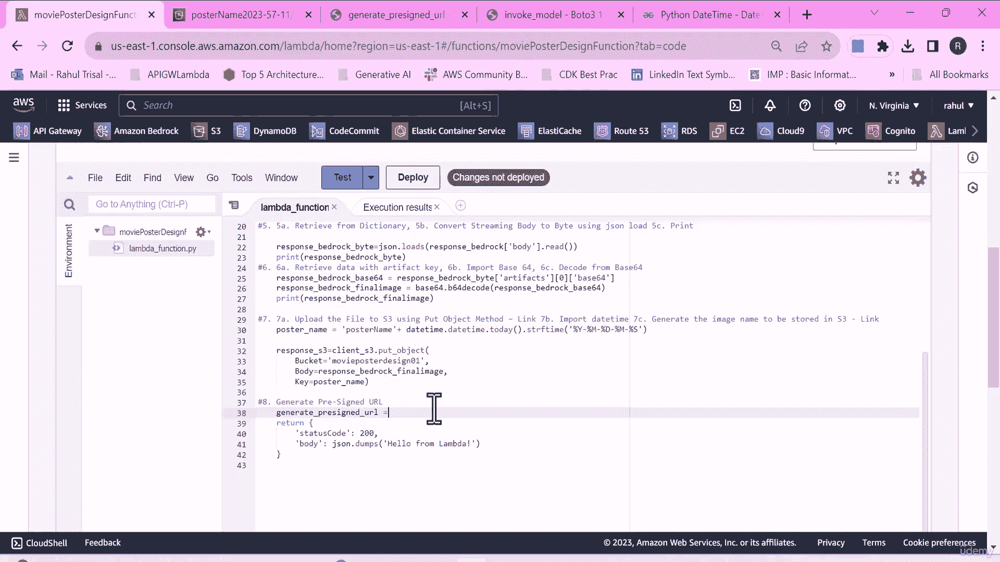

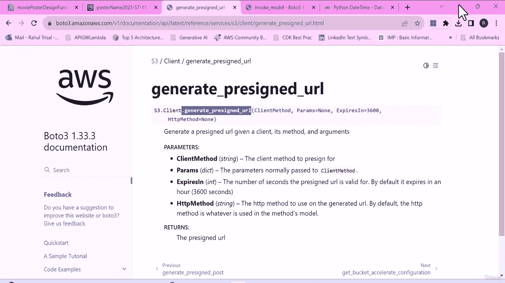

我们需要编写的请求格式其实并不复杂，核心逻辑可以用下面这个代码骨架来表示：

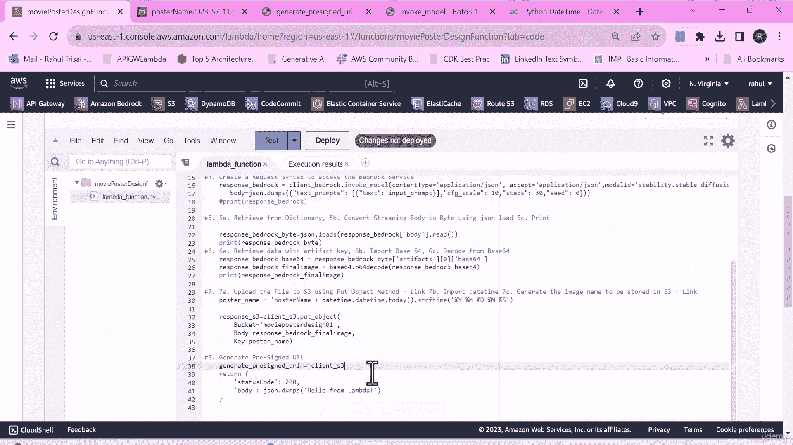

```python
presigned_url = client_s3.generate_presigned_url(
    ClientMethod=...,
    Params=...,
    ExpiresIn=...
)
```

其中 `client_s3` 就是我们已经定义好的 S3 客户端，直接使用即可。接下来我们就把这个请求补充完整。

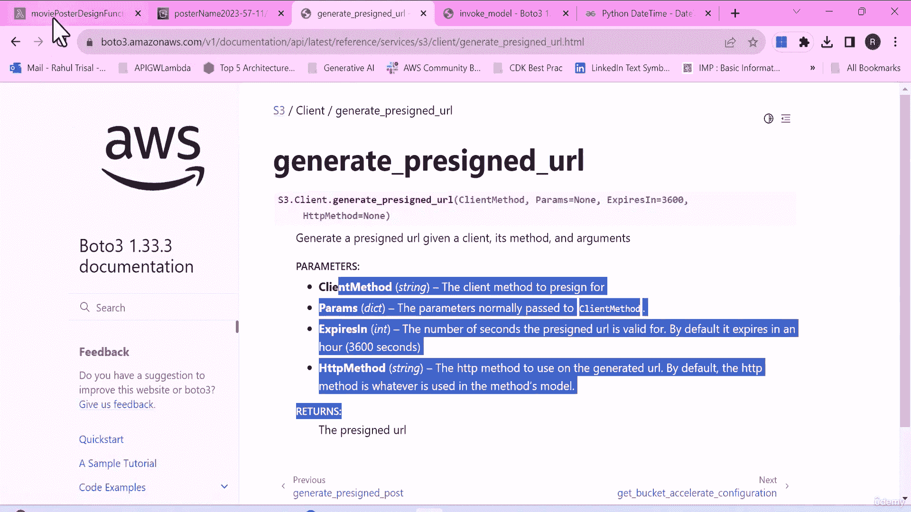

## 3️⃣ 编写生成预签名 URL 的代码 💻

我们先给结果起一个变量名，比如 `generate_pre_signed_url`，然后用它来接收方法返回的 URL。调用方式是前面看到的 `client_s3.generate_presigned_url(...)`。这里的 `client_s3` 是我们早就定义好的客户端，不需要重新创建。

这个方法有四个主要参数，分别是 `ClientMethod`、`Params`、`ExpiresIn` 和 `HttpMethod`。下面我们逐一介绍它们的作用，以及在我们的场景中应该怎么填。

以下是 `generate_presigned_url` 方法需要用到的主要参数，它们共同决定了 URL 的有效范围和行为：

- `ClientMethod`：字符串，表示要执行的操作。在我们的场景中，需要填写 `get_object`，也就是说我们希望通过这个 URL 从 S3 桶中获取一个对象。之所以使用 `get_object`，是因为当我们通过 API Gateway 创建 REST API 时，对应使用的方法是 GET 请求。
- `Params`：字典，用来描述操作的对象。我们需要在里面指定 `Bucket` 和 `Key`，也就是告诉 S3 我们要从哪个桶取哪个文件。其中 `Bucket` 是我们已经定义好的静态值，直接使用即可；`Key` 则使用我们在前面保存图片时定义的变量 `key_poster_name`。
- `ExpiresIn`：数字，表示这个预签名 URL 的有效期，单位是秒。默认值是 3600 秒，也就是一小时。你可以根据自己的需求修改这个值，但是要注意，一旦超过了这里设置的时间长度，终端用户就无法再通过这个 URL 访问对象了。
- `HttpMethod`：HTTP 方法。这个参数通常不需要显式提供，因此我们可以暂时省略它。

基于上面的分析，我们写出完整的代码：

```python
generate_pre_signed_url = client_s3.generate_presigned_url(
    ClientMethod='get_object',
    Params={
        'Bucket': bucket_name,
        'Key': key_poster_name
    },
    ExpiresIn=3600
)
```

代码写完后，我们会使用 `print` 把变量打印出来，确认它是否成功生成了一个预签名 URL。print 语句可以这样写：

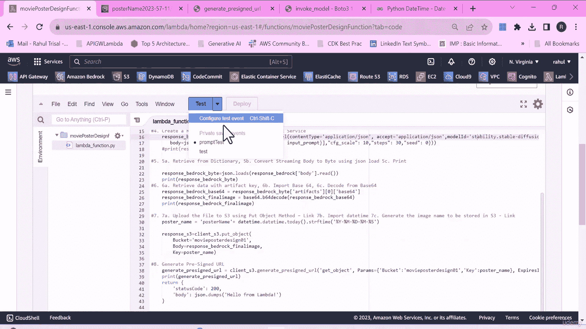

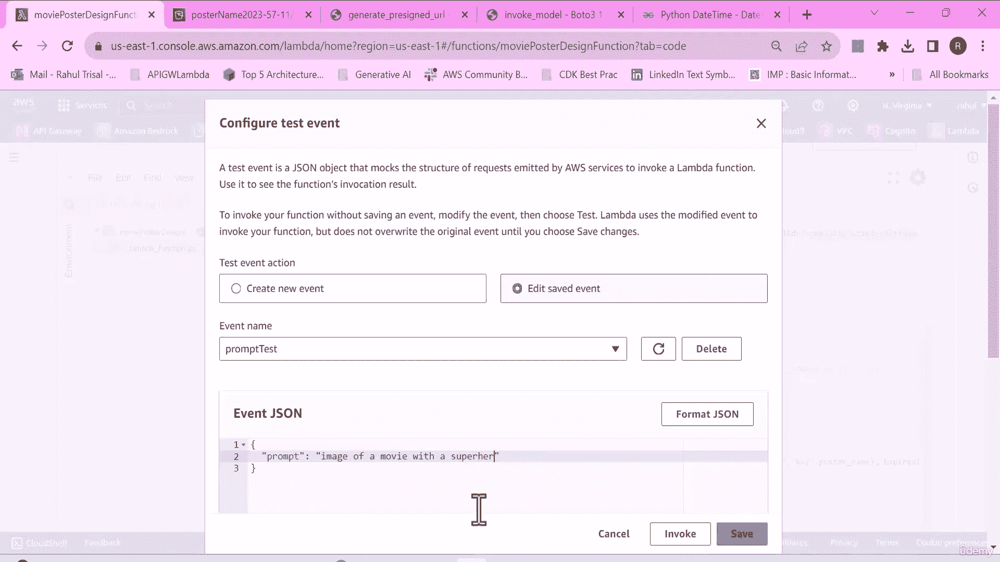

```python
print("Generate pre signed URL:", generate_pre_signed_url)
```

## 4️⃣ 部署并测试效果 🧪

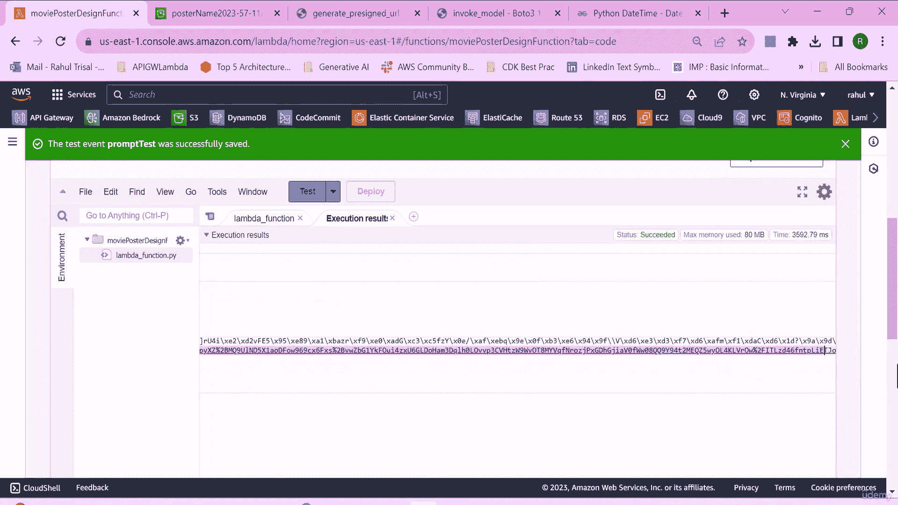

现在，我们把这个 Lambda 函数部署上去，然后进行测试。为了确保测试结果更明显，我们把提示词改成一个新的内容。简单调整一下，让它生成一张“超级英雄”的图片。修改完成之后，我们点击测试按钮，看看函数是否能正常返回一个预签名 URL。

测试成功后，我们得到了一个看起来很长很长的 URL。把它复制下来，然后在浏览器中打开这个地址，看看会发生什么。很快，浏览器就会开始下载图片。你会发现，下载的图片被浏览器自动换了一个新的文件名，但这完全不影响查看。我们把图片保存下来，并用画图之类的工具打开它。

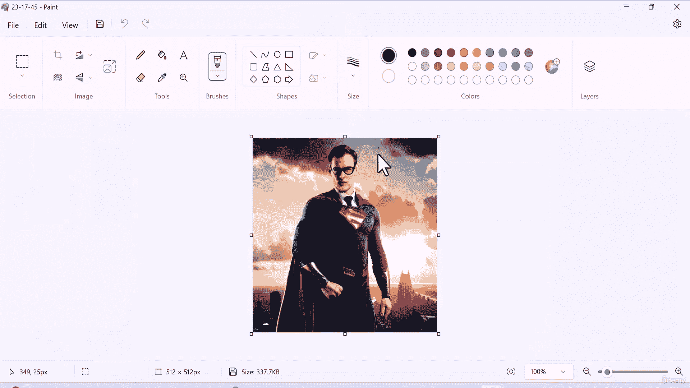

打开图片后，我们可以确认，这张图片确实是根据我们设置的超级英雄提示词生成出来的。它跟提示词是对应的。同时，这张图片也会出现在 S3 桶里面，也就是说，图片已经成功保存到了桶中。这样一来，从 Lambda 函数的角度来看，大部分的工作已经完成了，剩下的就是把这个 URL 通过 API Gateway 暴露给用户。

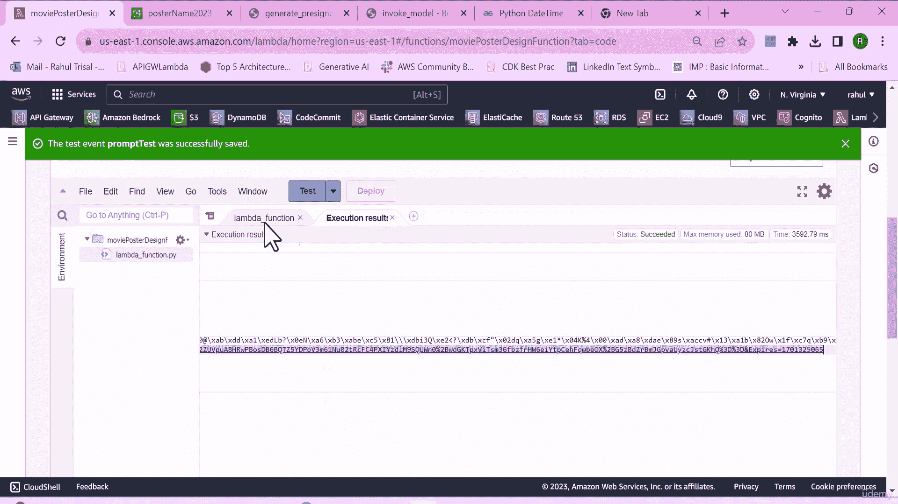

## 5️⃣ 修改 Lambda 函数的返回值 🔧

到目前为止，我们一直在用 Lambda 的测试事件来触发函数，并且只是把结果打印出来。但是，当我们把 Lambda 函数和 API Gateway 集成之后，API Gateway 需要从 Lambda 函数的返回值中获取预签名 URL，再把它返回给用户。如果我们现在看 Lambda 函数的 return 语句，会发现里面返回的还是“Hello from Lambda”，这显然不是我们想要的结果。

所以，我们需要修改 Lambda 函数的返回体，把原来的 body 内容替换成我们生成的预签名 URL。在我们的场景中，也就是把 body 设置为 `generate_pre_signed_url` 这个变量。可以这样写：

```python
return {
    'statusCode': 200,
    'body': generate_pre_signed_url
}
```

修改完成之后，我们再部署一次，然后重新测试。这一次，我们能同时看到两样东西：在函数日志中，可以看到打印出来的预签名 URL；在返回值中，也能看到 Lambda 函数返回给用户的预签名 URL。测试结果显示，响应状态码是 200，并且返回体中包含了一个完整的预签名 URL。这说明修改已经生效了。


这里有一个小细节需要说明：我们最终会把预签名 URL 送给 API Gateway，再由 API Gateway 以某种形式转发给客户端。因此，返回值中就不能只打印日志了，它必须是一个标准的 HTTP 响应结构。现在我们已经完成了这一步的调整，接下来就可以放心去创建 API Gateway 了。

## 6️⃣ 下一步计划与总结 ✅

接下来，我们要做的是创建一个 API Gateway，把它和 Lambda 函数集成起来，然后用 Postman 这类工具去测试整个链路。等这一步完成之后，整个用例就算真正完成了。

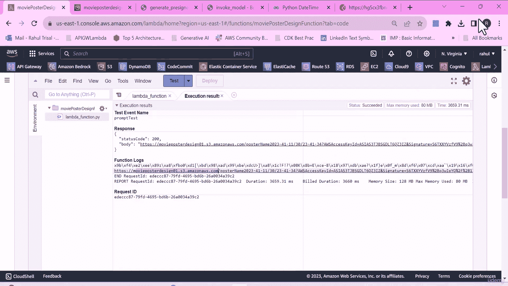

本节课我们一起学习了如何为 S3 桶中的图片生成预签名 URL。我们回顾了之前已经完成的 Lambda 函数和图片生成工作，然后深入了解了预签名 URL 的基本概念，接着编写了生成预签名 URL 的代码，部署并测试了它的实际效果。最后，我们还修改了 Lambda 函数的返回值，让它能够把预签名 URL 正确返回给 API Gateway。这些工作为下一步的 API Gateway 集成打下了扎实的基础。希望这节课的内容对你有所帮助。

