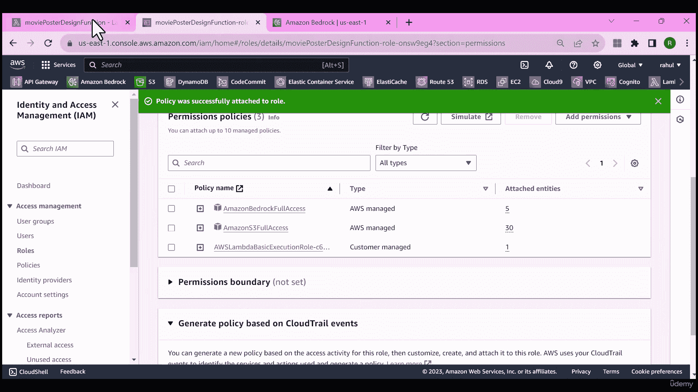
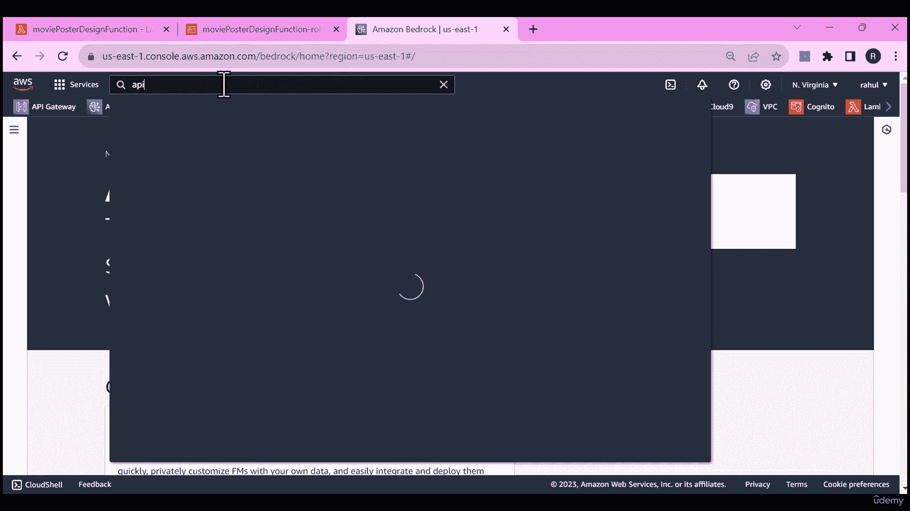
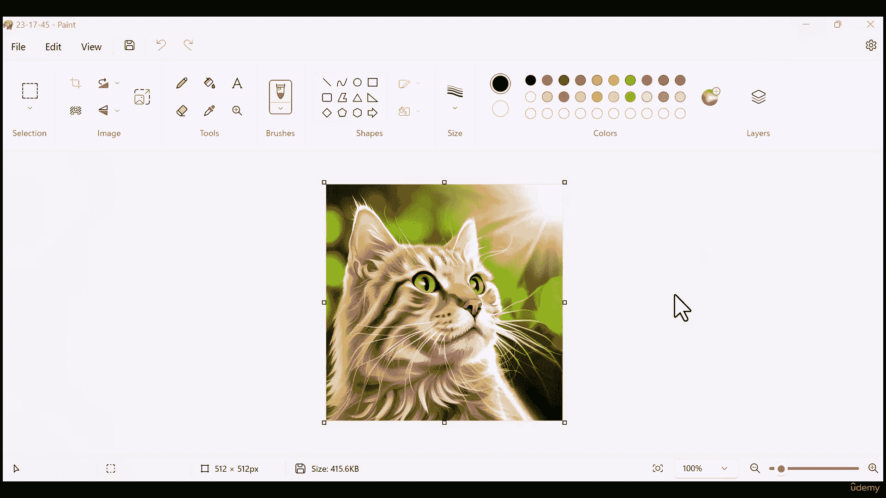

# 🚀 Generative AI on AWS：第29-31节：AWS API Gateway 与 Lambda 集成

## 🧭 Generative AI on AWS：第29-31节：课程概述

在本节课中我们将要学习如何用 AWS API Gateway 创建 REST API，并把它连接到已经创建好的 Lambda 函数。到这一步为止，这个用例所需的大多数 AWS 服务已经创建完成：我们已经创建了 Lambda，并把它连接到 Bedrock；也创建了 S3 桶，并生成了预签名 URL。本节的重点，是把 REST API 这一层补上，让外部请求可以进来，再转交给 Lambda 处理。

为了照顾初学者，我们会先从 Lambda 的 IAM 权限更新讲起，然后创建 REST API、配置资源和 GET 方法，再添加 `prompt` 查询参数、请求验证和集成映射模板，最后部署到 `dev` 阶段并做一次实际测试。整个流程会尽量用大白话解释，每一步都说明它在整条链路里起什么作用。

## 🔐 Generative AI on AWS：第29-31节：更新 Lambda 的 IAM 权限

上一节我们已经把 Lambda、Bedrock 和 S3 这些核心服务串起来了，本节中我们来看看在进入 API Gateway 之前，为什么需要先更新 Lambda 的 IAM 权限。原文提到，在创建 REST API 之前，AWS Bedrock 服务的 IAM 角色权限有一个更新，所以需要先解释并处理这个问题。

下面是这次权限更新的具体背景和操作步骤，先理解原因，再动手修改。

- 前几个视频里，我们给这个 Lambda 函数附加过管理员访问策略，因为当时没有现成的 AWS 托管策略可以让某个服务访问 Amazon Bedrock，唯一办法是通过内联策略实现。

- 最近 AWS 已经引入了相关托管策略，所以现在可以把原来的管理员访问策略移除，因为把这种高权限策略挂在 Lambda 上可能非常危险。

- 移除之后，可以看到这个 Lambda 函数只剩 `AWSLambdaBasicExecutionRole` 这个基本执行角色，也就是说它只拥有访问 CloudWatch Logs 的权限。

- 接下来点击添加权限、附加策略，搜索 Bedrock，选择 `AmazonBedrockFullAccess`，然后添加权限。

- 然后还要给这个 Lambda 函数添加 S3 访问权限，因为它需要访问 S3 桶，而之前并没有提供这个权限；点击添加权限、附加策略，搜索 S3，选择 `AmazonS3FullAccess`，再添加权限。

- 在生产环境中，建议使用更细粒度的权限，可以在策略里写明具体的 S3 桶名称，只允许这个 Lambda 函数访问那一个 S3 桶，而不是账号下的所有 S3 桶；当前练习阶段先使用 `AmazonS3FullAccess` 即可。

> 提示：练习阶段使用完整访问权限方便操作，但生产环境一定要收紧权限范围。

权限处理完成后，Lambda 就同时具备访问 Bedrock 和 S3 的能力。接下来就可以进入 API Gateway，把 REST API 这一层创建出来，并让它调用这个 Lambda 函数。

## 🧱 Generative AI on AWS：第29-31节：创建 REST API

上一节我们处理好了 Lambda 的权限，本节中我们来看看如何在 AWS API Gateway 里创建一个 REST API。这个 API 会成为外部请求进入系统的入口，后面我们会把 GET 方法连接到 Lambda 函数。

以下是创建 REST API 的主要步骤，操作时注意不要选错 API 类型。





- 打开 AWS 控制台，搜索 API Gateway，然后点击进入。

- 在 API Gateway 界面点击创建 API，向下滚动找到 REST API；不要点击 REST API Private，而是点击公开的 REST API，然后点击构建。

- 给 API 起一个名字，例如 `moviePosterAPI`，API endpoint 类型保持默认即可，然后点击创建 API。

- API 创建完成后，界面会给出后续操作指引；第一步是创建资源，资源名称可以自定义。

- 接着选择方法，本用例可以先选 GET；GET 或 POST 理论上都可以工作，原文也提到这个用例先做 GET，下一个再做 POST。

- 创建资源后，创建一个 GET 方法，集成类型选择 Lambda 函数，然后选择前面已经创建好的 Lambda 函数，点击创建方法。

- 方法创建完成后关闭面板，就能在资源下面看到这个 GET 方法。

到这里，API 的骨架和 GET 方法已经有了。可是这个 GET 方法还需要知道：请求里要带什么参数，参数如何校验，以及参数如何传给 Lambda。下面我们就来配置方法请求和查询字符串参数。

## 🧾 Generative AI on AWS：第29-31节：配置方法请求与查询参数

上一节我们创建了 REST API 资源和 GET 方法，本节中我们来看看如何给这个方法加上 `prompt` 查询参数，并开启请求验证。这样当外部调用 API 时，就必须带上这个参数，Lambda 才能拿到用户输入的提示词。

以下是方法请求和查询参数的配置步骤，核心是让 `prompt` 成为必填输入。

- 点击方法请求，再点击编辑。

- 找到 URL query string parameters，点击添加查询字符串参数，参数名写 `prompt`，并勾选必填。

- 这个 `prompt` 就是后面要传给 Lambda 的输入；在架构图里，它会通过 REST API Gateway 传到 Lambda 函数，并在 Lambda 中表现为事件对象的一部分。

- 在 Lambda 代码里，这个 `prompt` 会作为输入进入事件，然后被保存到变量 `input_prompt` 中，最后 `input_prompt` 会作为输入传给 Bedrock 服务，并获取响应；这就是这个参数的作用。

- 接着找到请求验证器，选择验证查询字符串参数和请求头，目的是确保这个 REST API 被调用时，一定带有名为 `prompt` 的查询字符串参数。

可以用下面的公式理解这条数据流，参数从 API 进入 Lambda，再进入 Bedrock。

```
REST API(?prompt=image of cat) → Lambda event.prompt → input_prompt → Bedrock → 响应
```

方法请求配置好后，API 已经知道要接收 `prompt` 参数了。下一步要让 API Gateway 把这个参数转换成 Lambda 能识别的事件格式，这就需要配置集成请求和映射模板。

## 🔁 Generative AI on AWS：第29-31节：配置集成请求映射模板

上一节我们给 GET 方法加了 `prompt` 查询参数和请求验证，本节中我们来看看如何通过集成请求的映射模板，把 API Gateway 收到的查询参数转换成 Lambda 事件里的 `prompt` 字段。没有这个映射，Lambda 可能无法按预期拿到参数。

以下是集成请求和映射模板的配置步骤，重点是模板内容要手写准确。

- 打开集成请求，点击编辑，然后向下滚动找到映射模板，点击添加映射模板。

- Content-Type 保持为 `application/json`。

- 在模板正文里填入下面这段内容，它会把 REST API 收到的 `prompt` 查询参数放进 Lambda 事件的 `prompt` 字段中。

```
{
  "prompt": "$input.params('prompt')"
}
```

- 这段模板使用的是 AWS 使用的 Velocity 模板语言，它是一个标准写法，可以直接按原样使用。

- 原文特别提醒：如果这里报错，有九成概率是模板写错了；不要直接复制粘贴，因为复制时引号有时会变形，最好手动输入。

- 这段模板的含义是：把 REST API 收到的 `prompt` 转换并传递到 AWS Lambda 的事件中，作为 `prompt` 字段使用。

填写完成后点击保存，所有配置更改就完成了。最后一步是把 API 部署到一个阶段，否则这些配置不会生效，也无法通过外部地址访问。

## 🚀 Generative AI on AWS：第29-31节：部署 API 到阶段并测试

上一节我们完成了映射模板配置，本节中我们来看看如何把 API 部署到阶段，并做一次完整测试。API Gateway 里的阶段可以理解成环境，例如开发、测试、生产等，不同阶段可以对应不同的使用场景。

以下是部署和测试的操作步骤，部署后我们会实际生成一张猫的图片来验证链路。

- 点击部署 API，选择新阶段，阶段名称可以自定义，例如 `dev`，然后点击部署。

- 需要记住一个提示：只要你对 AWS API Gateway 做了任何修改，都必须重新点击部署并再次部署，否则修改不会生效。

- 部署完成后回到资源页面，点击 GET 方法，再点击测试。

- 在测试页面里填写查询字符串参数，参数名使用前面定义的 `prompt`，可以先从简单内容开始，例如 `image of cat`。

- 点击测试后，如果返回状态码 200，并且响应体里有一个很长的 URL，这个 URL 就是 S3 的预签名 URL，说明链路已经跑通。

- 点击这个链接，浏览器会提示保存图片；把图片保存下来，例如文件名 `23,7,45`。

- 打开画图程序，选择打开文件并切换到所有文件，找到刚才保存的 `23,7,45` 并打开，就能看到生成的猫图片。

- 回到测试结果可以看到，我们提供的 prompt 是 `image of cat`，返回的图片也正是这个提示词对应的内容，效果符合预期。

到这里，通过 API Gateway 调用 Lambda、再由 Lambda 调用 Bedrock 并返回 S3 预签名 URL 的完整流程已经验证成功。下一节我们会使用 Postman 再做一次测试，具体内容在下一讲继续。

## ✅ Generative AI on AWS：第29-31节：课程总结

本节课中我们一起学习了如何把 AWS API Gateway 和 Lambda 集成起来，完成从 REST API 到 Bedrock 的调用链路。我们先是更新了 Lambda 的 IAM 权限，移除了高权限策略，附加了 `AmazonBedrockFullAccess` 和 `AmazonS3FullAccess`；然后创建了 `moviePosterAPI`，配置了资源和 GET 方法，并把它连接到已有 Lambda 函数。



接着我们添加了必填的 `prompt` 查询参数和请求验证，配置了 `application/json` 映射模板，把查询参数转换成 Lambda 事件中的 `prompt` 字段；最后把 API 部署到 `dev` 阶段，并用 `image of cat` 做测试，成功返回状态码 200 和 S3 预签名 URL，保存并打开图片后看到了生成的猫图。下一节我们会在 Postman 中继续测试这个 API。
