# 🚀 AWS生成式AI实战：第30讲：使用Postman完成端到端演示

## 📌 本讲概述

在本节课中，我们将使用 Postman 完成一个端到端演示。这个演示会把前面学到的提示词、API 调用和响应处理串起来，帮助初学者理解如何通过基础模型构建生成式应用。我们会先看提示词为什么重要，再进入 Postman 发起请求，最后查看响应并用返回的预签名 URL 保存生成图片。

## 🧠 提示词为什么重要

在进入实际操作前，先要理解提示词的作用。编写提示词是决定基础模型最终输出或补全效果的重要环节。针对每一个基础模型，都有特定的提示词写法，只有按这个写法组织内容，才更容易获得最佳结果。

以 Stability AI 的 Stable Diffusion 基础模型为例，它的提示词结构可以用下面的公式表示。

```text
Stable Diffusion 提示词 = 图像主体 + 描述细节（天气、时间等） + 图像类型（照片、素描等） + 艺术风格
```

具体来说，提示词先写图像主体，再写描述内容，例如天气条件或时间等信息。接着要告诉模型希望生成什么类型的图像，是照片、素描还是其他类型。最后还要说明艺术风格，因为 Stable Diffusion 提供了很多不同的艺术风格。提示词设计和提示词工程的细节会在后续章节中讨论，本讲先使用已经写好的提示词，观察它会生成什么图像。

以下是 Stable Diffusion 提示词中常见的组成部分。

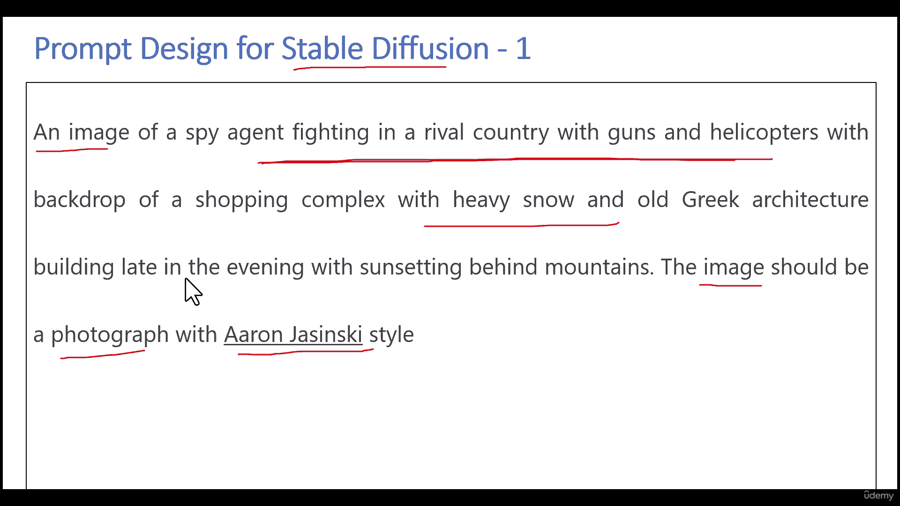

- 图像主体：先说明画面里要出现什么。

- 描述细节：补充天气、时间等信息。

- 图像类型：说明是照片、素描还是其他形式。

- 艺术风格：指定希望采用的视觉风格。

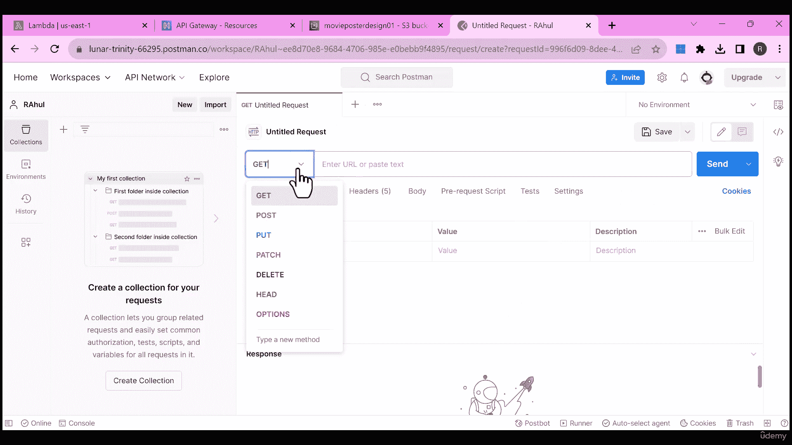

## 🧰 打开 Postman 并准备请求

了解了提示词结构后，我们进入 Postman 操作。Postman 是一个免费工具，可以自行下载，它常用于 API 测试。视频中主讲人打开了一个新的 Postman 窗口，准备开始测试接口。

在 Postman 中，请求方法设置为 GET。接下来要确认请求 URL。为了拿到可以运行的 URL，需要进入 Stages，然后选择 dev 阶段或当前正在测试的阶段，点击这个 GET 方法，就能看到 Invoke URL。复制这个调用 URL，再粘贴到 Postman 中。

下一步是提供键值。这里的键是 `prompt`，所以还需要添加提示词参数。视频中使用的是前面描述过的同一段提示词，但主讲人先把它复制到记事本，再从记事本复制到 Postman，原因是直接从端点复制时有时会出现错误。完成复制后，回到 Postman 并粘贴提示词。

现在，请求方法、请求 URL 和提示词都已经准备好。请求结构可以用下面的代码表示。

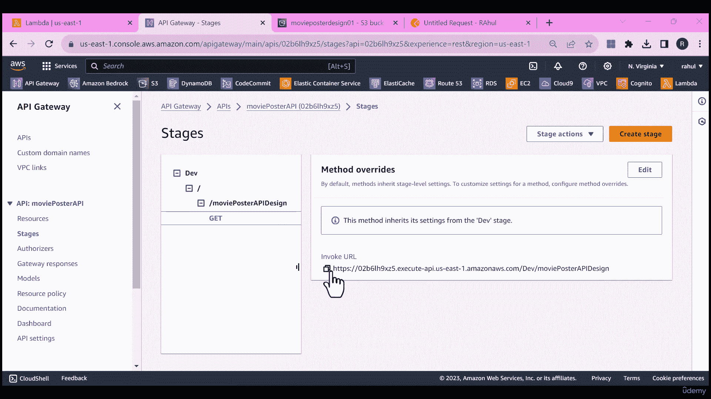

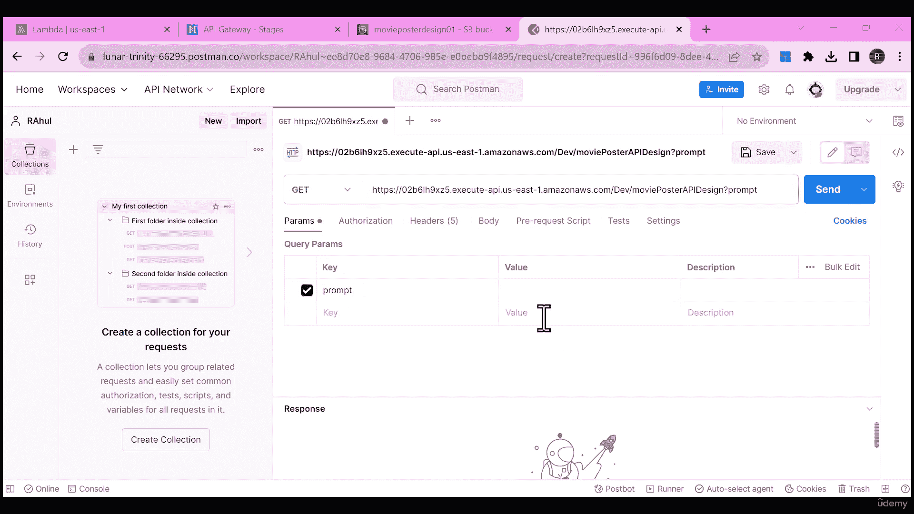

```http
GET {Invoke URL}?prompt={提示词}
```

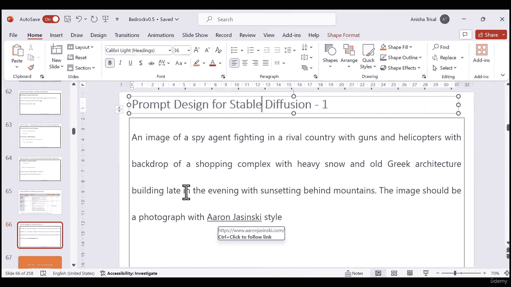

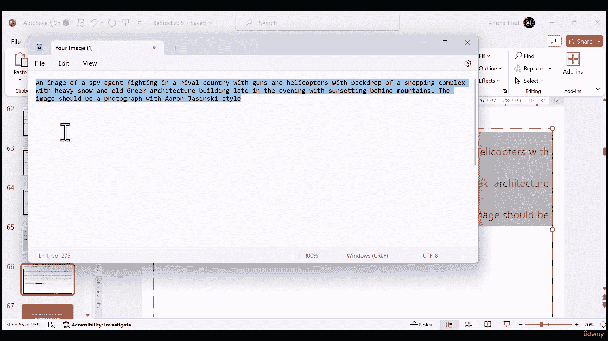

以下是发送请求前需要确认的三项内容。

- 请求方法：GET。

- 请求 URL：从 Stages 中复制得到的 Invoke URL。

- 查询参数键：`prompt`，值为前面准备的提示词。

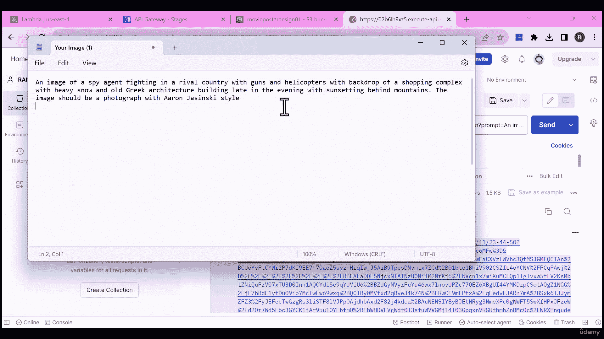

## 📤 发送请求并查看响应

准备工作完成后，就可以发送请求。等待几秒后，接口返回了响应。此时查看响应内容，可以看到状态码为 200，响应体 body 中包含一个预签名 URL。这个预签名 URL 可以用来访问生成的图片。

响应结构可以用下面的代码表示。

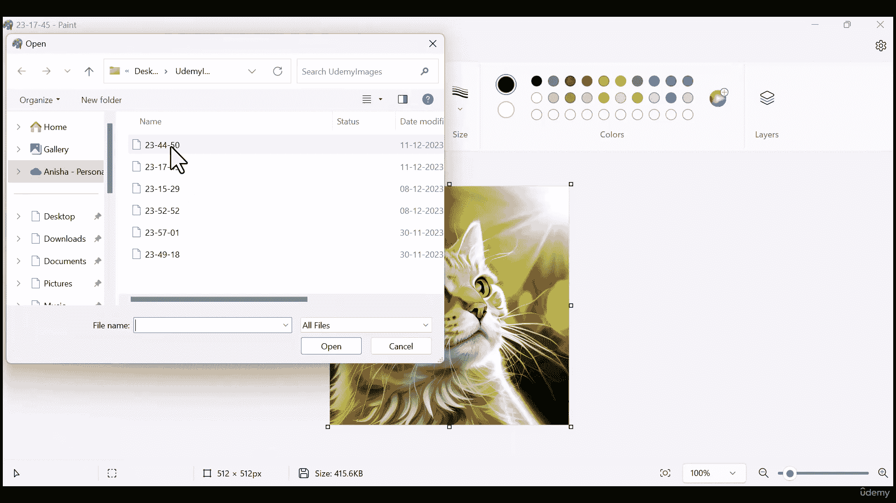

```http
HTTP/1.1 200 OK
body: {预签名图片URL}
```

复制响应体中的完整内容，再把它粘贴到浏览器地址栏。视频中对复制内容做了一些清理，去掉不需要的部分，并对链接做了整理，然后保存图片，保存时使用 23、44、50 这样的标识。保存完成后，打开画图软件查看，确认打开的就是生成的那张图片。

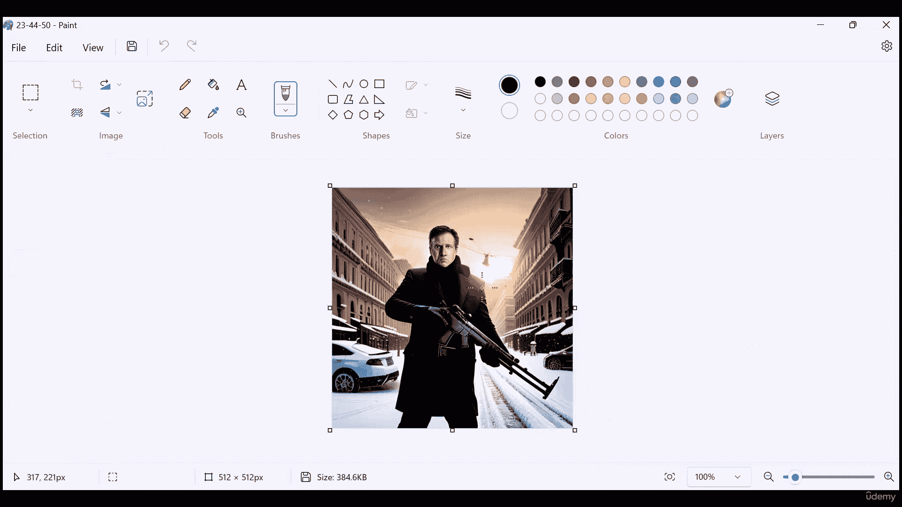

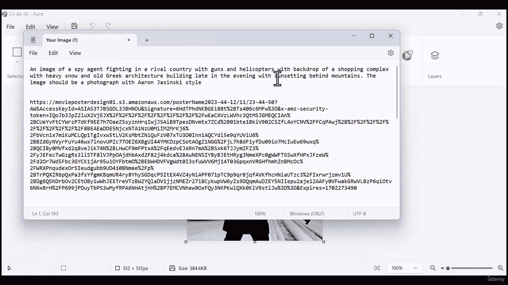

生成的图像看起来效果不错。画面中是雪地里的间谍，背后有正在落下的太阳，提示词中提供的各项细节都得到了体现。这一步说明，只要准备好提示词、请求方法和 URL，就可以通过基础模型完成图像生成。

## ✅ 本讲总结

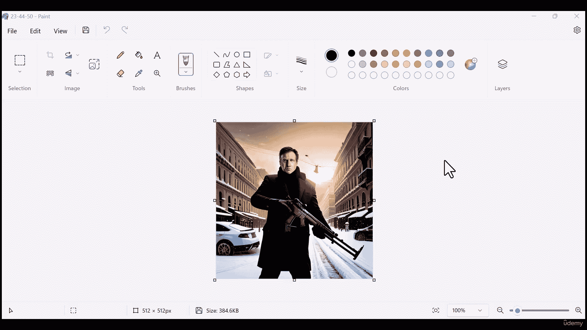

本节课中我们一起学习了如何使用 Postman 完成端到端演示。我们理解了提示词对基础模型输出效果的重要性，看到了 Stable Diffusion 提示词的基本组成，也在 Postman 中完成了 GET 请求、添加 `prompt` 参数、发送请求、查看状态码和预签名 URL，并最终保存和查看生成的图片。这就是使用基础模型构建生成式应用的一种实际方式，希望这个用例对学习有帮助，下一节继续。
