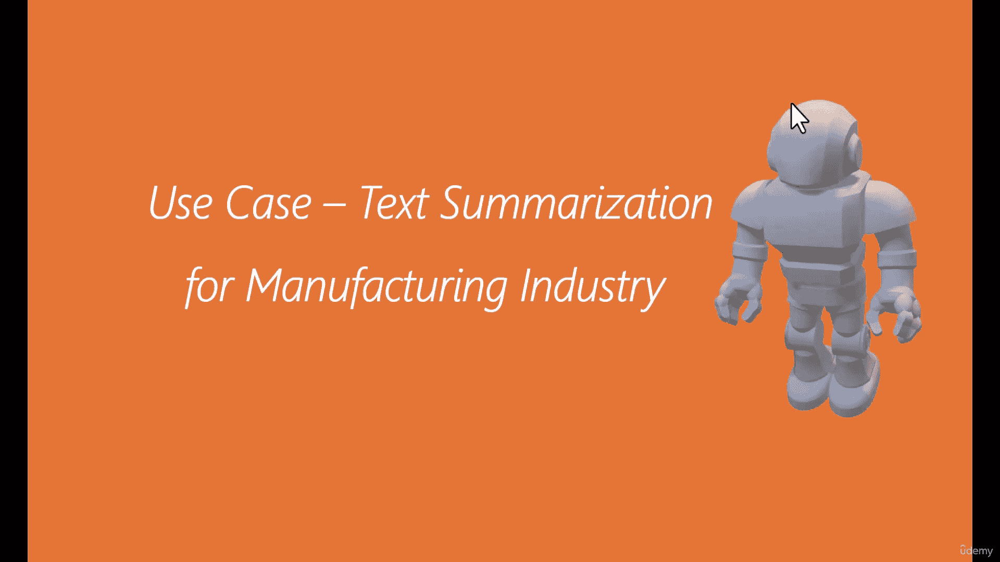
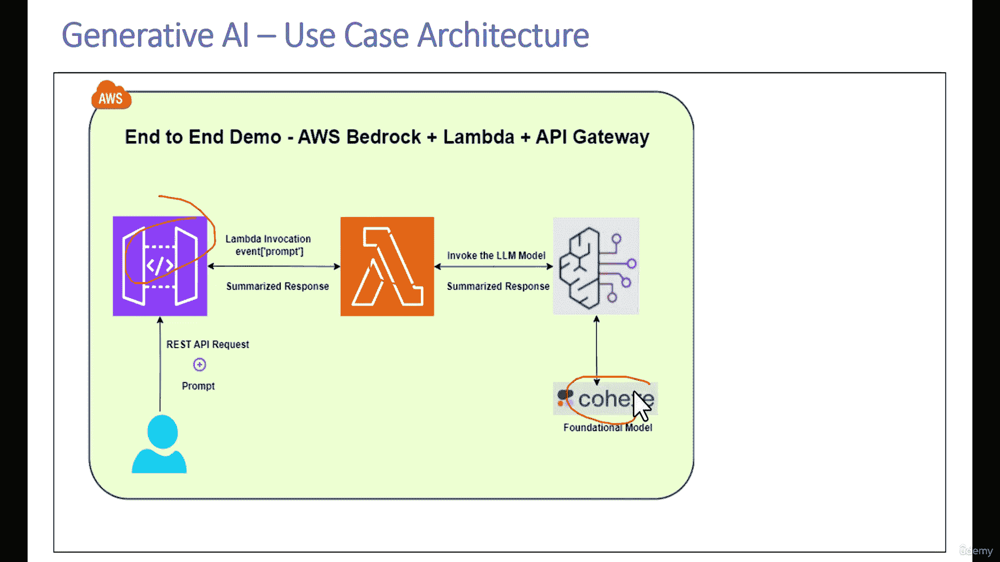

# 🚀 Generative AI on AWS - Amazon Bedrock, RAG & KIRO [2026]：第1部分 第31讲：📄 章节介绍：用例2：文本摘要

  

在本节课中，我们将要学习如何利用基础模型的文本摘要能力，在制造业场景下构建一个端到端的应用程序。我们会先了解这一用例的业务价值，然后认识构建过程中需要用到的核心云服务，最后用一段简单的代码示意把整个流程串起来。这节课不需要你有深厚的技术背景，只要跟着思路走，就能建立起一个整体框架。

  

首先，欢迎来到本节关于制造业文本摘要的课程。本节的核心目标非常明确，就是演示如何使用基础模型的文本摘要能力，从零到一构建一个完整的端到端应用。换句话说，这不是一个纯理论讲解，而是一个贴近真实业务场景的动手演示。我们会在后续的课程中一步步实现每一块功能。

  

接下来，我们来深入看这个应用要解决的实际问题。在制造业中，设备专家（SME，Subject Matter Expert）负责维护和维修复杂的生产设备，他们常常需要阅读大量设备日志、故障报告和技术文档，才能定位问题。为了帮助他们减少排查时间，我们要构建一个文本摘要工具。这个工具能自动把冗长文档的核心内容提炼成几句话，从而让专家快速抓住重点，最终提升生产力。本质上，这是用 AI 来替代重复性的信息筛选工作。

  

那么，要搭建这样一个应用，我们应该选择哪些工具呢？以下是本次用例中使用的三个主要技术组件：

  

- **AWS API Gateway**：作为整个应用的对外入口，负责接收用户发送的 HTTP 请求，并把请求安全地转发给后端的服务。
- **AWS Lambda**：一个无服务器计算服务，用来执行业务处理逻辑，比如解析请求内容、调用模型、处理异常等。你不需要管理任何服务器，只需关心代码。
- **Cohere 基础模型**：属于生成式 AI 模型，负责根据输入的原始文本生成摘要。它是这个应用中最核心的智能部分。

  

知道了这三个组件，你可能好奇它们之间是如何配合的。下面用一段简化的伪代码来表示从请求到摘要输出的调用过程：

  

```python
def summarize(text):
    # 1. 用户通过 API Gateway 发起 HTTP 请求，传入原始文本
    # 2. API Gateway 触发 Lambda 函数，将请求中的 text 字段作为参数
    # 3. Lambda 调用 Cohere 基础模型，把 text 交给模型处理
    summary = cohere_generate(text)
    # 4. Lambda 把生成的 summary 返回给 API Gateway
    return summary
```

  





这段伪代码展示了最核心的调用链：请求 → API Gateway → Lambda → Cohere 模型 → 摘要结果。实际开发中还需要考虑权限配置、错误重试、文本长度上限等问题，但这些细节并不会改变整个用例的基本架构。

  

最后，我们总结一下本节课的内容。我们共同学习了：本节的目标是构建一个面向制造业的文本摘要应用，用来帮助设备 SME 减少问题解决时间并提高生产力；我们选择了 AWS API Gateway、Lambda 和 Cohere 基础模型作为核心组件，并通过伪代码看到了它们之间的协作方式。现在你已经掌握了这一用例的骨架，下一讲我们将深入到具体实现细节中，敬请期待。

