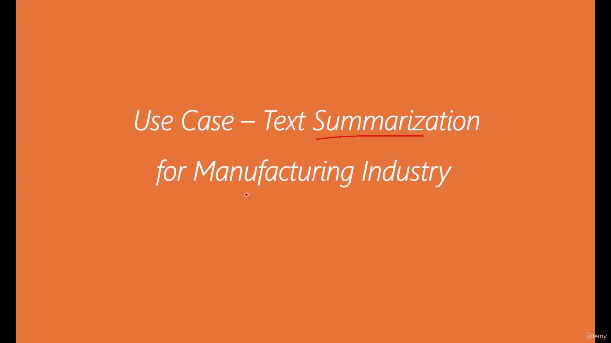
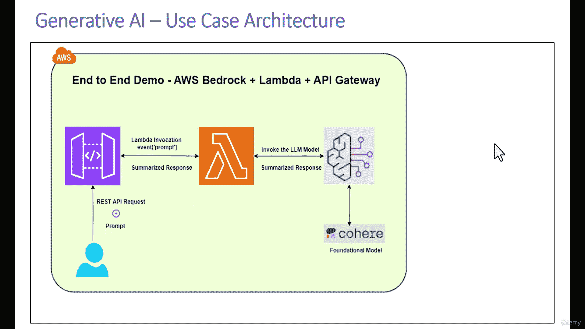

# 🚀 生成式AI on AWS（Amazon Bedrock、RAG 与 KIRO [2026] 第1部分）：第32–34节：文本摘要用例描述与架构




在本节课中，我们将要学习一个面向制造业的文本摘要用例，并理解它在 AWS 上对应的应用架构。这个用例的核心思路很直白：用基础模型的文本摘要能力，把冗长的事故报告压缩成重点信息，从而加快问题解决速度，提高技术员和服务经理的工作效率。我们会先看业务场景，再看系统由哪些服务组成，最后把一次请求从用户到模型再返回用户的流程完整走一遍。


## 🏭 制造行业文本摘要用例


概述之后，我们先把业务场景讲清楚。本用例关注的是制造业中的文本摘要，具体来说，是使用基础模型的文本摘要能力来加快问题解决速度，并提升技术员的生产力。这里的基础模型可以理解为一个已经经过大量训练的通用大模型，它能够阅读长文本并提取重点，而不是简单地删掉几句话。


这个用例适合大型设备制造商，例如生产水电设备或大型涡轮机的企业。下面把这类企业的典型故障处理场景按顺序列出来，方便初学者理解：


- 大型涡轮机通常部署在偏远地点，一旦发生故障，就需要技术员前往现场。
- 技术员到达现场后会拍摄照片，并生成一份事故报告，再把报告发送到为这个用途专门定制的应用程序中。
- 设备服务经理（原文中的 SM）可能位于全球任意地点，他会查看这些图片、事故报告以及其他数据点，用来帮助自己理解根本原因并提供解决方案。
- 问题在于，事故报告和其他数据点往往非常长，设备服务经理阅读起来会非常耗时。
- 一种可行的改进方案是：把详细的事故报告发送给基础模型，让基础模型对报告进行摘要，再把摘要返回给设备服务经理审阅，使他能在更短时间内做出决策。


上面的业务链路可以用一个简单公式来概括，核心概念如下：


```text
摘要结果 = 基础模型(事故报告 + 图片说明 + 其他数据点)
```


到这里，这个用例应该比较清楚了。它的价值不是替代服务经理做判断，而是先帮服务经理把长报告压缩成更容易快速阅读的版本，让决策时间变短。业务场景清楚后，本节我们来看看如果要构建这个应用，架构应该怎么设计。


## 🧱 应用架构总览


上一节我们介绍了制造业中的长报告阅读痛点，本节中我们来看看对应的应用架构。这个架构使用的是 Amazon Bedrock、AWS Lambda 和 API Gateway。下面的列表把架构中的主要角色和调用关系列出来，方便先建立整体印象：


- 全球任意地点的服务经理会调用 REST API，并提供一个提示（prompt）。
- 这个提示可以是事故报告，也可以是其他数据点，目的是帮助服务经理更快做出决策。
- REST API 被调用后，提示会作为事件传递给 Lambda 函数。
- Lambda 函数会调用 AWS Bedrock 服务，由 Bedrock 调用 Cohere 基础模型。
- 本用例选择 Cohere 基础模型来完成文本摘要。
- 输入的事故报告发送给基础模型后，基础模型会总结文本，并把摘要返回给 Lambda 函数。
- Lambda 函数再把响应返回给用户，也就是发起请求的服务经理。


也就是说，整个架构可以先用下面这段简化代码来描述：


```text
服务经理 -> REST API: 提交 prompt（事故报告 + 其他数据点）
REST API -> Lambda: 把 prompt 作为 event 传入
Lambda -> Bedrock: 请求调用 Cohere 基础模型
Bedrock -> Cohere 基础模型: 输入事故报告
Cohere 基础模型 -> Lambda: 返回摘要文本
Lambda -> 服务经理: 返回摘要响应
```


> 关键理解：API Gateway 负责对外提供 REST API，Lambda 负责承接请求并转发给 Bedrock，Bedrock 负责调用 Cohere 基础模型完成摘要。


架构总览之后，本节我们把一次请求的处理流程逐步展开。这样可以看到每个服务在链路中具体做什么，也能理解为什么这个方案适合把长报告快速变成短摘要。


## 🔁 请求处理流程


上一节我们介绍了 Bedrock、Lambda 和 API Gateway 组成的整体架构，本节中我们来看看一次请求从头到尾是怎么走的。下面的步骤列表按照调用顺序说明请求处理过程，初学者可以把它当作一条流水线来理解：


- 第一步，全球任意地点的服务经理调用 REST API，并提交一个提示。
- 第二步，这个提示可以是事故报告，也可以包含其他数据点，这些内容用于帮助服务经理更快决策。
- 第三步，REST API 被调用后，提示会作为事件传递给 Lambda 函数。
- 第四步，Lambda 函数调用 AWS Bedrock 服务，Bedrock 再调用 Cohere 基础模型。
- 第五步，输入的事故报告被发送到基础模型，基础模型对文本进行摘要。
- 第六步，基础模型把摘要文本返回给 Lambda 函数。
- 第七步，Lambda 函数把响应返回给用户，服务经理由此获得一份更短的报告内容。


把这些步骤合在一起，可以用下面这个公式再次概括请求链路：


```text
用户响应 = Lambda( Bedrock( Cohere_FM(事故报告 + 其他数据点) ) )
```


这样，一次请求就完成了从服务经理提交长报告，到基础模型生成摘要，再到服务经理收到摘要的完整闭环。到这里，用例和架构都应该比较清楚了，下节课我们继续学习后面的内容。


## ✅ 总结




本节课中我们一起学习了制造业文本摘要用例以及它在 AWS 上的应用架构。我们了解到，大型涡轮机等设备可能部署在偏远地点，技术员现场生成的事故报告可能很长，设备服务经理阅读这些报告和其他数据点会非常耗时；因此可以把详细报告交给基础模型做摘要，让服务经理更快审阅并做出决策。架构上使用 API Gateway 提供 REST API，用 Lambda 承接提示事件并调用 Bedrock，再由 Bedrock 调用 Cohere 基础模型完成摘要，最后把摘要响应返回给用户。核心公式是“摘要结果 = 基础模型(事故报告 + 其他数据点)”，核心链路是“服务经理 → REST API → Lambda → Bedrock → Cohere 基础模型 → Lambda → 服务经理”。下节课继续。

