# 🚀 Udemy - Generative AI on AWS - Amazon Bedrock, RAG & KIRO [2026]：第33-35节：创建 AWS Lambda 函数


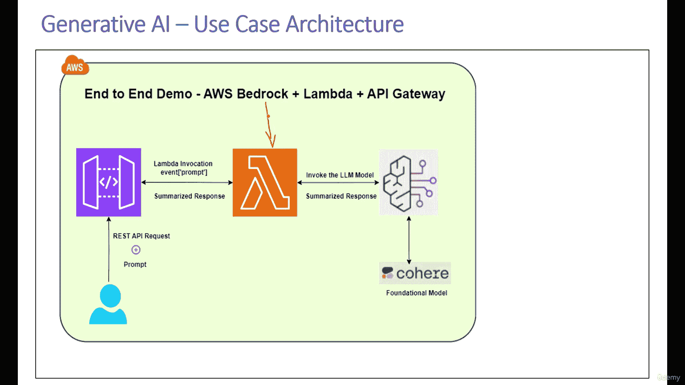

在本节课中我们将要学习在 AWS 控制台创建 Lambda 函数，并完成编码前的先决条件检查。具体会创建名为 `DemoManufacturing` 的函数，确认 Amazon Bedrock 中 Cohere 基础模型的访问权限，检查 `boto3` 版本，导入 `boto3` 并部署，最后配置测试事件验证运行环境。


## 🛠️ 第1步：创建 Lambda 函数


首先要做的是编写 Lambda 函数，因此需要进入 AWS 控制台开始创建。Lambda 是 AWS 提供的计算服务，创建函数的入口在控制台里，进入控制台后直接搜索 Lambda 就能找到。下面是创建 Lambda 函数时需要完成的操作：

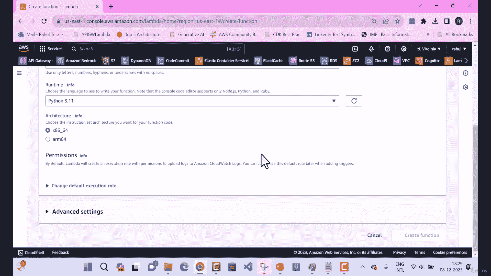

- 在 AWS 控制台搜索 Lambda。
- 进入 Lambda 控制台。
- 选择创建函数。
- 将函数名称填写为 `DemoManufacturing`。
- 将运行时选择为 `Python 3.11`。
- 执行创建函数操作。


```text
函数名称：DemoManufacturing
运行时：Python 3.11
```


完成这些操作后，Lambda 函数就处于就绪状态。不过，在开始为这个 Lambda 函数编写代码之前，还需要满足几个先决条件，下面进入先决条件检查部分。


## 📋 第2步：检查编码前的先决条件


Lambda 函数创建完成后，不能马上写代码，因为还需要确认访问 Amazon Bedrock 所需的条件。在开始编码前，需要确认以下先决条件：

- 在 Amazon Bedrock 服务中拥有对 Cohere 基础模型的访问权限。上一节在媒体娱乐行业用例中讨论过这个先决条件，并展示了如何获取访问权限。
- 升级 `boto3`。这个步骤现在不再需要，但为了确认每个区域都已实现，需要快速检查 `boto3` 版本。如果版本大于 `1.28.63`，则不需要升级。


> 判断条件：`boto3_version > 1.28.63`  
> 结论：无需升级 `boto3`。


这两个条件里，第一个条件决定能否调用 Cohere 基础模型；第二个条件只是版本确认，当前环境中通常不需要额外升级。先决条件确认后，就可以回到 Lambda 函数中编写代码并部署。


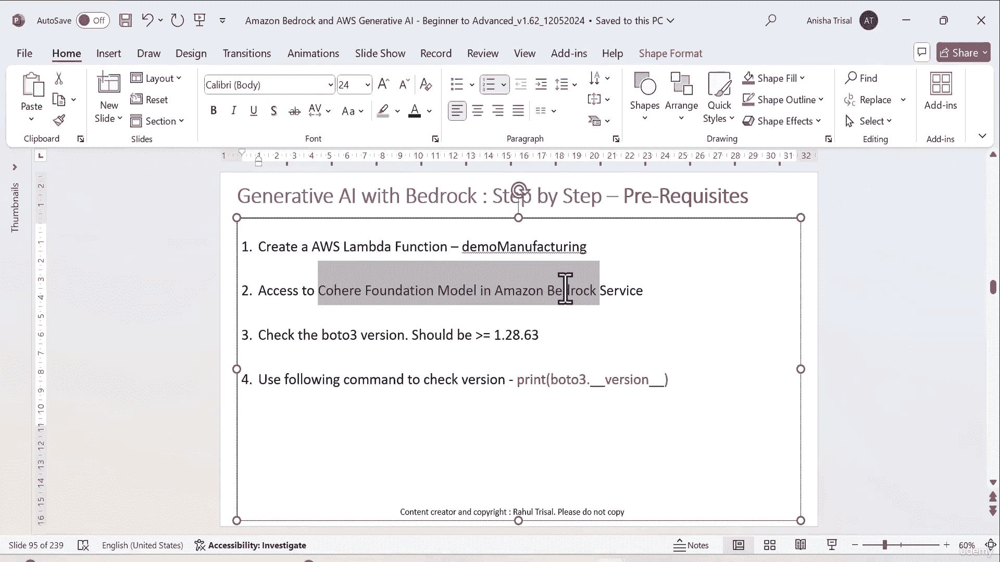

## 💻 第3步：编写并部署 Lambda 函数


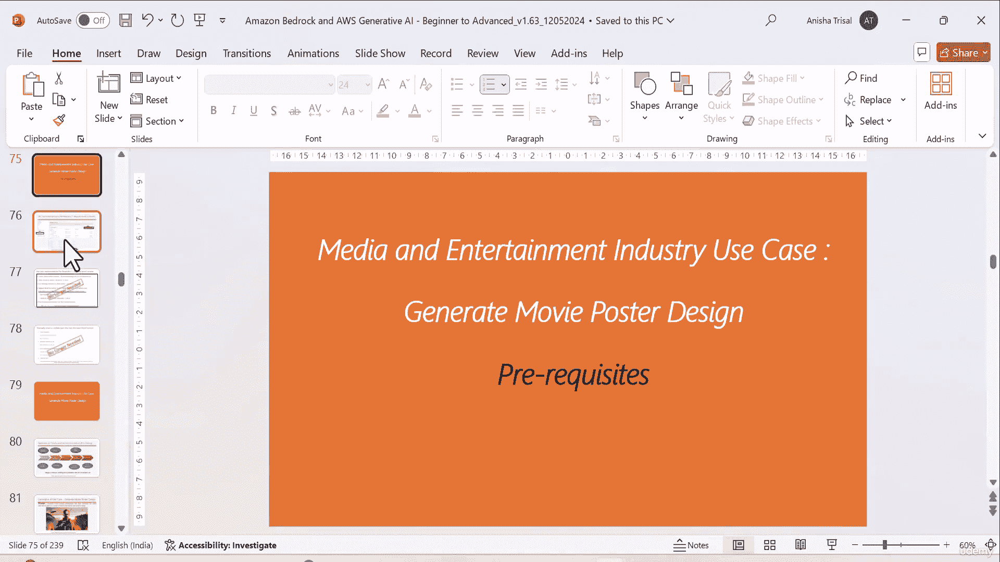

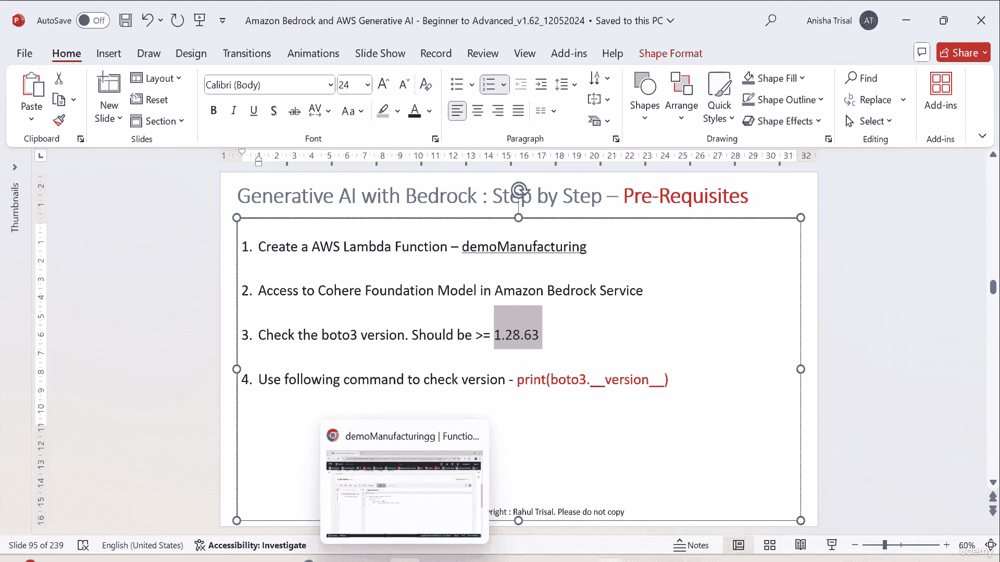

先决条件检查完成后，接下来进入 Lambda 函数代码编辑区，完成导入和部署。下面是编写和部署 Lambda 函数时需要完成的步骤：

- 导入 `boto3`。
- 回到幻灯片复制对应命令。
- 将命令粘贴到 Lambda 代码中。
- 执行部署。


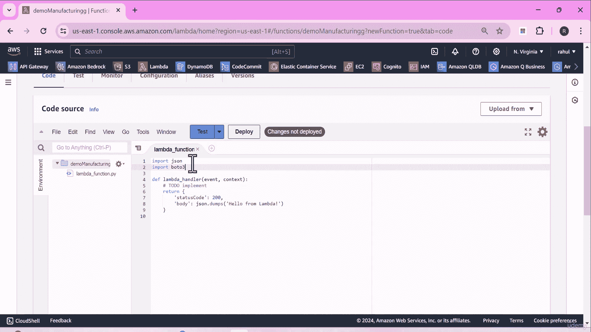

```python
import boto3
```


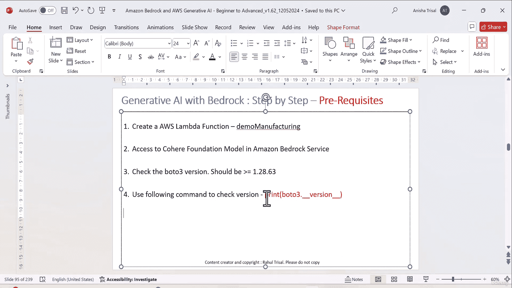

`boto3` 是用于访问 AWS 服务的 Python SDK，因此 Lambda 函数需要通过它来访问 AWS 服务。完成粘贴后执行部署，Lambda 函数就已经部署完成。代码部署完成后，还需要通过测试事件验证运行环境，尤其是确认 `boto3` 版本是否满足要求。


## 🧪 第4步：配置测试事件并验证结果


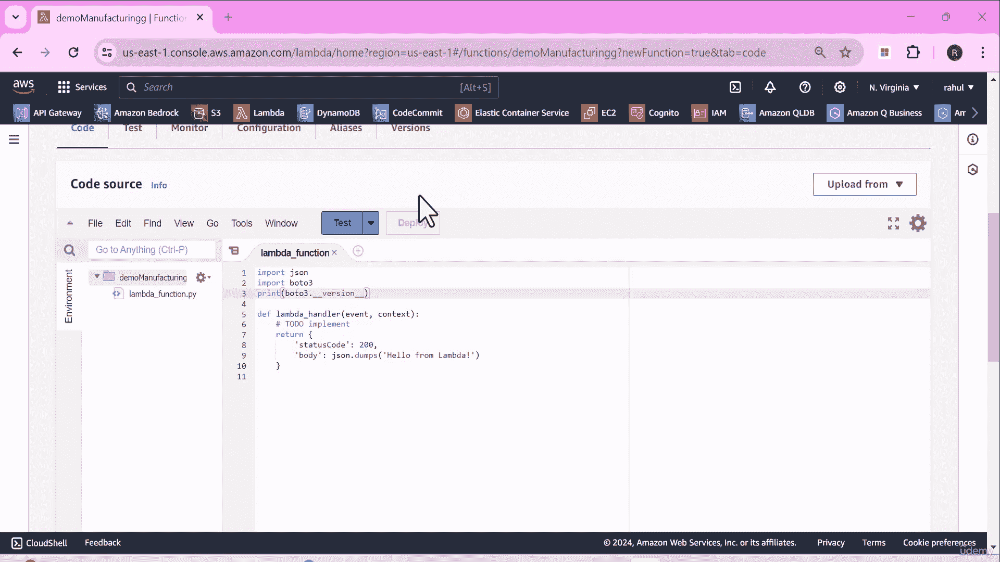

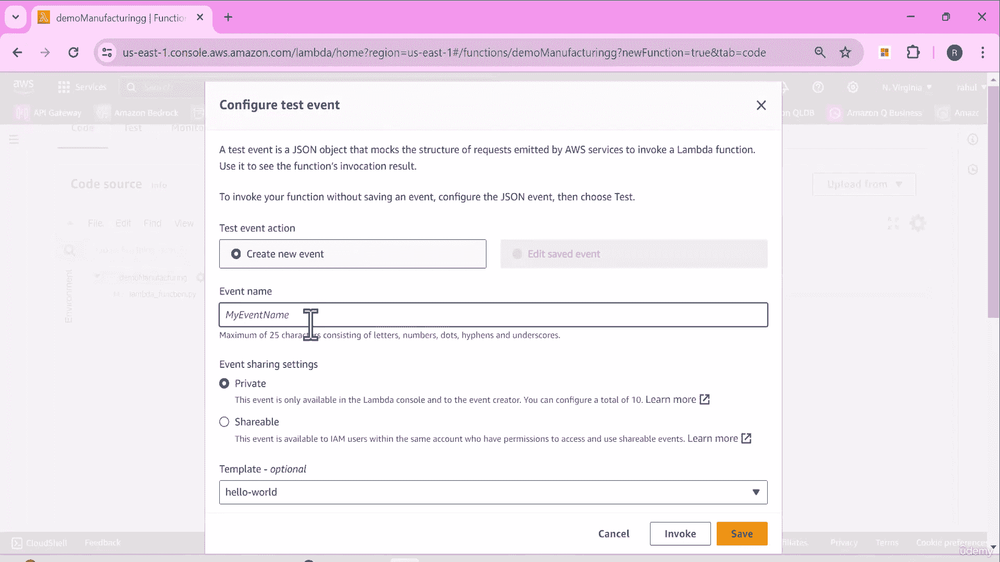

部署完成后，需要给 Lambda 函数配置一个测试事件，并运行测试查看日志。下面是配置测试事件并验证运行结果的步骤：

- 配置测试事件。
- 将测试事件名称设为 `test`。
- 保存测试事件。
- 运行测试。
- 在函数日志中查看 `boto3` 版本。


> `1.34.42 > 1.28.63`  
> 因此满足从 Lambda 函数访问 Amazon Bedrock 的要求。


日志显示 `boto3` 版本为 `1.34.42`，大于 `1.28.63`，说明当前 Lambda 函数可以直接访问 Amazon Bedrock，不需要对 Lambda 函数做任何更改。到这里，本节的操作就完成了，下节课见，谢谢。


## 📌 总结


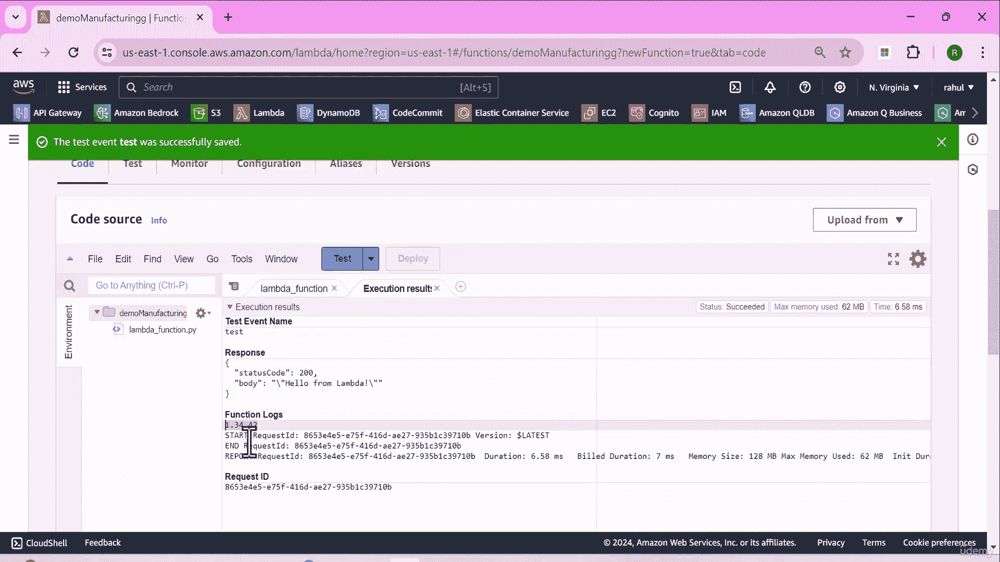

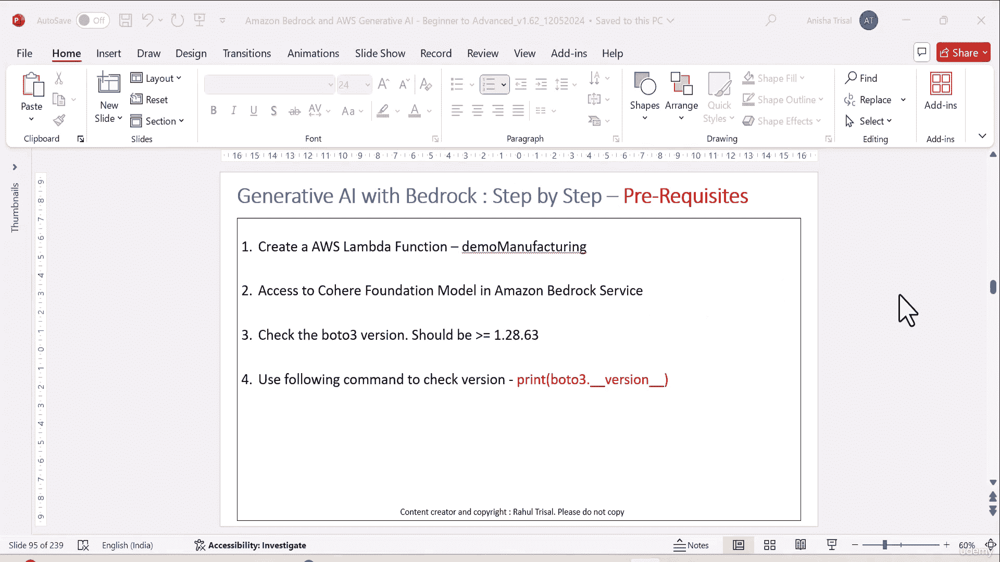

本节课中我们一起学习了在 AWS 控制台创建 Lambda 函数，确认 Amazon Bedrock 中 Cohere 基础模型的访问权限，检查 `boto3` 版本，导入 `boto3` 并部署函数，最后通过测试事件验证版本。按照这些步骤，Lambda 函数已经具备访问 Amazon Bedrock 的基础条件。

