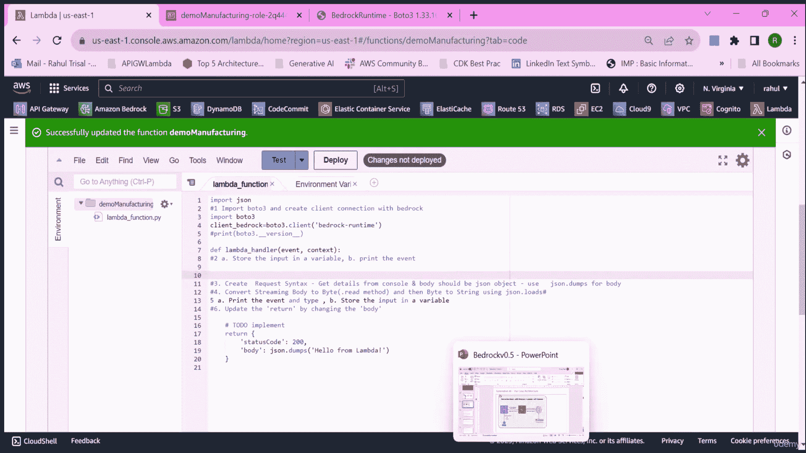
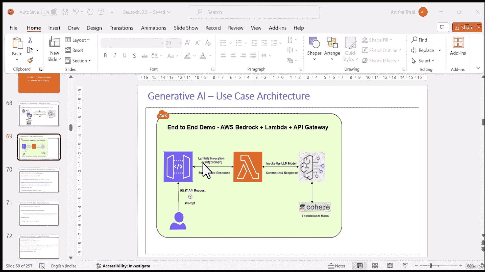
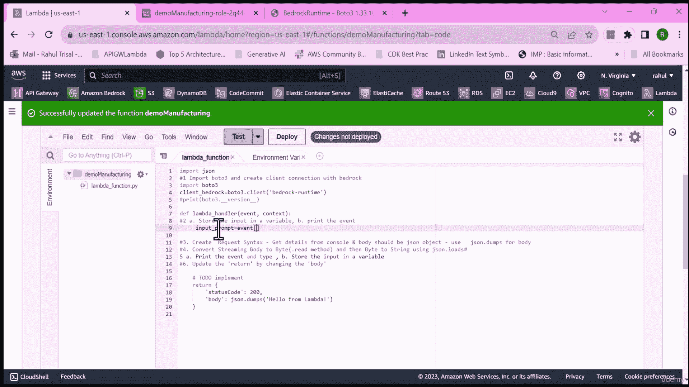
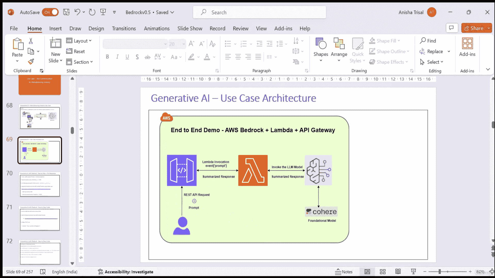
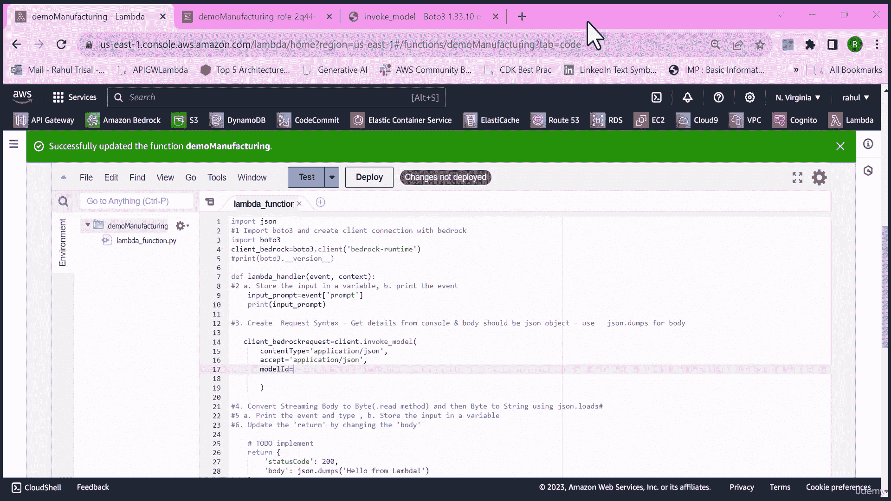
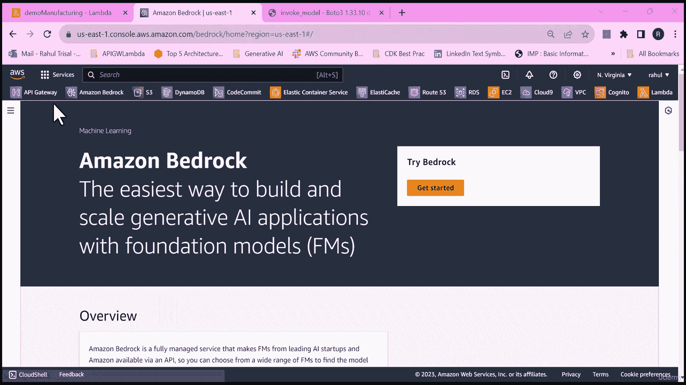
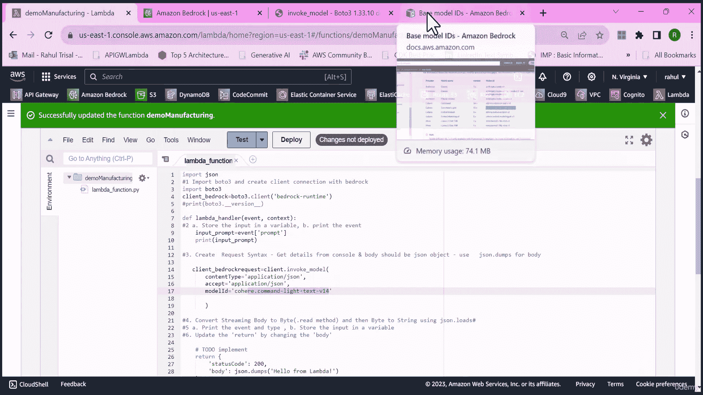

# 🤖 生成式AI on AWS：第34节：编写 Lambda 函数连接 Bedrock 服务（上）

## 📖 概述

本节课中，我们将学习如何编写一个 AWS Lambda 函数，并用它连接 Bedrock 服务。整个过程中，我们需要先准备好 IAM 角色权限和合适的超时时间，再编写函数代码。代码部分会包括导入 boto3、创建客户端连接、读取输入事件，以及构造模型调用请求。通过这节课，你可以掌握将 Lambda 与 Bedrock 连接起来的基础流程，为后续构建生成式 AI 应用打下基础。

## 🛠️ 1. 准备工作：IAM 角色与超时配置

上一节我们完成了相关的预备工作，本节中我们来看看实际编写 Lambda 函数时，第一步需要做什么。我们要做的第一件事是创建一个 IAM 角色，并增加这个 Lambda 函数的超时时间。如果你直接使用 AWS 控制台，可以通过以下步骤完成设置。

### 1.1 配置 IAM 角色权限

为了让 Lambda 函数能够调用 Bedrock 服务，我们需要为 Lambda 默认创建的那个角色添加一个权限策略。以下是具体的操作步骤：

- 打开 AWS Lambda 控制台，进入你创建的 Lambda 函数页面。
- 点击“配置”选项卡，然后点击“角色名称”链接。这个角色是创建 Lambda 函数时自动生成的默认角色。
- 在角色详情页面中，选择“添加权限”，再选择“附加策略”。
- 在搜索框中输入“bedrock”，你会找到一个名为“AmazonBedrockFullAccess”的策略。
- 选中这个策略，点击“添加权限”，完成策略附加。

需要说明的是，几周前 AWS 还没有任何与 Amazon Bedrock 相关的现成策略，但现在已经有对应的全访问策略了，所以我们可以直接使用。附加完成后，页面上会显示该策略已经成功附加到这个角色上。这样，Lambda 就拥有了调用 Bedrock 服务所需的权限。

### 1.2 增加 Lambda 超时时间

拥有了权限之后，我们还需要调整 Lambda 的超时时间。为什么要调整呢？因为 Lambda 的默认超时时间只有 3 秒。当函数需要访问 Bedrock 基础模型时，模型推理往往需要更长的时间，3 秒很容易导致请求超时。为了留出足够的等待时间，我们可以把超时时间增加到 1 分钟 3 秒。具体操作如下：

- 回到 Lambda 函数的控制台页面，点击“配置”选项卡。
- 在左侧菜单中点击“通用配置”，找到“超时”设置。
- 把超时时间从 3 秒改为 1 分 3 秒。
- 点击“保存”，完成超时时间的更新。

到这里，我们认为已经完成了大部分预备工作。接下来，我们就正式进入代码编写环节，看看怎么让 Lambda 函数真正调用 Bedrock。

## 🧩 2. 编写 Lambda 函数代码

现在，我们开始编写 Lambda 函数的代码。在编写之前，你可以点击视频描述中的文档链接，也可以直接在浏览器中搜索“boto3 bedrock”，这两种方式都会把你带到同一个文档页面。搜索官方文档是一个很实用的习惯，遇到不清楚的 API 时，查阅文档可以帮助你快速找到答案。如果你跟着本视频学习，可以按照我下面整理的步骤来操作；如果你希望先自己练习，也可以先看这些详细步骤，然后自己尝试编写代码。

下面这段内容，我会把整个代码步骤拆解开来，逐一讲解。

### 2.1 导入 boto3 并创建客户端

第一件要做的事，是导入 boto3 库。不过在之前的练习中，我们已经通过打印版本号的方式导入过 boto3 了，所以这一次并不需要重新导入。原来用于打印版本号的那行代码，我认为不再需要，直接把它注释掉就好。完成导入之后，接下来的重要一步是创建与 Bedrock 的客户端连接。只要你使用 boto3 和 Lambda，这一步就是必须的。我们来看一下具体怎么写。

首先，我们需要定义一个变量名，这个变量名可以随便起，比如我叫它 `bedrock_client`。然后，我们调用 `boto3.client` 方法，并传入服务名称。这里使用的库是 boto3，服务名称则是 `bedrock-runtime`。最终代码就像下面这样：

```python
import boto3

bedrock_client = boto3.client('bedrock-runtime')
```





上面的代码完成之后，我们就已经创建好了一个 Bedrock 客户端的连接。在客户端创建完毕后，接下来要处理的就是 Lambda 函数的事件输入。



### 2.2 存储输入事件并打印



现在，我们来看第二步。在 Lambda 函数中，系统会自动创建一个名为 `lambda_handler` 的函数，它接收两个参数：`event` 和 `context`。其中，`event` 是 Lambda 函数获取到的提示词或外部输入；`context` 则包含了与 Lambda 函数相关的所有参数，比如超时时间、内存大小等等。

让我们先通过一个简单的例子理解 `event` 的含义。在真实的应用场景中，用户调用 REST API 时，会携带一个提示词。这个提示词会通过 API Gateway 传递给 Lambda 函数，并且在 Lambda 函数中表现为 `event`。这就是我们所说的“事件”。明白了这一点之后，我们可以把输入保存到一个变量中，然后把它打印出来，确保我们接收到的是正确的数据。

在代码中，我们把 `event` 里键名为 `prompt` 的值取出来，并存到 `input_prompt` 变量中，然后打印。你可以把键名换成任何你喜欢的名字，但使用 `prompt` 这个词在逻辑上更直观，也方便理解。具体代码如下：

```python
def lambda_handler(event, context):
    input_prompt = event['prompt']
    print(input_prompt)
```

打印语句的作用是让我们在测试时能够清楚看到函数接收到的输入，从而确认整个流程是否正确。接下来，我们就部署这段代码，并进行一次测试。

### 2.3 配置测试事件并验证

部署完代码后，我们还需要配置一个测试事件，然后才能运行测试。在 AWS Lambda 中，测试事件是一个 JSON 格式的输入。我们必须按照代码里指定的格式来提供这个测试事件。也就是说，事件中需要包含一个 `prompt` 字段。例如，我们可以这样配置：

```json
{
    "prompt": "hello, how are you"
}
```

配置好测试事件后，先保存，然后返回代码编辑器。需要留意代码的缩进是否正确，确保代码整体格式没问题后，点击“部署”按钮。接着，我们点击“测试”按钮，执行一次测试。测试完成后，你会看到函数返回了一个响应。打开函数日志，你会看到我们设置的测试事件内容，也就是 `hello, how are you`。这说明测试事件已经成功传入了 Lambda 函数，也说明我们读取输入事件的功能是正常的。

## 📨 3. 构造调用 Bedrock 的请求

既然我们已经成功接收了外部输入，下一步就是构造调用 Bedrock 服务的请求。其实这一步才是关键，因为它决定了我们最终能否从模型那里拿到想要的结果。接下来，我们看看请求语法到底是什么样的。

### 3.1 请求语法解析

我们再次回到官方文档，找到 `invoke_model` 方法。这里展示的就是向 Bedrock 服务发送请求并获得响应的格式。简单来说，我们会定义一个变量 `response`，模型的输出会存储在这个变量中。然后，我们调用 `client.invoke_model` 方法，这个方法有四个参数。我先把代码框架写出来，再逐个解释参数：

```python
response = bedrock_client.invoke_model(
    contentType='application/json',
    accept='application/json',
    modelId='cohere.command-light-text-v14'
)
```

下面，我们仔细看看这四个参数分别是什么：

- `body`：请求体，它必须是字节类型或类文件对象。这个参数是必填的，我们稍后会补上具体的内容。
- `contentType`：请求中输入数据的 MIME 类型，默认值是 `application/json`，我们继续使用这个默认值就好。简单来说，它告诉 AWS 我们发送的数据是 JSON 格式。
- `accept`：表示你希望发送请求的格式，同样默认是 `application/json`。如果你不添加这个参数，其实也不会有什么问题，因为它不是必填项。
- `modelId`：基础模型的唯一标识。这个参数是必填的，它帮助 AWS Bedrock 服务定位到正确的基础模型。也就是说，通过 `modelId`，AWS 才能确定你要调用的是 Cohere、Jurassic、Stability AI，还是其他模型。

所以，在构造请求时，我们至少需要提供 `body` 和 `modelId`，而 `contentType` 和 `accept` 通常保持默认值即可。



### 3.2 获取模型 ID 的两种方法



对于初学者来说，最困惑的地方往往是如何获取 `modelId`。这里有两种常用的方法，你可以任选其一。

- **第一种方法：从 Bedrock 控制台获取。** 进入 Bedrock 控制台，因为我们这里处理的是文本任务，所以我选择“文本生成”下的模型。我选择了 Cohere 模型，然后使用 `command light` 这个版本，因为它比较便宜，适合做测试。在控制台里，我们可以输入一些测试内容，比如输入 `hello`。输入完成后，点击右侧的三个点菜单，然后选择“查看请求”（View request）。在弹出的请求示例中，你就能看到 `modelId` 的具体值，直接复制它就可以。
- **第二种方法：通过搜索引擎查找。** 如果控制台界面变化导致你找不到入口，也可以在浏览器中搜索“Bedrock Cohere model id”。搜索结果里通常能找到官方文档，进入文档后向下滚动，找到 Cohere 相关的模型列表。你会看到 Cohere 和 Cohere Light 这样的模型名称，对应的 `modelId` 就在旁边。这里的 `modelId` 和我们从控制台复制到的基本一致。

有一点要特别提醒你：Bedrock 的控制台界面是不断变化的，因为 AWS 一直在持续添加新的模型和功能。所以，如果你在界面上找不到某个按钮或入口，不用着急，直接搜索文档往往是最快的方法。我们这里看到的模型 ID 就类似 `cohere.command-light-text-v14` 这样的字符串，把它作为字符串填到代码里就可以了。

## ✅ 总结



本节课中，我们一起学习了如何编写一个 AWS Lambda 函数并连接 Bedrock 服务。首先，我们配置了 IAM 角色权限，为 Lambda 绑定了 Bedrock 的全访问策略，并把函数的超时时间从默认的 3 秒延长到 1 分钟 3 秒。然后，我们编写了第一版代码，包括导入 boto3、创建 `bedrock-runtime` 客户端、从事件中读取 `prompt` 并打印。接着，我们配置了 JSON 格式的测试事件，成功验证了输入传递。最后，我们拆解了 `invoke_model` 的请求语法，介绍了 `body`、`contentType`、`accept` 和 `modelId` 这四个参数的作用，并学习了如何通过控制台或文档获取模型 ID。在下一节中，我们会继续完善这里留下的代码，具体补上 `body` 参数，并真正调用一次 Bedrock 模型。希望这节课能够帮你建立一个清晰的思路，让你对接下来的动手实践更有信心。

