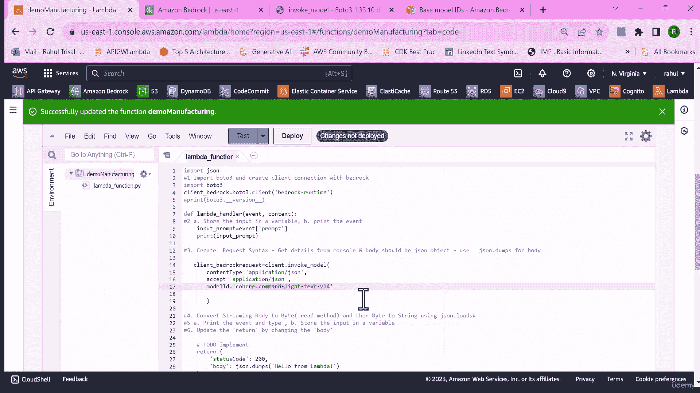

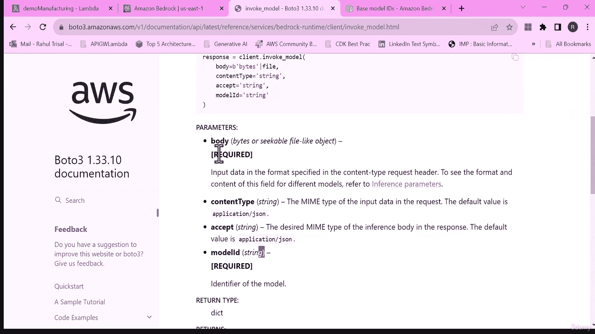

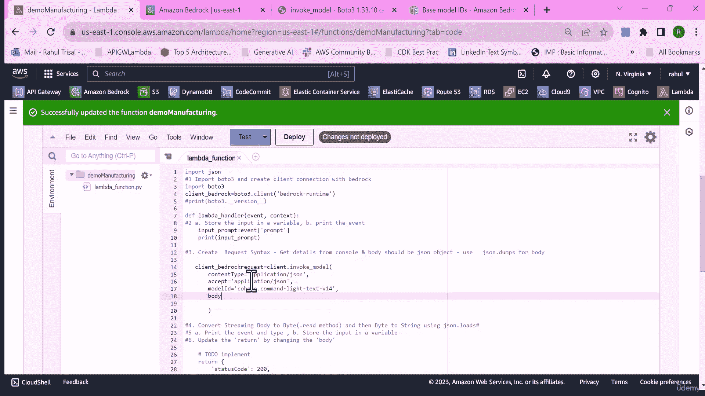

# 🚀 AWS生成式AI实战：第35-37讲：编写连接Bedrock服务的Lambda函数（二）

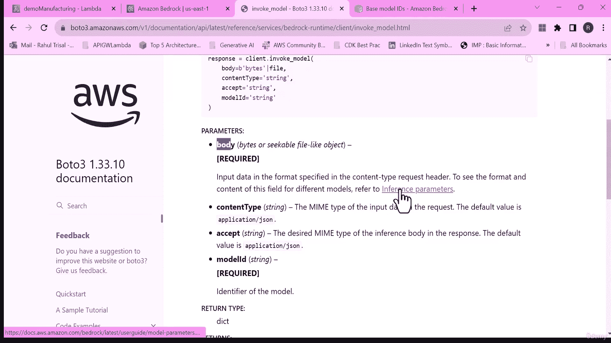

在本节课中我们将学习如何把AWS Lambda函数连接到Amazon Bedrock服务，重点补齐调用Cohere模型所需的请求体，配置推理参数，处理Bedrock返回的流式响应，并最终从响应中提取出可返回给API Gateway的文本结果。上一节已经完成了Lambda函数的基础连接部分，本节继续把请求和响应流程补完整，让函数能够真正返回模型生成的回答。

## 🧩 AWS生成式AI实战：第35-37讲-1：补齐请求体并查看Cohere推理参数

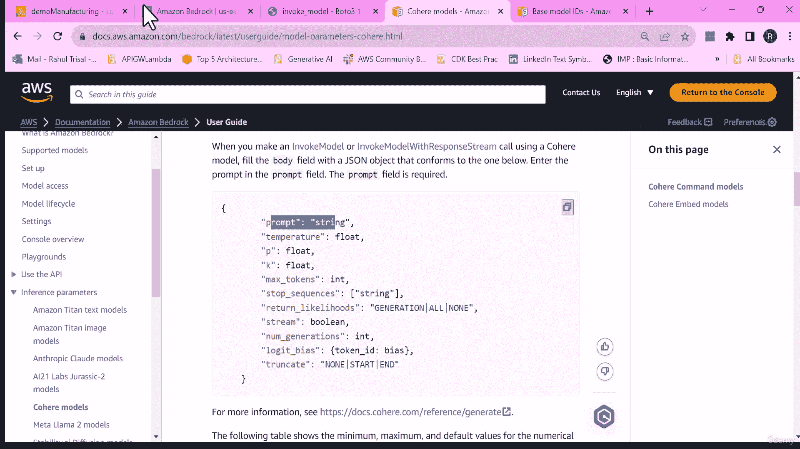

上一节我们介绍了如何准备调用Bedrock的基本结构，本节中我们来看看请求体中的`body`字段应该怎么填写。打开Bedrock文档后，点击推理参数页面，再向下滚动到Cohere模型部分，文档会展示请求语法。调用`invoke_model`方法时，`body`字段需要填入符合文档示例的JSON对象。文档中说明`prompt`字段是必填字段，其他字段可以按需添加，因此我们先把示例复制出来，再粘贴到Lambda代码中。

下面列出这一部分需要关注的核心信息。

- `invoke_model`调用中的`body`必须是符合文档格式的JSON对象。
- `prompt`是必填字段，而且它是一个字符串。
- 我们的提示词保存在`input_prompt`变量中，因此请求体里的`prompt`要引用这个变量。
- 原文中提到下划线写错的问题，需要把变量名修正为`input_prompt`。

可以用下面的代码结构理解请求体的基本形态。

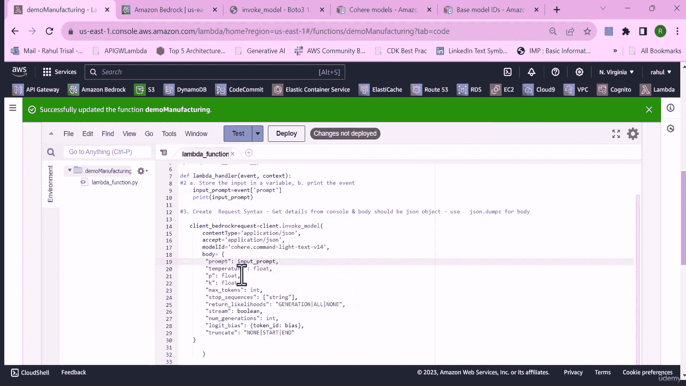

```python
body = {
    "prompt": input_prompt
}
```

到这里，请求体中最关键的必填字段已经明确。接下来需要把温度、采样参数和最大令牌数等可选参数加进去，让模型输出的风格和长度更可控。

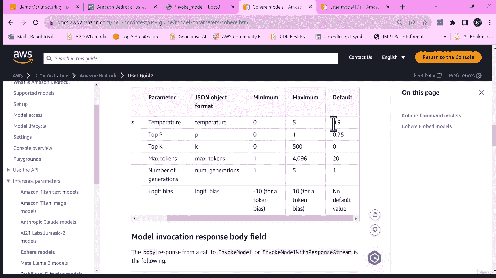

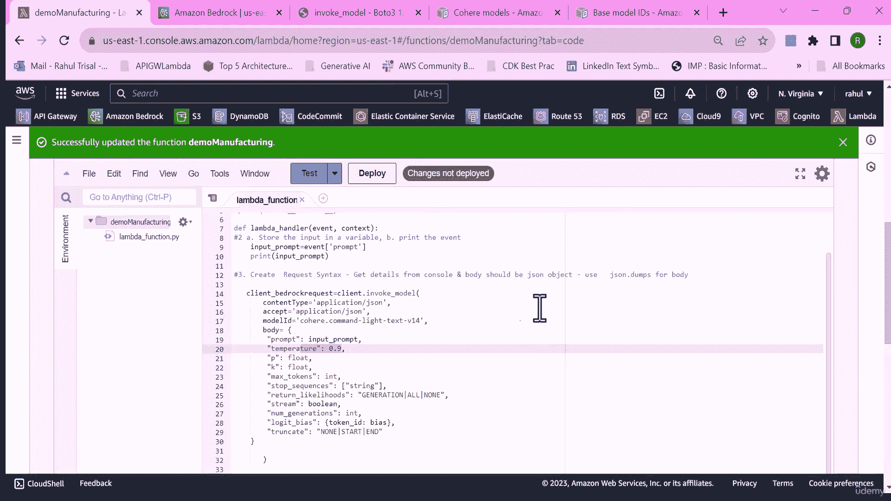

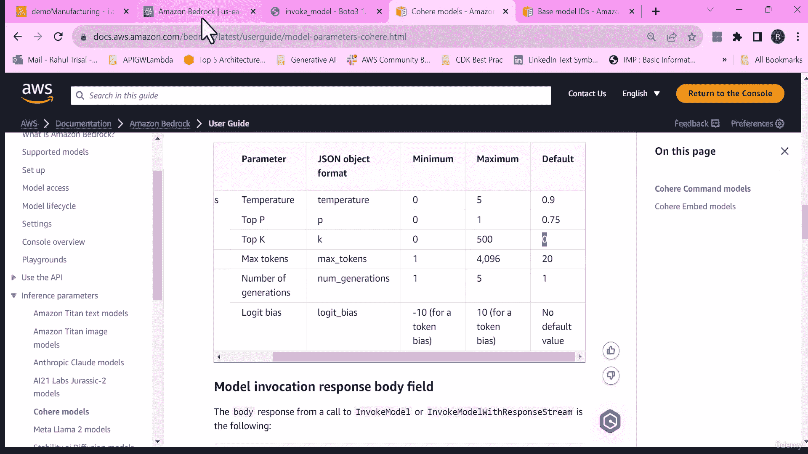

## 🧱 AWS生成式AI实战：第35-37讲-2：设置推理参数并控制响应

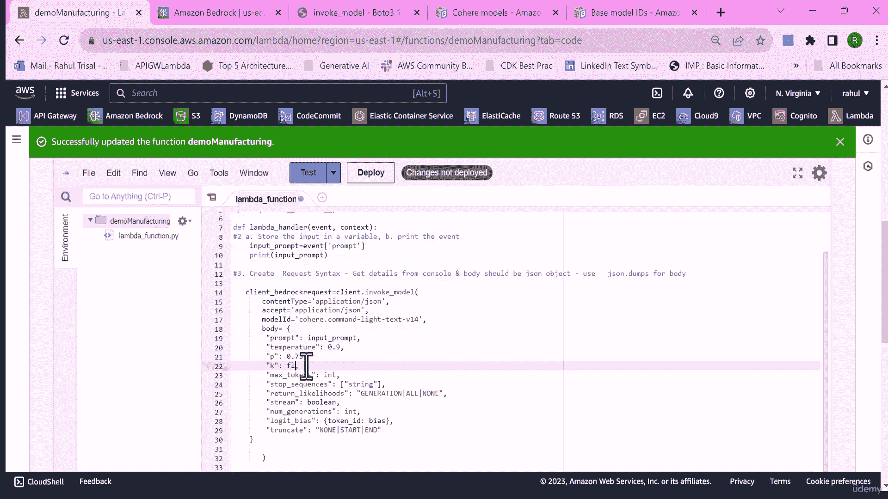

上一节我们确认了`prompt`是必填字段，本节中我们来看看如何设置推理参数。课程前面已经详细讨论过`temperature`、`top_p`、`top_k`和`max_tokens`等参数的含义，文档也会给出每个参数的最小值、最大值和默认值。`temperature`会影响回答的随机性，`top_p`和`top_k`会影响候选词的采样范围，如果不熟悉这些参数，可以回到上一节复习。

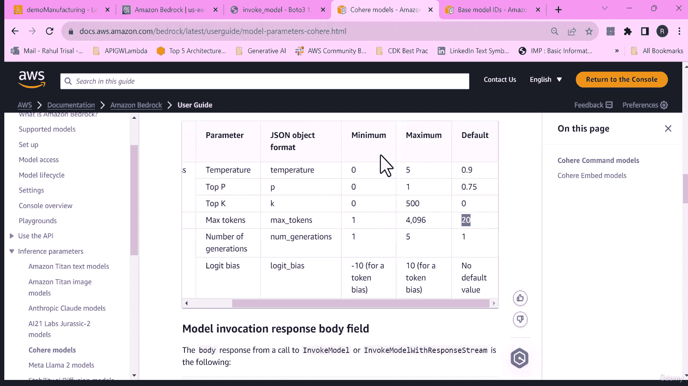

下面列出本示例中实际设置的参数。

- `temperature`设置为`0.9`，它是浮点数，也是文档示例中的默认值。
- `top_p`设置为`0.75`。
- `top_k`设置为`0`，原文中对应的是默认值。
- `max_tokens`设置为`100`，Cohere Light模型的最小值是`1`，最大值是`4096`，默认值是`20`。
- 原文中提到的`top_seconds`、`return_likelihoods`等字段不重要，本示例直接忽略。


`max_tokens`会影响调用成本，因此需要谨慎设置。这里设置`100`是为了让返回内容更有意义，而不是只返回很短的一句话。可以把请求体写成类似下面的形式，具体字段名以Cohere文档示例为准。

```python
body = {
    "prompt": input_prompt,
    "temperature": 0.9,
    "p": 0.75,
    "k": 0,
    "max_tokens": 100
}
```

只传`prompt`也能完成调用，但为了演示参数变化对输出的影响，我们显式传入这些参数。参数准备完成后，下一步是把Python字典转换成Bedrock要求的JSON字符串。

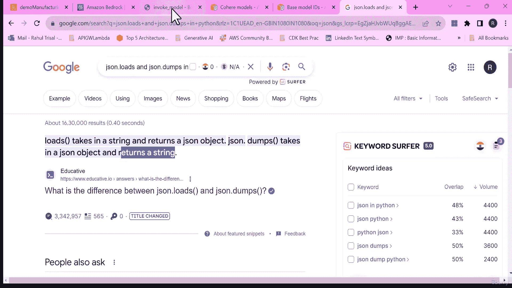

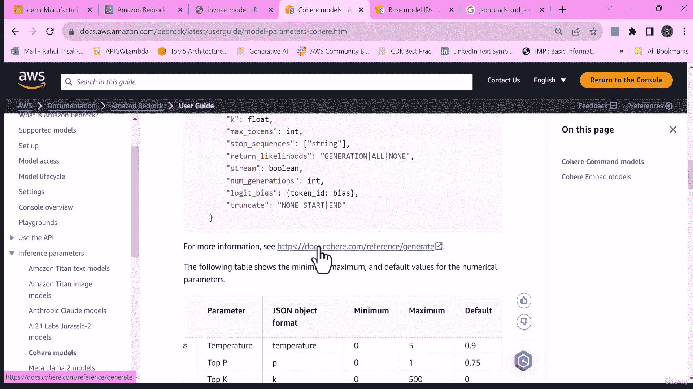

## 📦 AWS生成式AI实战：第35-37讲-3：使用json.dumps序列化请求体

上一节我们设置好了推理参数，本节中我们来看看如何把请求体转换成Bedrock能接收的格式。文档说明`body`需要是JSON对象，而在Python代码中我们通常先写字典，再用`json.dumps`把字典转换成JSON字符串。这里需要区分`json.loads`和`json.dumps`：`json.loads`接收字符串并返回Python对象，`json.dumps`接收Python对象并返回字符串。

下面列出这两个函数的核心区别。

- `json.loads`用于把字符串解析成字典或列表等Python对象。
- `json.dumps`用于把字典或列表等Python对象转换成字符串。
- 调用Bedrock时，`body`通常需要传入`json.dumps`处理后的字符串。

核心转换关系可以用下面的公式表示。

```python
body_string = json.dumps(body)
```

如果对这两个函数不熟悉，可以查阅文档或搜索资料。文档通常会明确说明需要传入字符串还是JSON对象，因此转换方向要以文档为准。请求体序列化完成后，还需要检查代码语法和变量名，再部署测试。

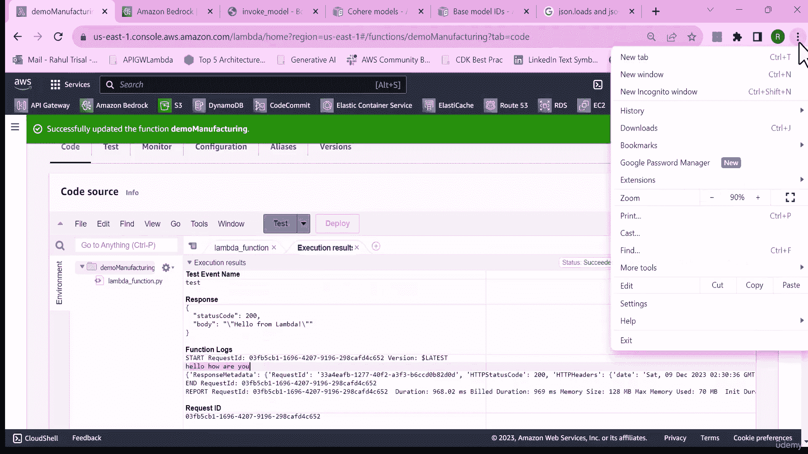

## 🛠️ AWS生成式AI实战：第35-37讲-4：修复语法与变量名并首次部署测试

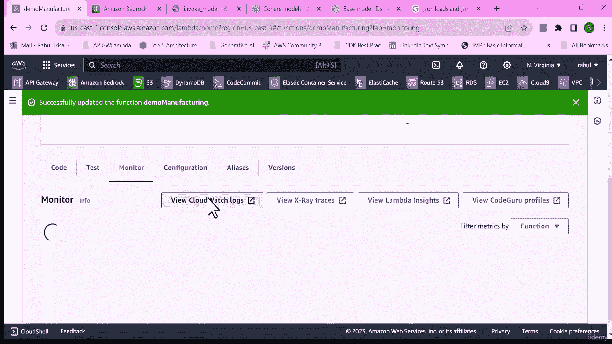

上一节我们完成了请求体的序列化，本节中我们来看看如何修复代码细节并部署测试。需要把相关代码调整到同一行，避免出现语法错误，同时检查括号是否成对。原文中提到有一个多余的右括号，因为整个`body`已经有一个闭合括号，所以需要把重复的括号删掉。完成这些调整后就可以部署Lambda函数并进行测试。

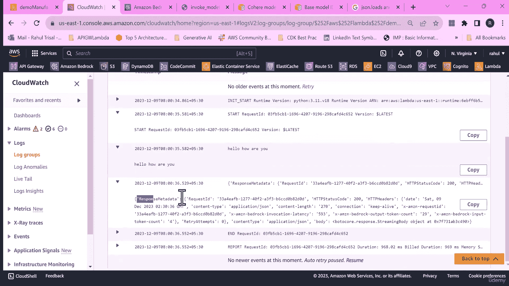

下面列出首次部署时需要检查的要点。

- 检查括号是否完整，避免`SyntaxError`。
- 检查变量名是否一致，原文报错`client is not defined`，原因是代码中定义的是`client_bedrock`，但调用时写成了`client`。
- 把变量统一改成`client_bedrock`后重新部署。
- 在部署前打印`input_prompt`和完整响应，方便确认请求和返回内容。

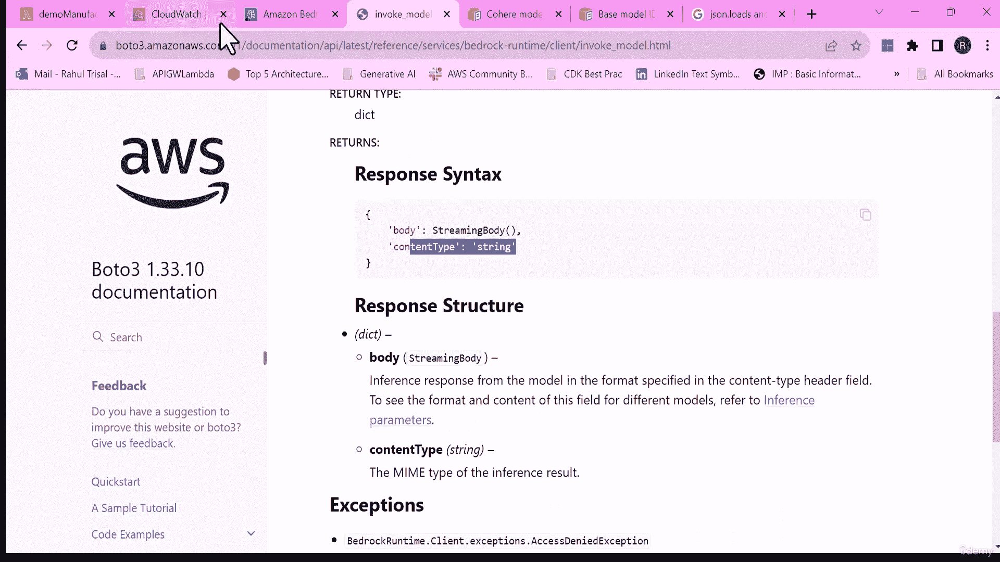

可以用下面的代码先打印提示词和响应。

```python
print(input_prompt)
print(response)
```

部署后测试时输入`Hello, how are you`，可以在CloudWatch日志中看到提示词和Bedrock返回的完整响应。响应中包含响应元数据、`content_type`和`body`等字段，其中`body`是一个流式响应对象。下一步需要只取出`body`字段，再把它转换成可处理的字节内容。

## 🔍 AWS生成式AI实战：第35-37讲-5：识别StreamingBody并提取body字段

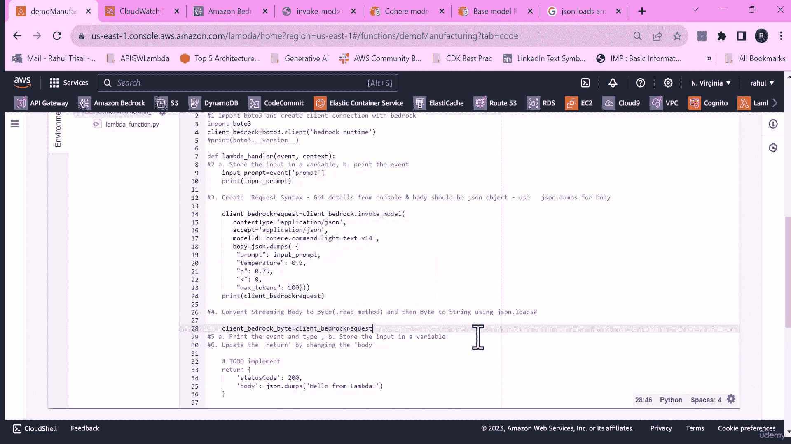

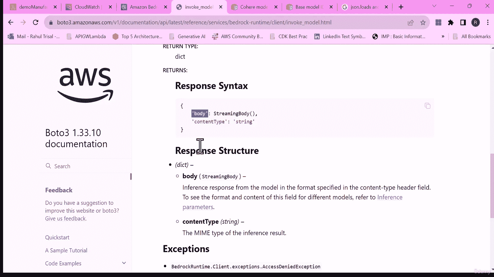

上一节我们看到Bedrock返回了完整响应，本节中我们来看看如何从响应中提取真正需要的内容。Bedrock响应是一个字典，可以通过键来取值，文档中也用括号和说明表示它是字典结构。这里需要取出的键是`body`，而`body`对应的是一个StreamingBody对象，不是普通字符串。

下面列出这一部分的关键操作。

- 响应对象是字典，使用`response["body"]`取出`body`字段。
- `body`是流式响应对象，需要调用`read()`方法读取内容。
- `read()`返回的是字节数据，后续还需要转成字符串或解析成字典。
- 如果不熟悉字典和列表取值，可以查看课程最后附带的Python复习内容。

核心代码可以写成下面的形式。

```python
response_body = response["body"]
raw_bytes = response_body.read()
```

可以先打印`type(raw_bytes)`确认当前类型。原文测试时显示类型是`bytes`，说明读取出来的是字节数据。接下来需要把字节转换成字符串或可解析的对象，并从CloudWatch日志中观察`generations`和`text`等结构。

## 🔄 AWS生成式AI实战：第35-37讲-6：从字节转换到可解析对象

上一节我们取出了`body`并读取成字节，本节中我们来看看如何把字节转换成可解析的内容。原文中先打印完整响应，再只打印`body`，为了减少干扰，可以把打印完整请求和完整响应的代码注释掉，只保留需要观察的部分。部署后再次测试，CloudWatch日志中可以看到`body`内部包含`generations`等字段，最终文本位于`text`字段中。

下面列出字节转换的处理思路。

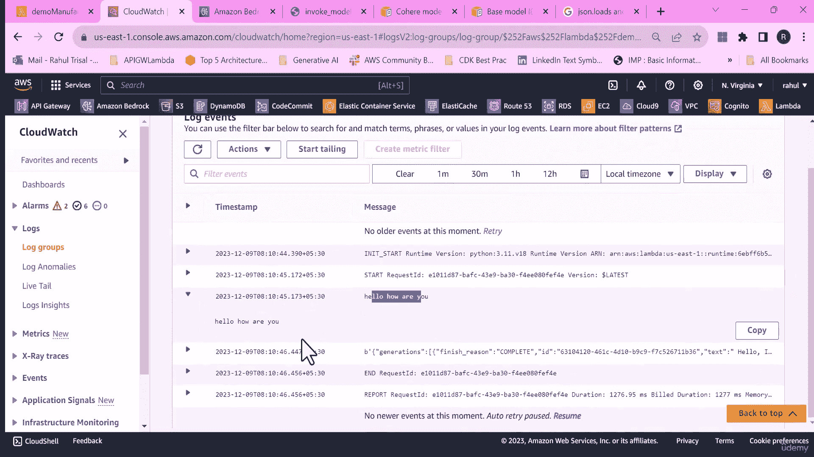

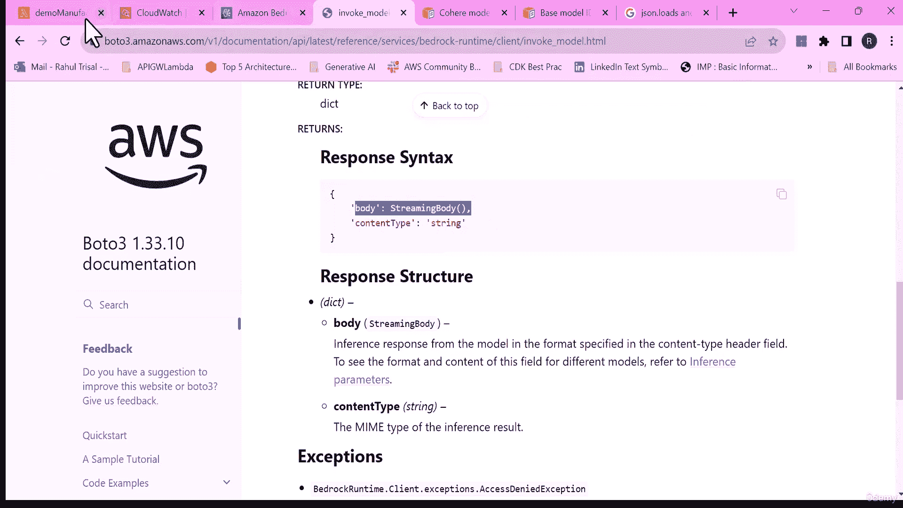

- `read()`得到的是`bytes`，可以先用`type()`确认类型。
- 可以把字节解码成字符串，例如使用`.decode("utf-8")`。
- 也可以直接把字节传给`json.loads`，它会解析成Python字典。
- 原文提到用`json.loads`处理这段内容，实际效果是得到可按键取值的字典对象。

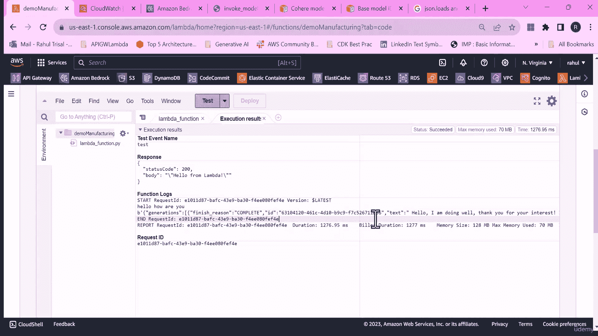

核心转换关系可以写成下面的公式。

```python
raw_bytes = response["body"].read()
response_text = raw_bytes.decode("utf-8")
response_json = json.loads(response_text)

# 也可以直接解析字节
response_json = json.loads(raw_bytes)
```

完成转换后，就可以像操作普通字典一样从响应中取值。下一步是从`generations`列表中取出第一个元素，再从这个元素中取出`text`字段。

## 🎯 AWS生成式AI实战：第35-37讲-7：提取generations中的text并返回最终响应

上一节我们得到了可解析的响应字典，本节中我们来看看如何提取最终文本。响应字典中的键是`generations`，它对应一个列表；列表的第一个元素包含`finish_reason`、`id`和`text`等字段，其中`text`就是模型生成的回答。取出`text`后，可以把它保存到`final_response`变量中，打印确认后再作为Lambda函数的返回值。

下面列出提取最终文本的步骤。

- 使用`response_json["generations"]`取出生成结果列表。
- 使用`[0]`取出列表中的第一个元素。
- 再使用`["text"]`取出该元素中的文本内容。
- 把结果保存到`final_response`变量并打印检查。
- 最后把`final_response`作为Lambda函数的返回值。

核心代码可以写成下面的形式。

```python
final_response = response_json["generations"][0]["text"]
print(final_response)
return final_response
```

部署测试后，返回内容类似`Hi, good day to you. I am well, thank you`以及`Hello, how are you`等回答，说明从Bedrock响应中提取文本的流程已经跑通。最后还需要通过API Gateway的测试事件验证Lambda返回结果。

## 🌐 AWS生成式AI实战：第35-37讲-8：通过API Gateway测试事件验证返回结果

上一节我们成功提取并返回了最终文本，本节中我们来看看如何通过API Gateway测试事件验证整个链路。部署最新代码后，进入API Gateway的测试配置，把测试请求改成询问伦敦天气，例如`How is the weather in London`，保存后执行测试。响应体中会返回类似“伦敦属于温带气候”的描述，函数日志中也会打印最终响应。

下面列出验证阶段需要检查的内容。

- 确认Lambda已经部署最新代码。
- 在API Gateway中配置并保存测试事件。
- 执行测试后检查响应体中的`body`内容。
- 查看CloudWatch日志，确认函数内部也打印了最终响应。
- 确认API Gateway请求能够把Bedrock生成的文本返回给调用方。

最终返回逻辑可以简化为下面的代码。

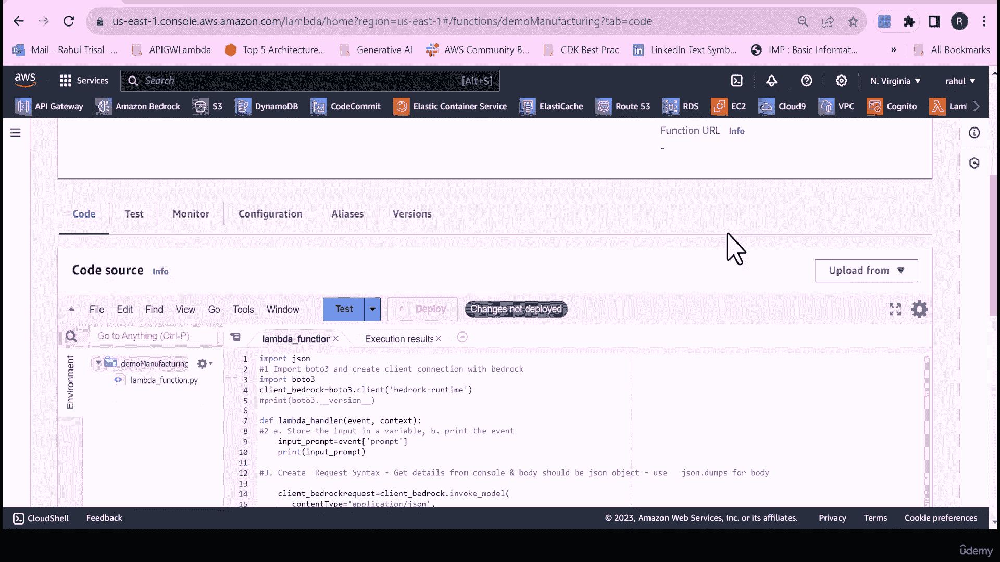

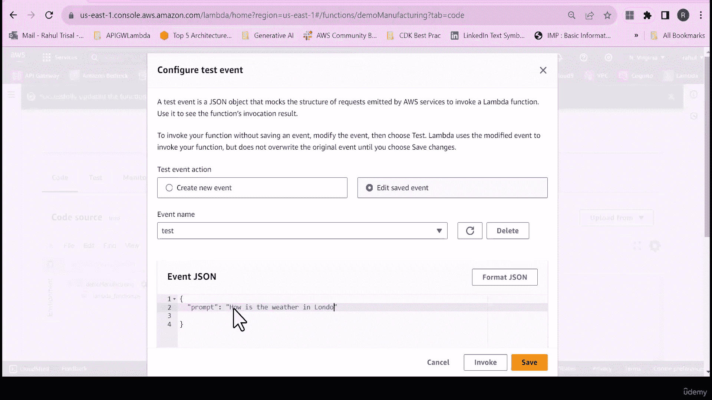

```python
return final_response
```

到这里，Lambda函数连接Bedrock、处理响应并返回文本的流程已经完成。下节课将创建REST API和API Gateway，把整个调用链路正式暴露出去。

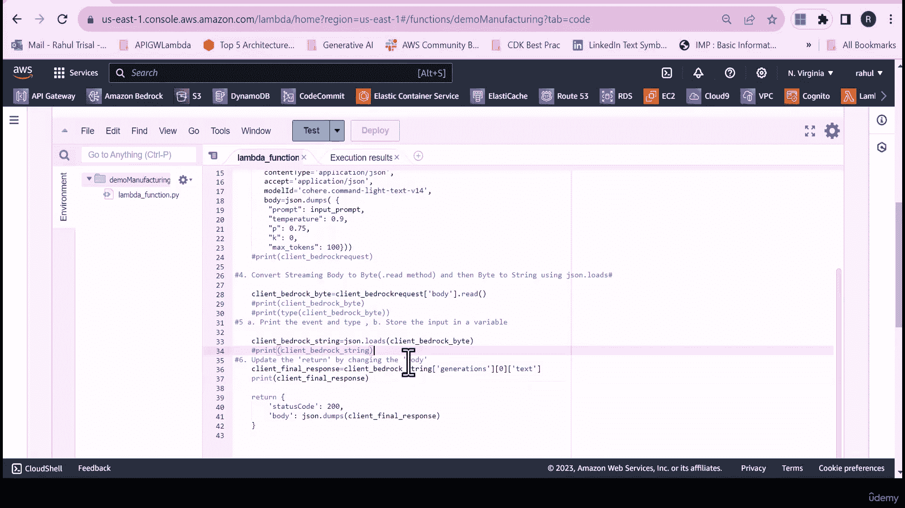

本节课中我们一起学习了如何补齐Cohere请求体、设置推理参数、使用`json.dumps`序列化请求体、修复变量名问题、从Bedrock响应中提取StreamingBody、读取字节并解析响应，最后从`generations`列表中取出`text`作为最终返回结果，并通过API Gateway测试事件完成验证。整个流程把Lambda函数和Bedrock服务连接了起来，为后续创建REST API和API Gateway打下了基础。

