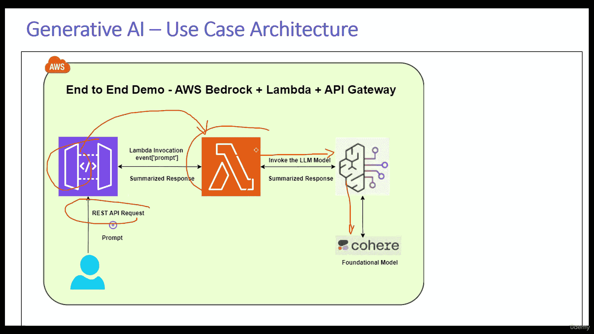
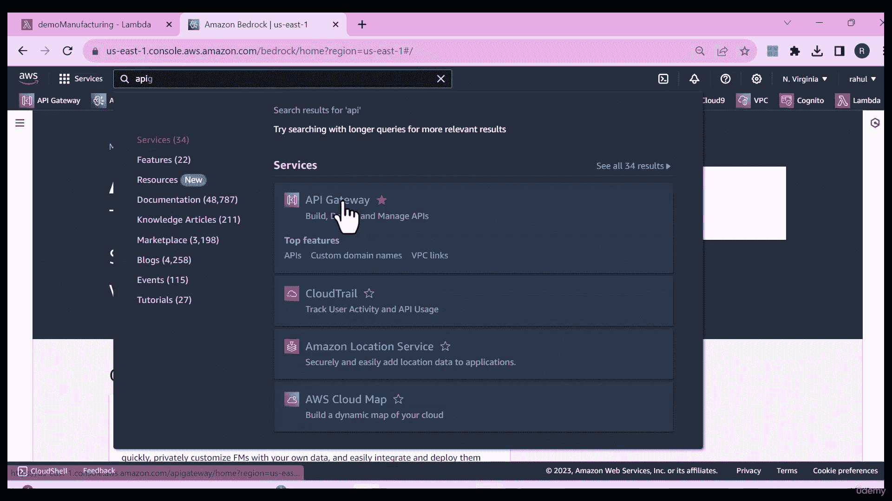
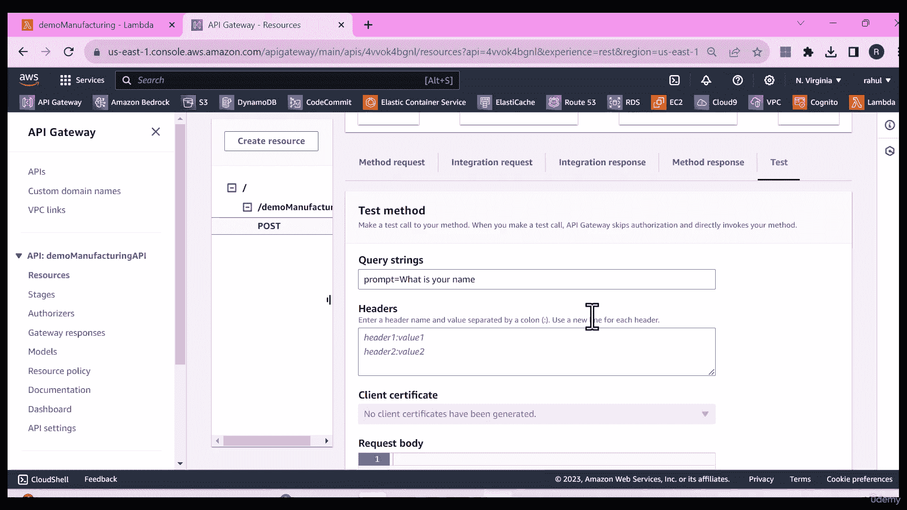

# 🚀 AWS 生成式 AI 实战：第36-38讲：使用 AWS API Gateway 与 Lambda 集成创建 REST API


在本节课中我们将要学习如何用 AWS API Gateway 创建一个 REST API，并把它连接到上一讲已经写好的 AWS Lambda 函数上。上一讲我们创建了 AWS Lambda 函数，把它连接到 Amazon Bedrock 服务，最后连接到了 Cohere 基础模型。本讲要继续往前走一步，把 API Gateway 放在 Lambda 前面，让外部请求可以通过 REST API 进入 Lambda，再由 Lambda 调用 Cohere 基础模型。整体链路可以先用下面这段代码直白地表示：

```text
prompt
  → API Gateway（query string 参数 prompt）
  → Lambda 事件（event.prompt）
  → Cohere 基础模型
  → 响应
```





这条链路是后面测试和端到端演示的基础，理解它以后，配置 API Gateway 的每一步都会更容易看懂。下面我们按照控制台操作顺序，把创建 REST API、创建资源、创建 POST 方法、配置方法请求、配置集成请求、部署阶段和测试接口完整走一遍。


## 🧭 AWS 生成式 AI 实战：第36-38讲：本讲目标与整体流程


上一节我们回顾了 Lambda 与 Bedrock、Cohere 基础模型的连接关系，本节中我们来看看 API Gateway 在整个架构中的位置。当前已经在 AWS 控制台，需要在控制台搜索框输入 API Gateway，然后进入 API Gateway 服务页面。进入服务后，点击 Create API，选择 REST API，不要选择 REST API Private，然后点击 API 的 Build 按钮开始构建。这个选择很关键，因为本讲使用的是普通 REST API，而不是私有 REST API。

下面是本讲要完成的主要步骤，先列出整体流程，方便后面按顺序操作：

- 创建 REST API，并给 API 起一个名称。
- 创建资源，资源名称使用 demo。
- 在资源下创建 POST 方法，集成类型选择 Lambda。
- 在方法请求中创建 URL query string 参数 prompt，并设为必填。
- 在集成请求中配置映射模板，把 API Gateway 收到的 prompt 转成 Lambda 事件中的 prompt。
- 把 API 部署到 stage，例如 Dev。
- 使用控制台测试 POST 方法，并检查返回结果。

完成整体流程后，我们就能看到一个可测试的 REST API。下面先进入创建 REST API 的步骤，把 API 容器先建出来。


## 🛠️ AWS 生成式 AI 实战：第36-38讲：创建 REST API


上一节我们梳理了整体流程，本节中我们来看看如何在 API Gateway 中创建 REST API。进入 API Gateway 后，点击 Create API，然后选择 REST API，不要选择 REST API Private，点击 API 的 Build。接下来需要给 API 起名称，例如 demo-vuring-api，然后创建 API。创建完成后可以关闭提示窗口，回到 API Gateway 的主界面。

这一步相当于先建立一个 API 外壳，后面的资源和方法都会挂在这个 API 下面。原文也提到准备了一份分步指南，可以在指南中看到顺序：先创建 REST API，再创建资源，然后创建方法，本例中的方法使用 POST。下面进入资源和方法的创建，把 API 的访问路径和请求方式确定下来。


## 🧱 AWS 生成式 AI 实战：第36-38讲：创建资源与 POST 方法


上一节我们创建了 REST API，本节中我们来看看如何创建资源和 POST 方法。点击创建资源，给资源命名，例如 demo，然后创建资源。资源创建完成后，在资源下创建方法，点击创建方法并选择 POST 方法。集成类型选择 Lambda，因为本讲要把 API Gateway 与 Lambda 集成起来。

接下来需要填写 Lambda 函数名称，可以直接从之前写好的 Lambda 函数处复制名称，再粘贴到这里，然后创建方法。完成以后，demo 资源下的 POST 方法就已经创建好了。这个方法就是后面测试时调用的入口，API Gateway 收到 POST 请求后，会按照集成配置把请求转给 Lambda。下面继续配置方法请求，让 API 能接收 prompt 参数。


## 🔧 AWS 生成式 AI 实战：第36-38讲：配置方法请求与 query string 参数


上一节我们创建了 POST 方法，本节中我们来看看如何在方法请求中增加 URL query string 参数。进入方法请求页面，点击编辑，找到 URL query string parameter，添加一个名为 prompt 的参数，并勾选 required，把它设为必填，然后保存。这个参数的作用需要结合架构来理解：prompt 会通过 API 请求传给 API Gateway，然后作为事件传给 AWS Lambda 函数，再从 Lambda 函数作为输入传给 Cohere 基础模型，最后得到响应。

可以把这一步理解成给 API 增加一个入口字段，外部调用者通过 prompt 把问题带进来。下面是这个参数在链路中的核心关系，用公式表示如下：

```text
API Gateway 请求参数 prompt → Lambda 事件字段 prompt → Cohere 输入 prompt
```

保存方法请求后，API 已经知道要接收 prompt。下面进入集成请求，把 prompt 真正映射到 Lambda 事件里。


## 🧩 AWS 生成式 AI 实战：第36-38讲：配置集成请求与映射模板


上一节我们配置了方法请求中的 prompt 参数，本节中我们来看看如何在集成请求中配置映射模板。进入集成请求页面，点击编辑，向下找到 mapping template，在 content type 中添加 application/json。接下来要添加模板细节，这一步需要特别小心，不要直接复制粘贴，因为有时引号会不正确，最后导致报错，所以建议手动输入括号和内容。

模板可以使用下面的代码表示，它的含义是把 API Gateway 收到的 prompt 转成 Lambda 事件中的 prompt：

```json
{
  "prompt": "$input.params('prompt')"
}
```

这个模板使用 AWS 用于创建 template body 的 Velocity 模板语言。直白地说，它做的事情就是：API Gateway 里拿到的 prompt，会被转换并放进 Lambda 函数的 event 中。配置完成后保存。下面进入部署阶段，把 API 发布到一个可访问的环境。


## 🚀 AWS 生成式 AI 实战：第36-38讲：部署到 stage


上一节我们完成了集成请求和映射模板，本节中我们来看看如何把 API 部署到 stage。下一步要部署 API，并选择新建 stage。stage 可以理解为 AWS API Gateway 的环境，例如 dev、QA 等，本讲可以使用 Dev 作为阶段名称，然后执行部署。部署完成后关闭提示窗口，回到资源页面，点击左侧资源并选中 POST 方法。

部署这一步相当于把刚才配置好的 API 发布到一个环境中，只有部署后，外部请求才能通过这个阶段访问 API。完成部署后，下面就可以在控制台里直接测试 POST 方法，确认 API Gateway、Lambda 和 Cohere 基础模型的链路是否打通。


## 🧪 AWS 生成式 AI 实战：第36-38讲：测试 REST API


上一节我们把 API 部署到了 Dev 阶段，本节中我们来看看如何在控制台测试 POST 方法。点击 POST 方法后进入测试页面，query string parameter 使用 prompt。可以先从简单提示开始，例如输入 What is your name，然后点击 Test。原文提到摘要用例可以留到端到端演示时再试，这里先用简单 prompt 验证接口是否工作。

测试后得到响应，状态码为 200，回复内容大意是：Hi，My name is Coral，我是一个 AI 助手，经过训练来帮助人类用户并提供详细回复，我能如何帮助你。这个结果说明 API Gateway 到 Lambda 再到 Cohere 基础模型的链路已经工作正常。下一讲会通过 Postman 测试这个 API，并给出一些用于摘要的 prompt。下面进入本讲总结，把关键步骤再串一遍。


## 📌 AWS 生成式 AI 实战：第36-38讲：本讲总结


上一节我们完成了 API 测试，本节中我们对整讲内容做总结。本节课中我们一起学习了如何用 AWS API Gateway 创建 REST API，如何创建 demo 资源和 POST 方法，如何把 POST 方法与 Lambda 集成，如何在方法请求中增加必填的 prompt 查询字符串参数，如何在集成请求中配置 application/json 映射模板，如何把 API 部署到 Dev 阶段，以及如何通过控制台测试接口并得到状态码 200 的响应。

整个核心链路可以再次用下面的代码概括：

```text
prompt → API Gateway → Lambda event → Cohere 基础模型 → 响应
```



希望本讲对后续的 Postman 测试和端到端演示有帮助，下一讲见，谢谢。

