# 🏭 生成式AI在AWS上的应用：第37-39节：端到端演示

在本节课中我们将要学习如何通过一个端到端演示，把制造业场景中的涡轮机故障日志交给基础模型做摘要。这个演示会从提示词结构开始，经过 Postman 发起请求、API Gateway 接收请求，最后在 Lambda 函数中拿到基础模型返回的结果。我们还会说明两个容易踩坑的地方：请求体格式和 token 限制。为了让初学者更容易理解，下面会按操作顺序拆开讲，每一步都解释清楚它在整个流程里起什么作用。

## 🧩 生成式AI在AWS上的应用：第37-39节：认识提示词结构

在进入 Postman 和接口操作之前，先要认识这个用例里的提示词。这个提示词是基于制造业经验为当前用例写出来的，内容基本上就是现场工程师写下的一条涡轮机故障日志。后续章节会讨论提示工程以及如何写好的提示词，现在只需要知道：要让基础模型给出好的响应，提示词需要按特定格式来写，这个演示里的提示词就是按这种格式尝试写出来的。提示词模板的骨架如下。

> 这是一份涡轮机故障的现场日志报告。  
> 问题日志日期是……  
> 涡轮机型号是……  
> 问题描述是……  
> 技术员判断的潜在根本原因是……  
> 上次维护记录还有这些细节……  
> 请把以上内容总结成两行。

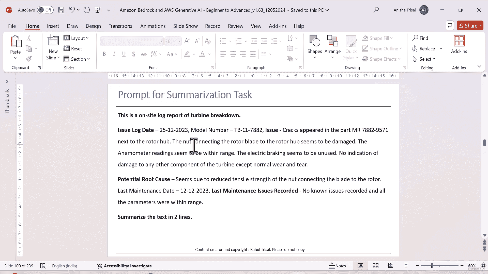

这段模板先给基础模型一点上下文，说明这是一份涡轮机故障现场日志报告，让模型知道接下来要处理什么内容；接着给出问题日志日期和涡轮机型号；然后描述具体问题；再给出技术员定义的潜在根本原因，并补充上次维护记录的更多细节；最后明确告诉基础模型，需要把所有这些内容总结成两行。核心请求体格式可以用下面的代码描述，重点是 `prompt` 后面接引号，再把整段提示词放进去。

```text
prompt "<把整段提示词放在这里，并保持单行>"
```

上一节我们认识了提示词的结构，本节中我们来看看怎样用 Postman 把这个用例真正跑起来。

## 🛠️ 生成式AI在AWS上的应用：第37-39节：用Postman测试

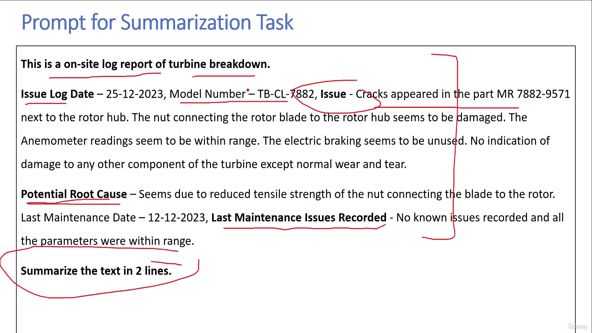

上一节我们拆开了提示词的结构，本节中我们来看看如何发起测试。演示中会先搜索并打开 Postman。Postman 是一个免费的 API 测试工具，如果没有安装，可以去 Google 搜索并下载，它不收费。为了让整个调用过程更直观，下面先列出准备测试时要做的操作步骤。

以下是开始测试前要完成的准备步骤：

- 在 Postman 里选择请求方法，这个用例使用的是 POST 方法。
- 打开 API Gateway，进入已经创建好的 REST API。
- 在 REST API 左侧找到 Stages，点击进入。
- 这个演示使用的阶段是 dev，点击 dev。
- 点击 POST，拿到 Invoke URL，并复制这个地址。
- 回到 Postman，把复制的 Invoke URL 粘贴到地址栏。

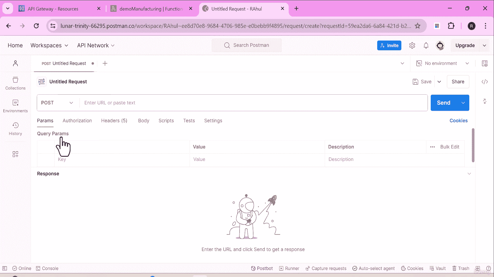

这些步骤的作用是把 Postman 和 API Gateway 连接起来。请求方法可以用下面的代码表示，重点是使用 POST，并把请求发到对应的 Invoke URL。

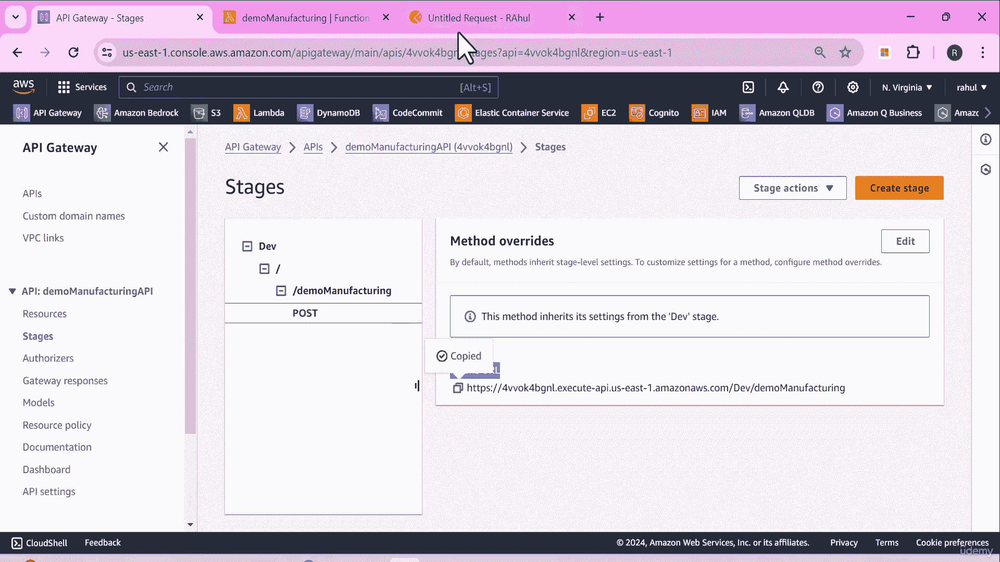

```text
POST <Invoke URL>
```

上一节我们拿到了调用地址，本节中我们来看看如何在 Postman 里把请求体写好。

## 📮 生成式AI在AWS上的应用：第37-39节：在Postman里构造请求

上一节我们拿到了 Invoke URL，本节中我们来看看请求体怎么填。演示里的提示词和前面基本相同，只是先复制到了记事本，因为有时直接从 PowerPoint 复制内容可能会出问题。把提示词准备好之后，就可以进入 Postman 的 Body 区域，选择 raw，然后按特定格式写入请求体。以下是构造请求体时需要依次完成的操作。

以下是 Postman 里构造请求体的操作步骤：

- 打开 Body 区域，选择 raw。
- 把 raw 的格式从 JSON 改成 Text，原文口述为 JN，按上下文理解为 JSON。
- 先写 `prompt`，再写英文双引号，把提示词粘贴到引号里面。
- 检查整段文本是否保持在一行内，如果有换行就删掉，把它推回成一行。
- 最后几行也要检查，把多余换行去掉，同样合并回一行。
- 确认所有文本都在单行、格式看起来正确后，再发送请求。

这里最关键的是请求体格式和单行要求。提示词一旦被拆成多行，请求可能无法按预期工作，所以需要反复检查。上一节我们写好了请求体，本节中我们来看看发送之后 Lambda 和基础模型会返回什么。

## 📊 生成式AI在AWS上的应用：第37-39节：查看Lambda与模型响应

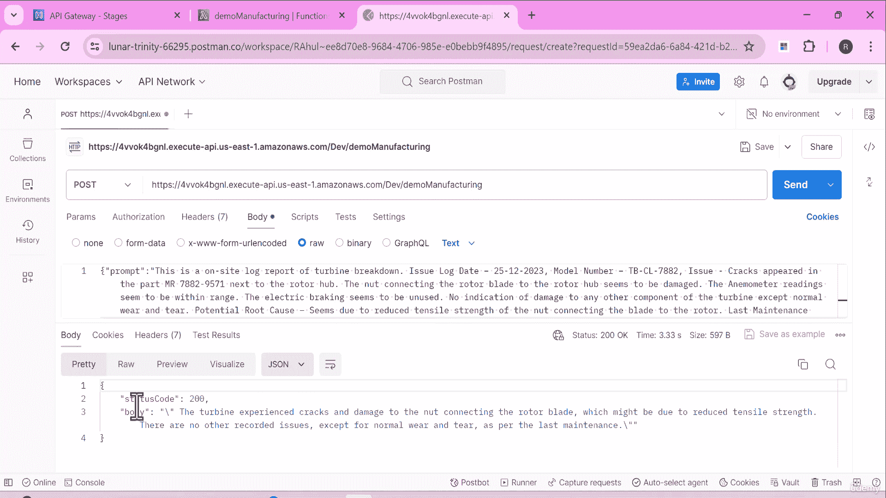

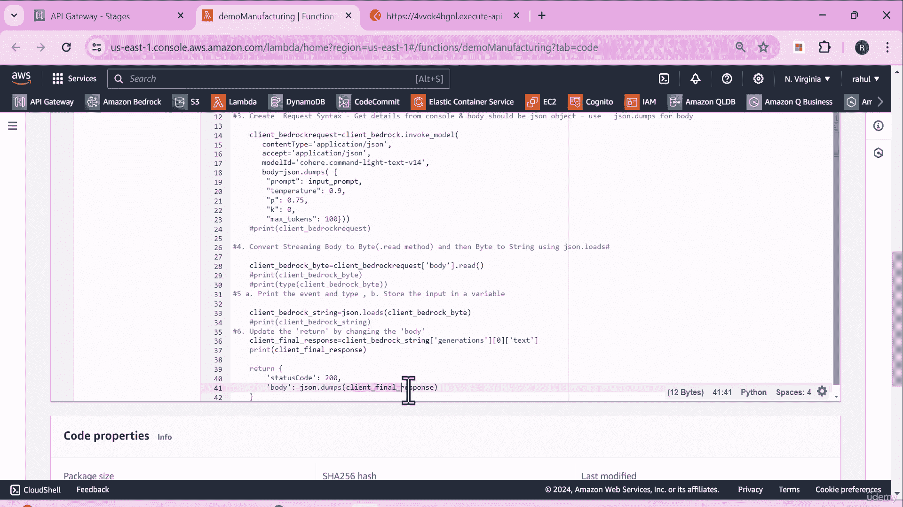

上一节我们构造好了请求，本节中我们来看看发送请求后的返回结果。发送请求后，演示中拿到了响应，并把响应展开查看，可以看到基础模型返回了内容。接着进入 Lambda 函数查看返回结果，可以看到返回状态码是 200，并且有 `client final response`，这个字段就是最终摘要。以下是查看响应时要关注的几个点。

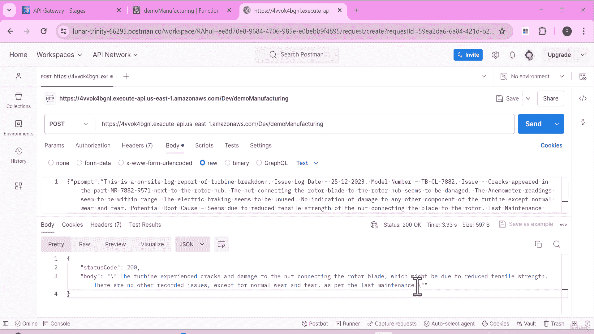

以下是发送请求后需要检查的响应信息：

- 发送请求后展开响应内容，确认基础模型已经返回结果。
- 进入 Lambda 函数，确认返回状态码是 200。
- 查看 `client final response`，这里存放的就是摘要结果。
- 复制这段响应并粘贴出来，可以放大字体方便阅读。
- 响应内容比较合理，它说明涡轮机发生了故障，原因是连接转子叶片的网损坏，这可能会降低抗拉强度。

通过这个流程，就完成了一个端到端摘要用例的构建。上一节我们看到了正常响应，本节中我们来看看容易踩坑的地方以及 token 不够时怎么调整。

## ⚠️ 生成式AI在AWS上的应用：第37-39节：两个易错点和token调整

上一节我们看到了模型返回的摘要，本节中我们来看看实际操作中可能遇到问题的地方。演示重点提醒了两个容易出错的位置，并且说明了当提示词较长时如何调整 Lambda 里的 token 参数。以下是需要特别注意的事项。

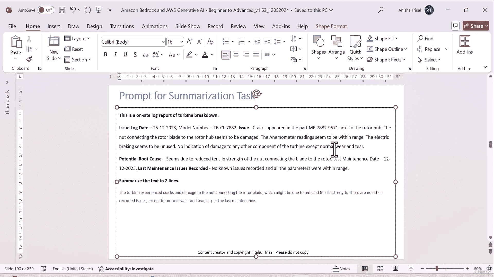

以下是使用这个演示时要注意的易错点：

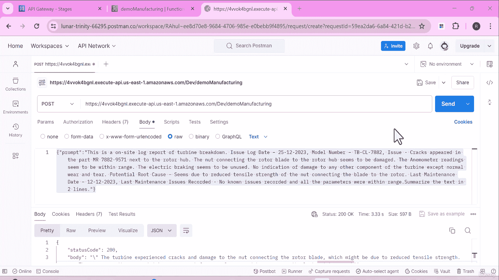

- 发起 POST 请求时，要确保在 raw 里选择 Text。
- 提供的提示词要放在单行里，不要出现多余换行。
- 如果尝试不同的提示词，要确保提示词不超过推理参数里的最大 token 数。
- 在 Lambda 函数里，演示中的最大 token 数显示为 00，按上下文应理解为 100。
- 之前学过 100 个 token 大约等于 75 个单词，所以如果请求或响应超过 75 个单词，可能会报错。
- 如果提示词很长，可以把最大 token 数提高到 500，然后重新部署。

token 换算关系可以用下面的公式描述，方便初学者记住限制。

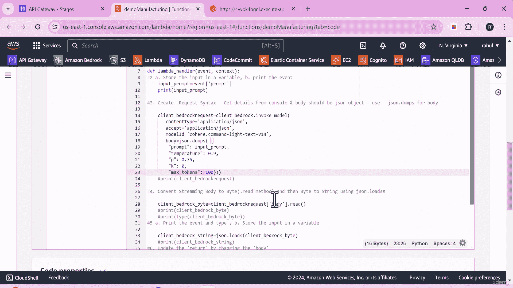

```text
100 tokens ≈ 75 words
max_tokens = 100
```

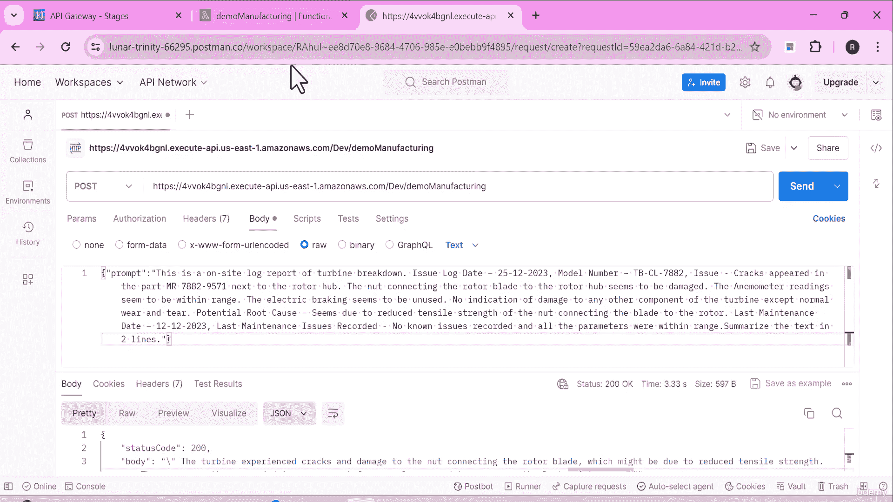

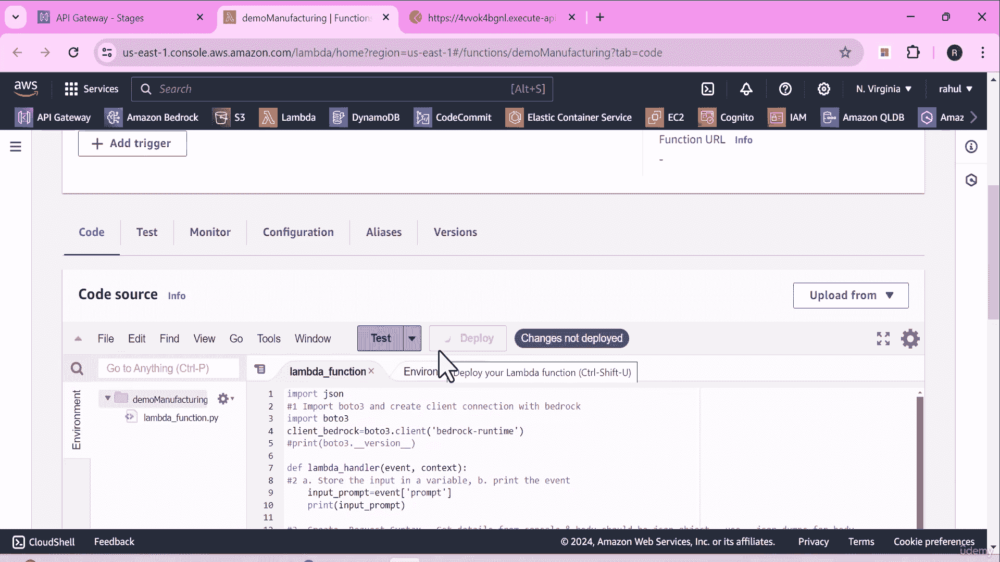

如果调整了 Lambda 函数，还需要重新部署 REST API，否则更新不会生效。以下是更新 Lambda 后重新部署的步骤。

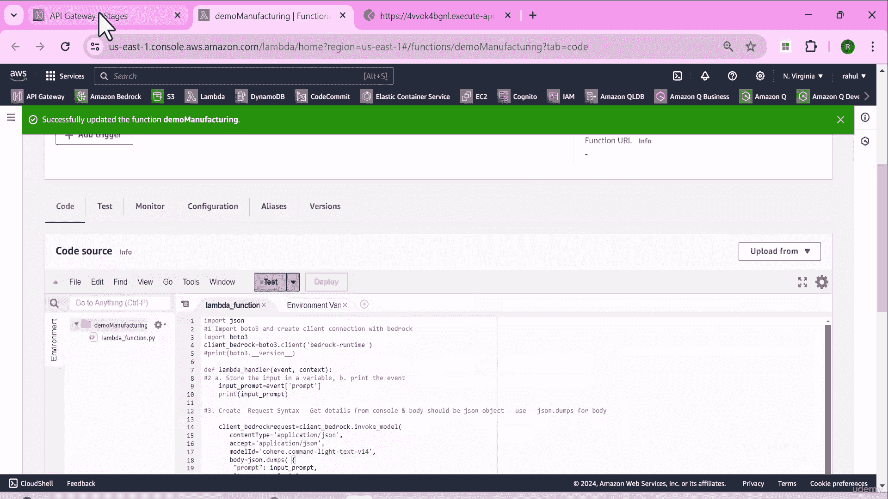

以下是更新 Lambda 后重新部署 REST API 的步骤：

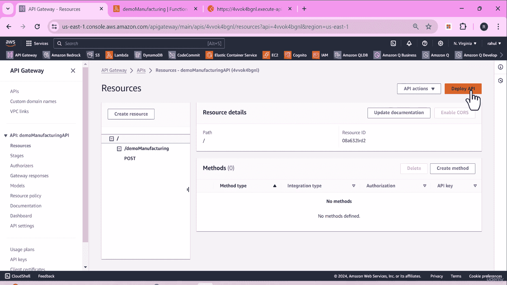

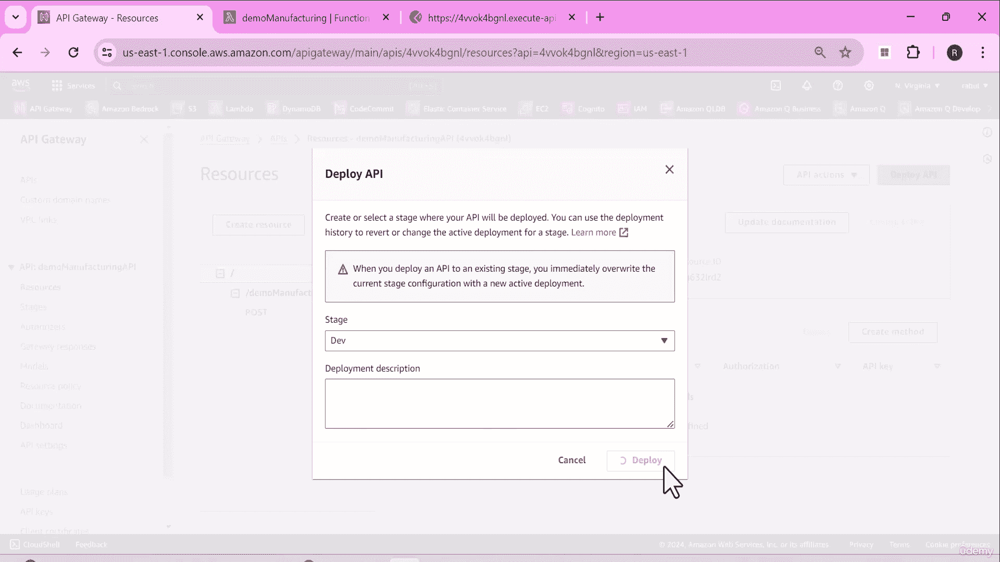

- 进入 API Gateway。
- 打开 Resources。
- 执行 Deploy API。
- 选择阶段，这个演示选择 dev 阶段。
- 点击 Deploy 完成部署。
- 部署完成后回到 POST，使用 Invoke URL 继续测试。
- 记住：更新 Lambda 函数后，必须重新部署 REST API，否则整个流程不会正常工作。

这个演示到此结束，希望整个流程已经讲清楚，也希望大家喜欢这个演示。上一节我们走完了所有操作，本节中我们做一次收束。

## ✅ 生成式AI在AWS上的应用：第37-39节：本节总结

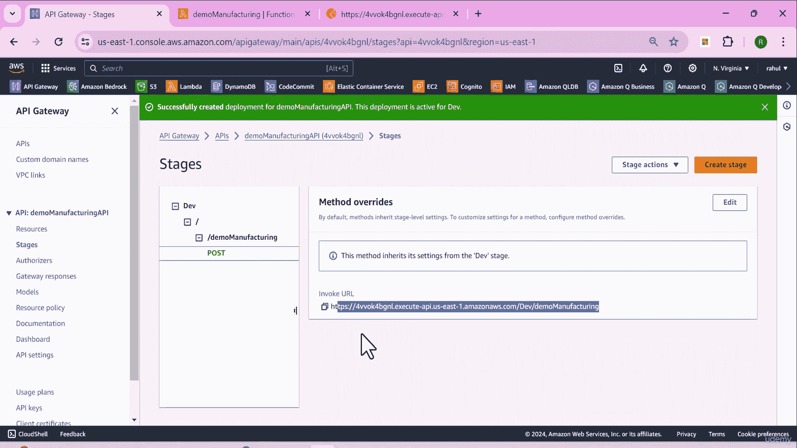

本节课中我们一起学习了如何通过端到端演示完成涡轮机故障日志摘要用例。我们从提示词结构开始，认识了上下文、日志日期、涡轮机型号、问题描述、技术员判断的潜在根本原因、上次维护细节以及“总结成两行”的要求；然后使用 Postman 选择 POST 方法，通过 API Gateway 的 dev 阶段拿到 Invoke URL；接着在 Body 的 raw 中写入 `prompt "<提示词>"`，并确保整段提示词保持单行；发送请求后，在 Lambda 函数中看到状态码 200 和 `client final response` 摘要结果；最后说明了 raw 选择 Text、提示词保持单行、不要超过最大 token 数，以及更新 Lambda 后必须重新部署 REST API。下节课再见，谢谢。

