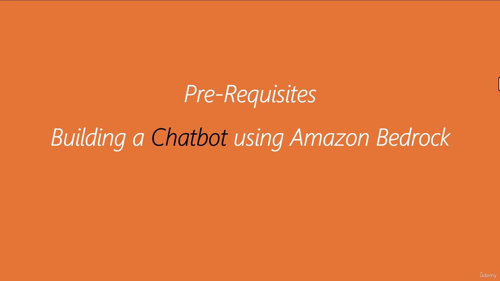

# 🛠️ AWS生成式AI实战：39-41：编码前的聊天机器人环境搭建

在本节课中，我们将学习在正式开始编写聊天机器人代码之前，必须完成的前置条件和安装步骤。这里的目标是把开发环境搭好，包括编辑器、Python、AWS CLI、Anaconda Navigator、IAM 权限和后续要用的依赖包。只有这些准备工作完成，后面才能顺利写代码。

在开始搭建聊天机器人之前，有一些前置条件和安装项需要先完成，下面我们逐项查看这些前置条件是什么。完成这些安装后，我们才能进入编码阶段。

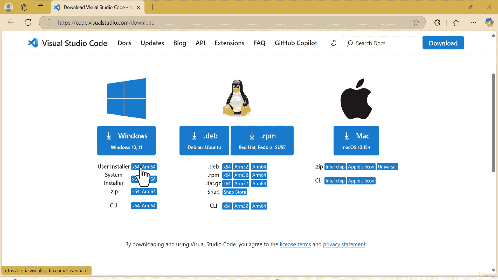

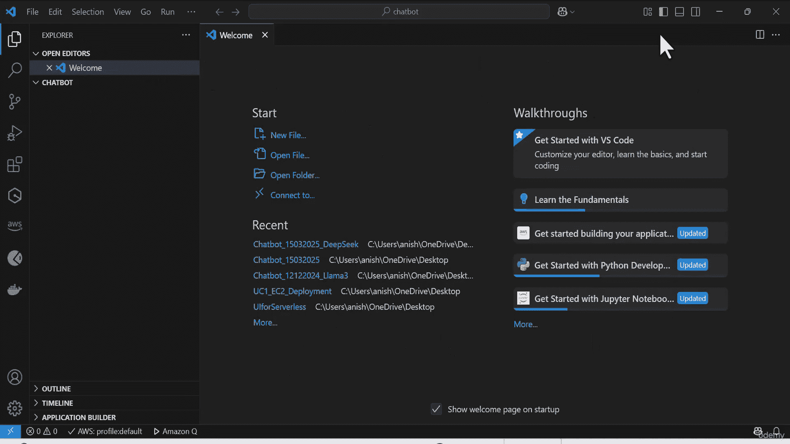

## 📋 AWS生成式AI实战：39-41.1：前置条件总览

上一段我们明确了准备工作的重要性，本节先看需要安装的前置条件清单。下面是我们开始前需要安装的项目列表，后续小节会按顺序逐项说明。

- 下载并安装 VS Code。
- 安装 Python，并确认 Python 与 Pip 版本。
- 安装 AWS CLI，并确认 CLI 版本。
- 在 VS Code 中安装 AWS Toolkit 和 AWS Boto3 相关扩展。
- 通过 AWS 控制台创建 IAM 用户、附加管理员策略并创建访问密钥。
- 使用 `aws configure` 把访问密钥配置到 AWS CLI。
- 安装 Anaconda Navigator，并从它启动 VS Code。
- 安装 Boto3、LangChain、LangChain AWS、Streamlit、Transformers、PyYAML 等依赖。

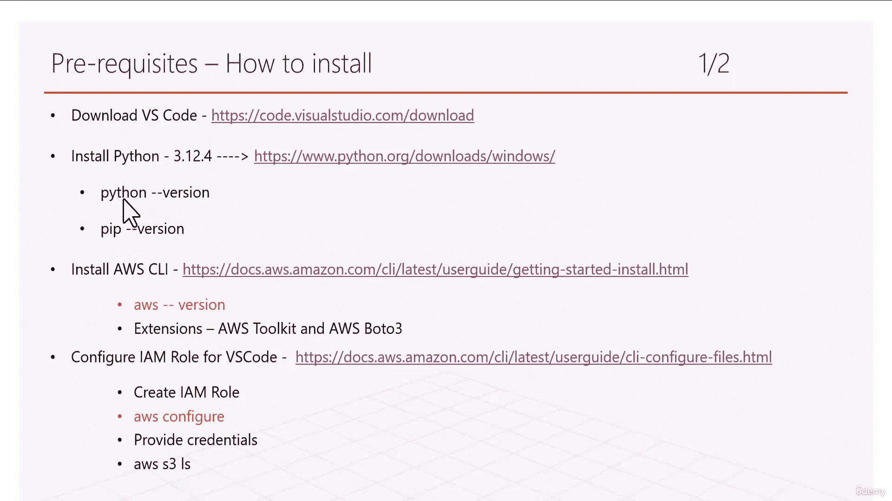

这个清单看起来步骤不少，但可以理解为一次性的环境搭建。下面我们从编辑器开始，先把写代码的地方准备好。

## 🧑‍💻 AWS生成式AI实战：39-41.2：安装 VS Code

在了解总览后，我们先从代码编辑器开始。第一件事是下载 VS Code，可以访问资料中的链接，也可以直接搜索 VS Code。打开页面后下载 Visual Studio Code，然后根据你的操作系统选择对应版本；无论使用 Mac、Windows 还是 Linux，都可以下载并安装。若使用 Windows，可以点击用户安装器（User Installer）或 `.zip` 文件，然后按提示完成安装。

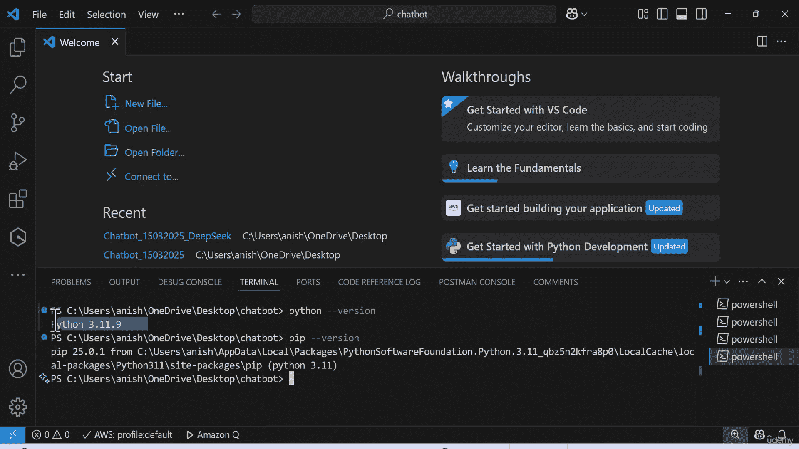

安装完成后，VS Code 的界面应该与示例类似。这个编辑器后续会作为我们编写聊天机器人代码、打开终端和安装依赖的主要工具。

## 🐍 AWS生成式AI实战：39-41.3：安装 Python 并检查版本

完成 VS Code 安装后，本节我们来看看 Python 的安装和版本检查。接下来需要安装 Python。示例中说明安装的是 Python 3.12.4，可以点击资料中的链接，也可以搜索 Python 安装并进入页面。在页面中既可以安装最新版本，也可以安装示例中的 3.12 版本。页面上会看到 Windows installers 的 64 位和 32 位版本；如果你的 Windows 是 64 位，就下载对应的 64 位安装包。

安装完成后，需要检查 Python 版本和 Pip 版本。Python 和 Pip 通常会一起安装，下面是检查命令，可以直接在 VS Code 终端中执行。

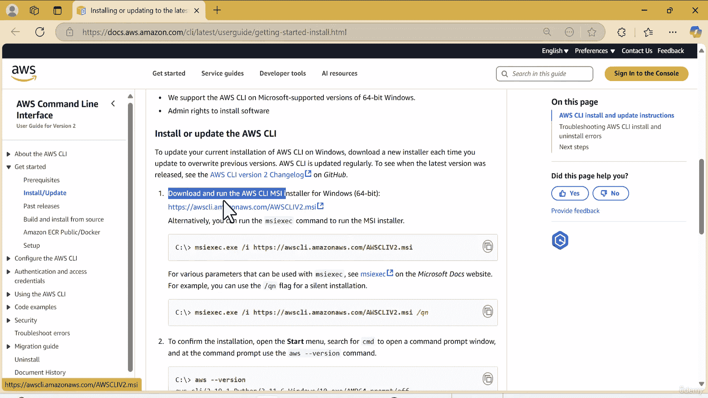

```bash
python --version
pip --version
```

为了确认 Python 和 Pip 是否安装正确，打开前面下载的 VS Code，点击三条横线菜单中的 Terminal，再选择 New Terminal。可以把终端面板向上拉一点，然后输入 `python --version`，它会显示已安装的 Python 版本。示例中显示的是 Python 3.11.9。接着输入 `pip --version` 检查 Pip 版本，示例中显示 Pip 25.0.1。需要注意，你可能安装的是 Python 3.12 或更高版本，这没有问题；示例中实际检查到的是 3.11 系列，而不是 3.12.4，这同样可以继续。

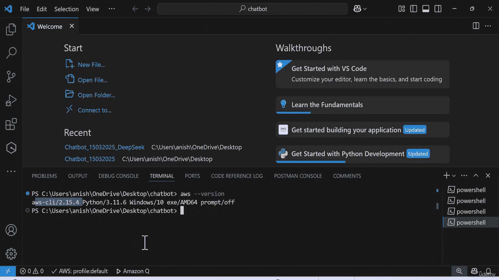

## ☁️ AWS生成式AI实战：39-41.4：安装 AWS CLI 并检查版本

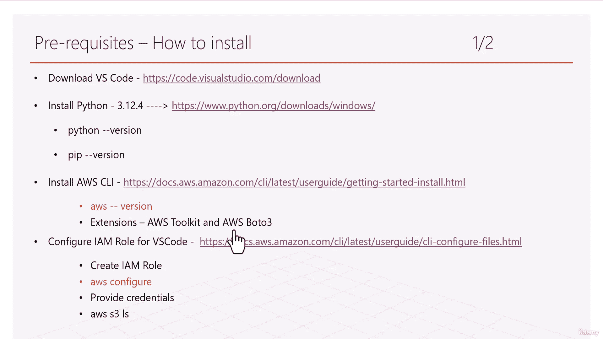

上一节我们确认了 Python 和 Pip 可用，本节中我们来看看 AWS CLI 的安装。接下来需要安装 AWS CLI。点击资料中的链接后，会进入“安装或更新到最新版 CLI”的页面；如果没有使用链接，也可以通过搜索引擎找到该页面。向下滚动后，根据你的操作系统选择安装方式，可以点击链接使用安装器，也可以通过命令行方式安装。下载后按步骤完成安装。

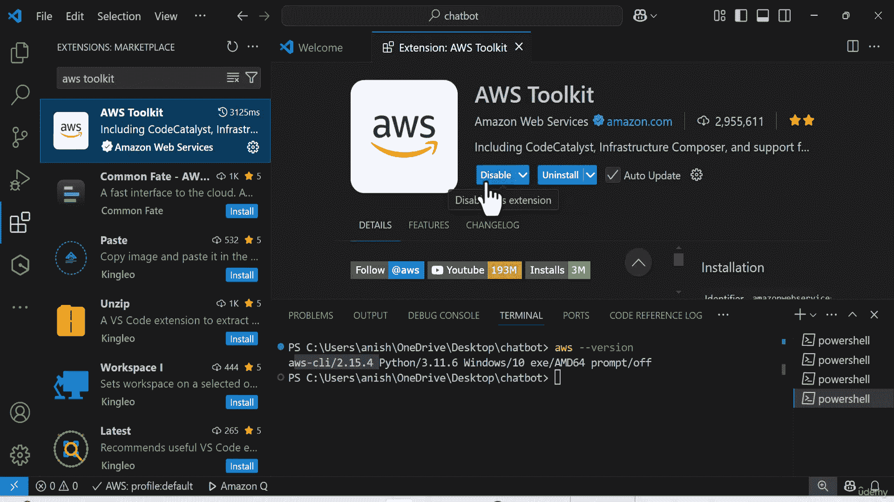

安装完成后，需要检查 AWS CLI 是否安装正确。先清空终端，然后执行下面的命令检查版本。

```bash
aws --version
```

示例中显示 AWS CLI 2.15.4。如果你安装的是更高版本，也没有问题。AWS CLI 的作用是把 IAM 角色或权限附加到 CLI 上，使我们能够通过命令行访问 AWS 账户中的资源。

## 🧩 AWS生成式AI实战：39-41.5：安装 VS Code 扩展

在 AWS CLI 安装完成后，我们还可以安装 VS Code 扩展。可以安装 AWS Toolkit，以及 AWS Boto3 相关扩展。下面是在 VS Code 中安装扩展的步骤列表。

- 在 VS Code 中点击扩展图标。
- 搜索 `AWS Toolkit`。
- 点击该扩展并进行安装。

示例中因为已经安装过，所以会显示已安装状态；如果你之前没有安装，界面会显示安装按钮，点击后即可完成安装。这个扩展可以帮助后续在编辑器里更方便地使用 AWS 相关能力。

## 🔐 AWS生成式AI实战：39-41.6：创建 IAM 用户与访问密钥

安装完扩展后，下一步需要配置 IAM 权限。这里要做的是通过 AWS 控制台配置 IAM 角色或用户，让 AWS CLI 获得访问 AWS 服务的权限。下面先给出权限链路的核心概念，方便理解每一步在做什么。


```text
IAM 用户 chatbot.User
  → 直接附加策略 AdministratorAccess
  → 创建 CLI 访问密钥（Access Key + Secret Key）
  → AWS CLI 获得访问 AWS 服务的权限
```

现在进入 AWS 控制台创建 IAM 用户。在控制台中搜索 IAM，进入 IAM 服务。在左侧点击 Users，然后点击 Create users，用户名填写 `chatbot.User`，点击 Next。接着选择直接附加策略（Attach policies directly），搜索 admin，选择 AdministratorAccess 管理员访问策略，然后点击 Next。最后点击 Create user 创建用户。

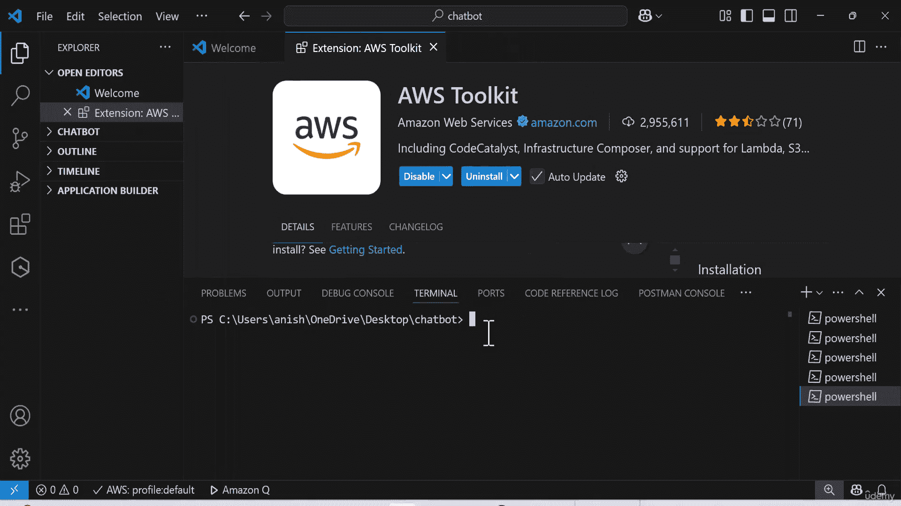

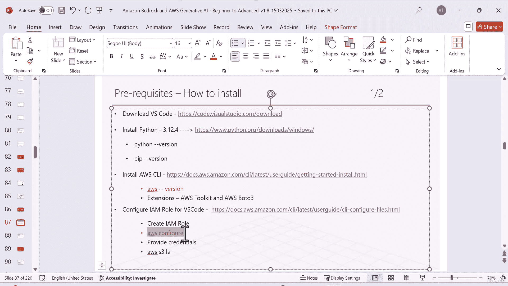

用户创建完成后，点击 View user 可以看到 `chatbot.User`。以后也可以在 Users 页面中搜索 `chatbo` 来找到这个用户。接下来需要点击 Security credentials，向下滚动找到访问密钥区域，点击 Create access key。系统会询问用途，这里选择命令行界面或 CLI，然后点击 Next，再点击 Create access key。创建完成后会显示访问密钥和秘密访问密钥值，需要保持机密，不要泄露；示例中的密钥会在录制结束后删除。

## ⚙️ AWS生成式AI实战：39-41.7：用 aws configure 配置 CLI 并测试权限

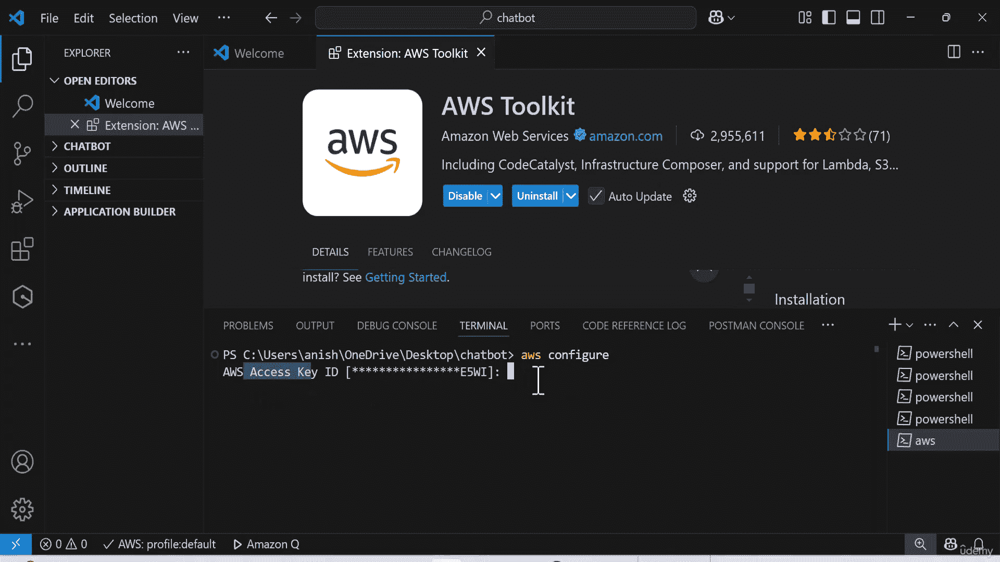

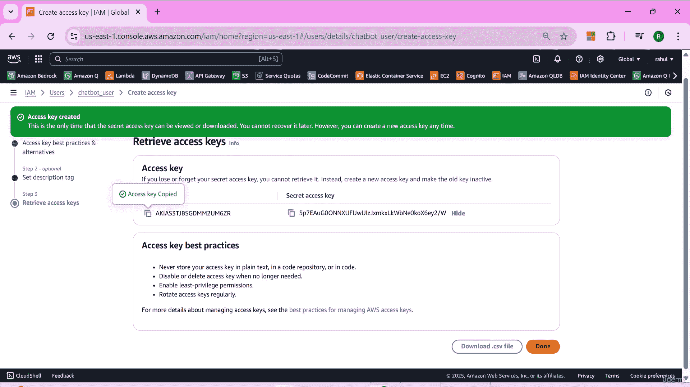

创建访问密钥后，我们回到 VS Code 进行配置。重新打开终端，点击三条横线菜单中的 Terminal，再选择 New Terminal，可以把终端面板向上拉一点，也可以把它放到左侧。首先输入 `aws configure` 命令，然后按回车。下面的代码块展示交互过程。

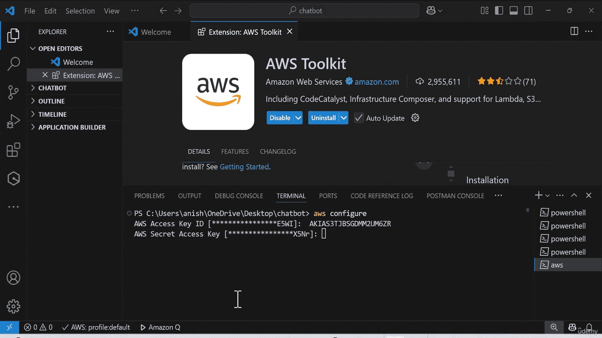

```bash
aws configure
# AWS Access Key ID: 粘贴访问密钥
# AWS Secret Access Key: 粘贴秘密访问密钥
# Default region name: 输入区域名；us-east-1 可以回车留空
# Default output format: 留空或输入 none
```

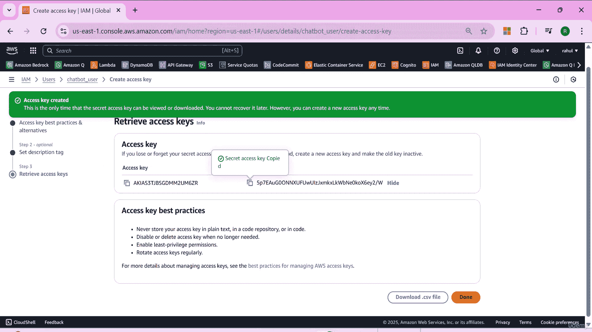

执行 `aws configure` 后，它会先询问 AWS Access Key ID。示例中虽然已经持有访问密钥和秘密密钥，这里仍按首次安装的场景演示复制粘贴。回到创建 IAM 用户时生成访问密钥的位置，复制访问密钥并粘贴到终端，然后按回车。接着会询问 Secret Access Key，再次回到密钥页面复制秘密访问密钥，粘贴到 VS Code 终端后按回车。然后需要输入默认区域名；如果区域是 US East，可以直接按回车留空；如果使用其他区域，就输入区域名后按回车。最后会询问默认输出格式，可以留空或输入 `none`，再按回车。

完成这些输入后，就相当于把 IAM 用户或管理员权限配置到了 CLI 上。此时应该可以从 VS Code 访问 AWS 资源。为了测试权限是否正常，可以执行下面的命令列出账户中的 S3 存储桶。

```bash
aws s3 ls
```

示例中执行后会列出账户中的所有 S3 存储桶。这说明 CLI 和 IAM 权限配置正确，能够访问 AWS 资源。

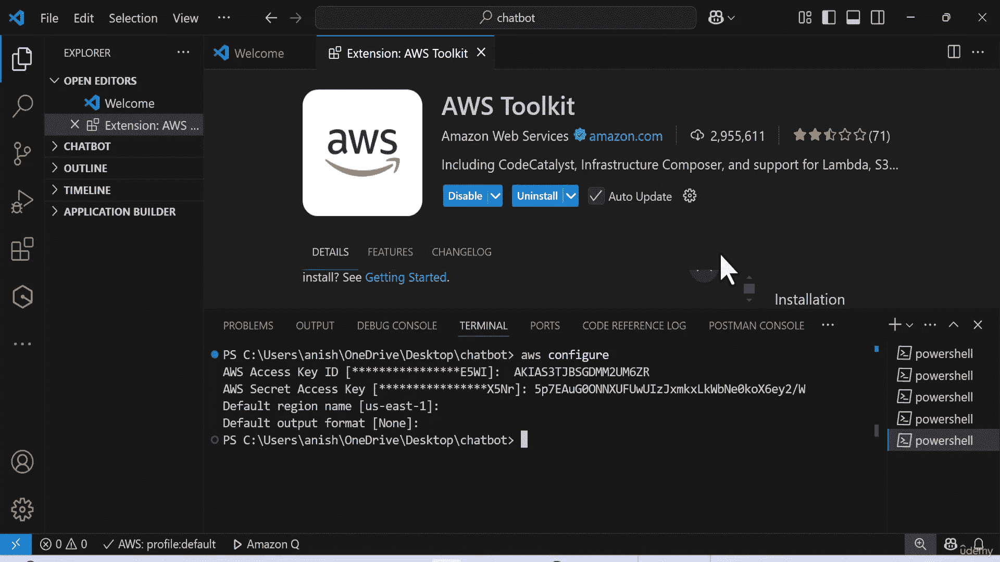

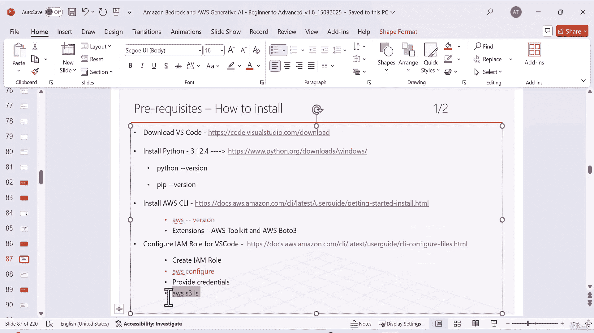

## 🧰 AWS生成式AI实战：39-41.8：安装 Anaconda Navigator 并从它启动 VS Code

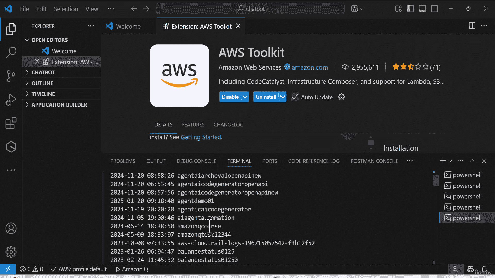

上一节我们验证了 AWS CLI 权限，本节中我们来看看 Anaconda Navigator 的安装。接下来需要安装 Anaconda Navigator。点击资料中的链接进入下载页面，点击 Download。页面会要求提供邮箱才能下载，也可以点击 Skip registration 跳过注册。随后页面会显示适合当前操作系统的安装器；例如使用 Windows，就点击对应安装器并完成安装。

安装完成后，Anaconda Navigator 的页面会显示出来。向下滚动并搜索 VS Code，找到后点击 Launch 启动。这里有一个重点：建议始终从 Anaconda Navigator 启动 VS Code。原因是后面安装 Streamlit 后，如果不通过 Anaconda Navigator 打开 VS Code，可能会遇到一些问题；虽然有些场景可能不会出问题，但示例中确实遇到过，而这就是找到的解决方案。

从 Anaconda Navigator 启动 VS Code 的关系可以用下面的路径表示。

```text
Anaconda Navigator → 搜索 VS Code → Launch → 在 VS Code 中打开终端
```

## 📦 AWS生成式AI实战：39-41.9：安装聊天机器人所需依赖

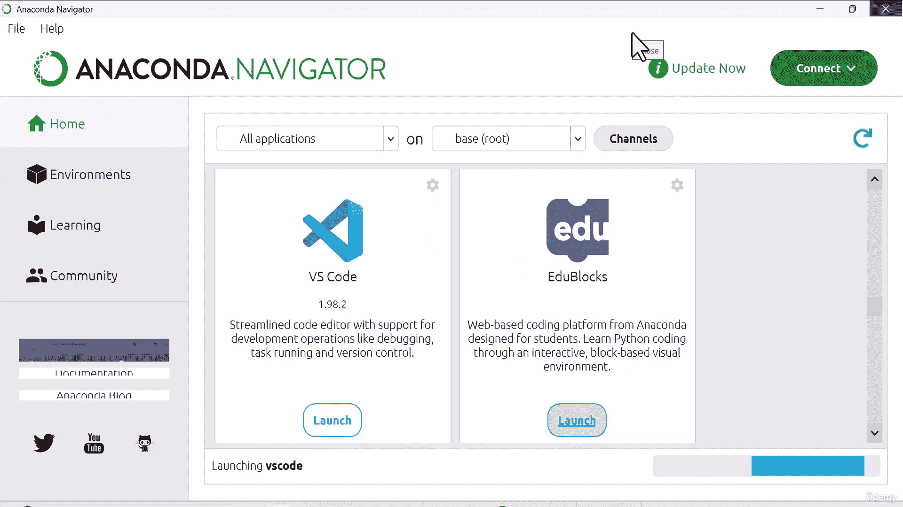

从 Anaconda Navigator 启动 VS Code 后，本节我们开始安装依赖。点击三条横线菜单中的 Terminal，选择 New Terminal。接下来需要安装 Boto3、LangChain、Streamlit 以及另外一些依赖包。下面先列出每个依赖的用途，方便初学者理解为什么要安装它们。

- Boto3：用于访问各种 AWS 服务的 Python SDK。
- LangChain：用于和 Amazon Bedrock 一起构建聊天机器人。
- LangChain AWS：LangChain 对接 AWS 的模块。
- Streamlit：用于搭建聊天机器人界面。
- Transformers：与 LLM 的 Transformer 架构相关。
- PyYAML：用于处理可能用到的 YAML 文件。

首先是 Boto3。Boto3 是访问各种 AWS 服务的 Python SDK，示例中安装的版本是 1.37.11。执行安装命令后，如果已经安装过，终端会提示依赖已经满足，并显示 Boto3 Core 和 Boto3 的版本。对应命令如下。

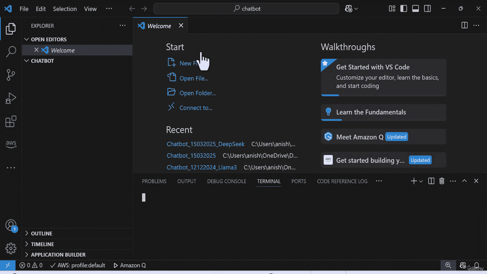

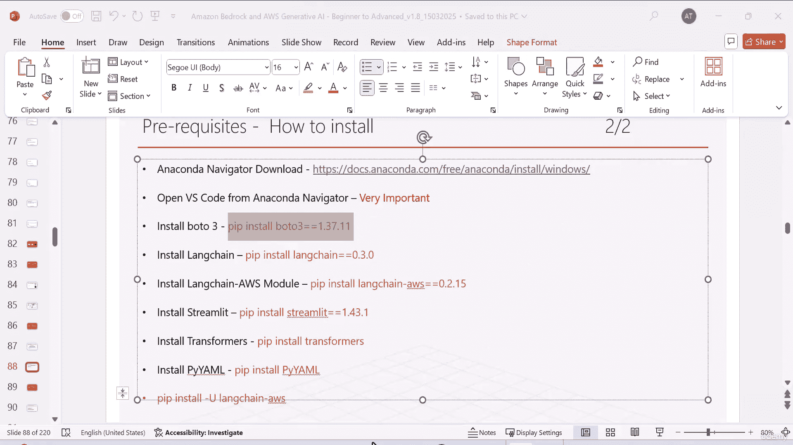

```bash
pip install boto3==1.37.11
```

接着安装 LangChain，因为后面会使用 LangChain 和 Amazon Bedrock 一起构建聊天机器人。示例中安装的是 LangChain 0.3.0。执行安装命令后，如果已经安装过，会提示依赖已经满足。

```bash
pip install langchain==0.3.0
```

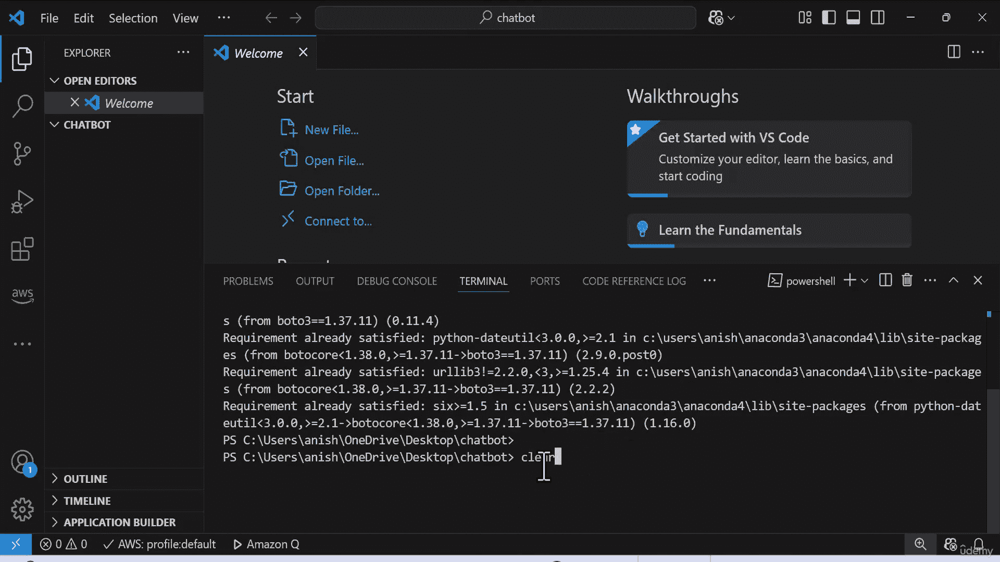

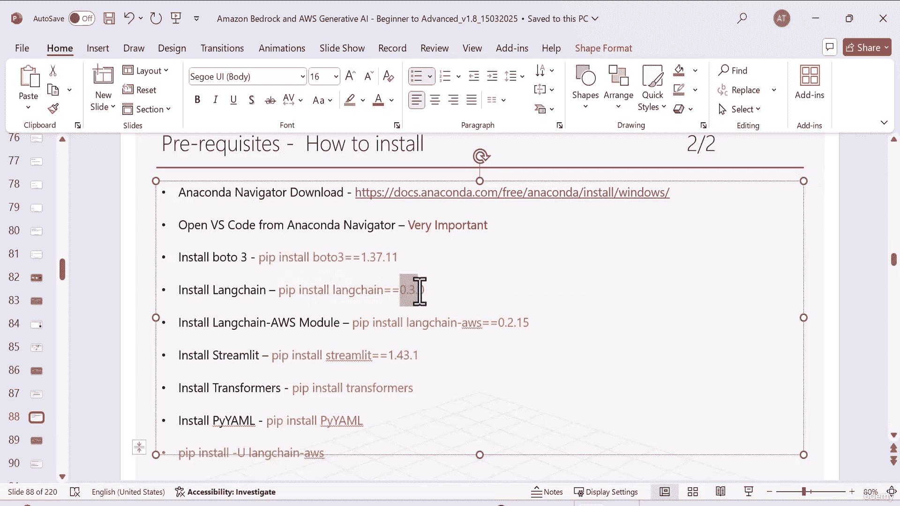

下一步安装 LangChain AWS 模块，也就是 `langchain-aws`。示例中使用的版本标记是 0.2.15，安装完成后终端显示安装了 `langchain-aws 0.2.18`。对应命令如下。

```bash
pip install langchain-aws==0.2.15
```

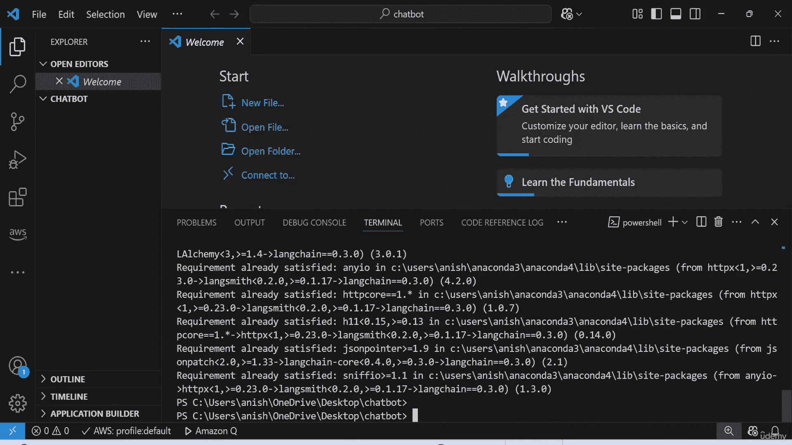

然后安装 Streamlit，用于后续界面开发。示例中已经安装过 Streamlit，因此执行命令后会提示依赖已经满足。

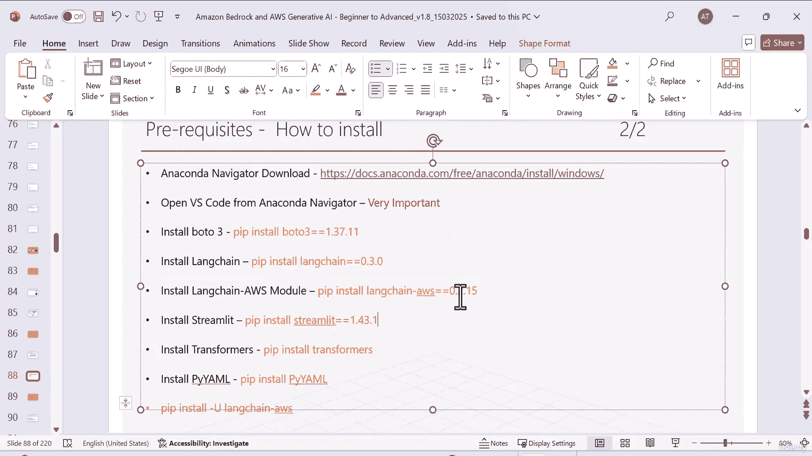

```bash
pip install streamlit
```

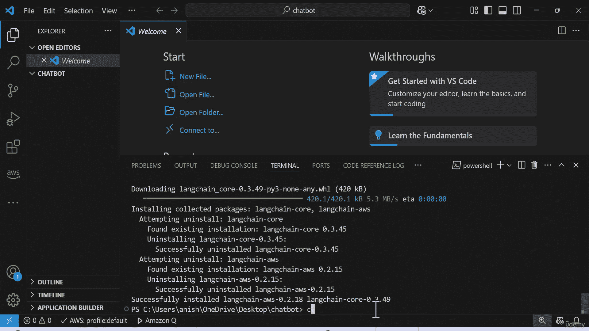

完成 Streamlit 后，还剩三项需要处理。第一项是 Transformers，它与 LLM 的 Transformer 架构相关；示例中已经安装过，所以会提示依赖已经满足。

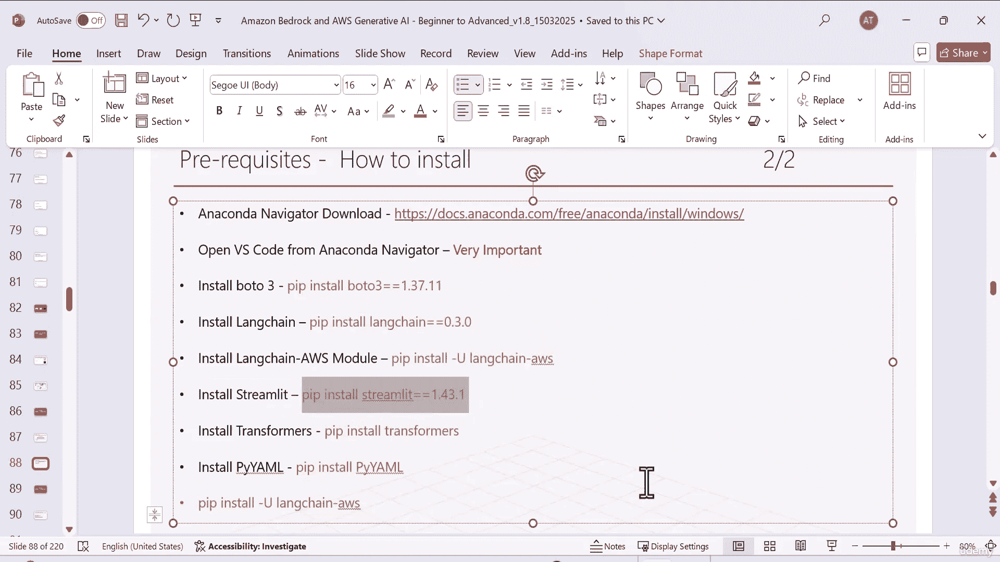

```bash
pip install transformers
```

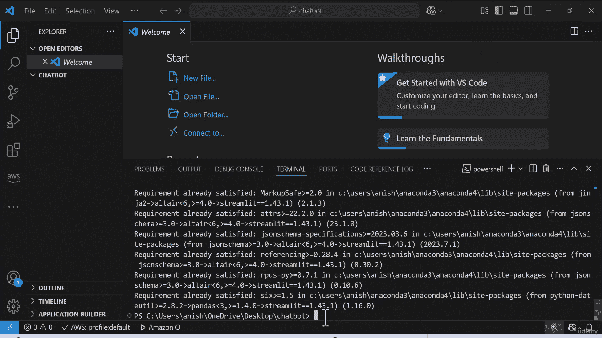

第二项是 PyYAML，用于处理可能用到的 YAML 文件；示例中同样已经安装过，因此会提示依赖已经满足。

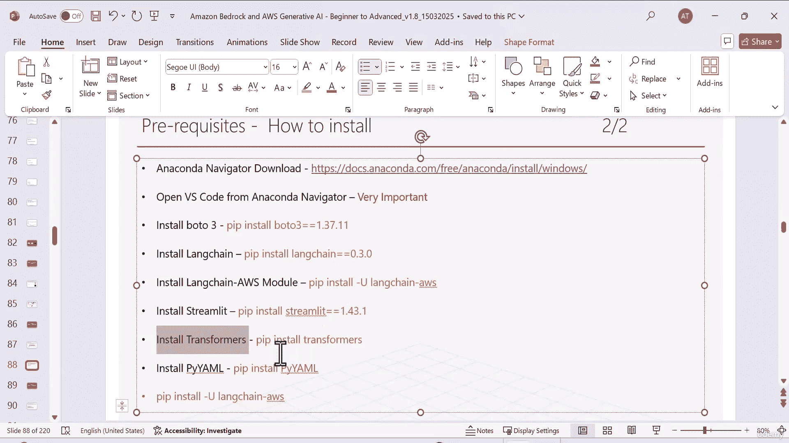

```bash
pip install pyyaml
```

第三项是 `pip install -U langchain-aws`，它本质上与前面的 LangChain AWS 安装项相同。由于该模块已经安装，这一项可以视为重复，不需要再单独处理。

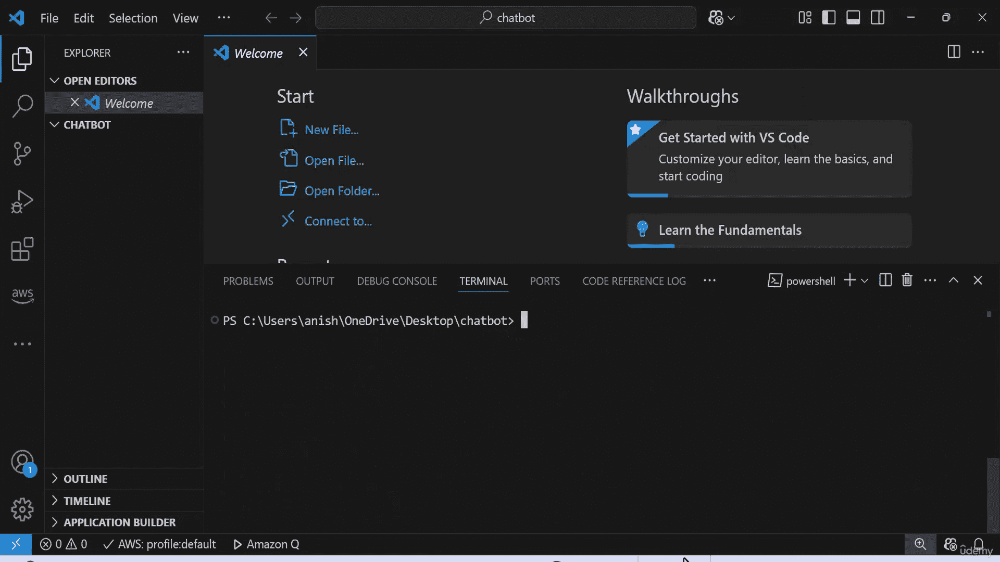

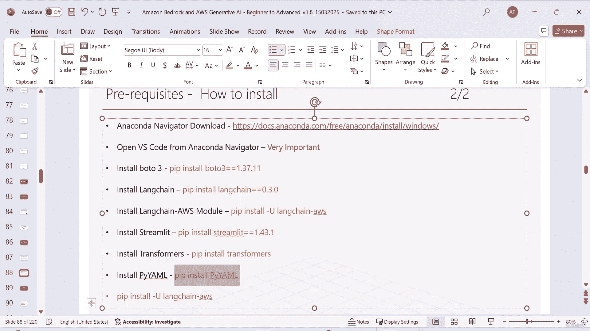

```bash
pip install -U langchain-aws
```

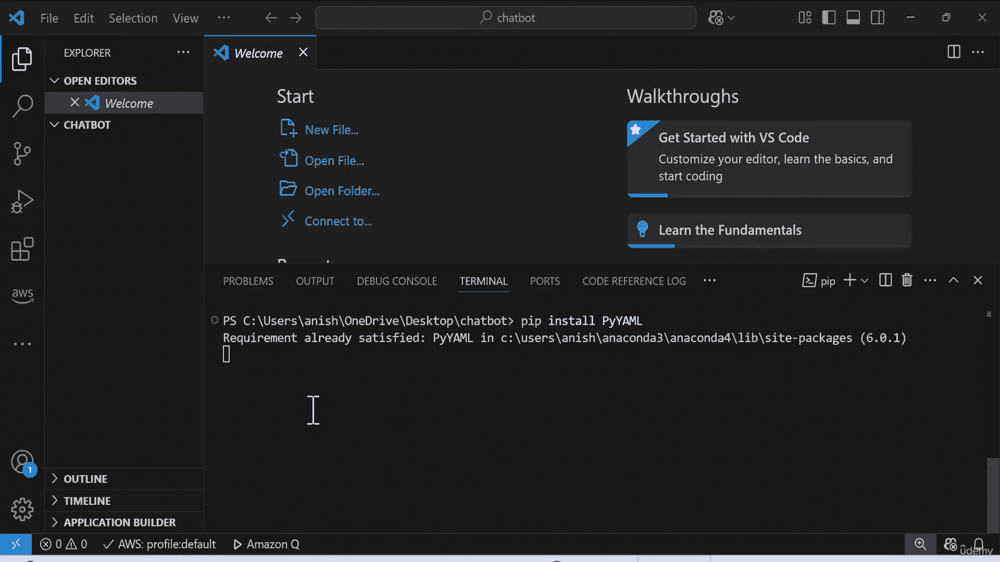

到这里，编码前需要安装的内容基本完成。下一讲将开始编写这个应用的后端代码。

## ✅ AWS生成式AI实战：39-41.10：本节总结

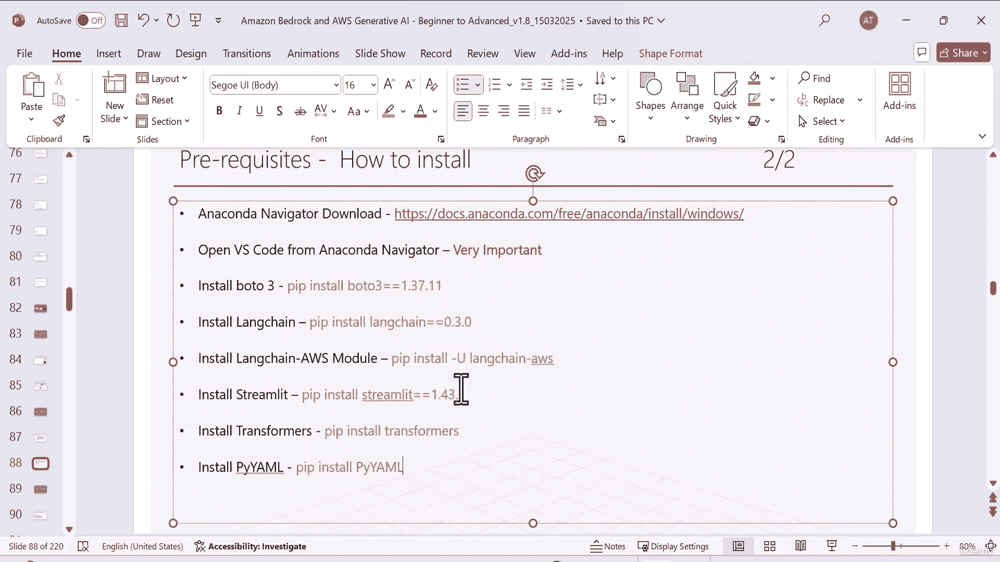

在本节课中，我们一起学习了聊天机器人编码前的环境搭建流程。我们安装了 VS Code、Python、AWS CLI 和 Anaconda Navigator，检查了 Python、Pip 与 AWS CLI 的版本，安装了 VS Code 的 AWS Toolkit 扩展，创建了带管理员策略的 IAM 用户和 CLI 访问密钥，使用 `aws configure` 配置了权限，并通过 `aws s3 ls` 验证了 AWS 访问能力。随后我们安装了 Boto3、LangChain、LangChain AWS、Streamlit、Transformers 和 PyYAML 等依赖。完成这些准备后，下一节课就可以开始编写聊天机器人的后端代码。

