# 🚀 AWS生成式AI实战：第40-42节：聊天机器人后端搭建（一）

在本节课中，我们将要学习如何为基于 Amazon Bedrock 的聊天机器人搭建后端的第一部分。课程会先说明 LangChain 模块和 AWS 推荐的大模型访问方式发生的变化，再回顾聊天机器人应用的三个核心组件，随后从零开始准备开发环境、创建 Python 文件、导入必要模块，并完成一次 Amazon Bedrock 模型调用测试。原文中出现的 “Lin modules”“Amazon Brock”“Ananaconda”“deepse”等拼写，在本教程中按 LangChain、Amazon Bedrock、Anaconda、DeepSeek 来理解和整理。

## 🧭 AWS生成式AI实战：第40节：课程更新与整体架构

本节先交代课程更新的背景和整体架构。LangChain 模块以及 AWS 推荐访问 Amazon Bedrock 大语言模型的方式都发生了一些变化，因此这节课在 2025 年重新录制，目的是让内容保持最新。之前在架构部分已经讨论过，要让这个应用或聊天机器人正常工作，需要构建三个组件。

以下是这三个核心组件的说明，它们共同组成聊天机器人后端的基础结构。

- 第一，要能够访问托管在 Amazon Bedrock 上的大语言模型，也就是让应用与 Bedrock 服务完成集成。

- 第二，要使用对话缓冲记忆来保存用户与大语言模型之间的历史对话。


- 第三，要使用 LangChain 的对话链，把提示词、Bedrock 模型和 LangChain 记忆串联在一起。

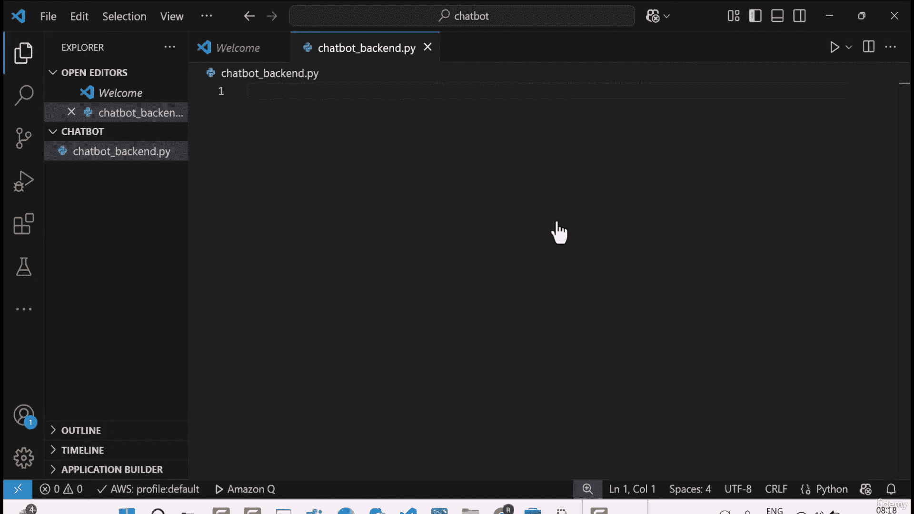

为了更直观地理解，可以把核心关系写成下面的公式。

$$
\text{聊天机器人后端} = \text{Bedrock 模型调用} + \text{ConversationBufferMemory} + \text{ConversationChain}
$$

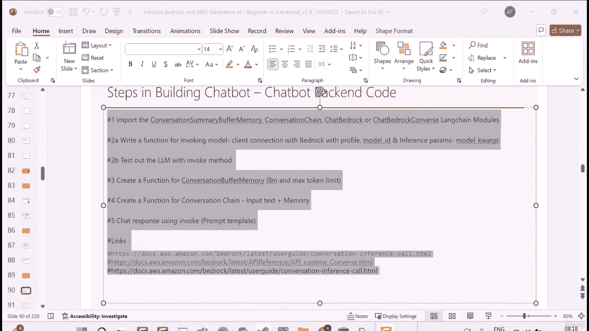

上一节说明了整体架构，本节中我们来看看如何一步一步把这些组件搭建出来。接下来会按照顺序完成环境准备、文件创建、模块导入、模型调用测试，并为下一节的记忆和对话链代码打好基础。

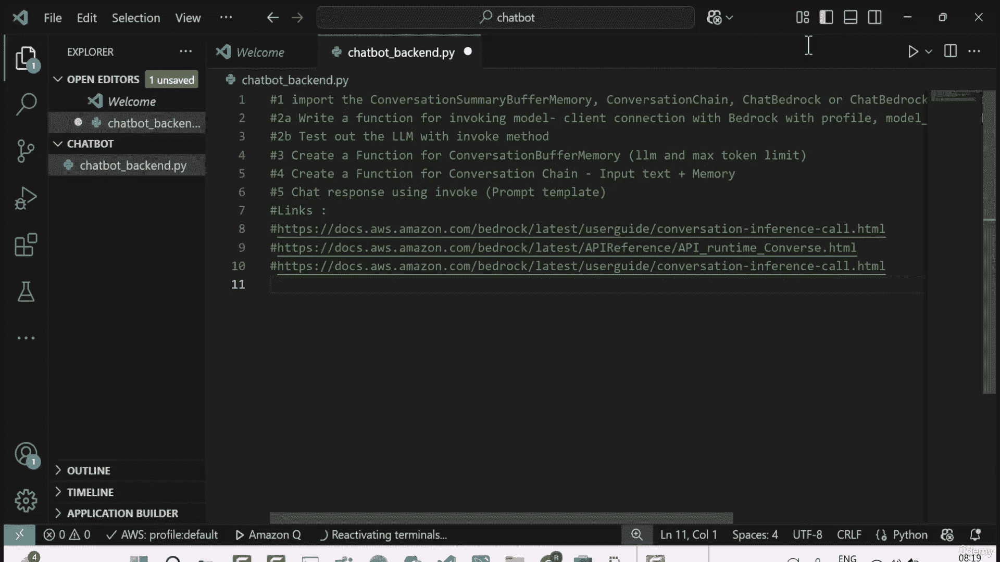

## 🧱 AWS生成式AI实战：第41节：准备开发环境与创建文件

本节开始准备开发环境。第一步是打开上一节课下载的 Anaconda Navigator，然后通过 Anaconda Navigator 启动 VS Code。原文特别强调，应该通过 Anaconda Navigator 启动 VS Code，这样后面用 Streamlit 运行应用时不容易遇到环境问题。

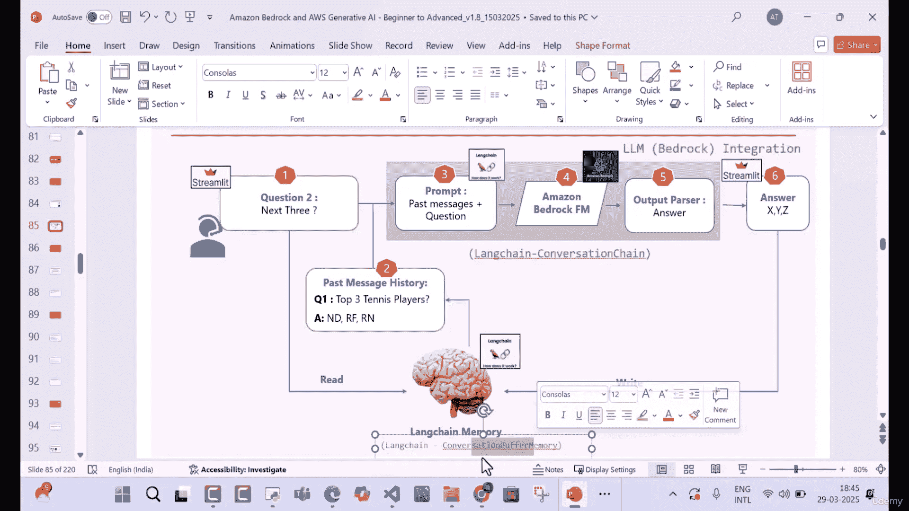

接下来，在本地创建一个名为 `chatbot` 的文件夹，并在 VS Code 中打开它。具体操作是点击 File，再点击 Open Folder，然后选择刚才创建的 `chatbot` 文件夹并打开。

环境准备好后，下一步是创建一个 Python 文件。操作方式是点击 File，点击 New Text File，然后保存文件。保存时把文件名写成 `chatbot_backend.py`，文件类型选择 Python，最后点击保存。此时会得到一个空白的 `chatbot_backend.py` 文件。

以下是原文中列出的开发步骤，这些步骤是为了方便读者自己动手写代码而提前整理出来的。

- 第一步，完成 Amazon Bedrock 大语言模型集成。

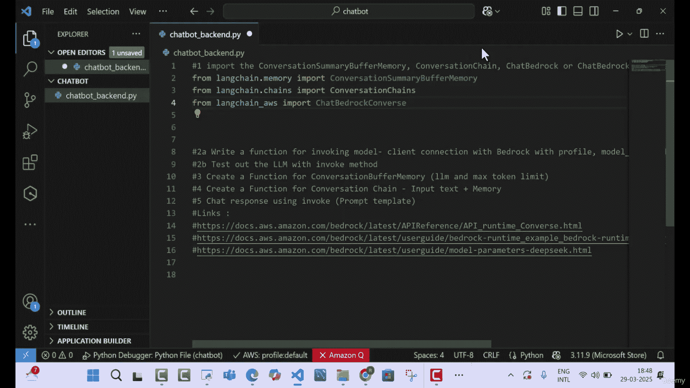

- 第二步，使用对话链。

- 第三步，使用对话缓冲记忆。

- 第四步，把提示词、模型和记忆连接起来。

- 第五步，测试并整理代码。

原文把这些步骤复制到了 VS Code 中，并说明会用这五个步骤来构建聊天机器人。上一节我们回顾了架构，本节中我们完成了文件夹和 Python 文件的准备工作，下一节就开始导入模块并编写 Bedrock 集成代码。

## 🔌 AWS生成式AI实战：第42节：导入模块与Bedrock集成

本节进入代码部分。按照架构讨论，需要完成大语言模型与 Bedrock 的集成，使用对话链，并使用对话缓冲记忆。因此要先为这三个部分导入模块，分别是 `ConversationSummaryBufferMemory`、`ConversationChain` 和 `ChatBedrockConverse`。其中 `ChatBedrockConverse` 用于与 Bedrock 集成。

以下是本阶段需要导入的模块代码，读者可以直接放入 `chatbot_backend.py` 文件中。

```python
from langchain.memory import ConversationSummaryBufferMemory
from langchain.chains import ConversationChain
from langchain_aws import ChatBedrockConverse
```

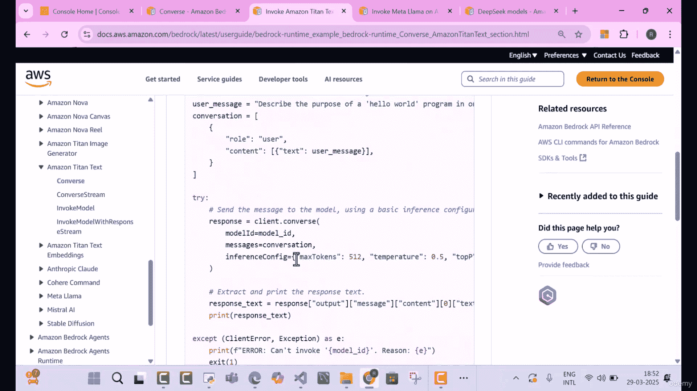

这里需要解释一个关键变化。`langchain_aws` 模块中可以看到 `ChatBedrock` 和 `ChatBedrockConverse`，本教程导入的是 `ChatBedrockConverse`。原因是 AWS 推荐使用 Converse API，而不是之前两个用例中看到的 Invoke API。

原文已经打开了相关文档链接，用来节省时间。Converse API 提供了一个一致的接口，可以配合所有支持 messages 的模型使用。下面用 Titan Text 和 Meta Llama 3 的例子说明这种一致性。

以下是 Invoke API 下不同模型参数命名的差异说明。

- 使用 Amazon Titan Text 模型并调用 Invoke API 时，请求中需要发送 `modelId`，同时提供配置参数和提示词。提示词就是 prompt，配置参数包括 `maxTokenCount` 和 `temperature`。

- 使用 Meta Llama 3 模型并调用 Invoke API 时，请求中同样有 prompt 和 temperature，temperature 与 Titan Text 类似，但最大长度参数名变成了 `maxGenLength`，而 Titan Text 中叫 `maxTokenCount`。两者表达的是同一类东西，只是命名不同。

为了标准化这种差异，AWS 推荐使用 Converse API。使用 Titan Text 的 Converse API 时，配置参数是 `maxTokens`、`temperature` 和 `topP`。使用 Meta 模型并点击 Converse API 时，参数同样是 `maxTokens`、`temperature` 和 `topP`，与 Titan Text 完全一致。这样一来，如果要更换模型，只需要修改模型 ID，不需要再修改所有配置参数名。因此本教程使用 Converse API。

上一节完成了环境准备，本节中我们来看看如何编写一个调用 Bedrock 模型的函数。这个函数的作用是完成与 Amazon Bedrock 的集成，通过它向选定的模型发送请求或提示词，本教程选择 DeepSeek 模型，并接收模型返回的响应。

以下是调用 Bedrock 模型的函数示例代码，函数名为 `demo_chatbot`，内部变量名为 `demo_llm`，并使用 `ChatBedrockConverse`。

```python
def demo_chatbot(messages):
    demo_llm = ChatBedrockConverse(
        credentials_profile_name="default",
        model="us.deepseek.r1-v1:0",
        temperature=0.1,
        max_tokens=500
    )

    response = demo_llm.invoke(messages)
    return response
```

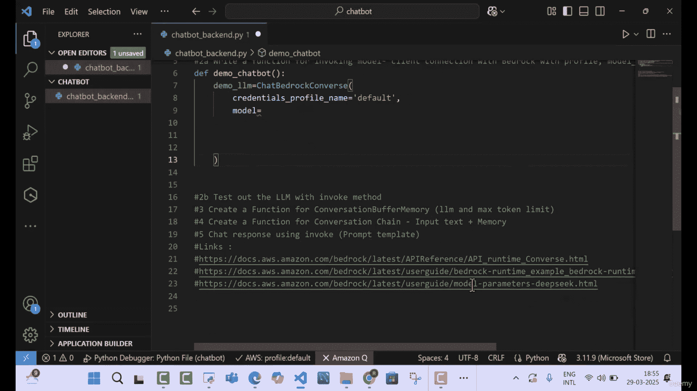

在上面的代码中，`credentials_profile_name` 是可选参数，但原文仍然选择传入它。之前在配置 AWS CLI 时输入过访问密钥和秘密密钥，默认会创建一个配置档案，原文中可以看到 `AWS profile default`，因此这里传入 `default`。接下来需要提供模型信息，点击模型链接可以获取模型 ID。原文打开的是 DeepSeek 模型页面，复制到的模型 ID 形如 `us.deepseek.r1-v1:0`。原文提到，这个格式看起来像 Invoke 模型的模型 ID，但这里使用的是 Converse，所以只需要把模型 ID 传给 `model` 参数。

然后是配置参数。`ChatBedrockConverse` 会显示可用的配置参数，例如 `temperature` 是浮点数，另外还有 `top_p`、`top_k`、从环境变量读取密钥等参数。原文建议读者浏览这些参数，看看是否有其他适合自己的参数可以传入。示例中把 `temperature` 设置为 `0.1`，因为它的取值范围是 0 到 1，较小的值可以让响应更稳定。随后传入最大 token 数量，原文中对应 `max_tokens` 参数。完成这些设置后保存文件。

上一节完成了模块导入，本节中我们编写了 Bedrock 调用函数。在继续编写记忆和对话链代码之前，需要先测试模型是否能返回响应，这个测试通过 `invoke` 方法完成。

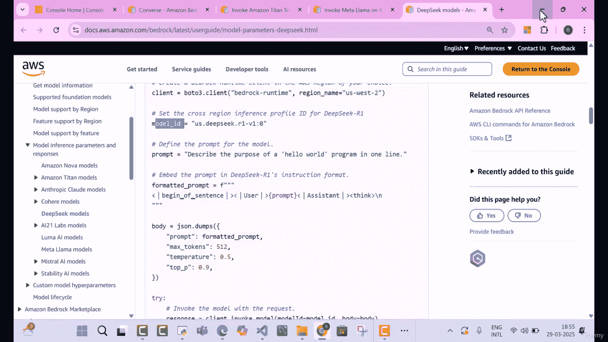

## 🧪 AWS生成式AI实战：第42节：验证模型调用

本节验证模型调用是否成功。如果直接按照上面的格式向 Bedrock 模型发送请求，还缺少一个关键内容，就是用户输入，也就是要发送给模型的问题或提示词。原文提供了一个文档链接，用来说明如何编写提示词消息。

以下是构造用户消息的代码示例，变量名通常写作 `messages`，它内部是一个列表，列表中包含 `role` 为 `user` 的消息，消息内容是 `content`，`content` 中再放入 `text`，这个 `text` 就是提示词。

```python
messages = [
    {
        "role": "user",
        "content": [
            {
                "text": "What is an LLM?"
            }
        ]
    }
]
```

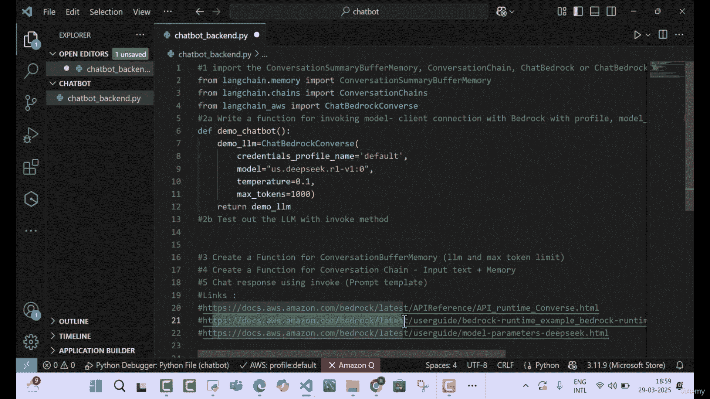

原文复制了文档中的消息结构，并在 `conversation` 的位置改名为 `messages`，因为这是更常见的命名方式，当然也可以使用其他变量名。这里的用户输入是问题 “What is an LLM?”。接下来要把 `messages` 作为函数参数传入，也就是让函数接收 `messages`，并在函数内部使用 `invoke` 方法调用模型。

以下是运行和打印响应的代码示例。

```python
response = demo_chatbot(messages)
print(response)
```

保存代码后，点击右上角的三个点，打开 Terminal，再新建一个终端。然后选择 Run，再选择 Run Without Debugging，观察是否能够获得响应。原文等待了几分钟后成功收到响应。把输出向上翻，可以看到类似“大语言模型是一种人工智能系统，它基于大量数据训练……”的内容。到这里，第一部分测试完成。

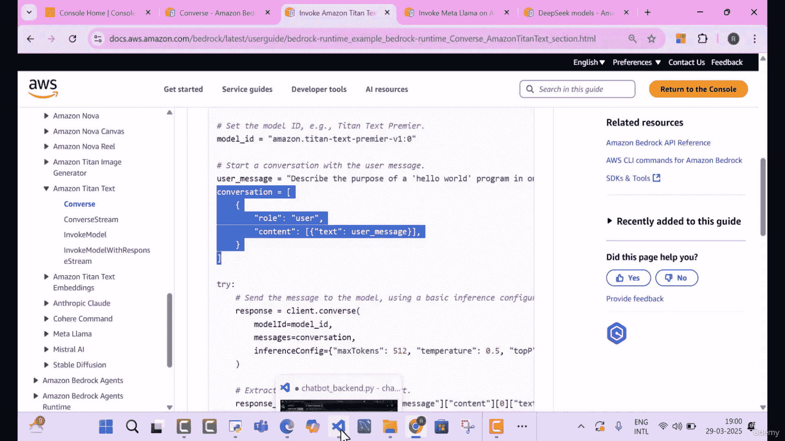

上一节完成了函数编写，本节中我们验证了模型调用。为了便于读者自行测试，原文把当前版本另存为一个中间文件，文件名可以叫 `intermediate.py`。这样本地会同时拥有中间文件和 `chatbot_backend.py`，后续继续在 `chatbot_backend.py` 中开发。

## 🧹 AWS生成式AI实战：第42节：整理代码与下一步

本节整理测试代码，为下一节做准备。继续编辑 `chatbot_backend.py` 时，需要删除刚才用于测试的代码，包括测试用的 `invoke` 调用、`messages` 以及打印响应的部分。删除后保存文件，让 `chatbot_backend.py` 回到适合继续开发的状态。

以下是本阶段整理代码时的操作要点。

- 删除用于测试的临时调用代码。

- 删除测试用的 `messages` 变量。

- 删除测试用的 `print(response)`。

- 保存 `chatbot_backend.py`，准备下一节继续开发。

原文说明，下一节课会编写对话缓冲记忆和对话链的代码。本节的代码测试和整理工作到此结束，下一节会继续把聊天机器人后端补充完整。

## 📌 AWS生成式AI实战：第42节：本节总结

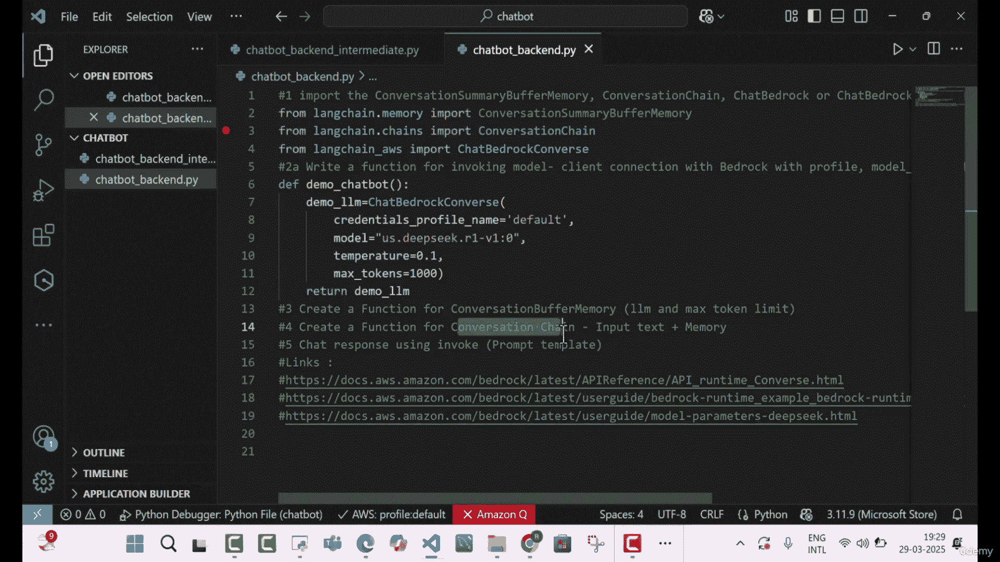

本节课中我们一起学习了聊天机器人后端搭建的第一部分。我们了解了 LangChain 模块和 AWS 推荐访问 Bedrock 大模型方式的变化，回顾了聊天机器人应用的三个核心组件，也就是 Bedrock 模型调用、对话缓冲记忆和 LangChain 对话链。随后通过 Anaconda Navigator 启动 VS Code，创建 `chatbot` 文件夹和 `chatbot_backend.py` 文件，导入了 `ConversationSummaryBufferMemory`、`ConversationChain` 和 `ChatBedrockConverse`，并使用 Converse API 编写了 `demo_chatbot` 函数。最后构造 `messages` 用户消息，调用 DeepSeek 模型完成响应测试，并把测试代码整理掉，为下一节编写记忆和对话链代码做好准备。

