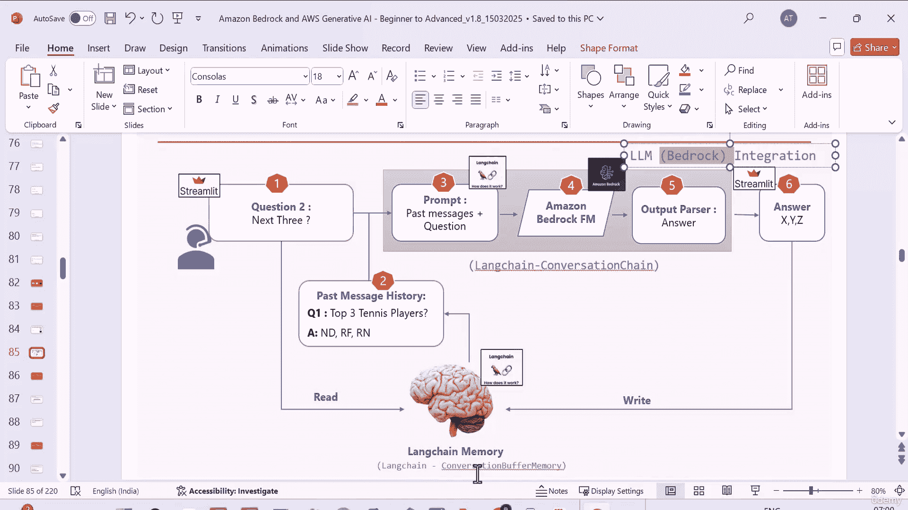
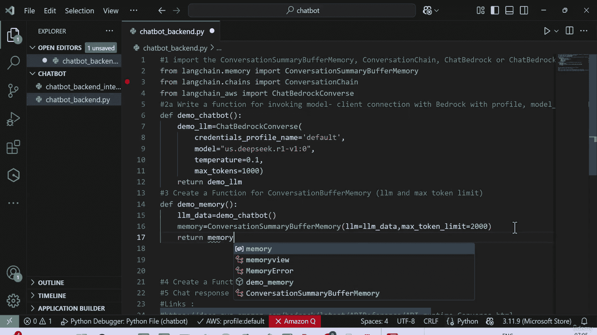
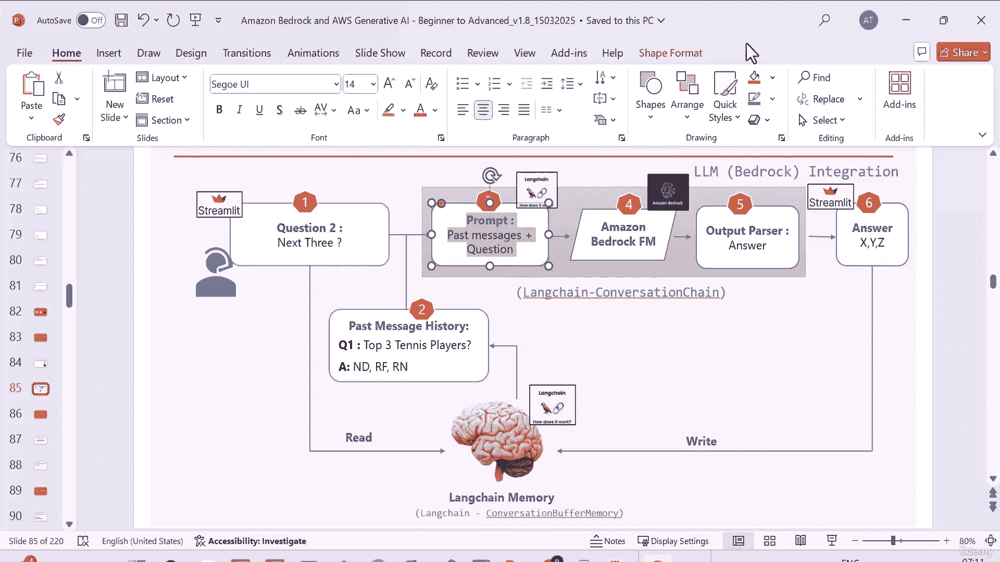
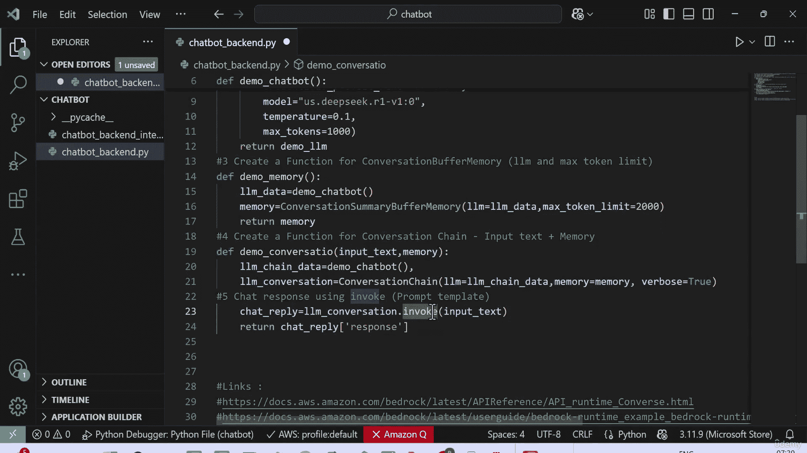
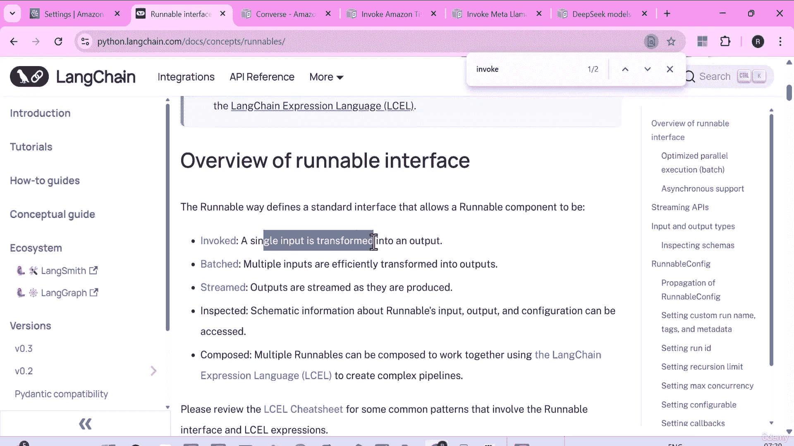
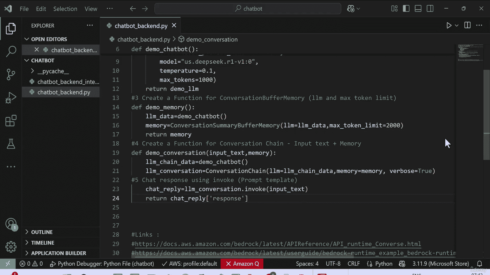

# 🧠 Udemy - 生成式AI on AWS - Amazon Bedrock、RAG与KIRO [2026]：第41–43讲：聊天机器人后端（二）

## 📌 Udemy - 生成式AI on AWS - Amazon Bedrock、RAG与KIRO [2026]：第41–43讲：课程概述



在本节课中，我们将要学习聊天机器人后端（二）的核心代码，包括对话缓冲记忆函数、LangChain 对话链以及 `invoke` 调用方式。上一讲已经完成与 Amazon Bedrock 的集成模块，这一讲把记忆、模型和用户输入串成一个完整后端流程。为了便于初学者理解，下面先给出本讲的学习路线，再按步骤说明每个函数为什么这样写、变量如何连接、代码检查要注意什么。以下是本讲的学习路线。

- 编写对话缓冲记忆函数，保存之前的聊天内容。

- 编写 LangChain 对话链，把 Bedrock 模型、记忆和用户输入连接起来。

- 使用 `invoke` 方法生成回复，并做代码检查与前端预告。

这段路线对应三个小目标：先解决“记住上下文”，再解决“把组件连起来”，最后解决“正确调用与收尾”。接下来进入第一节，先把对话缓冲记忆写出来。

## 🧩 Udemy - 生成式AI on AWS - Amazon Bedrock、RAG与KIRO [2026]：第41讲：对话缓冲记忆函数

上一节我们介绍了如何编写模块，让应用与 Amazon Bedrock 集成；本节中我们来看看如何编写对话缓冲记忆代码。对话缓冲记忆的作用很直接：大语言模型本身不保存聊天历史，每一次调用都像重新开始，所以需要把之前的对话内容存进一个缓冲区，再在后续请求中一起带给模型。这样用户连续提问时，模型才能理解上下文。为了让费用可控，这个函数还要设置最大 token 限制，避免一次带入过多历史内容。以下是编写记忆函数时需要明确的参数和思路。

- 第一个参数是使用的 LLM，本例使用通过 Amazon Bedrock 调用的 DeepSeek 模型。

- 第二个参数是最大 token 限制，把 token 数量控制在约 2000，避免产生更高费用。

- 函数可以命名为 `demo_memory`，内部创建 `ConversationSummaryBufferMemory` 对象并返回。

在写函数之前，先准备一个变量保存要使用的 LLM。原文把变量命名为 `LLM_data`，原因是它要读取之前对话的数据，变量名可以按自己的习惯修改。这个变量从已经集成的 Bedrock 服务对象中取得，示例里对应 `demo_chatbot`。接着创建名为 `memory` 的变量，让它等于导入的 `ConversationSummaryBufferMemory` 模块。编辑器会提示这个类可以接收哪些属性，其中一个是基础语言模型 `llm`，另一个是最大 token 限制 `max_token_limit`。下面的代码展示记忆函数的基本写法。

```python
def demo_memory(llm_data, max_token_limit=2000):
    memory = ConversationSummaryBufferMemory(
        llm=llm_data,
        max_token_limit=max_token_limit
    )
    return memory
```

代码里传入两个关键参数：`llm=LLM_data` 负责指定模型，`max_token_limit=2000` 负责限制记忆内容大小。这个限制值可以更小，也可以更大，需要根据业务场景权衡。限制值较小时，模型拿到的历史内容会被截断，回复可能不完整，但费用更低；限制值较大时，模型能看到更完整的上下文，回复更完整，费用会略高。Amazon Bedrock 按每千 token 收费，可以用下面的公式粗略理解费用关系。

$$
\text{费用} \approx \frac{\text{输入 token 数} + \text{输出 token 数}}{1000} \times \text{每千 token 单价}
$$



因此，设置 `max_token_limit` 是控制成本的重要手段，不是可有可无的配置。函数最后返回 `memory`，后续对话链会使用这个对象保存和读取历史消息。到这里，记忆函数已经完成，它解决了“模型不记事”的问题。下一节要把 Bedrock 模型、记忆对象和用户输入连接起来，形成真正的对话链。

## 🔗 Udemy - 生成式AI on AWS - Amazon Bedrock、RAG与KIRO [2026]：第42讲：LangChain对话链

上一节我们完成了对话缓冲记忆函数，本节中我们来看看 LangChain 的对话链代码。对话链需要连接三样东西：第一是前面写好的 Bedrock 集成代码，第二是对话缓冲记忆，第三是用户输入提示词。只有把这三部分串起来，应用才能在一次调用中完成“读取历史、发送当前问题、生成回复”的流程。以下是 `ConversationChain` 需要连接的三个组件。



- Bedrock 模型：负责实际生成回复。

- 对话缓冲记忆：负责保存并携带之前的聊天内容。

- 用户输入：作为本次对话的提示词传给模型。

先写一个函数承载对话流程，函数可以命名为 `demo_conversation`，接收两个参数：`input_text` 是用户提供的提示词，`memory` 是上一节返回的记忆对象。然后确定这次对话链要连接哪个 LLM，示例中把变量命名为 `LLM_chain_data`，并让它等于 `demo_chatbot`。这个对象在前面已经出现过，如果重复定义，编辑器会报错，所以只保留一次定义即可。下面的代码展示对话链的创建方式。

```python
def demo_conversation(input_text, memory):
    LLM_chain_data = demo_chatbot

    LLM_conversation = ConversationChain(
        llm=LLM_chain_data,
        memory=memory,
        verbose=True
    )

    chat_reply = LLM_conversation.invoke(input=input_text)
    return chat_reply
```

创建 `ConversationChain` 时需要传入三个属性。以下是这三个属性的作用说明。

- `llm`：指定对话链使用的语言模型，这里等于 `LLM_chain_data`。

- `memory`：指定记忆对象，让对话链在发送用户提示词时，同时带上记忆中保存的历史内容。

- `verbose`：设置为 `True` 后，LangChain 会在内部打印输入和输出，便于调试和观察运行过程。

`verbose=True` 属于 LangChain 对话链的内部配置，不会改变业务结果，但对学习和排查问题很有帮助。对话链创建完成后，需要调用 `invoke` 方法。`invoke` 接收一个输入，在本例中就是用户提示词 `input_text`，然后生成输出。示例把返回结果保存到 `chat_reply`，最后把 `chat_reply` 返回给调用方。下面的代码片段单独展示调用关系。

```python
chat_reply = LLM_conversation.invoke(input=input_text)
return chat_reply
```

如果想进一步了解 `invoke` 方法，可以直接搜索“LangChain invoke”，打开官方文档页面查看说明。官方文档把 `invoke` 描述为调用运行的标准方法，单个输入会被转换成输出，这正是本例使用的模式。文档描述可以用一句话概括，如下所示。

> `invoke` 是调用运行的标准方法，单个输入会被转换成输出。

这段说明与代码中的 `LLM_conversation.invoke(input=input_text)` 完全对应。到这里，对话链把模型、记忆和用户输入连接完成，后端主流程已经成形。下一节做最后的代码检查，并说明前端课程的安排。

## 🛠️ Udemy - 生成式AI on AWS - Amazon Bedrock、RAG与KIRO [2026]：第43讲：代码检查与前端预告

上一节我们写完了 LangChain 对话链和 `invoke` 调用，本节中我们来看看代码检查与收尾工作。写代码时出现小错误很常见，本例在检查时发现一处单词拼写漏了字母 `n`，另外还有一个多余的逗号需要删除。修正之后保存文件，后端代码就可以进入下一阶段。以下是本节最后的收尾动作。

- 检查 `invoke` 相关拼写，补上漏掉的字母 `n`。

- 删除多余的逗号，保持代码格式正确。

- 保存文件，确认后端代码完成。

回顾这一讲的代码结构：先处理输入，再编写连接 Amazon Bedrock 上 DeepSeek 模型的函数，然后创建对话缓冲记忆函数，因为 LLM 是无状态模型，需要把之前的对话存入缓冲区；接着编写对话链函数，把所有组件连接起来，最后使用 `invoke` 方法生成回复。这个顺序符合从底层集成到上层调用的思路，初学者按同样顺序阅读代码会更容易理解。原文还给出一个学习提示，如下所示。

> 注意：后端在 2025 年已经更新，但前端没有改动，所以前端那一讲保持原样，因为确实没有变化。

这意味着学习前端部分时，不需要因为后端更新而担心中间出现额外改动，按原课程继续即可。下一讲将编写前端代码，后端部分到这里基本结束。下面进入本节总结，把关键点再串一遍。

## ✅ Udemy - 生成式AI on AWS - Amazon Bedrock、RAG与KIRO [2026]：第41–43讲：本节总结

本节课中，我们一起学习了聊天机器人后端（二）的三个关键部分：对话缓冲记忆、LangChain 对话链和 `invoke` 调用。以下是本讲覆盖的关键点。





- 使用 `ConversationSummaryBufferMemory` 保存历史对话，并用 `max_token_limit` 控制 token 数量与费用。

- 使用 `ConversationChain` 连接 Bedrock 模型、记忆对象和用户输入，并通过 `verbose=True` 观察内部输入输出。

- 使用 `invoke(input=input_text)` 生成回复，返回 `chat_reply`。

- 检查拼写和多余逗号，保存代码，并了解前端课程保持不变的原因。



整体流程可以概括为：先准备模型对象，再创建记忆对象，然后把两者和用户输入交给对话链，最后调用 `invoke` 得到回复。下一讲将进入前端代码，本讲到此结束，感谢阅读。

